# 汉字笔顺闯关 · Hanzi Stroke Quest

> 一款专为小学低年级孩子打造的 **纯前端** 汉字笔顺学习小游戏。108 种互动模式（笔顺调焦坊 / 笔顺拍字行 / 笔顺调色坊 / 笔顺抢石坊 / 笔顺音游 / 汉字俄罗斯方块 / 笔顺打地鼠 / 笔顺拼图 / 笔顺跑酷 / 笔顺大魔王 / 笔顺宠物屋 / 笔顺跳房子 / 笔顺连连消 / 笔顺切水果 / 笔顺打砖块 / 笔顺塔防 / 笔顺钓鱼 / 笔顺双人大乱斗 / 笔顺挖宝 / 每日签到星运转盘 / 笔顺贪吃蛇 / 笔顺消消乐 / 笔顺刮刮卡 / 笔顺多米诺 / 笔顺叠叠塔 / 笔顺扭蛋机 / 笔顺合合合 / 笔顺保龄球 / 笔顺跳一跳 / 笔顺推箱子 / 笔顺天平屋 / 记忆翻翻屋 / 笔顺倒水杯 / 笔顺泡泡龙 / 笔顺大富翁 / 笔顺水管屋 / 笔顺弹珠台 / 笔顺娃娃机 / 笔顺神探 / 笔顺四子棋 / 笔顺闪现 / 笔顺猜字 / 笔顺小镇 / 笔顺无双 / 笔顺堆堆消 / 笔顺地宫 / 笔顺星图 / 笔顺排排队 / 笔顺回声 / 笔顺甩金钩 / 笔顺登云梯 / 笔顺滚雪球 / 笔顺分拣厂 / 笔顺喷喷乐 / 笔顺数织屋 / 笔顺炸炸岛 / 笔顺滑滑梯 / 笔顺投石机 / 笔顺卡牌远征 / 笔顺小战机 / 笔顺折纸屋 / 笔顺吃吃棋 / 笔顺抢椅子 / 笔顺走钢丝 / 笔顺种字田 / 笔顺拔河赛 / 笔顺划龙舟 / 笔顺夜巡 / 笔顺机器人 / 笔顺踢毽子 / 笔顺神射 / 笔顺热气球 / 笔顺吹泡泡 / 笔顺台球 / 笔顺飞轮 / 笔顺拔钉 / 笔顺花灯阵 / 笔顺牧羊犬 / 笔顺解绳结 / 笔顺光路阵 / 笔顺齿轮坊 / 笔顺磁力场 / 笔顺水闸 / 笔顺电路坊 / 笔顺火候坊 / 笔顺秋千坊 / 笔顺影子戏 / 笔顺淘沙场 / 笔顺冰火岛 / 笔顺萤夜林 / 笔顺蝠洞回声 / 笔顺光影坊 / 笔顺溜冰场 / 笔顺风谷 / 笔顺撬木场 / 笔顺锁链坊 / 笔顺弹膜坊 / 笔顺织字坊 / 笔顺甩星坊 / 笔顺叠浪坊 / 笔顺调车场 / 笔顺夺字狐 / 笔顺洇纸坊…）+ 星星奖励 + 动物收藏馆，让孩子在玩中掌握 200+ 常用汉字的正确笔顺。

<p align="center">
  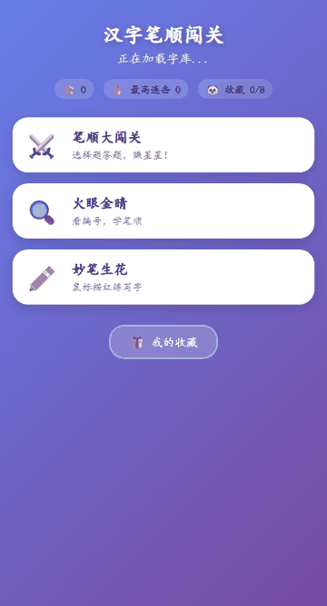
</p>

<p align="center">
  <a href="https://shixingya.github.io/hanzi-practice/"></a>
  &nbsp;&nbsp;
  <a href="https://github.com/shixingya/hanzi-practice/releases/latest"></a>
  &nbsp;&nbsp;
  
  &nbsp;&nbsp;
  
</p>

<p align="center">
  <a href="#-在线体验">在线体验</a> ·
  <a href="#-核心功能">核心功能</a> ·
  <a href="#-模式详解">模式详解</a> ·
  <a href="#-技术栈">技术栈</a> ·
  <a href="#-快速开始">快速开始</a>
</p>

---

## 🌐 在线体验

**👉 立即试玩：<https://shixingya.github.io/hanzi-practice/>**

（已通过 GitHub Pages 部署，无需下载，打开即玩。建议用 Chrome / Edge / Safari，移动端也支持。）

---

## ✨ 项目亮点

**核心功能一览：**

- 🎯 **零构建、零后端**：单文件 `index.html` 打开即用，任何静态托管都能部署（GitHub Pages / Vercel / Netlify / Nginx）。
- 🧒 **儿童友好 UI**：糖果紫渐变背景、大圆角按钮、田字格练字区，专为 6–9 岁孩子设计。
- 🎮 **游戏化激励**：星星 ⭐ + 连击 🔥 + 动物收藏 🐼 + 全屏彩带彩蛋，学习成就感拉满。
- 🕹️ **108 种玩法不重样**：选择题闯关、冒险地图、限时挑战、笔顺调焦坊、笔顺拍字行、笔顺调色坊、笔顺抢石坊、笔顺音游、汉字俄罗斯方块、笔顺打地鼠、笔顺拼图、笔顺跑酷、笔顺大魔王、笔顺宠物屋、笔顺跳房子、笔顺连连消、笔顺切水果、笔顺打砖块、笔顺塔防、笔顺钓鱼、笔顺双人大乱斗、笔顺挖宝、每日签到星运转盘、笔顺贪吃蛇、笔顺消消乐、笔顺刮刮卡、笔顺多米诺、笔顺叠叠塔、笔顺扭蛋机、笔顺合合合、笔顺保龄球、笔顺跳一跳、笔顺推箱子、笔顺天平屋、记忆翻翻屋、笔顺倒水杯、笔顺泡泡龙、笔顺大富翁、笔顺水管屋、笔顺弹珠台、笔顺娃娃机、笔顺神探、笔顺四子棋、笔顺闪现、笔顺猜字、笔顺小镇、笔顺无双、笔顺堆堆消、笔顺地宫、笔顺星图、笔顺排排队、笔顺回声、笔顺甩金钩、笔顺登云梯、笔顺滚雪球、笔顺分拣厂、笔顺喷喷乐、笔顺数织屋、笔顺炸炸岛、笔顺滑滑梯、笔顺投石机、笔顺卡牌远征、笔顺小战机、笔顺折纸屋、笔顺吃吃棋、笔顺抢椅子、笔顺走钢丝、笔顺种字田、笔顺拔河赛、笔顺划龙舟、笔顺夜巡、笔顺机器人、笔顺踢毽子、笔顺神射、笔顺热气球、笔顺吹泡泡、笔顺台球、笔顺飞轮、笔顺拔钉、笔顺花灯阵、笔顺牧羊犬、笔顺解绳结、笔顺光路阵、笔顺齿轮坊、笔顺磁力场、笔顺水闸、笔顺电路坊、笔顺火候坊、笔顺秋千坊、笔顺影子戏、笔顺淘沙场、笔顺冰火岛、笔顺萤夜林、笔顺蝠洞回声、笔顺光影坊、笔顺溜冰场、笔顺风谷、笔顺撬木场、笔顺锁链坊、笔顺弹膜坊、笔顺织字坊、笔顺甩星坊、笔顺叠浪坊、笔顺调车场、笔顺夺字狐、笔顺洇纸坊、火眼金睛、妙笔生花，同一个笔顺知识点反复练也不腻。
- 🔊 **多感官反馈**：Web Audio API 合成音效（正确 / 错误 / 完成 / 彩蛋）+ Web Speech API 中文语音鼓励（"太棒了！""你真厉害！"）。
- 🏠 **首页只留五个，其余进实验室**：108 种玩法不再一股脑摊在首页。首页只有「🌟 每天练这五个就够」五张精选卡（笔顺大闯关 / 冒险地图 / 妙笔生花 / 火眼金睛 / 笔顺音游），另外 **103 个**全收进 🧪 **玩法实验室**，按「练什么」分成五组，顶部锚点一键直达；从实验室点进任何小游戏，**「← 返回」都会回到实验室**，不用一遍遍翻首页。
- 📚 **难度渐进**：字库按笔画数从少到多排序，同笔画组内随机洗牌，避免挫败感也保留趣味性。
- 🌐 **多 CDN 容错**：`hanzi-writer` 库与字形数据依次尝试 jsDelivr / unpkg，任一可用即可运行；取字队列为空时自动回退到全字库，不会再出现「空字」请求。
- 💾 **本地进度保存**：`localStorage` 持久化星星数、最高连击、已解锁动物，关掉浏览器也不丢。

---

## 🎮 模式详解

### 🏠 首页只有五个 · 其余全在「玩法实验室」

108 种玩法全摊在首页，孩子只会盯着前几张看。现在首页改成「**每天练这五个就够**」，其余 103 个下沉进 🧪 **玩法实验室**，按「练什么」分组：

- ⚔️ **笔顺大闯关**（答题赚星星）· 🗺️ **冒险地图**（闯关解锁徽章）· ✏️ **妙笔生花**（描红写字）· 🔍 **火眼金睛**（看编号学笔顺）· 🎵 **笔顺音游**（节奏打笔画）—— 五张白卡一次翻到底，覆盖「认笔顺 → 写字 → 巩固」的完整闭环，孩子不用挑、家长不用选
- 🧪 五张卡下面是一张米色虚线的「玩法实验室」入口卡，右上角挂 **102** 的数字胶囊，孩子一眼知道「这里面还有很多关」
- 🗂 实验室里五组直达锚点：**🧠 眼力与结构 45**（调焦坊 / 拍字行 / 调色坊 / 抢石坊 / 洇纸坊 / 叠浪坊 / 甩星坊 / 织字坊 / 弹膜坊 / 锁链坊 / 撬木场 / 光影坊 / 蝠洞回声 / 萤夜林 / 冰火岛 / 淘沙场 / 影子戏 / 秋千坊 / 火候坊 / 电路坊 / 水闸 / 磁力场 / 齿轮坊 / 光路阵 / 牧羊犬 / 花灯阵 / 拔钉 / 机器人 / 夜巡 / 拼图 / 排排队 / 翻翻屋 / 连连消 / 数织屋 / 折纸屋 / 合合合 / 天平屋 / 推箱子 / 水管屋 / 倒水杯 / 分拣厂 / 四子棋 / 地宫 / 挖宝）、**👁 记忆与辨认 14**（吹泡泡 / 神探 / 猜字 / 闪现 / 回声 / 限时挑战 / 钓鱼 / 保龄球 / 跳一跳 / 弹珠台 / 刮刮卡 / 多米诺 / 堆堆消 / 消消乐）、**⚡ 手速与反应 28**（调车场 / 风谷 / 溜冰场 / 飞轮 / 台球 / 热气球 / 神射 / 踢毽子 / 划龙舟 / 走钢丝 / 抢椅子 / 打地鼠 / 跑酷 / 切水果 / 打砖块 / 小战机 / 跳房子 / 登云梯 / 喷喷乐 / 滚雪球 / 炸炸岛 / 滑滑梯 / 投石机 / 俄罗斯方块 / 贪吃蛇 / 甩金钩 / 娃娃机 / 泡泡龙）、**🏗️ 养成与收集 7**（种字田 / 宠物屋 / 小镇 / 扭蛋机 / 每日签到 / 大富翁 / 叠叠塔）、**⚔️ 对战与远征 9**（夺字狐 / 拔河赛 / 吃吃棋 / 大魔王 / 双人大乱斗 / 无双 / 塔防 / 卡牌远征 / 星图）
- 🔙 **返回不迷路**：一个 `lastLobby` 变量记住孩子是从首页还是实验室进来的，从实验室点进任何小游戏，结算页的「← 返回」都会回到实验室原来的位置；点「🏠 回首页」才真的回首页
- ⭐ 实验室顶栏独立显示当前星星数和年级，和首页保持同一份数据；「🎁 我的收藏」仍在实验室底部

<p align="center">
  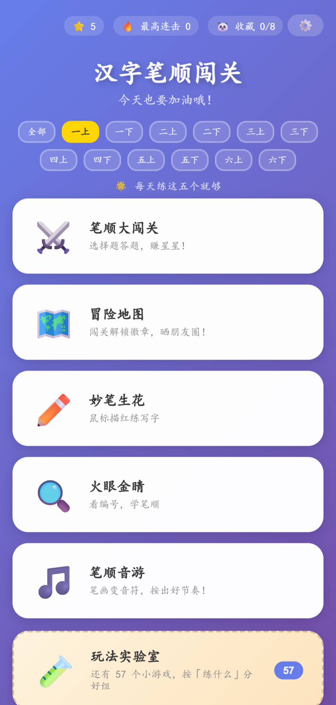
  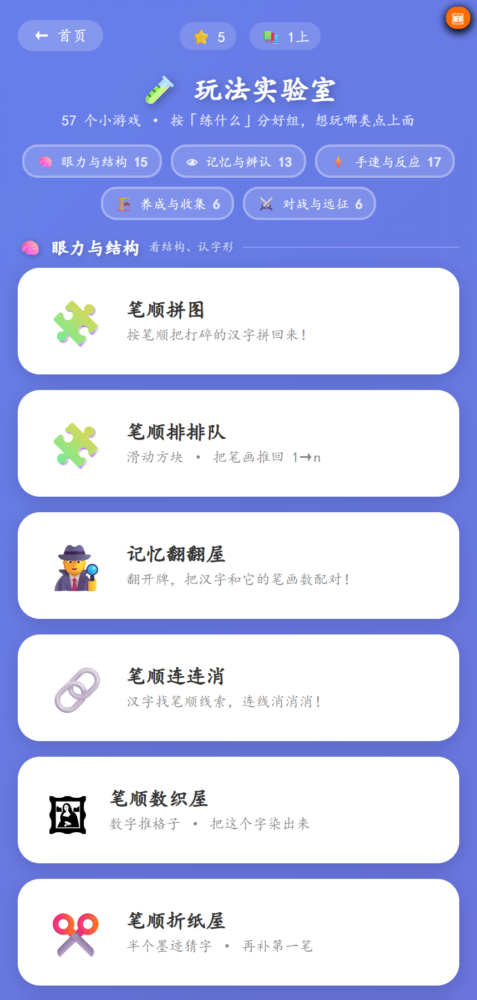
</p>

### 🎵 笔顺音游（Rhythm 模式）

把写字变成打架子鼓！汉字的每一笔化作下落的音符，像音乐游戏一样踩着节奏按出来：

- 🎼 **笔画即音符**：随机抽取 6–9 个汉字，每个字按正确笔顺拆成一串音符，按 4 轨道下落（横➡️ / 竖⬇️ / 撇↙️ / 捺↘️，提并入横轨）
- ⌨️ **双操作方式**：电脑用 F / G / J / K 键，手机直接点屏幕底部四个彩色按键
- 🎯 **三档判定**：完美 / 良好 / MISS，判定窗口对幼儿友好；音符砸到金色判定线时按下
- 🎹 **命中即奏乐**：每次命中按五声音阶上行发音，连击越高旋律越亮，整局自动演奏成一段小乐曲；节拍器滴答声帮你找节奏
- 🔥 **连击爆炸特效** + 屏幕中央「超级连击」大字 + 星星飞散
- ✨ **写完一个字** 触发「写完啦 +50」奖励音和星星雨，笔顺记忆潜移默化
- 🎵 **背景乐**：Web Audio 实时合成小学生经典儿歌（欢乐颂 / 两只老虎 / 小星星 / 粉刷匠 / 铃儿响叮当），每局随机一首，🎵 按钮一键开关
- 🐢 **三档速度**：慢速 / 中速 / 快速自由调节（只改下落速度，节奏不变），选择自动保存
- 🏆 **结算段位**：🌈 全连击演奏家 / 🎼 节奏之神 / 🎹 小小钢琴家 / 🥁 节奏小鼓手，历史最高分本地保存，高分还可赢得星星并触发彩带彩蛋

### 🧱 汉字俄罗斯方块（Tetris 模式）

笔顺知识变成消除武器，像俄罗斯方块一样越堆越高：

- 🎯 答对一笔一画的问题 → **消除最顶层一行方块**（+100 分起，连击加成最高 +200）
- ❌ 答错 → **方块叠高一层**，堆满 10 层游戏结束（危险时棋盘红框闪烁警告）
- 🧨 **全消波次**：把方块全部清空触发「全消 +300」，下一波堆得更高、更刺激
- 🟦 双色糖果方块塔 + 消除闪光动画 + 新层弹跳落下动画
- 🈵 大号楷体当前汉字 + 数笔画 / 判方向两种题型，全程循环出题
- 🏆 结算评段：方块终结者 🏆 / 堆叠高手 🥇 / 消除新星 🥈，历史最高分保存，赚星星解锁动物

### 🐹 笔顺打地鼠（Whack-a-Mole 模式）

答案从洞里钻出来，眼疾手快才能打中——练笔顺顺便练反应力：

- 🐭 **地鼠扛答案**：每题随机钻出 4–7 只地鼠，各举一块答案牌（`3 笔` / `➡️ 往右`），只有一只是正确答案
- 👀 **先想清楚再出手**：题目「「水」第二笔往哪写？」常驻顶部，孩子必须先心算笔顺，再在一堆地鼠里找到那只
- ⏱️ **手速压制**：地鼠停留时间从 2.5 秒起，每答一题缩短 140ms，越玩越快，逼出条件反射
- ❤️ **三颗爱心**：打错、或眼看地鼠扛着答案钻回去，都掉一颗心；心掉光这局结束
- ⚡ **秒了奖励**：地鼠刚冒头 0.9 秒内就打中 → 额外 +30 分并弹出「⚡秒了！」
- 🔨 **打击感拉满**：💥 爆炸贴图、地鼠被打飞旋转缩小、金色分数飘字、星星飞散、连击爆炸字、五声音阶上行的锤击音效
- 🎚️ **难度自适应**：题数越多，同屏地鼠越多（最多 7 只），永远不重样
- 🏆 结算评段：地鼠克星 🏆 / 快手小达人 🥇 / 打得不错 🥈，命中率与历史最高分本地保存

<p align="center">
  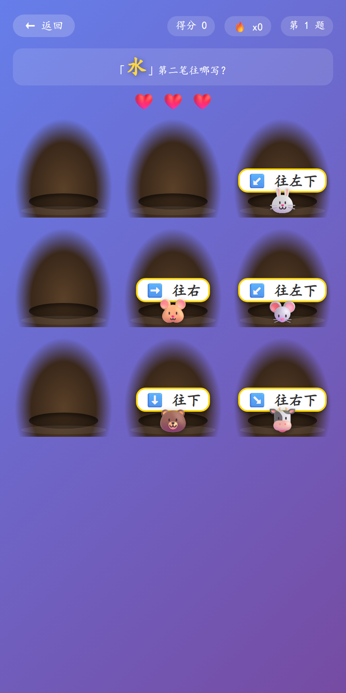
</p>

### 🧩 笔顺拼图（Puzzle 模式）

把汉字**打碎成笔画碎片**，按正确笔顺一块块拼回来——最直接的笔顺肌肉记忆训练：

- 🧩 **真·笔画碎片**：直接从 `hanzi-writer-data` 的 SVG 笔画路径裁出每一笔（自动测量包围盒），随机打乱、随机微旋转后摊在碎片盘里
- 👻 **影子字提示**：田字格里淡紫色显示目标字轮廓，孩子对照着找「下一笔是哪块」
- 🎯 **必须按笔顺**：点错碎片 → 抖动 + 扣 3 秒 + 连击清零，逼孩子真正想清楚下一笔而不是乱试
- ⏱️ **倒计时压力**：70 秒起步，每拼好一个字 +9 秒，拼得越快时间越充裕，天然「再来一局」
- ✨ **落位动画**：点对的碎片淡出，对应笔画立刻在田字格里弹跳定格（金色），整字完成时外圈金光扩散 + 星星雨 + 完成和弦
- 💡 **提示 / 换字**：提示会点亮正确的下一块（−5 秒），换字跳过难题（−10 秒），孩子自己掌控难度
- 🌟 **完美零失误**：整字一次不错 +150 分并触发语音表扬，结算统计「完美字数」
- 🏆 结算评段：拼图宗师 🏆 / 结构小达人 🥇 / 越拼越顺 🥈，历史最高分本地保存

<p align="center">
  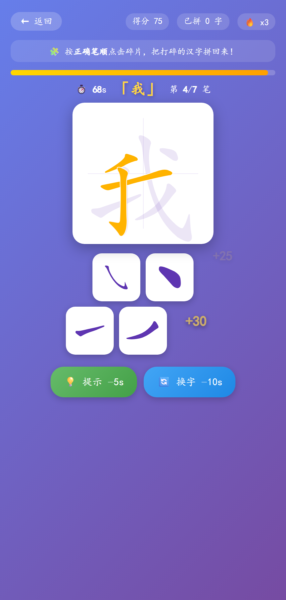
</p>

### 🏃 笔顺跑酷（Runner 模式）

孩子操控小人一路狂奔，前方不断落下**三道抢答门**——想穿过去，只能冲进正确的那一栏：

- 🚪 **三道抢答门**：上/中/下三条跑道各挂一个答案，点跑道、点底部按钮、键盘 ↑↓（或 WASD / 数字 1-2-3）、手机上下滑动都能变道，怎么顺手怎么来
- 🧠 **边跑边算**：题目「「一」的第一笔往哪写？」「「山」一共几笔？」常驻顶部，孩子必须心算笔顺再选道，答错直接撞墙
- 💥 **撞墙有代价**：三颗爱心，撞错一次掉一颗并屏幕震动；每通过 10 道门补一颗心（最多 3 颗），逼出「谨慎但又想冲」的紧张感
- 🎚️ **越跑越快**：速度随通过门数线性提升（1.8% → 4.5% 屏宽/毫秒），距离米数实时增长，天然刷纪录
- ✨ **通过特效**：撞对 → 小人起跳 + 正确门牌飞散 + 五声音阶上行 + 连击爆炸字 + 星星雨；每 5 连击语音表扬
- 🏆 结算评段：跑酷之王 🏆 / 飞毛腿 🥇 / 越跑越顺 🥈 / 起步啦 🥉，总跑动距离与历史最高分本地保存

<p align="center">
  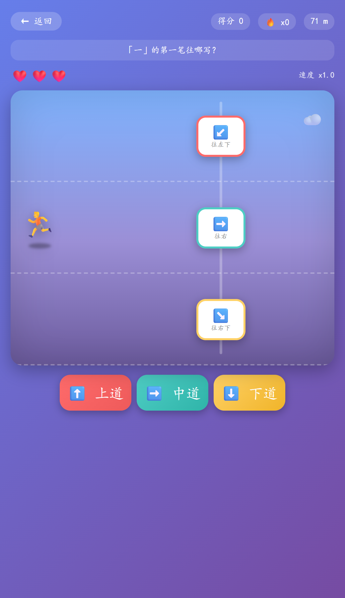
</p>

### 👹 笔顺大魔王（Boss 战模式）

不是刷完就散的答题——**五位魔王排着队等你**，答对砍它一刀，答错它打你，血条见底才算赢：

- 🩸 **双血条对战**：魔王血量 110 → 280 逐位变厚，小勇士 100 点血，答对回 5 血，答错扣 22~39 血，紧张感全靠这两条槽
- ⚔️ **答对即输出**：伤害 = 8 + 连击×2（上限 16）+ 速攻加成 6，越连击砍得越狠，屏幕飘出「-18」伤害数字
- ⏱️ **回合限时**：每回合 9 秒倒计时条（后段变红），超时视为魔王抢先出手，逼孩子**看清笔顺再下手**
- ⚡ **能量大招**：每答对攒 22 点能量，攒满 100 点亮「⚡放大招」按钮，一键砍掉 40+ 血 + 全屏刀光，键盘空格也能放
- 😡 **狂暴阶段**：血量掉到 50% / 20% 时魔王狂暴，场景变红、魔王发亮、答题时间砍到 78% / 60%，伤害更高
- 🏅 **魔王阵容收集**：击败一位解锁下一位（`hz_boss_beat` 存档），结算页用 💀 标出已打倒的魔王，通关五位即「笔顺宗师」
- 🎮 **四种操作**：点选项、键盘 1-4、空格放大招，手机直接点，怎么快怎么来

<p align="center">
  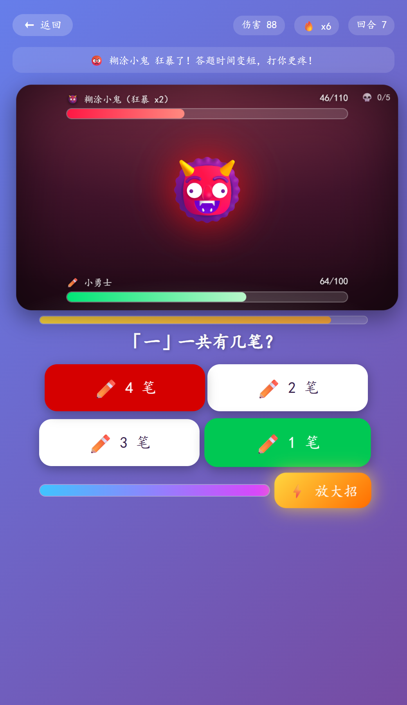
</p>

### 🐣 笔顺宠物屋（养成模式）

一只**真的会饿、会难过、会长大**的汉字宠物住在房间里，它的口粮只有一种——你答对的笔顺题：

- 🍖 **三条状态槽**：饱食 / 心情 / 成长值实时显示，宠物状态直接反映在表情和动作上（饿了会耷拉变灰）
- ⏳ **真实时间衰减**：按 `localStorage` 里的时间戳结算，离开 3 小时回来它就饿了 60 多点——**明天还想看看它**的钩子全靠这个
- 🍚 **喂饭 = 答题**：一顿饭 6 道笔顺题，答对食物掉进嘴里 + 咀嚼动画 + 连击叠成长，全对触发「加餐 +25」
- 🎾 **陪玩**：5 秒内点中乱弹的小球，点一次心情 +6、成长 +3，音调随连击升高
- 🫧 **洗澡**：房间里爬出 4 只小脏东西，逐个点掉，洗完亮晶晶 + 经验奖励
- ❤️ **摸摸头**：随时点宠物，飘爱心 + 心情 +2，它会跟你说话（气泡台词按饥饿/心情/阶段变化）
- 🐉 **五阶段进化**：🥚 汉字蛋 → 🐣 破壳小鸡 → 🐥 笔顺雏鸟 → 🐔 神气大公鸡 → 🐉 汉字神兽，进化时全屏白光 + 彩带弹窗
- 🔗 **全局成长联动**：**在任何模式里拿到星星都会顺便给宠物 +2 成长值**，首页卡片实时显示它的阶段，练字越勤它长得越快
- 📅 **每日见面礼**：第一次打开送 +20 成长、+12 心情

<p align="center">
  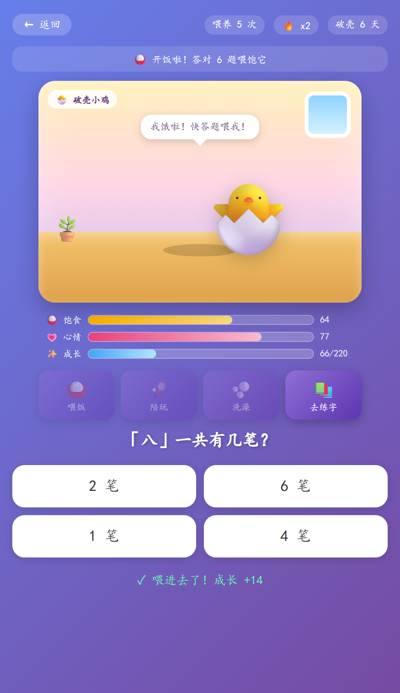
</p>

### 🦘 笔顺跳房子（对战赛跑模式）

12 格蛇形赛道，你和一只 AI 小怪兽**同时往前跳**——答对才动，答错就让它偷跳一格：

- 🏁 **真正的竞速感**：谁先踩到第 12 格谁赢，对手每 6~9 秒**自己往前跳一格**，你不答题它照样冲线
- 🧠 **答对才跳得动**：笔顺题（数笔画 / 判方向）四选一，答对跳 1 格；连击 ≥3 且手速快 → **⚡连跳加倍一次跨 2 格**
- 😈 **答错代价明确**：连击清零 + 对手立刻白赚一格，小怪兽还会弹气泡嘲讽你「我跳到你前面啦！」
- 🏅 **连胜解锁更强对手**：👾 小紫怪 → 🐒 急猴子 → 🦖 快龙仔 → 🤖 铁蛋机器人 → 🐆 闪电豹，连胜越多它跳得越快、答题时限越短（9 秒 → 6 秒）
- 💨 **跳跃手感**：格子高亮描边、起跳抛物线动画、落地扬尘、音阶随前进格数升高，冲线撒花
- ⌨️ **键盘 1-4 直接抢答**，鼠标手机点选都行
- 📈 结算记录答题数 / 最长连跳 / 当前连胜 / 历史最长连胜（`hz_hop_wins` / `hz_hop_best`），输了连胜清零——「再来一局把它赢回来」

<p align="center">
  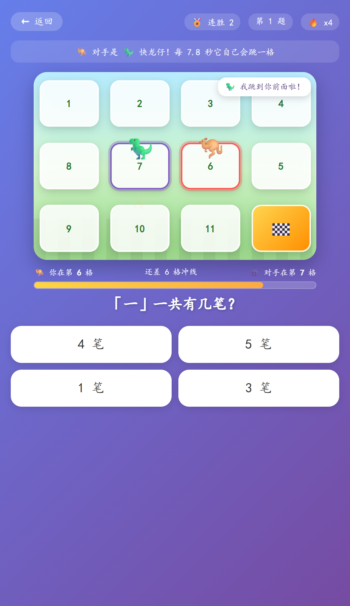
</p>

### 🧱 笔顺打砖块（弹球 Breakout 模式）

一整面砖墙压在头顶，每块砖上写着一个候选答案，脚下是一块会发光的挡板——**把球弹上去，只砸写着正确答案的那块砖**：

- 🕹️ **真弹球手感**：鼠标 / 手指 / ← → 都能控挡板，球打在挡板不同位置会**改变反弹角度**，想砸哪一块得自己算线路
- 🧠 **边弹边算**：题目问「『一』第一笔往哪写？」「『人』一共有几笔？」，25 块砖分四种颜色写着四个候选答案，先想清楚答案，再守好角度
- 💥 **砸对**：砖块当场**炸成碎片**、飘出 +分、五声音阶随连击往上爬，「漂亮！」「真准！」弹在墙上；把这一题的正确答案全砸完立刻换新题
- 😅 **砸错**：砖也会碎，但连击清零、扣 4 分、屏幕一震，并提醒你这题的正确答案是什么
- ❤️ **球掉地下才扣心**：三颗心，掉完结束一局——比手速更考走位
- 🚩 **无限过关**：清空整面砖墙进下一关，球更快、挡板更窄；`hz_brick_lv` 记录最高关数、`hz_brick_best` 记录最高分，结算给出正确率与最长连击

<p align="center">
  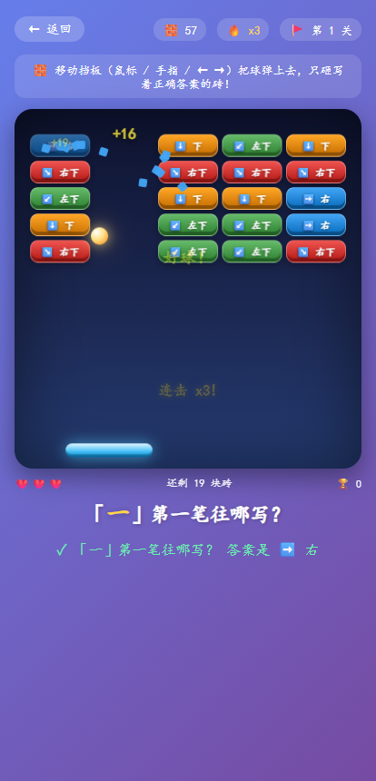
</p>

### 🍉 笔顺切水果（刀刃切割模式）

夜空下的木台，答案写在飞来的水果上——**用鼠标/手指划一刀**，把正确的那颗切开：

- 🔪 **真·刀感**：按住划过水果才算切中（触屏直接点也行），切中瞬间水果**裂成两半飞散**、果汁四溅、刀刃拖出蓝色光轨，「完美一刀！」「好刀法！」大字弹在天上
- 🧠 **先算再切**：题目问「『一』第一笔往哪写？」「『人』一共有几笔？」，四颗水果上写着四个候选答案，看准了才下刀——切错一下就去一颗 ❤️
- 💣 **炸弹别碰**：混在果子里的 💣 越到后面越多，切到直接扣心 + 屏幕震动，贪刀必翻车
- 🔥 **连击加分**：连切正确答案，五声音阶一路往上爬，分数随连击水涨船高（最高 +36/颗），每切中一颗回 1.5 秒
- 🍃 **放走也算失误**：写着正确答案的水果掉下木台，连击清零并提醒你别再让它飞走
- ⏱️ 90 秒一局、3 颗心，结算给出得分 / 最长连击 / 切中数与**刀法评级**（🔰 水果学徒 → 🥷 水果忍者大师），记录 `hz_fruit_best` / `hz_fruit_wins`，连胜越多炸弹越密、下一波水果来得越快

<p align="center">
  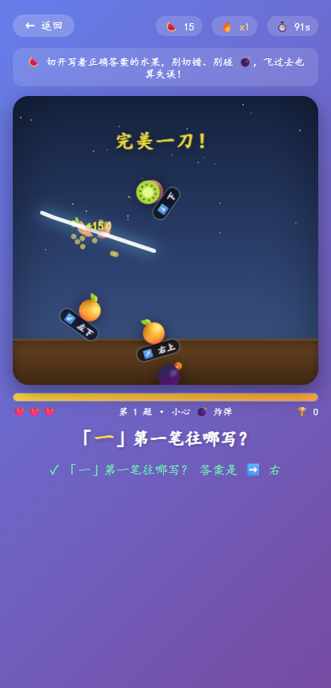
</p>

### 🔗 笔顺连连消（知识连连看模式）

30 个字块铺满棋盘，一半是**汉字**、一半是**笔顺线索**（「4 笔」/「第一笔 ➡️」/「最后一笔 ⬇️」），把一对连起来就能消除：

- 🧠 **连线要考笔顺**：光找一样的字没用，得先数清「王」到底几笔、第一笔往哪写，才知道它配哪块线索——15 对线索文字互不重复，每一对都是唯一解
- 📐 **经典连连看规则**：两点之间的连线最多**拐两个弯**，可以绕出棋盘外沿；被挡住的字块要先消掉，越消路越开，空间推理一起练
- 💥 **连击越打越响**：连对一串，五声音阶一路往上爬，消除处炸星屑、连线闪光、头顶飘 +分，连击 ≥5 还有语音夸你
- ⏱️ **抢时间**：100 秒倒计时，每消一对 +2 秒，连错一对扣 3 秒；💡 提示（扣 5 秒）、🔀 洗牌（扣 8 秒）自己权衡着用，死局会自动洗牌
- 🎓 **消完就复盘**：每次消除都把「这个字几笔、首笔末笔往哪写」写在屏幕下方，连错时还会主动告诉你正确答案
- 🏆 通关记录得分与连胜（`hz_lian_best` / `hz_lian_wins`），连胜越多下一局初始时间越短；结算页列出本局复习到的字

<p align="center">
  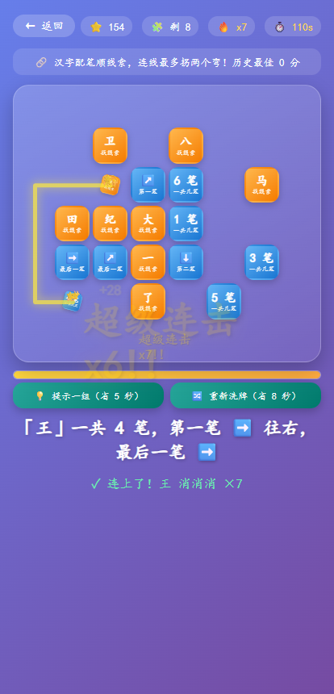
</p>

### 🏰 笔顺塔防（守城开炮模式）

怪兽排着队沿小路走向城门——**答对一题，大炮就开一炮**，答错全场怪兽红眼加速：

- 💣 **答题就是开火**：题目问「『菊』第十笔往哪写？」「一共有几笔？」，答对立刻锁定最靠前的怪兽，炮弹拖着弧线飞过去炸开火星；连击 ≥4 两连炮、≥8 三炮齐发
- 👾 **怪兽带血条**：🐛 毛毛虫 1 炮、👹 红鬼 3 炮，每 5 波一只 6 血的 🐲 恶龙压轴，血条就写在脚下，一题一血慢慢磨
- 💨 **答错看得见**：答错清连击、扣分，所有怪兽还会**加速冲刺 1.8 秒**，瞎蒙的代价当场就还
- 🏯 **5 座城楼**：每闯进一只怪塌一座城楼，城门被撞特效 + 屏幕震动，5 座全塌这局就结束了
- 🌊 **越守越猛**：波次递增——怪兽更多、更快、更肉，第 9 波起每只怪额外加一格血
- 🏆 无限波次，记录最高波数与最高分（`hz_td_wave` / `hz_td_best`），结算给出守住的波数、消灭数与正确率

<p align="center">
  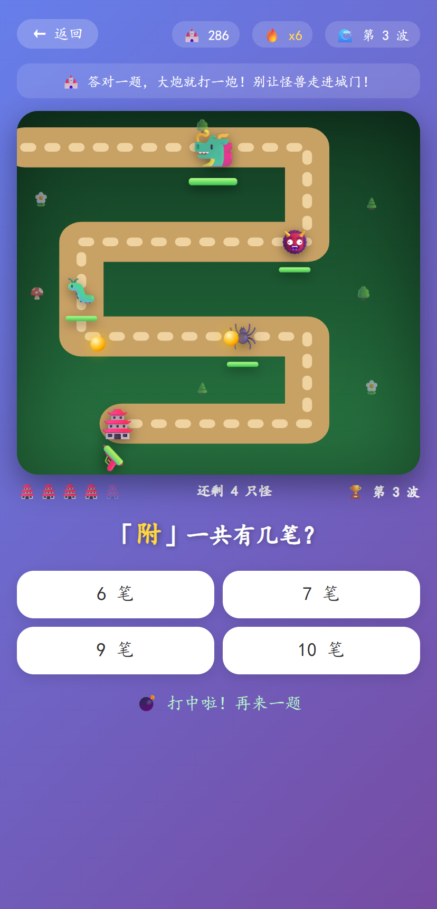
</p>

### 🎣 笔顺钓鱼（蓄力抛竿模式）

水面上漂着小船，四个候选答案写在四条鱼的肚子上——**看准答案，蓄力抛竿，把它钓上来**：

- 🎣 **按住蓄力、松手抛竿**：力度条来回摆动，决定鱼钩落水的远近；鱼在五条水道上左右游动，力度差一点就落到隔壁那条鱼旁边
- 🐟 **答案写在鱼身上**：题目问「『春』一共有几笔？」「第二笔往哪写？」，四条鱼各举一个答案，游得越快（🦈 大鲨鱼）分越高，🐢 海龟爷爷慢但值钱
- ⬆️ **咬钩提竿 QTE**：鱼钩附近最近的鱼会被吸引过来咬钩，此时出现「小白条」——滑进绿区的一瞬点一下（或按空格）才钓得上来，太早太晚都会挣脱（-3 秒）
- 🥾 **水里有垃圾**：偶尔漂过一只旧靴子 🥾，钓上来又臭又扣分扣时间；等待时乱点会把整群鱼吓跑（-2 秒）
- 📖 **鱼图鉴收集**：7 种鱼跨局记录在 `hz_fish_book`，钓到新鱼种会「🌟 新鱼收录图鉴！」并额外加星星，集齐才有 👑
- ⏱ **90 秒限时**：答对 +3 秒、答错 -5 秒，连击越深鱼游得越快也越值钱，结算给出条数、连击、正确率与图鉴进度（`hz_fish_best` / `hz_fish_caught`）

<p align="center">
  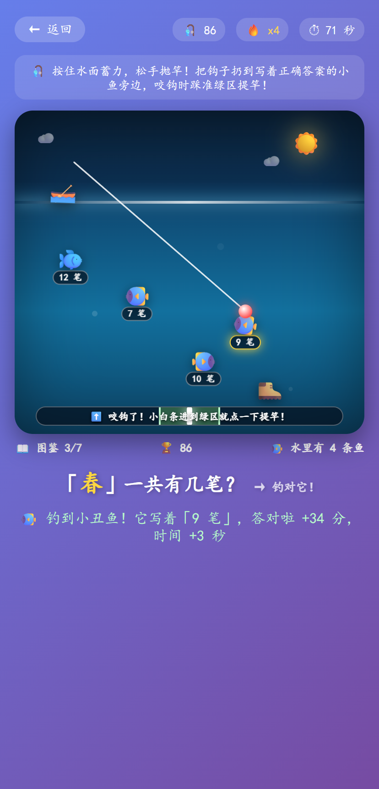
</p>

### 🤼 笔顺双人大乱斗（分屏拔河模式）

一块屏幕两个人玩——**上下两个答题面板，中间一根拔河绳**，谁答得又快又准，就把绳子拉过自己这边：

- 🎯 **答对就是拉力**：红队（上半屏）答对一格往自己这边拉，蓝队（下半屏）同理；绳子上的 🚩 拖过线的一方直接获胜，先拉满 5 格定胜负
- ⚡ **连击双倍拉绳**：同一方连对 3 题以上，之后每答对一题拉两格，翻盘就靠这一波
- 💥 **答错当场还债**：答错不仅断连击，还把绳子**白送给对手一格**，自己的面板还会被锁 1.3 秒（变灰），瞎蒙在双人局里是会被抓住的
- ⌨️ **两个人同时按**：红队用键盘 1/2/3/4，蓝队用 7/8/9/0，平板上就分上下半屏各按各的，谁手快谁占便宜
- 🤖 **没人陪练也行**：一键切换电脑对手，电脑落后时会自动变准（橡皮筋难度），一个人也能练
- 🏆 **累计战绩**：红蓝双方胜场分别存进 `hz_duel_p1` / `hz_duel_p2`，另有最长连胜拉 `hz_duel_streak`、总场次 `hz_duel_matches`；90 秒打满没分胜负就按绳子位置判险胜或平局，两边都加星星

<p align="center">
  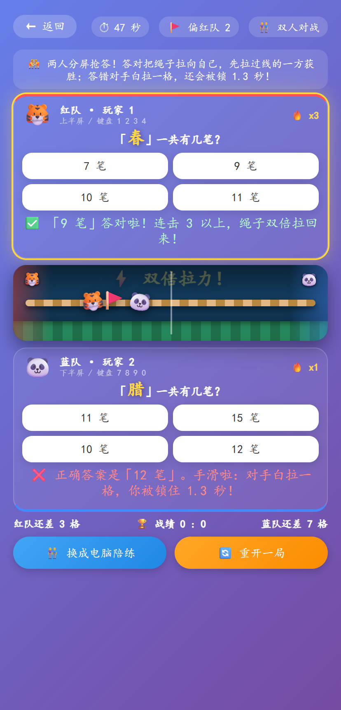
</p>

### ⛏️ 笔顺挖宝（考古探方模式）

一块沙土探方，底下埋着文物——**答对一题领两把铲子**，点格子开挖，挖空了会告诉你离宝物还有几格：

- 🔥 **冷热线索推理**：每挖开一格空格，沙子上就留下 🔥（1 格内）、♨️（2 格）、🌡️（3 格）、❄️（还远）+ 距离数字，孩子像小考古学家一样把线索拼起来定位宝藏
- ⛏️ **铲子靠答题赚**：答对 +2 把铲子、连击 ≥3 变 +3 把；答错吃一场 🌪️ 沙暴：扣 4 秒、扣 8 分、铲子被埋一把、断连击，当场就还
- 💥 **深埋要连挖**：陶罐一铲就出，刀币两铲，青铜鼎三铲——碰到硬的东西会显示「💥 还差 N」，越贵越费铲子，孩子自己会算「这格值得再挖」
- 🏺 **12 件文物图鉴**：从 🐚 贝币、🪙 刀币到 🐉 玉龙、👑 金冠、🦚 凤冠，跨局存进 `hz_dig_book`，第一次出土额外 +25 分并撒彩带
- 🕳️ **越挖越深**：松散表土 → 陶片层 → 古钱层 → 青铜层 → 王陵秘宝，探方从 4×3 长到 6×5，埋的文物更多也更值钱，清空一层 +12 秒 +2 铲
- 🪨 **惊喜与坑**：沙里还混着 🪨 石头格，一铲下去硬邦邦什么也没有（不过照样给你冷热线索），乱挖就是浪费铲子
- 🏆 记录最高分与最深土层（`hz_dig_best` / `hz_dig_deep`），结算页给出出土件数、层数、正确率与文物图鉴墙

<p align="center">
  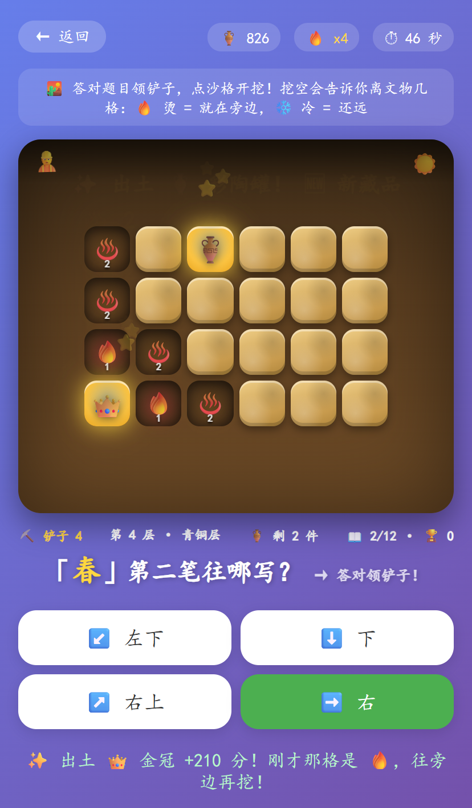
</p>

### 📅 每日签到 · 星运转盘（跨真实时间的养成钩子）

不答题也能玩，但必须「每天回来」—— 签到按真实日期算，跨 0 点才刷新：

- 🔥 **连签火焰**：连续签到天数决定称号，🌱 签到新人 → 🔥 三日火苗 → 🏅 七日勋章 → 🎖️ 两周铁杆 → 👑 月度皇冠 → 🐉 神兽之友 → 🏆 百日笔顺王；断签只会让火焰重燃，累计天数永远不清零
- 🎁 **7 天宝箱循环**：第 1 天 +5⭐ 一路涨到第 7 天 👑 +25⭐，签到条上提前看得到后面几天的奖励，孩子自己就惦记着明天
- 🎡 **技巧型幸运转盘**：拆完宝箱转盘立刻开转，转速按正弦忽快忽慢，只有盯住「慢下来那一瞬」点停才停得准 —— 8 个奖项：💫 星星×2、👑 星星×3、🌟 +12⭐、✨ +6⭐、🎁 盲盒、🐣 宠物口粮、💎 徽章碎片、🌱 谢谢参与
- 💎 **碎片换徽章**：转盘落到碎片格，攒满 3 块自动兑换一枚还没解锁的徽章，荣耀墙 🔥🎖️👑🐉🏆 逐盏点亮
- ⭐ **星星进总账**：签到所得走 `addStars()`，顺手喂养宠物、推进动物收藏馆，等于给所有玩法接了一条每日回访线
- 📍 首页卡片带红点提醒，没签到就一直写着「今天还没签到，点开领星星！」；空格 = 拆宝箱 / 急停转盘

<p align="center">
  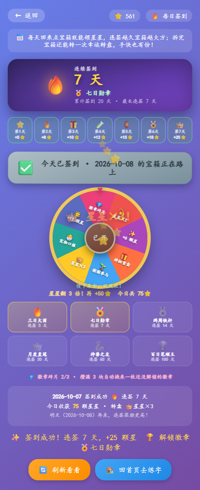
</p>

### 🐍 笔顺贪吃蛇（越写越长、越长越快）

一条小蛇在 11×13 的方格盘上游走，蛇身就是孩子一笔一笔「写」出来的：

- 🍎 **答对才解锁食物**：每回合盘面给一个 🔒 苹果 + 一道「『春』的第二笔往哪写？」的方向题；答对了锁开、苹果发亮，蛇头碰到它就吞下去，蛇身长一节、那笔的箭头永久留在节上
- 🧱 **答错会被封路**：答错断连击、扣分，盘上立刻多一颗 💣 炸弹，食物也被重新挪走——孩子得先看题再规划路线，而不是乱转
- 📏 **一笔一笔成一个字**：蛇身把「春」的所有笔顺方向按顺序吃满，就 `🎉 写成『春』` +大额奖励 + 撒彩带 + 成字数 +1，比音游更直观地感受「笔画组成字」
- ⚡ **升级提速加石头**：每成两个字升一级，步伐间隔从 300ms 压到 150ms，并额外撒两颗 🪨 石头，蛇身越长越考验路线规划
- 💥 **四种撞法都算事故**：撞墙、撞石头、撞炸弹、撞到自己身子都会扣一颗 ❤️，剩两颗心时原地重生 3 格小蛇（自动清掉身边危险格），3 心耗尽才结算
- 🎮 **三种操作任选**：键盘方向键 / WASD、盘面下方 d-pad 按钮、手指在盘面上滑动；按 1–4 数字键直接作答
- 🏆 记录最高分、累计成字数与最长蛇身（`hz_snake_best` / `hz_snake_chars` / `hz_snake_len`），结算页给出本局分数、等级、正确率

<p align="center">
  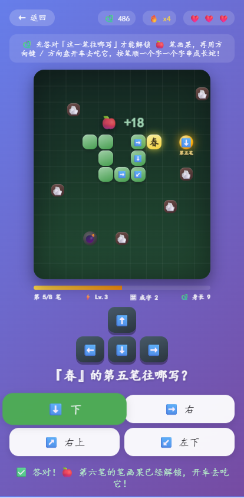
</p>

### 🍬 笔顺消消乐（答对才给交换的三消）

7×8 糖果盘，五种颜色的糖块分别写着 ➡️ 横、⬇️ 竖、↙️ 撇、↘️ 捺、↗️ 点——**想交换两颗糖，先答一道笔顺方向题**：

- 🔓 **答案就是钥匙**：每答对一题攒 1 次「交换机会」（最多攒 2 次），而且这一笔的方向会当场变成**本关目标色**——盘面上所有同色糖块亮起金边，孩子一眼看到「原来我要消的是竖」
- 🎯 **消对颜色才算进度**：三个同方向连成一线就消除，但只有目标色计入 `9/17` 进度条，其余颜色只是帮你腾地方的辅助消除，逼着孩子带着目标去看盘
- ❌ **答错不给交换**：答错断连击、扣 3 分、震屏，并且红块 + 绿框同时标出正确答案，交换机会一次也不给——想玩就得先把这一笔想清楚
- ⭐ **四连出星星块**：连成 4 个会留下一颗 ⭐，再交换它就把周围 3×3 一起炸开；🌈 **五连出彩虹**：把彩虹和任意颜色对调，全场同色一次清光
- 🔗 **连锁升音阶**：消除后糖块下落补位，自动连环消除，每多一连锁分数 ×1.5 倍，音效沿 C-D-E-G-A-C-D 音阶往上爬
- 🔄 **换不动了自动洗牌**：死局检测 + 无解交换自动重排（不额外扣步数），换不出三连的尝试会原样退回、步数与交换机会一并还给你
- 🍭 **无限过关**：第 1 关消 11 个，每过一关目标 +3、补 15 步，通关 +3⭐ 撒彩带；步数用尽才结算，记录最高分、最高通关数与累计特殊糖块（`hz_m3_best` / `hz_m3_lv` / `hz_m3_wins` / `hz_m3_sp`）
- 🎮 手指拖动相邻两颗糖即可交换，点选也行；键盘 1–4 直接作答

<p align="center">
  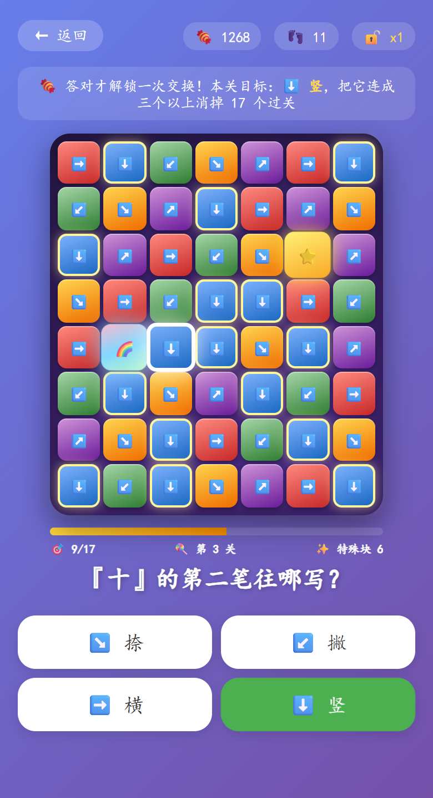
</p>

### 🎫 笔顺刮刮卡（答对印卡 · 硬币刮开涂层）

把「答对一题」变成一张真的能刮的彩票：屏幕上按住手指来回蹭，银色涂层就被 🪙 硬币一点点刮掉，露出下面九个奖格——

- 🪙 **真·刮涂层**：涂层是一张 canvas，手指经过的地方按像素擦除，边刮边飞银色碎屑、沙沙音效，刮到哪露到哪，比点按钮爽得多
- 🎫 **卡是答对印出来的**：每答对一题（数笔画 / 这一笔往哪写）立刻印出一张新卡；答错也能刮，但卡片会「印糊」——涂层更厚、要刮更多才翻开，符号池也更差
- 🍀 **刮出三个一样就是 BINGO**：金边高亮 + 彩带 + 大奖分数，BINGO 越多星星越多；💎 钻石、👑 皇冠、🐉 龙这些高级符号第一次刮到还会进「稀有符号图鉴」
- 🥉→🐉 **卡面会升级**：每答对 2 题卡面涨一档（铜 / 银 / 金 / 钻 / 龙），卡面越贵符号越值钱，孩子自己就想「再答对两题换龙卡」
- 📊 **幸运值看得见**：连击越高，本张卡出 BINGO 的概率越大，答题快、答得准真的能「手气变好」
- 🧽 **不逼孩子刮到累**：刮到八成涂层自动帮你刮完（+20 干净奖励），也可以随时点「一键刮开这张」，卡照样结算
- 🏆 一局 8 张卡，记录单张最佳、单局最高奖金、累计张数、BINGO 次数与符号图鉴（`hz_sc_best` / `hz_sc_score` / `hz_sc_cards` / `hz_sc_bingo` / `hz_sc_rare`），结算页给奖金、正确率与图鉴进度

<p align="center">
  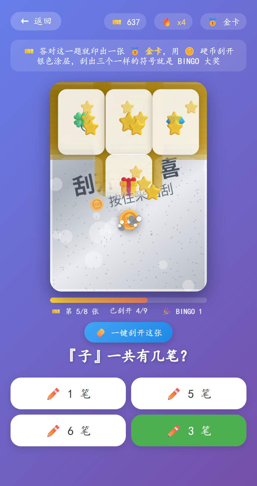
</p>

### 🀄 笔顺多米诺（越立越值钱，敢不敢推倒领钱）

把「再答一题」变成一次赌博：骨牌一张比一张值钱，随时可以推倒领钱，但答错或手慢就整条链哗啦倒塌——

- 🀄 **答对一题立一张牌**：第 1 张 10 分、第 2 张 14 分……按 6×3 蛇形牌道一路排下去，牌越立越贵，孩子自己就会算「再立一张多几分」
- 🔥 **随时推倒领钱**：按下去整条链按顺序一张张倒下，配一路升高的五声音阶音效 + 火花 + 彩带，攒的分数全额入账；也可以贪到底继续答
- 💥 **答错 / 手慢就塌链**：只有 **35%** 能保住，连击和倍率当场清零——「见好就收」和「再搏一张」的拉扯就是这个模式的上瘾点
- ⭐ **金牌 / 🐉 龙牌翻倍**：每 5 张一张金牌面值 ×2，第 18 张是龙牌；整条链排满 18 张再推倒直接 **×2 一条龙**，结算页给 🐉 称号
- ⏳ **引线会烧**：每题 8–12 秒引线（链数越高越快），最后 3 秒滴答报警，逼孩子果断而不是磨蹭
- 🐣→👑 **称号靠攒牌**：累计骨牌数解锁 小板牙 → 小蛇龙 → 翻江龙 → 骨牌之王，结算页实时显示还差几张升级
- 📊 一局 5 条链，记录单局最高金币、累计骨牌、稳稳收手次数、单链最长与一条龙次数（`hz_dp_score` / `hz_dp_total` / `hz_dp_lines` / `hz_dp_chain` / `hz_dp_dragon`）
- 🎮 键盘 1–4 作答、按 C 直接推倒；卡壳了可以「🔄 换一张」扣 15 分保命

<p align="center">
  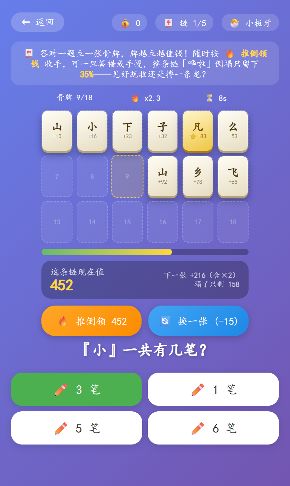
</p>

### 🗼 笔顺叠叠塔（答对一题发一块砖，看准时机叠成摩天大楼）

把「叠叠乐」的爽感接到笔顺练习上：砖只有答对才发，但**能不能叠正全看落砖的那一下手感**——

- 🧱 **答对才发砖**：砖从塔顶左右滑出，滑得越快越难瞄；点一下（或空格）让它落下，越正剩下的越宽
- ✂️ **切边真实惩罚**：落歪了只保留重叠部分，切掉的那截「哗啦」掉出画面——塔越叠越窄，下一次容错越小，孩子会自己屏住呼吸瞄准
- ✨ **完美对齐连击**：落点正负 6 像素内算 PERFECT，砖自动吸附满宽、金框亮起、分数按连击递增（+25 → +35 → +45…），四连完美放彩带
- 😵 **答错发歪砖**：不是直接扣血，而是给一块**更窄、更快、还标红**的歪砖，且这一砖不许算 PERFECT——手滑答错的代价留在塔上
- ⛅ **越叠越换天**：每 8 层升一个场景（🌱 田野 → ⛅ 云端 → 🌙 月宫 → 🌌 银河），云朵飞鸟换成星月行星，相机跟着往上推，「再看一层」的冲动停不下来
- ❤️ **三颗心**：完全落空才算摔一次，掉一颗心并震屏；心掉光本局结束，塔倒了也不打击人
- 🚀 **楼越高砖越快**：滑动速度随层数递增（95 → 252 px/s），同一道题在高层瞄准的难度完全不同
- 📊 记录最高层数、单局最高分、累计完美次数与累计认字数（`hz_stack_best` / `hz_stack_score` / `hz_stack_perfect` / `hz_stack_chars`）
- 🎮 键盘 1–4 作答，空格 / 回车或点塔区落砖；窗口变窄时整塔按比例重映射，手机上也不会歪

<p align="center">
  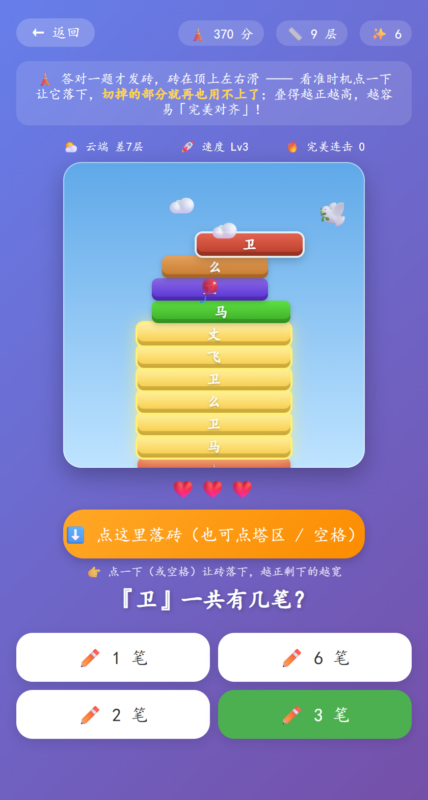
</p>

### 🎡 笔顺扭蛋机（答对攒币，抽你的汉字精灵馆）

把「抽卡」这套让人上头的机制反过来用：**币只能靠答对笔顺题挣**，越爱抽就越爱答：

- 🪙 **答对才给币**：单抽 1 枚、十连 8 枚（打八折），普通题 +1，连击 3 以上每题 +2，答错零收益并清零连击——想抽卡就得先把笔画方向想清楚
- 🎡 **真会转的机器**：点抽之后胶囊在罩子里翻滚、掉进托盘、再「啪」地开蛋出卡，全程有节奏音阶配音，稀有度越高升的音越多
- 🐉 **五档稀有度按笔画分**：🐣 N（≤3 画）→ 🐰 R（≤5）→ 🦊 SR（≤7）→ 🦄 SSR（≤9）→ 🐉 UR（更难），权重 600/250/110/35/5——**字越难写抽到越稀有**，孩子会主动去认那些没见过的字
- 🏷️ **精灵有名字**：每只按字形取「🌸花花 · 春 / 9 画 · 第一笔 ➡️ 往右」，卡面直接复述笔顺知识点，抽到就是复习一次
- 🔥 **30 抽保底**：保底条实时倒计时，攒满 30 抽必出 SSR 以上；十连若全是 N/R，最后一张自动升级为 SR，绝不会「十连全垃圾」
- 🧩 **重复不白抽**：抽到已有的精灵转成碎片（N 1 / R 2 / SR 5 / SSR 12 / UR 30 片），碎片可在图鉴里兑换没抽到的 SR 以上精灵（15 / 40 / 90 片三档）
- 📚 **汉字精灵馆图鉴**：66 格按稀有度上色分区，未收集的 SR+ 格子带「换」角标，顶部图例逐档显示 `SR 3/14` 进度；集齐一整档触发全家大奖（+10 ~ +150⭐，走 `addStars()` 进总账）
- 🔴 **回访钩子**：币够单抽时首页卡片亮红点并提示「🪙 有 N 枚币，够抽 1 发」，把「先答几题攒币」变成每天的回机理由
- 🎮 键盘 1–4 作答、G 直接单抽；币 / 碎片 / 保底 / 图鉴全部落盘（`hz_gg_coin` / `hz_gg_frag` / `hz_gg_pity` / `hz_gg_pulls` / `hz_gg_book` / `hz_gg_sets`）

<p align="center">
  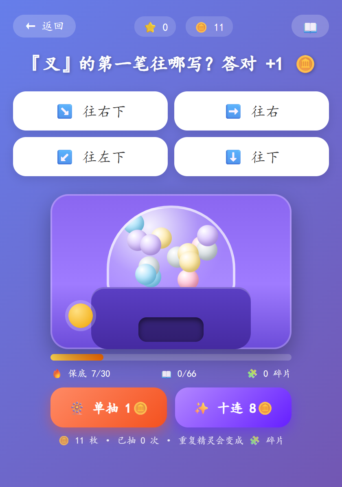
  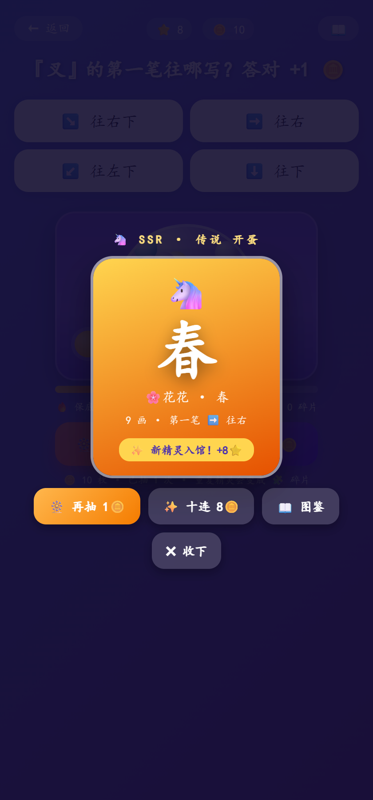
  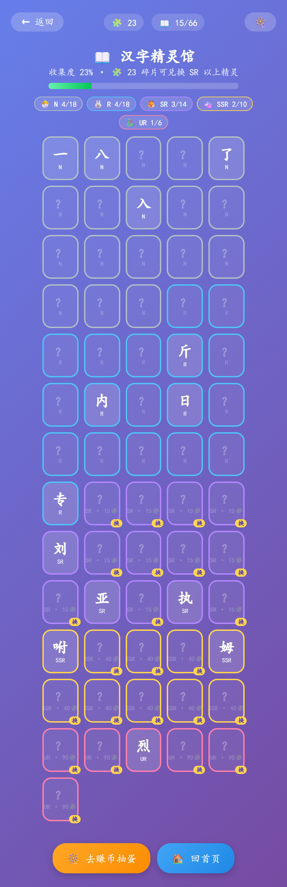
</p>

### 🧩 笔顺合合合（汉字版 2048：只有笔画数相同的字才能合）

把 2048 的「滑动合成」换成**数笔画**——孩子要先把两个字的笔画数数对，才知道它们能不能合：

- 🔢 **合并规则即知识点**：两块砖的**笔画数相同**才能合成「多一笔」的新字（1 画「一」→ 2 画「人」→ 3 画「川」→…→ 16 画），砖面上直接印着真实汉字与 `N 画`，每次滑动都是一回全班数笔画
- 🧱 **砖只能靠答对题掉**：棋盘不会自己长砖——答对一道笔顺题才掉一块新字砖；答错砸下一块 🪨 **石砖**占格（不能移动合并），把「答错的代价」明明白白摆在棋盘上
- 🔥 **连击会掉高级砖**：连对 4 题开始掉 2 画砖、连对 8 题掉 3 画砖，越顺开局越豪华；一次滑动里合成多对算连合成，分数按 ×1 → ×1.5 → ×2 递增
- 🔮 **能量与合成术**：每答对一题攒 1 点能量（最多 3 点），满 3 点放「合成术」——优先炸掉挡路的石砖，没有石砖就自动帮孩子合掉最低级的一对，是给卡壳时的救命按钮
- ↩️ **悔一步 ×3**：每局 3 次反悔，滑错了能整盘复原（含分数 / 能量 / 石砖），鼓励孩子大胆试而不是不敢动
- 👑 **16 画汉字之王**：合到 16 画那格会亮起金框、全屏彩带并永久记录 `字王次数`，是这套玩法里最硬的荣誉勋章
- 📊 记录最高分、最高合到几画、累计合成 / 累计答对 / 字王次数（`hz_mg_best` / `hz_mg_top` / `hz_mg_merges` / `hz_mg_answers` / `hz_mg_king`），结算星星走 `addStars()` 进总账
- 🎮 方向键 / WASD / 手指拖动棋盘 / 屏幕四向按钮四种操作，键盘 1–4 作答、X 放合成术；砖块滑动、合并弹跳、飘分都有独立动画

<p align="center">
  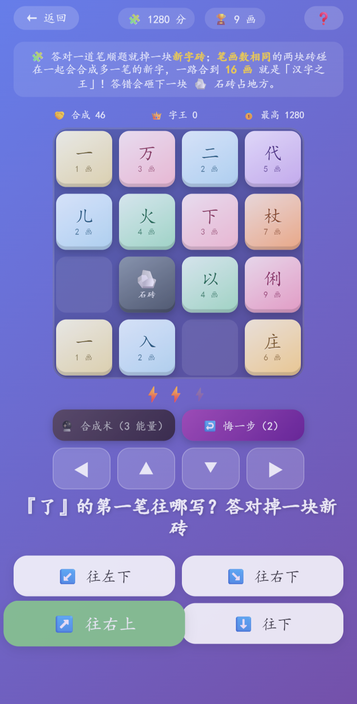
  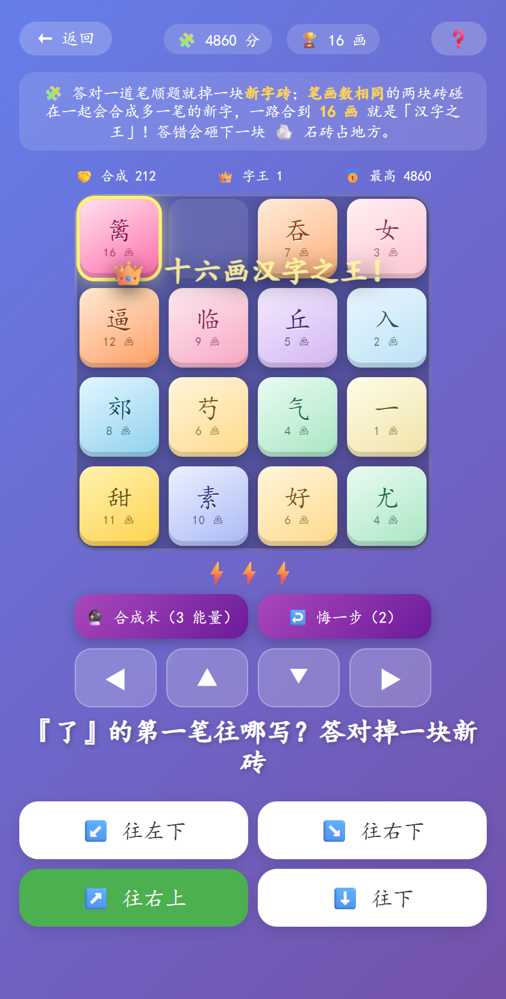
  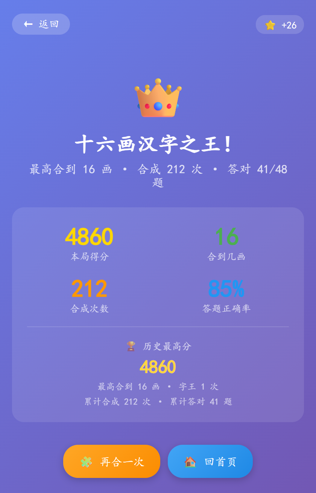
</p>

### 🐰 笔顺跳一跳（答案就写在远处三块平台上，蓄力跳过去）

把微信「跳一跳」的蓄力手感接到笔顺上——**这一跳既是选择题，也是力度题**：

- 🎯 **答案是落点**：三块候选平台漂在前方，板面上直接印着「✏️ 4 笔」「↙️ 往左下」这样的答案，先算对笔顺、再跳到那块板上，答错就是踩空
- 🔋 **按住蓄力**：按住屏幕或空格，力度条 0→100%→0 来回摆，松手起跳；跳多远完全由力度决定，**算对了但蓄力不够照样掉进缝里**
- ✨ **完美落心**：落在平台正中心触发「完美落心」，这一跳分数直接翻倍，连击 3 以上还会放彩带
- 🕳️ **容错但不白给**：单次踩空只清连击不扣心，累计三次空跳才掉一颗 ❤️；跳上写错答案的板子立刻扣心，并把真正正确的平台亮一圈绿框
- 🎁 **礼物台**：连击 5 以上会随机出现金框礼物板，跳上去 +60 分还顺手补一颗心
- 🌙 **月亮台**：每第 10 跳必出紫月亮板，落上去分数 ×3，是这一局的里程碑
- 📏 **越跳越远**：平台间距随跳数慢慢拉开（最多 ×1.18），后程既要算得快也要控得准
- 📖 **踩过的字会复述**：每次落稳都在提示条上重念一遍知识点（「『木』第 3 笔 ↙️ 往左下」），跳 30 格等于复习 30 次
- 🎮 按住屏幕 / 按住空格蓄力，松手起跳；最高分、累计跳格 / 完美 / 答对 / 局数落盘（`hz_jump_best` / `hz_jump_hops` / `hz_jump_perfect` / `hz_jump_answers` / `hz_jump_games`）

<p align="center">
  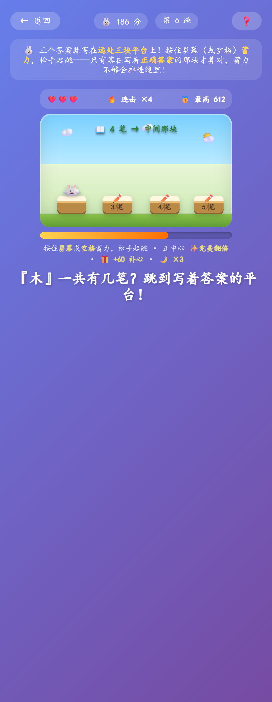
  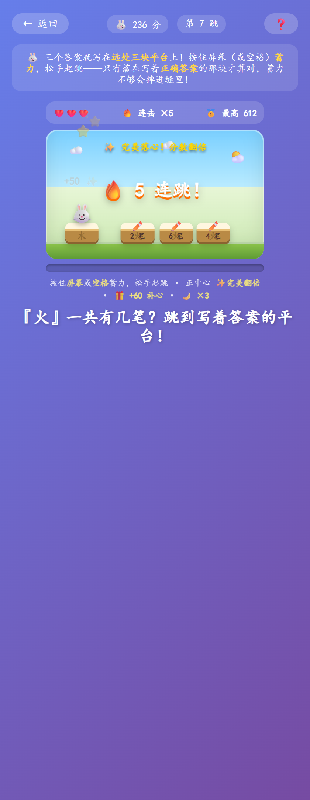
  
</p>

### 🎳 笔顺保龄球（答对拿大力球，瞄准口袋位一票全倒）

把保龄球搬进手机：**能不能进袋，取决于笔顺题答得对不对**——答错只能拿软绵绵的"奶油球"，同一角度最多扫倒三四瓶：

- 💪 **答题决定球的硬度**：答对 → 🔵 大力球（球速快、撞瓶角度大、能连锁），答错 → 🟠 软球（能量衰减快、倒得少），错一题这一帧就亏大了
- 🎯 **答对才亮口袋位**：答对后球道上会出现一圈金色虚线"口袋位"（1-3 号瓶之间，真实保龄球的最优入射点），它是程序现场暴扫 −14°~+14° 全部角度算出来的**这一局真正能打全倒的角度**
- 📐 **会走的瞄准线**：黄色瞄准线左右来回扫，按空格 / 点屏幕定角度；线越歪越容易吃边沟，节奏感 + 判断力双重考验
- 🎳 **物理是真算出来的**：球逐格爬球道、撞瓶后按左右偏转、能量逐帧衰减、飞出去的瓶子还能再撞倒别的瓶（连锁深度 2），所以**全倒靠的是打进口袋位而不是蒙**——正中心直球反而会留 1-2 号分瓶
- 🕳️ **边沟会吃球**：球道两侧收窄，角度太大直接掉进边沟零得分，配音效告诉你这球废了
- 🧾 **标准十帧记分牌**：全倒记 X 加后两球、补中记 / 加下一球、第 10 帧最多三球，未定帧留空——孩子顺手就学会看真的保龄球记分表
- 🔥 **连击与横幅**：连续全倒触发「🎳 STRIKE!」横幅 + 彩带 + 上行琶音，补中亮 ✨，结算按总分/全倒/补中给星（`addStars()` 进总账）
- 🎮 空格 / 回车投球，键盘 1–4 作答；最高分、累计全倒 / 补中 / 倒瓶数 / 答题数 / 局数落盘（`hz_bw_best` / `hz_bw_strike` / `hz_bw_spare` / `hz_bw_pins` / `hz_bw_answers` / `hz_bw_games`）

<p align="center">
  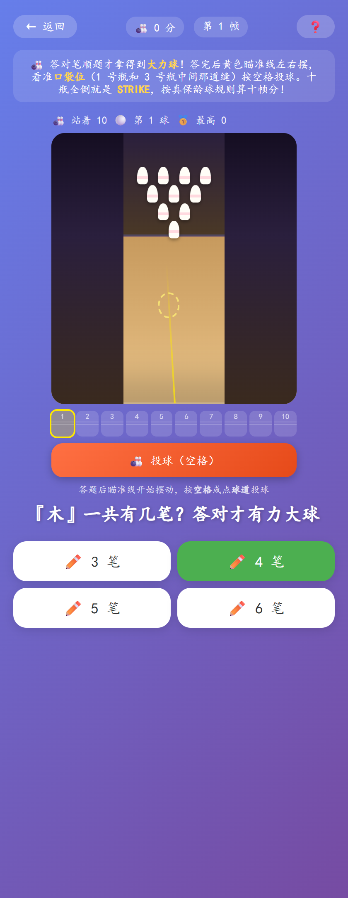
  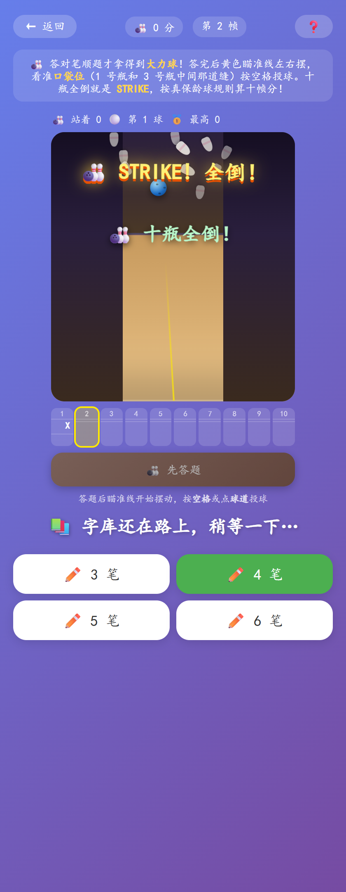
  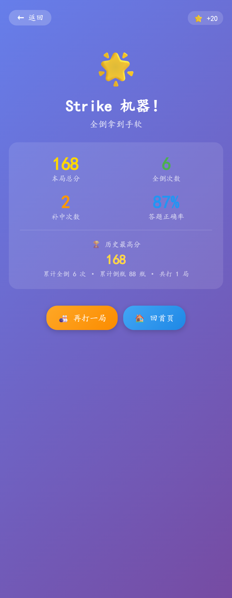
</p>

### 📦 笔顺推箱子（汉字箱推到笔画线索格上，一关一关推上去）

把最经典的推箱子搬进笔顺课堂：**箱子上写的不是编号，而是一个汉字和它的笔画数**；地板上的金色线索格只写要求——「4 笔」「首笔➡️」「末笔⬇️」。推哪只箱、往哪推，全看孩子会不会数笔画、记笔顺：

- 🧠 **一格就是一道选择题**：把「木 4 笔」推上「4 笔」格算对，推上「首笔⬇️」格立刻判错，判词还会把这只箱子的『笔画数 · 首笔 · 末笔』整条念一遍——**数笔画和辨首末笔两种练法混在一关里**
- 🚧 **推不动才是真难点**：箱后是墙、是另一只箱子就推不动，人得绕到对面去推，一步一算，比点选择题费脑子得多
- 🔁 **每一关都保证有解**：地图不是随机摆的，是程序从"已经全归位的终局"**倒着拉箱子**反推出来的，再用产品自带的 BFS 走法校验器现场走一遍，走不通的地图根本不会生成
- 👣 **步数预算 + 每关最佳**：真解步数当场算出来，按它给步数上限，HUD 实时显示「27/44 步」「过关参考 30 步 / 7 次推箱」，每关单独记最佳步数，剩 3 步会报警
- ↩️ **撤销不罚步、提示会指路**：按 U 退回上一步（走过的步数不退，防止无限试错），按 H 同时点亮该推的箱子和它的目标格 2.6 秒，只扣 12 分
- 🔥 **强反馈**：归位 → 箱子变绿 + 五声音阶上行 + 星星飞散 + 「✅「日」4 笔，和「末笔➡️」对上了！×3」，连击 3 / 6 弹横幅；放错 → 红圈闪 + 震屏 + 判词把正确笔顺再教一遍
- 🏅 **过关即进阶**：全部归位自动进下一关，棋盘从 5×5 一路长到 7×7，箱子 2 只长到 4 只，墙越摆越刁，但拉箱次数被压在小学生的耐心范围内
- 🎮 方向键 / WASD 走动、U 撤销、H 提示；屏下十字键、点相邻格、盘面滑动四向都能推，单手手机可玩（`hz_tk_lv` / `hz_tk_par` / `hz_tk_pushes` / `hz_tk_chars` / `hz_tk_best`）

<p align="center">
  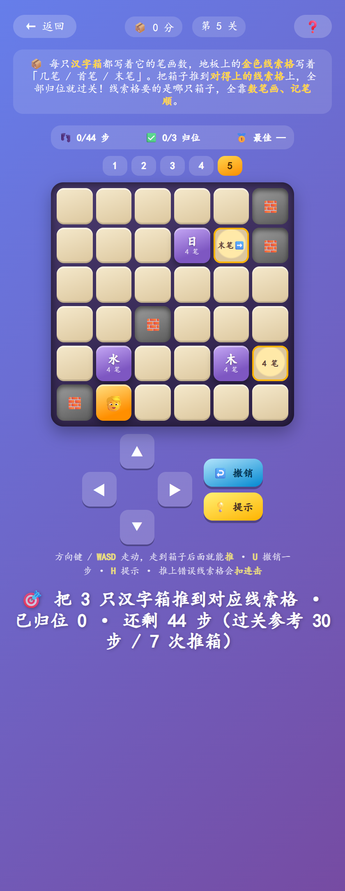
  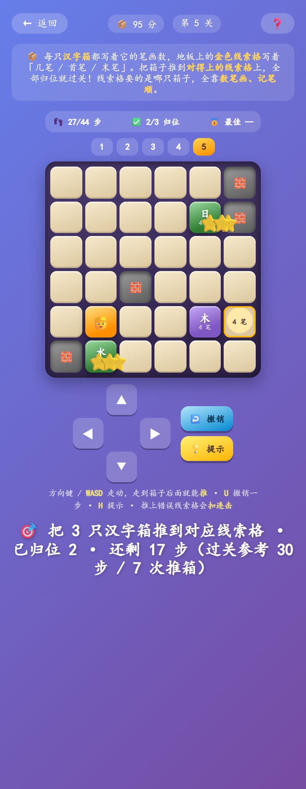
  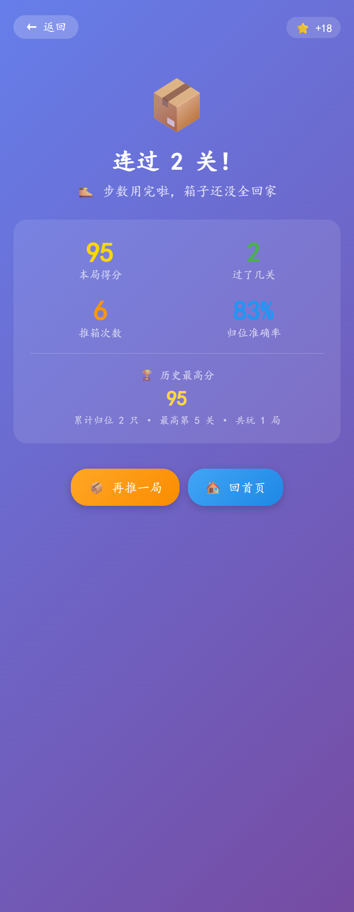
</p>

### ⚖️ 笔顺天平屋（汉字当砝码，凑够顾客要的笔画数）

开一间「汉字礼物摊」：顾客一上门就报一个数——**「我要买 11 笔的礼物！」**。货架上每个汉字都是一块砝码，**牌子上写着它自己的笔画数**。点字放上天平，天平是真的会歪：哪边重哪边沉，横梁回到水平的那一刻，就是加法算对的那一刻：

- 🧮 **数笔画变成了看得见的物理**：`木 4 笔 + 王 4 笔 + 小 3 笔 = 11 笔`，判词当场把整条加法念出来——**数笔画 + 口算加法**一次练两样，而且算错了天平立刻歪给孩子看
- 🥇 **一称就中**：一次没拿回、一次没放错就称平，额外大奖加横幅，逼孩子先把笔画数清楚再伸手
- 😡 **轻了和重了不一样**：轻了只提示「还差 N 笔」继续试；重了盘子砸歪、扣一颗 ❤️；三颗心没了就收摊
- 🕐 **顾客有耐心值**：进度条走完顾客就走掉了（第 1 档 28 秒，够小学生一笔一画数），档位越高越催
- 🎯 **高档位顾客会挑笔顺**：第 2 档起可能提出「每个字首笔都要↙️」——加法凑对了但字不合要求，盘子照样翻，笔顺方向躲不过去
- 🔥 **强反馈**：每上一块砝码按笔画数弹一个音、成交金盘 + 彩带 + 星星飞散、连击每 +1 单多 +15 分，每成交 3 单升一档（货架更长、砝码更多、订单更刁）
- 💡 **换一单扣 20 分**：这单实在凑不出来就换一单，只断连击不扣心
- 🎮 点货架字上秤、点盘里的字拿回来、空格称重、1-8 快速上货、H 换一单（`hz_bl_best` / `hz_bl_sold` / `hz_bl_exact` / `hz_bl_lv` / `hz_bl_chars`）

<p align="center">
  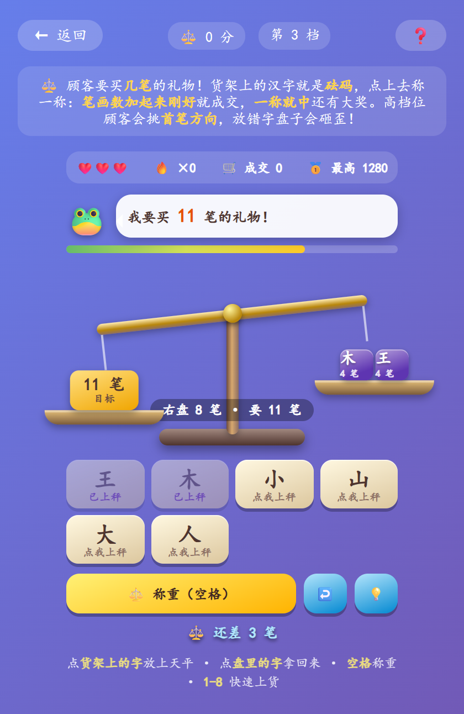
  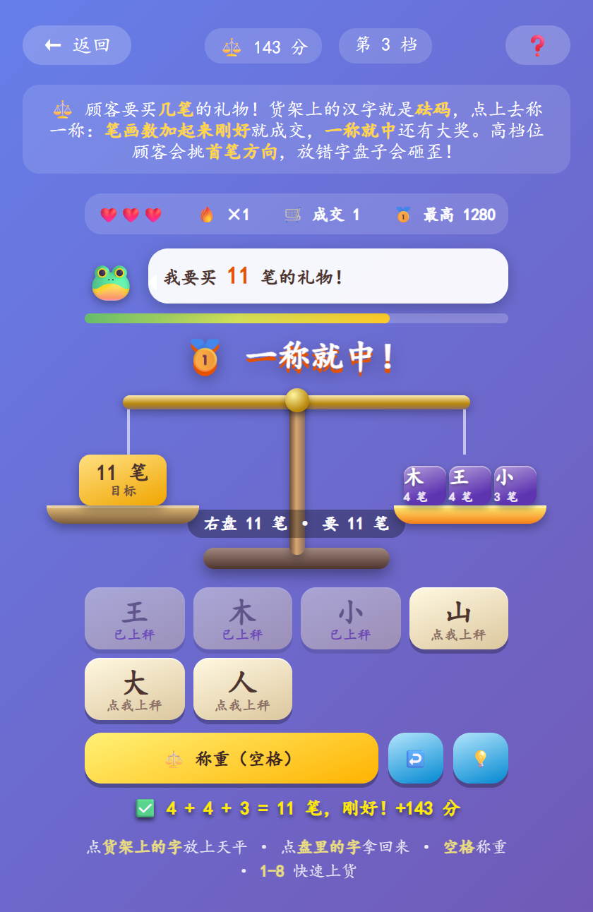
  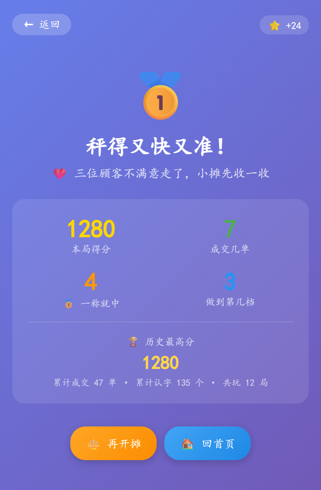
</p>

### 🕵️ 记忆翻翻屋（汉字和它的笔画数，藏在牌背后面）

一间「侦探事务所」接的新案子：**桌上摊着一排扣着的牌，一半写着汉字、一半写着笔画数**，一张字卡只能和属于它自己的那个数字配上。翻开两张，配上了就绿，配错了就红——而下一次翻开之前，孩子得先记住刚才瞥见的那一眼：

- 🧠 **练的是「记住」而不是「猜对」**：牌翻回去之后位置不变，第二对、第三对全靠上一眼记下的画面，短期记忆被反复调用，笔顺数就在一遍遍「刚才那个 3 画在哪儿」里记住了
- 🔒 **答案保证唯一**：每一关挑出来的汉字笔画数互不相同，一张字卡只有一个合法对象，孩子不可能靠碰运气蒙对，也不可能配出歧义
- ⏳ **沙漏代替生命**：配成一对回 4 秒、配错扣 2.5 秒，漏完就收队——想拖延不去记牌，时间反而会先跑光
- 🔍 **连对三次触发「侦探直觉」**：全场牌面自动亮一秒，把孩子的记忆奖励给他看，然后立刻扣回去——最上瘾的就是这一秒
- 💡 **两条求助通道**：点「看一对」花 5 秒只亮一对，按 🔍 花 8 秒全场亮一下，都是拿时间换信息，用不用由孩子自己权衡
- 🎯 **判词当场念答案**：配上时报「🎯 「口」就是 3 画！+60 分 · ⏳+4s」，配错时报「🙈 「山」和 4 画不配对，⏳−2.5 秒」，侦探再补一句「记住它们的位置，下次就不会翻错了」——读一遍就是一次复习
- 📈 **牌桌越玩越大**：第 1 关 3 对 6 张，每过一关多一对，最多加到 8 对 16 张；沙漏也跟着变长，但封顶 96 秒——要记的画面翻了一倍，时间却不会翻倍地给
- 💎 **完美搜查**：一局里一次都没配错，结算给钻石和额外 120 分，比单纯通关更值得吹
- 🎮 点牌翻开、一次翻两张、1-9/0 快速翻牌、H 看一对、P 全场闪视（`hz_mm_best` / `hz_mm_lv` / `hz_mm_pairs` / `hz_mm_perfect` / `hz_mm_games` / `hz_mm_chars`）

<p align="center">
  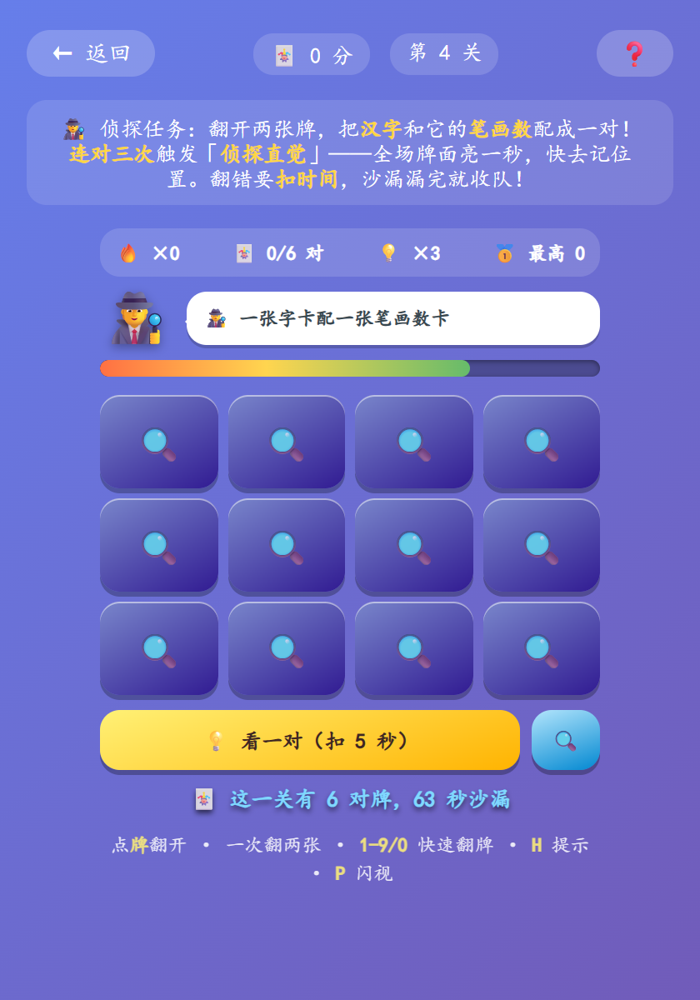
  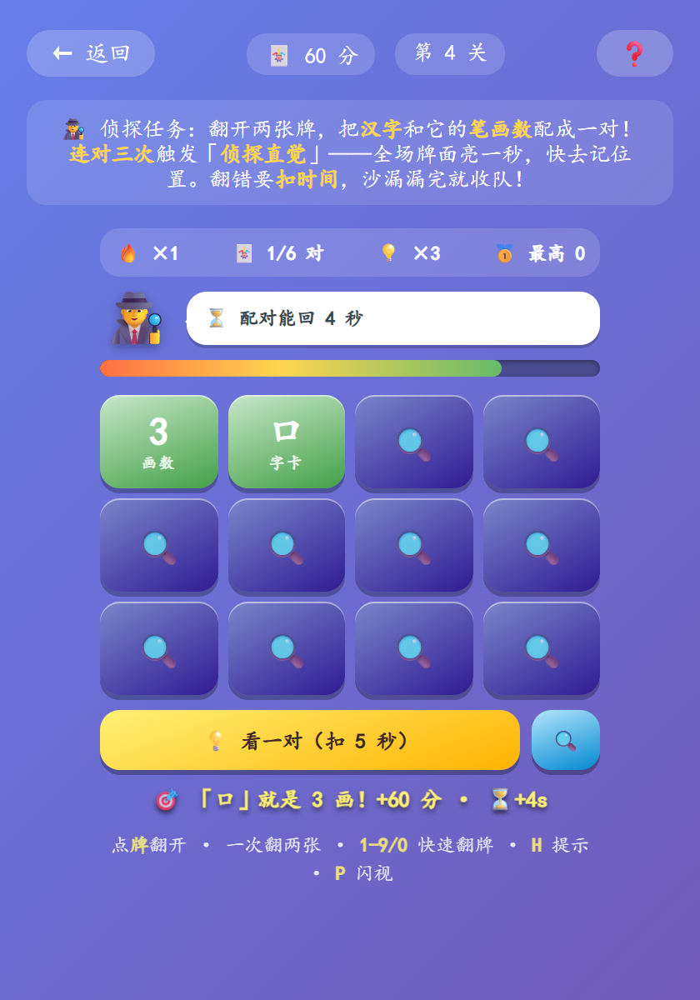
  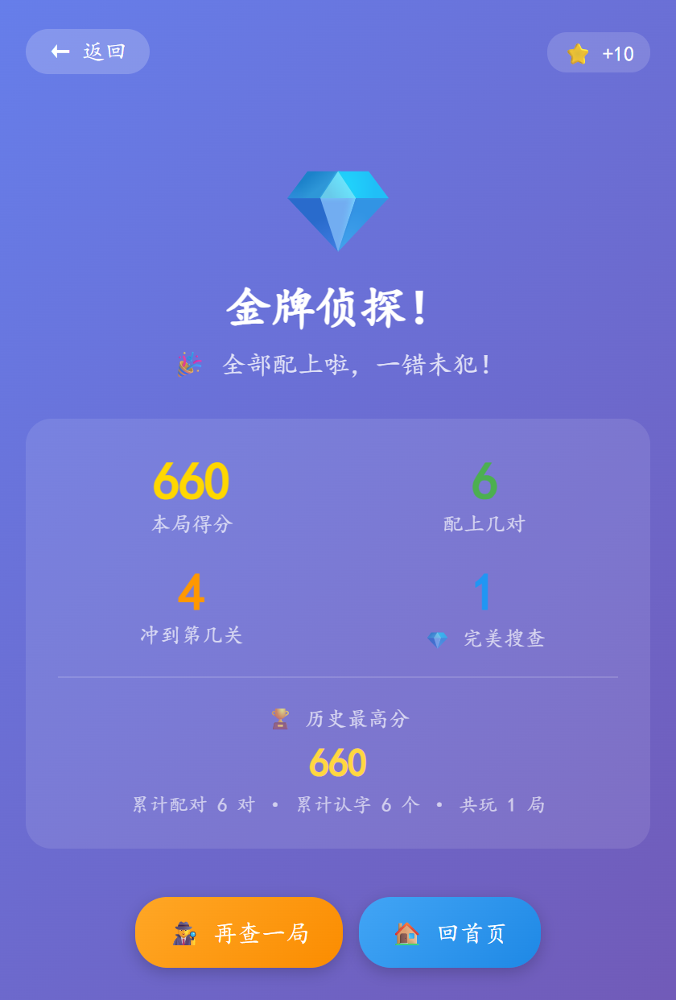
</p>

### 🧪 笔顺倒水杯（打翻的笔画墨水，一杯杯按方向倒回来）

实验桌上打翻了墨水：**横➡️ 红、竖⬇️ 蓝、撇↙️ 绿、捺↘️ 橙、点↗️ 紫**，五种笔画方向混在几只量杯里层层压着。玩法就是经典的倒水排序解谜——点一杯**拿起来**，再点一杯**倒过去**，但孩子马上会发现规则卡在笔顺上：**只能倒最上面那一段同色的水，而且只能倒进同方向的杯子里**。想把某一笔救出来，就得先想清楚它上面压着谁：

- 🧠 **倒水排序 = 排序思维**：谁压着谁、先给谁腾位置，一步棋错要退回三步——空间与顺序推理被反复调用，而判词只负责鼓励，不负责给答案
- 🎯 **参考步数是真的能走到**：每一关都由「已排好的笔顺」逆向打乱生成，打乱几次就是参考几步，所以盘面**保证有解**，孩子不会撞上死局，也不会觉得题目在骗人
- 🎨 **颜色就是笔画方向**：倒满一杯立刻报「🎉 倒满一杯 点（↗️）！「子」的第 1 笔就是它 +168 分」，下面那排笔顺小格同步亮起——一杯一杯倒完，这个字的笔顺走向也就顺着念完了
- 🔥 **连击越倒越响**：每倒一步 +6 分、连击每加一层多 +3 分，倒满一杯 80 + 连击×20 + 关卡×8，五声音阶一段段往上爬，星星从杯口飞出来
- 💎 **完美倒水**：一整关一次都没倒错（没试过颜色对不上、也没试过满杯），额外 +150 分和钻石，结算称号直接给「金牌调香师」
- 💡 **三条求助，各扣各的**：提示（每关 3 次，-20 分，把该倒的两只杯子描边 1.2 秒）、撤销（3 次，不罚分只断连击）、重摆（换个乱法重来，参考步数跟着变）
- 📈 **越往后杯子越多、水层越深**：第 1 关 3 种方向 / 3 层，每过 3 关多一种方向，第 3 关起水深变成 4 层，最多 5 种方向 7 只杯子；连过 5 关自动收工去结算
- 🎮 点杯拿起 / 再点一杯倒过去、1-8 直接选杯、H 提示、U 撤销、R 重摆（`hz_wc_best` / `hz_wc_lv` / `hz_wc_cups` / `hz_wc_perfect` / `hz_wc_steps` / `hz_wc_games` / `hz_wc_chars`）

<p align="center">
  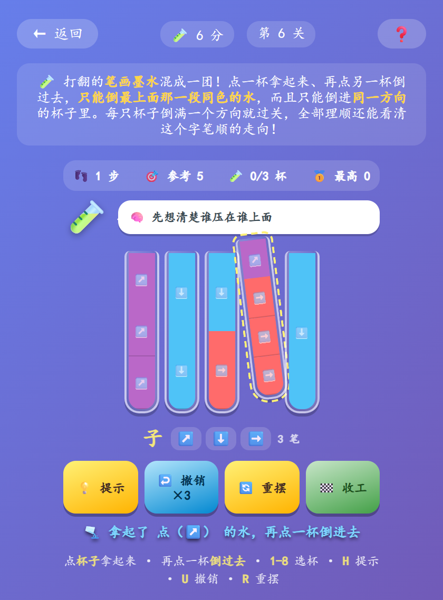
  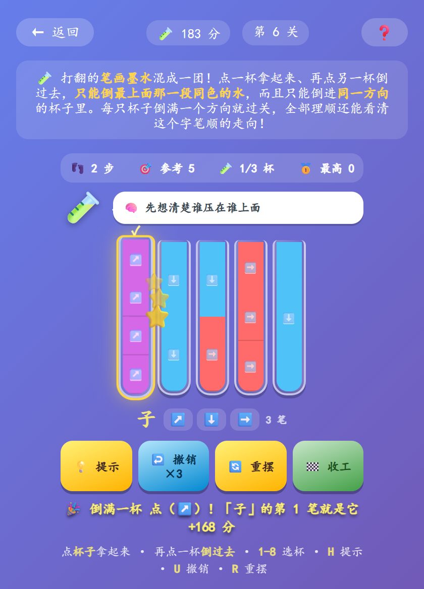
  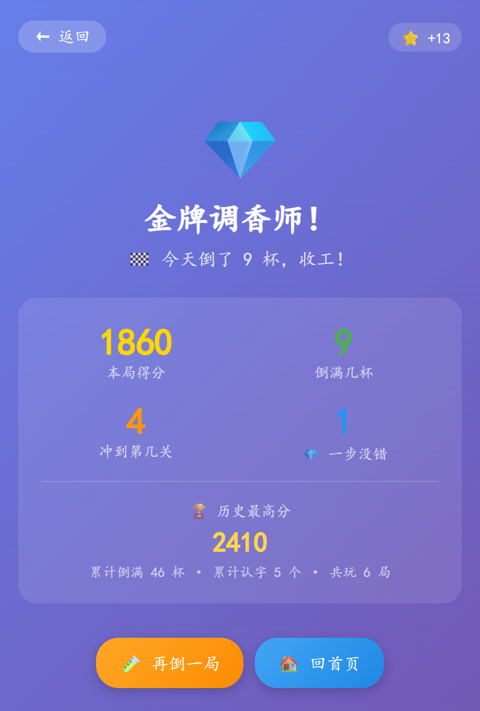
</p>

### 🫧 笔顺泡泡龙（答对装同色弹，瞄准三个连成一片炸）

天花板上挂着一整片**笔画方向泡泡**：**横➡️ 红、竖⬇️ 蓝、撇↙️ 绿、捺↘️ 橙、点↗️ 紫**。这是经典泡泡龙（射击三消），但弹药不是随便给的——**答对一道笔顺题，炮口才装上那一发**，而且装的颜色就是正确答案的方向。孩子要一边算「这一笔往哪写」，一边算「这一发该打到哪一片」：

- 🎯 **答案就是弹药颜色**：题目问「『二』的第一笔往哪写？」，答对「横」就装上一发**红色**泡泡——想打红色那一片，就必须先答对题，答题和瞄准变成同一件事
- 📐 **拖动瞄准 + 撞墙反弹**：虚线弹道实时预览，会在左右墙之间反弹，落点亮出虚线圈并标 `+3` / `+5`，一眼看出这一发能炸几个，空间与角度直觉在反复用
- 💥 **三个同色连成一片就炸**：六边形蜂窝盘（奇偶行 9/8 列错位），炸完还会做**悬空判定**——被炸断的那一串会整串掉下来，每个再算 20 分，一次「断链收割」比乱打十发都值钱
- 🔥 **连击越打越响**：连着炸合算连击，每片分数 ×(1+0.3×(连击-1))，连击 ≥6 时答对一题直接发**两发**，屏幕中间甩出「连击 ×N!」
- ⬇️ **顶上会压下来一行**：每打 7 发（越往后越快，最少 4 发）顶上挂下新一行，泡泡越过黄色警戒线就收工——答错也压一行，所以「瞄得准」和「答得对」同样重要
- 🌈 **一关关打干净**：把整片泡泡全炸光直接 +180+60×关卡 并放彩带进下一关；颜色从 3 种涨到 5 种、初始行数从 4 行涨到 8 行，越往后越要挑着打
- 💡 **三条求助各扣各的**：提示（每关 3 次，-20 分，扫遍所有角度挑最炸的一发并给它邻居描边）、撤销（3 次，把这一发原样收回不罚分）、换一题（-15 分）
- 🎮 在盘面拖动瞄准 / 松手发射、←→ 微调、空格发射、1-4 答题、H 提示、U 撤销、R 换题（`hz_bb_best` / `hz_bb_lv` / `hz_bb_pops` / `hz_bb_drops` / `hz_bb_shots` / `hz_bb_games` / `hz_bb_chars`）

<p align="center">
  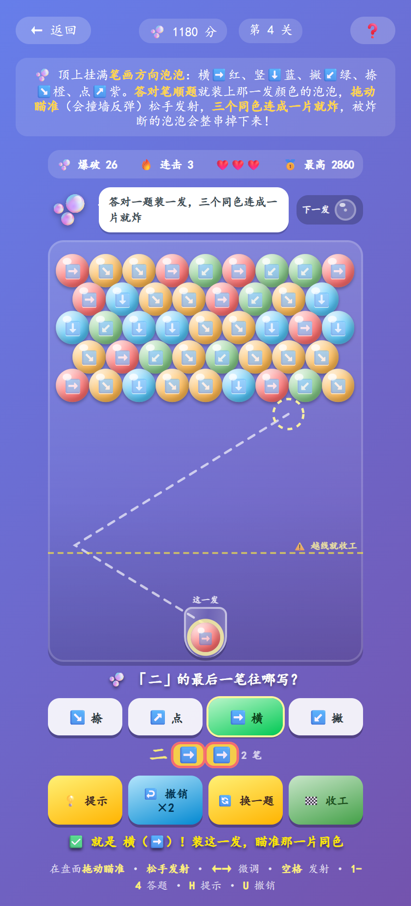
  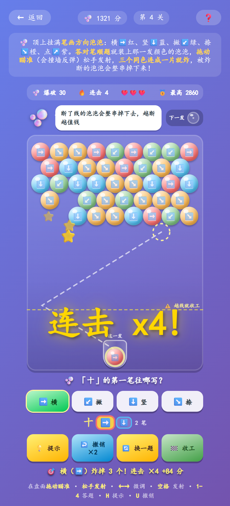
  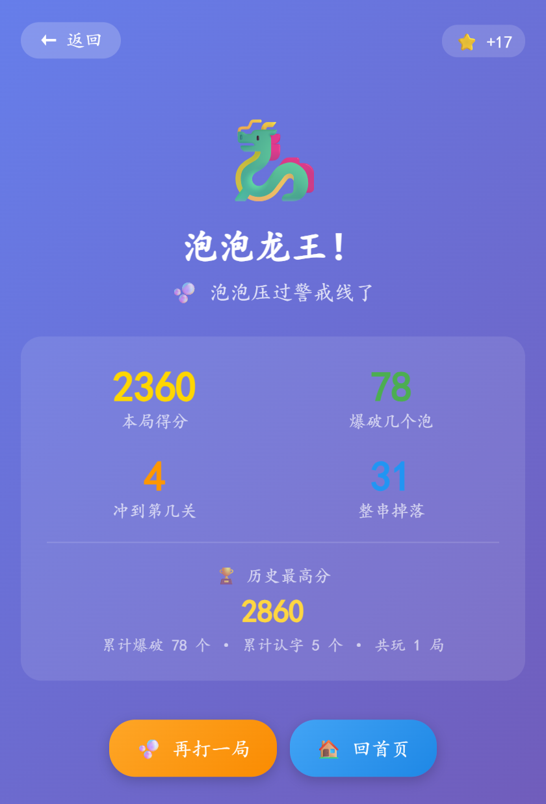
</p>

### 🎲 笔顺大富翁（掷骰走汉字小城 · 答题赚金币 · 买地收租）

一座 16 格的**汉字小城**绕成一圈：`学校大门 → 写字摊 → 一笔巷 → 神秘屋 → 二文铺 →…`，每块地皮都写着一个汉字。孩子和 AI 对手「小墨」轮流掷骰子走格，**先攒够目标金币的一方赢**——而金币的主要来源不是运气，是笔顺：

- ✏️ **写字摊是提款机**：踩到 4 个写字摊就答一道笔顺题（几笔？这一笔往哪写？），答对当场进账 `26 + 连击×6 + 关卡×3` 金币，连击越长越肥；答错只扣 14，不驱赶孩子
- 🏠 **买地才收得到租**：无主地（一笔巷 60 → 大雨城 180）当场能买下，对手再踩到就交 `地价×30%` 过路费；踩自家地可**翻修**，一级再涨 `地价×24%`，角标 `×2 ×3` 一眼看清投入
- 🎁 **神秘屋抽事件卡**：10 张卡有赚有赔——写春联 +30、老鼠叼走零钱 -22、免租卡 🛡️（挡一次过路费）、免费翻修、再掷一次 🎲、坐公交回起点补薪水，运气也讲策略
- 💰 **经过学校大门就发薪水**：走一圈保底进账，越往后关卡薪水越高（22 → 34），答错也不至于破产出局；破产两次或金币清零才判负
- 🐼 **小墨会算账**：AI 按关卡提升答题正确率（54% → 86%）与买地欲望（50% → 92%），第 1 关温柔、第 6 关开始抢地盘，孩子始终有个「刚好打得过」的对手
- 🔁 **反悔不罚款**：每局 2 次反悔，把棋子、金币、地皮、回合整体退回上一次掷骰前——鼓励孩子「想清楚再走」而不是乱掷碰运气；提示（3 次）划掉两个错答案，代价是这一笔奖励打六折
- 📈 **过关涨目标**：目标金币 240 → 636、回合 22 → 34，赢了自动开下一关；累计收租、置地、认字都进结算屏，`纪录` 一栏盯着历史最高金币
- 🎮 点**掷骰子**或空格、1-4 答题、点格子看这块地的行情、H 提示、U 反悔（`hz_mf_best` / `hz_mf_lv` / `hz_mf_wins` / `hz_mf_rent` / `hz_mf_estates` / `hz_mf_games` / `hz_mf_chars`）

<p align="center">
  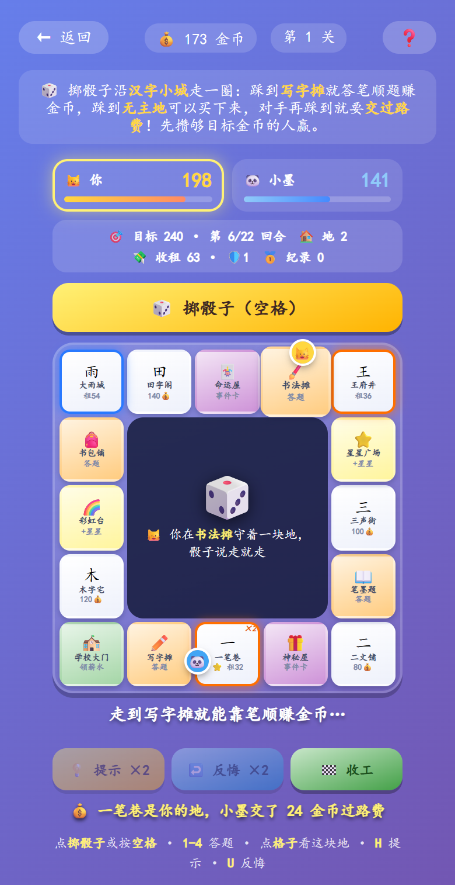
  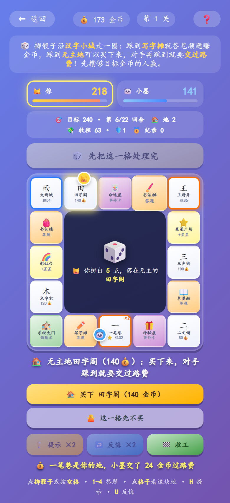
  
</p>

### 💧 笔顺水管屋（转管道引墨水 · 水阀必须按笔顺开）

一张 4×4 到 6×5 的**水管地图**：左边是**墨池**🖌️，路上钉着几颗**田字格水阀**🚰，编号 1、2、3……就是今天要写的**第 1 笔、第 2 笔、第 3 笔**。孩子点管道把它转一格，墨水会自己顺着接好的管子一路淌过去——但**关着的水阀是单向阀门，墨水顶到就停**，所以想开第 2 号阀，必须先把第 1 笔答对：

- 🔒 **笔顺就是物理规则**：越位顶到的阀门会当场抖一下并说「墨水堵在第 3 号阀，得先开第 1 号」——写倒笔顺在这个游戏里是真的通不了水，比十句提醒都管用
- 🧩 **一格一转，墨水自己找路**：直管 ⟪I⟫ 和弯管 ⟪L⟫ 混排，转对了墨水「咕」地往前推一格并亮起、音阶一格一格往上涨；转错就是转错，随时 ↩️ 转回原样
- 🎯 **每开一阀答一笔**：面板问「『永』的第 2 笔往哪写？」，四个方向选项（➡️ 横 / ⬇️ 竖 / ↙️ 撇 / ↘️ 捺 / ↗️ 点），答对 +60 分并按连击加成，答错扣一颗心但**管子不用重转**，再答一次就行
- 🏅 **一步不差才算真会**：每关开局就按真实解算出「参考步数」，收工时转管数 ≤ 参考步数直接甩出「💧 一步不差！」横幅 + 完美奖励，逼孩子先看清整条路再动手
- 🌊 **一关关涨难度**：第 1 关 16 格 2 阀、每 2 关多一颗阀，格子最多涨到 30 格 5 阀、干扰管最多 8 根；倒计时 50–85 秒，**答题时自动暂停**，不会一边想笔顺一边被时间追着跑
- 💡 **三条求助各扣各的**：提示（每关 3 次，闪一根真转错的管子，代价是扣 5 秒）、转回（3 次，把上一根管子原样退回、步数也退回）、重新打乱（R 键，同一张图换个乱法，分数关卡都不掉）
- 📈 **成长都在账上**：累计开水阀、通关数、完美关、认过的字分开记账，结算屏给「水管大师 / 越通越顺」称号，星星进总账
- 🎮 点**管子**转一格、1-4 答水阀题、H 提示、U 转回、R 重新打乱（`hz_pi_best` / `hz_pi_lv` / `hz_pi_valves` / `hz_pi_levels` / `hz_pi_perfect` / `hz_pi_games` / `hz_pi_chars`）

<p align="center">
  
  
  
</p>

### 🧸 笔顺娃娃机（一爪一题 · 夹中才考这个字 · 答对才落袋）

一台**竖屏娃娃机**：箱子里堆着七八个会互相挤压、会弹跳的娃娃，每个娃娃挂着一个真实汉字——**爪子落下去夹住谁，就问谁的第 N 笔**，答对了才搬去取物口落袋，答错它当场从爪子里滑回娃娃堆。孩子天生就懂这台机器的痛：「明明夹住了，怎么又掉了！」

- 🪙 **游戏币就是燃料**：落一爪花一枚币，**答对立刻返一枚**——答得准就能一直玩下去，乱抓八下就见底。第 1 关发 8 枚，之后逐关加到 14 枚
- 🧲 **抓取圈按稀有度收紧**：第 1 关爪子抓取半径 19.4px（一路缩到第 12 关的 13px），普通娃娃按这个半径算、稀有 ÷1.35、闪光 ÷1.7——**越值钱的娃娃越滑**，正上方偏一点点就空爪；爪子合拢前会实时判定，落点差之毫厘，夹上来的就是隔壁那个
- ✍️ **题目只问手里这个字**：面板写「夹到『禾』🐝 的第 1 笔往哪写？」，四个方向选项（➡️ / ⬇️ / ↙️ / ↘️ / ↗️），答对爪子往左挪去取物口、撒星星；答错扣一颗心、公布正确答案、娃娃**掉回堆里再弹一下**，爪子空着升回去
- 🏆 **闪光娃娃是硬通货**：8% 概率出闪光（分值 220 起、全屏彩带），稀有 22%（90 起）；连击每多一题单只娃娃贵 20%，第三只起触发连击特效
- 📖 **抓到的字进图鉴**：每个落袋的字记进 `hz_cw_book`，机台顶栏实时显示「📖 图鉴 N 个字」，跨局不清，孩子会为了凑字专门去夹没抓过的娃娃
- 🎯 **四种求助各管各的**：💪 强爪（下一爪抓取圈 ×1.9，3 次）、🎯 对准（站到最值钱的娃娃正上方，3 次）、💡 提示（划掉两个错答案，3 次）、🔀 换娃（整箱重新倒一遍，2 次）
- 📈 **关卡目标是「抓满几个」**：第 1 关抓 3 个、每两关加一个（最多 8 个），过关奖励按剩余游戏币结算，爱心回一颗、四种求助全部补满，箱子里的娃娃也变多
- 🏅 **结算与总账**：按过关数和抓到数量给「娃娃机大师 / 满载而归 / 差一点点就夹住」，最高分、最高关、累计抓娃、闪光娃娃、答对题数、落爪次数、局数分开记账
- 🎮 **拖动**爪子瞄准 · **空格 / 双击**落爪 · **1-4** 答题 · **J** 强爪 · **N** 对准 · **H** 提示 · **T** 换娃（`hz_cw_best` / `hz_cw_lv` / `hz_cw_dolls` / `hz_cw_shiny` / `hz_cw_answers` / `hz_cw_drops` / `hz_cw_games` / `hz_cw_book`）

<p align="center">
  
  
  
</p>

### 🔮 笔顺弹珠台（答对一笔领一颗珠 · 撞进 ×5 大奖格）

一台**竖屏弹珠机**：钉阵从第 1 关的 6 排一路长到第 10 关的 9 排，底下是一排倍率奖格——**正中间 ×5，往两边依次降到 ×3、×2、×1**。规则简单到孩子一听就懂：**答对一笔才发一颗珠子**，珠子从顶上滑下来，一颗一颗撞钉子，最后掉进哪格就按哪格结算：

- 🎯 **答题是唯一的领珠方式**：面板问「『永』的第 5 笔往哪写？」，四个方向选项（➡️ 往右 / ⬇️ 往下 / ↙️ 往左下 / ↘️ 往右下 / ↗️ 往右上），答对收起面板进入瞄准，答错扣一颗心、当场把正确答案亮出来——**不答题，机器里一颗珠子都没有**
- 🕹️ **拖动瞄准、松手就投**：按住画布左右拖出虚线瞄准线（键盘 ← → 也能挪），松手或按空格投珠。重力 1500、碰钉弹性 0.42、每次弹跳带 ±15 的随机侧推，珠子走的是**真轨迹**，不是抽奖动画
- 🌟 **金珠翻倍**：连击 3 题以上，下一颗自动烧成**金珠**，落格分数直接 ×2，撞进中间格就是「🌟 头奖 ×5！」全屏撒彩带，单珠最高能拿五百多分
- 🧲 **三种求助各扣各的账**：💡 提示（每关 3 次，划掉两个错答案，-12 分）、🧲 磁铁（2 次，-15 分，下一颗会被**真的吸**向中间大奖格）、🔤 换题（3 次，-8 分，换一个字从第 1 笔重来，连击清零）
- 📈 **一关一个目标**：每关只发 10～16 颗珠，要在珠子投完前把「本关分」攒到 480～2180；过关剩的珠子按每颗 18 分折进奖励，爱心回一颗、提示磁铁换题全部补满，钉阵当场变密一档
- ✍️ **整字写完另算**：一个字的每一笔都答完，额外给「100 + 关卡×10」的整字奖励并自动换下一个字——所以**多答一题就是多一颗珠，也是离写完一个字更近一步**
- 🏅 **称号与总账**：结算按过关数和头奖次数给「弹珠大师 / 越投越顺 / 差一点点就够」，最高分、最高关、累计投珠、头奖、答对题数、写完的字全部分开记账，星星进总账
- 🎮 **拖动**瞄准 · **空格**投珠 · **1-4** 答题 · **H** 提示 · **G** 磁铁 · **T** 换题（`hz_pl_best` / `hz_pl_lv` / `hz_pl_jack` / `hz_pl_beads` / `hz_pl_answers` / `hz_pl_chars` / `hz_pl_games`）

<p align="center">
  
  
  
</p>

### 🧐 笔顺神探（只露几笔 · 从形近字里认出它）

全仓库唯一一个**笔画是题目**的模式：其它玩法都是「答对才有奖励」，这里则是把字一笔一笔露出来让孩子**认字**——米字格里只有前两笔，四个候选字长得几乎一样，靠笔画的走向和形状判断到底是谁。孩子会自己喊出「我知道！」，因为答案就在屏幕上，只是要看清每一笔。

- 🔍 **逐笔线索，越要越便宜**：本案分值 = `(70 + 关卡×12) × 折扣`，每要一条线索按 `[100%, 74%, 55%, 40%, 30%, 24%]` 掉一档（保底 12 分）。**一条线索都没要就答对 = 🧠 一眼看穿 ×1.35**，屏幕正中盖下红色「结案」印章 + 全屏彩带
- 🖌 **四种线索**：`🖌 再露一笔`（把下一笔琥珀色高亮、顶上带方向角标）、`📏 共几笔`（说出总笔画数和还藏几笔）、`🧭 方向串`（➡️ ⬇️ ️ ↗️…整字的笔顺方向一次给全）、`🔍 排除`（每关 2 次，划掉两个不像的候选，-8 分）
- 🎯 **干扰项是真·形近字**：把每个字光栅化成 40×40 笔画轮廓，按「轮廓重合度 ×0.5 + 笔画数差 ×0.2 + 笔顺方向串最长公共子序列 ×0.3」算相似度，**候选永远是跟目标最像的那几个**（未/末、己/已、王/玉这种）；第 4 关起只在**同笔画数**的字里挑干扰，前三关则混进一个明显不相干的送分选项
- 📓 **错字复仇手册**：看走眼的字自动记进 `hz_dt_book`（最多 12 个），下一局开局**第一个案子就是它**；只靠一条线索就认回来 → 当场销案 +60 分，手册清空时结算页会写「看错的字都认回来了」
- ❤️ **三颗心 · 答错不判死**：猜错扣一颗心、本案立刻贬值，但**白送一笔线索**（多露一笔），孩子可以盯着正确的字再来一次；心用完才结案
- 🔥 **连击加成封顶 3 倍**：连对不断涨（每连一击 +22%），答错清零；每关破满 3～5 案过关，奖励 `90 + 关卡×20 + 剩余心×25`，爱心回一颗、排除补满、关卡最高到第 12 关（候选从 4 个涨到 6 个、起手只露 1 笔）
- 🏅 **称号与总账**：按分数与破案的案子给「神探大师 / 一眼就认出你 / 破了不少案子 / 差一点点就看出来了」，最高分、最高关、连破纪录、累计破案、一眼看穿、答对、看走眼、局数分开记账
- 🎮 **1-6** 选字 · **S** 再露一笔 · **N** 共几笔 · **D** 方向串 · **H** 排除（`hz_dt_best` / `hz_dt_lv` / `hz_dt_streak` / `hz_dt_cases` / `hz_dt_easy` / `hz_dt_answers` / `hz_dt_miss` / `hz_dt_games` / `hz_dt_book`）

<p align="center">
  
  
  
  
  
</p>

### 🔴 笔顺四子棋（答案挂在列上 · 答对才落得进 · 和 AI 抢四连）

把「答题」变成「抢地盘」：七列六行的棋盘顶上挂着四个答案，**正确答案同时印在两列上**。答对了才落得进子，而且还能自己挑要占哪一列；答错，那颗子直接归 AI。孩子为了连成四子会主动去数笔画、辨方向——落点是自己选的，输了也只怪自己没看清笔顺。

- 🧠 **答案挂在列上**：一题四个答案占四列，正确的那个印在**两列**上，挑一列落子；倒计时（`11000-段位×750ms`，最短 5.2 秒）归零 = 手慢，AI 白捡一子
- 👥 **连击双子**：连击 ≥3 触发 🛡️ 护身（答错不送子），连击 ≥4 再开 👥 双子（两个正确列各落一子，一步占两地）
- 🎯 **答对才涨分**：单题得分 `(14 + 段位×3) × (1 + min(1.5, 连击×0.12))`，连击越长越值钱
- ⚫ **先连成四子的人赢**：横/竖/两条斜线都算，赢一盘 `120 + 段位×40 + min(60, 连击×6)` 分，四颗子点亮金框 + 全屏彩带；棋盘下满没人连上算和棋 +30 分
- 🥉 **三颗挑战星**：输一盘掉一颗，掉完收官；段位按本局胜局升到 `min(8, 1+胜局)`，从「新手村」一路下到「棋坛小神童」
- 🤖 **AI 会成长**：失误率 `max(.10, .45-段位×.05)`、来堵你的概率 `min(.78, .20+段位×.12)`、思考 `max(420, 1000-段位×70)ms`。新手村的 AI 常常忘记堵你，高段位会先收官、再堵人、还会算「这一手会不会送你四连」
- 💡 **三种求助**：`💡 提示`（每局 2 次，划掉一个错答案列）、`🔀 换题`（2 次，同一个棋盘换一个字的题）、`⏪ 悔棋`（1 次，把上一手你和 AI 的子一起收回）
- ⚖️ **实测平衡**：让一个「每次都答对、还会挑更好落点」的机器人自玩 60 盘/段位，lv1 胜率 80%、lv3 75%、lv5~8 约 45%——低段位敢下，高段位要算
- 🎮 **1-7** 选列落子 · **H** 提示 · **T** 换题 · **U** 悔棋（`hz_c4_best` / `hz_c4_lv` / `hz_c4_streak` / `hz_c4_games` / `hz_c4_wins` / `hz_c4_losses` / `hz_c4_answers` / `hz_c4_miss` / `hz_c4_slow` / `hz_c4_boards`）

<p align="center">
  
  
  
  
</p>

### 📸 笔顺闪现（大字只闪一下 · 凭这一眼答题 · 答对的字永久留在记忆墙）

其它玩法都是「看着字答」，这一个偏不让看：米字格里的大字只闪 1.85 秒（九段只剩 0.65 秒），快门一亮字就收走，屏幕上空空如也——它**第几笔往哪写**、**一共几笔**、**刚才到底是哪个字**，全凭孩子脑子里留下的那一眼。练的正是「看一眼就记住」的整体字形识别，而不是逐笔描红。

- 📸 **一眼定分**：闪字时长 `max(650, 2000-段位×150)ms`（一段 1.85 秒、九段 0.65 秒），答题限时 `max(6000, 11000-段位×600)ms`；快门闪白 + 笔画碎开的粒子，字是真的「被收走了」
- ❓ **三种题型**：`第 N 笔往哪写`（四个方向箭头）、`一共几笔`（四个数字）、`刚才是哪个字`（三段起，四个**形近字**候选，复用神探那套字形相似度引擎挑「日/曰/目」这种近亲）
- ⚡ **一眼记住 ×1.35**：限时前 40% 就答对，说明这一眼确实看清了；🔥 **连拍 ×1.5**：连击 ≥5；👥 **双子 ×1.6**：六段起一次闪两个字并点名「左边那个字」，记的是一幅画面而不是一个字
- 🧠 **过目不忘**：连击 ≥3 时下一张多给 0.5 秒——状态越好眼睛越毒，形成正向循环
- 🔄 **再看一眼 ×2**：把这张字再闪一遍（只有正常时长的 60%），代价是这题得分 ×0.5；✂️ **排除 ×2**：剪掉两个不相干的候选 -8 分
- 👀 **答错就现场教学**：错一次掉一颗记忆星（3 颗用完收官），但那个字会**重新亮回来**，被考的那一笔染成金色并贴上方向标签，判词直接写明「『有』第 5 笔是 ➡️ 往右」——看错一眼胜过抄十遍
- 🧱 **记忆墙**：答对的字当场盖上墙（新字弹跳高亮），并跨局存进 `hz_fl_wall`（滚动保留最近 48 个字），一局一局攒出自己的识字量
- 🎯 **计分与段位**：单题 `(16 + 段位×4) × (1 + min(1.6, 连击×0.14))` 再叠乘上面的加成；段位 `min(9, 1+答对数÷4)`，从「快照学徒」一路升到「最强大脑」
- 🎮 **1-4** 选答案 · **R** 再看一眼 · **X** 排除 · **空格** 立刻下一张（`hz_fl_best` / `hz_fl_lv` / `hz_fl_streak` / `hz_fl_cards` / `hz_fl_easy` / `hz_fl_answers` / `hz_fl_miss` / `hz_fl_games` / `hz_fl_wall`）

<p align="center">
  
  
  
  
</p>

### 🔤 笔顺猜字（逐笔翻彩牌 · 用最少次数揪出那个字）

把 Wordle 的推理快感搬进笔顺里：系统从字库里挑一个**藏起来的字**，只告诉孩子它几笔，并把 10~20 个候选字摊在桌上。随便点一个去猜，这个字就**一笔一笔翻出彩牌**——🟢绿牌=方向和位置都对、🟡黄牌=这个方向它用了但站错了位、⬜灰牌=这一笔根本不是这个方向；更狠的是彩牌会**直接染到米字格的笔画上**，抽象的方向符号当场变回看得见的字形。练的是「拿笔顺反推字形」，猜得越准、次数越少，分越高。

- 🟩⬜ **两遍判定不虚报**：先数绿牌，再用目标字剩下的方向数黄牌，所以「多/夕」这种方向重复的字也算得清清楚楚，黄牌数永远不超过它真实还欠的方向数
- 🧩 **保证推得出来**：发牌时按方向串去重（`strokeTypes[ch].join('')` 相同的字只留一个），杜绝「两个字线索一模一样」的死局
- 💡 **亮一笔 ×2**：探出某一笔的真实方向，当场把不符的候选全划掉（-12 分、这局得分 ×0.7）；如果只剩一个可能，它会直接说「就是它」并且不扣这次提示
- 🔀 **换字 ×2**：另换一个字藏起来，代价是之前所有线索作废 + 得分 ×0.5
- ⚡ **四种爽感倍率**：🎯 一击即中 ×2、⚡ 闪电猜手（20 秒内猜中）×1.25、💡/🔀 用过打折，最后由 🧡 三颗爱心兜底收官
- 🏆 **段位与图鉴**：底分 `60+段位×14` 再乘 `1+min(1.2, 连胜×0.15)`，单题得分 `底分 × 剩余次数占比 × 倍率`；段位 `min(9, 1+猜中数÷2)`，从「猜字新手」一路升到「汉字大师」，机会次数从 6 次压到 4 次、笔画数从 3~5 笔涨到 7~9 笔；猜中的字永久存进 `hz_wd_book`（最近 60 个）
- 🎮 **1-9** 猜第几个字 · **H** 亮一笔 · **S** 换字 · **回车** 再来一局（`hz_wd_best` / `hz_wd_lv` / `hz_wd_streak` / `hz_wd_wins` / `hz_wd_guesses` / `hz_wd_miss` / `hz_wd_games` / `hz_wd_gsum` / `hz_wd_book`）

<p align="center">
  
  
  
  
</p>

### 🏗️ 笔顺小镇（按笔顺砌砖赚材料 · 盖楼收租的放置经营）

43 个模式都在考「这一下点得对不对」，小镇考的是**长期**：把笔顺练习变成上班。孩子先到工地**按笔顺点砖**砌墙换 🧱 材料，再回小镇拿材料 + 💰 金币盖楼；楼一旦盖起来就**每秒自动产金币**，连关掉页面都在偷偷攒，于是「练字 → 赚材料 → 盖楼 → 收租 → 想再来一班」自己转了起来。练的还是同一件事：砖上写的是**笔画名**（横 / 竖 / 撇 / 捺 / 提），必须按这个字的真实笔顺点下去，点错了墙就塌。

- 🧱 **按笔顺砌砖**：米字格里摊着一堆打乱的砖，每块砖压着这个字某一笔的位置；点对了砖「飞」上墙、那一笔当场染成金牌，连击越高额外材料越多，一整面墙一堵不塌还有 **完美 +2** 奖励
- 👷 **上班要掐表**：班次从 40 秒起，小镇等级越高班越长（封顶 75 秒）；点错塌一块 **-2 秒 + 连击清零 + 整屏抖动**，🧤 护手手套能吃掉一次点错（不断连击不扣时），⏱️ 加时卡上班自动吃（一张 +8 秒，最多 90 秒）
- 🏗️ **8 张图纸逐级解锁**：🏪 小卖部 → 🥟 饺子馆 → 📚 汉字书屋 → 🏮 灯笼铺 → ⛲ 喷泉广场 → 🗼 笔顺钟楼 → 🎪 汉字戏台 → 🏯 汉字城；造价 `5 金 2 料 × 1.55^级`，每栋 9 级封顶，**小镇等级 = 所有楼等级之和**，解锁门槛 0 / 2 / 5 / 9 / 14 / 20 / 27 / 36 级
- 💰 **关掉页面也在赚钱**：楼每秒产 0.5~17 金币，钱包上限 = 产出 × 180；回来时按上次在线时间补算离线收益（最多补 1 小时），首页那张卡片上会挂着一个 **💰N 红点**喊孩子回来收租——这就是第二天还愿意打开的理由
- 🏘 **看得见的成长**：天际线上的楼随等级越长越大，称号从「一块荒地」一路升到「汉字皇城」（8 档）；砌满过的字永久收进 📖 小镇图鉴
- ⭐ **结算**：工钱 `10 + 5 × 墙数`、星星 `min(20, 1.6×墙数 + 最高连击÷6)`，最佳单班材料与累计砌墙数都会记下来
- 🎮 **W** 去工地 · **C** 收租 · **1-8** 盖对应那栋楼 · 砖角数字 **1-9** 点砖 · **回车** 下工再来一班（`hz_tw_b` / `hz_tw_coin` / `hz_tw_mat` / `hz_tw_purse` / `hz_tw_seen` / `hz_tw_work` / `hz_tw_best` / `hz_tw_games` / `hz_tw_buy` / `hz_tw_prop` / `hz_tw_pl` / `hz_tw_book`）

<p align="center">
  
  
  
  
</p>

### 🗡️ 笔顺无双（踩在一个巨大的字上割草 · 撞对一笔才拔刀）

前面 44 个模式都是「答一题、动一下」，这一个是**站在字上打怪**：竞技场地板就是今天要练的那个字（1024×1024 的真实字形轮廓），四面八方涌来的「倒笔怪」每只顶着一个笔画名——横、竖、撇、捺、提。孩子操控小侠客自由跑动，**只有撞上「下一笔」那只才会拔刀**：一刀横扫一圈，那一笔当场金光刻进脚下的字；撞错了不掉进度，只掉血。于是要在当前几十只怪里认出「第 3 笔是撇」的那一只并冲过去，练的是**笔顺的直觉**，而不是选择题的手速。字一笔一笔被刻满，就通关换下一个字，波次更高、怪更凶。

- 🗡️ **撞对才拔刀**：贴身撞上顶着正确笔画名的怪 → 横扫半径内一圈全清 + 金色冲击波 + 那一笔染成金牌刻进脚下的字，连击一路涨；**撞错** → -14 点血、连击清零、整屏抖动，判词还会把「它顶的是竖，这一波要找横」再念一遍
- 🌊 **波次会自己变难**：第 1 波只出 3~5 笔的字、1.5 秒一只、同屏 7 只；越往后字越复杂（8~9 笔）、怪越快（38 → 98 px/s）、越密（0.54 秒一只、同屏 24 只），第 4 波起混进紫色的精英怪（掉 3 倍经验珠）
- 🔍 **脚下的字会「看不清」**：第 1~3 波地板字淡淡亮着当答案，第 4~6 波更淡，**第 7 波起完全消失**——这时候孩子只能靠脑子里那套笔顺打，这才是真正的验收
- ⬆️ **升级三选一（Roguelike）**：吃经验珠攒满就暂停，从 7 门绝学里挑一门：⚔️ 刀光更宽（横扫 +9）· 👟 轻功了得（移速 +8）· 🧲 吸星大法（吸取 +12）· 🛡️ 护心镜（上限 +25 并回血）· 🔥 杀意沸腾（经验 +25%）· ❄️ 剑气更快（冷却 -1.1 秒）· 🌿 回春诀（每秒回血 0.8），每门都有层数上限，每局从零开始重挑——「这一局 build 不一样」就是想再来一场的理由
- ⚡ **剑气与号角**：空格放一圈剑气，半径 94 内全清但**不刻字**（那一笔还得自己撞对），8 秒冷却；实在找不到正确那只时按 **H 报一笔**，号角会牵一只发光的过来并念出笔画名，一场只有 2 次、每次 -10 分
- 🏅 **成长看得见**：一笔不落地斩完一个字 → 收进无双图鉴、进入下一波，奖励分 `(30 + 8×波次 + 5×笔画数) × 段位加成 × 连击加成`，**一整场没掉过血再 ×1.35**；累计斩满 3 个字升一档段位，从「无双新秀」一路到「汉字无双」共 9 档，最高分 / 最高波次 / 最长存活 / 累计斩杀全部留档
- 🎮 **方向键 / WASD 或手指拖动**跑动 · **空格** 剑气 · **H** 报一笔 · **1-3** 挑绝学 · **回车** 再来一局 · **Esc** 回首页（`hz_mw_best` / `hz_mw_lv` / `hz_mw_chars` / `hz_mw_games` / `hz_mw_kills` / `hz_mw_wave` / `hz_mw_time` / `hz_mw_book`）

<p align="center">
  
  
  
  
</p>

### 🐑 笔顺堆堆消（层叠抽牌 · 三张同方向才炸）

「羊了个羊」式的**层叠抽牌**，但牌面上**不写方向**——只写着「**暖 第12笔**」。孩子抽之前看得见的是「哪个字的第几笔」，**抽进槽里的那一瞬间才翻出这一笔往哪写**。桌面是一摞压了好几层的牌（最高 5 层），被压住的一律上锁（🔒），只能抽最上面那张；下面挂着 7 个空槽，**同一个方向凑满三张才「砰」地炸掉**，槽挤满 7 张当场崩盘。于是每一张牌都要先在脑子里把那个字默写一遍：「暖的第 12 笔……是横还是撇？」练的是**笔顺的回忆**，不是乱点碰运气。

- 🐑 **抽了才知道**：牌面只印「字 + 第几笔」，落槽才亮出 ➡️横 / ⬇️竖 / ↙️撇 / ↘️捺 / ↗️点，五色彩牌按方向自动挨着排，连击越高爆破音阶越往上走
- 🔒 **压着的牌看得见摸不着**：判词直接告诉你为什么点不动——「🔒 『夕』的第 3 笔被压在下面了，先抽掉压着它的那层」，先决定拆哪一层，再决定凑哪一色
- ✨ **凑成一对会提醒你**：槽里出现第二张同方向时弹出「✨ 凑成一对——再来一张就炸」（+4 分）；可要是抽来一张槽里没有的方向，🙅「连击断了」当场清零。所以真本事是**先攒两对再连着炸**，这条技巧写在玩法提示里，也有专门的断言守着
- 💥 **一次爆破 = 三个字的同一笔**：判词把炸掉的三张当场念出来——「💥 三个「横」！ 读 第6笔 · 暖 第12笔 · 么 第1笔 都往横写 → +18 分」，炸过的字收进 📖 笔顺图鉴（跨局最多存 80 个，收录新字当场加星星）
- 🧯 **三种道具**：↩️ 退一张（把槽里最后一张塞回它原来那格）· 🔄 洗牌（牌面全部重发、方向张数不变）· 📤 挪三张（挪到架子上腾 3 格，点架子上的牌还能放回来）；第 1~3 关各 1 次，第 4 关起各 2 次
- 🏔 **6 档牌型**：从 5×3 格 2 层 21 张一路摊到 7×4 格 5 层 66 张，方向从 3 种涨到 5 种，整摞拆光就进下一关，**连击跨关不清零**——攒了一晚上的对子能在下一关一次炸穿
- 🏆 **段位与留档**：爆破得分 `15 + (连击-1)×6 + 关卡×3`，段位从「堆堆新手」到「叠牌至尊」9 档（累计通关每 3 次升一档），结算给出本局分 / 炸掉几组 / 冲到第几关 / 最长连击 / 拆掉几张，还差几张通关都会写清楚
- 🎮 **点牌**抽进槽 · **点架子上的牌**放回槽 · **1/2/3** 退牌 / 洗牌 / 挪三张 · **H** 看玩法（`hz_dd_best` / `hz_dd_lv` / `hz_dd_wins` / `hz_dd_games` / `hz_dd_pops` / `hz_dd_combo` / `hz_dd_tiles` / `hz_dd_book`）

<p align="center">
  
  
  
  
  
</p>

### 🏮 笔顺地宫（火把只照亮两格 · 找钥匙开石门 · 宝箱上刻着题）

前面 45 个模式都是「题目摆在脸上」，地宫把题**藏进了迷宫里**：一座随机生成的地下宫殿，手里一支火把只照亮身边一两格，其余全是黑的——走过的路会留在记忆里（暗黄），没去过的地方连墙都看不见。这一层的 🔒 石门必须先摸到 🗝️ 钥匙才开得动，而钥匙多半在最远的那个角落；路上每遇到一只 📦 宝箱，箱盖上就刻着一道笔顺题，**答得开才拿得到宝**。脚下还埋着看不见的 ⚡ 暗雷，踩过才知道。火把一直在烧，多走一步少一秒，于是「先看清 🗝️ 大概在哪头再动」变成了真本事，而练的还是那件事：**这个字的第几笔往哪写、一共几笔**。

- 🏮 **火把视野 = 记忆游戏**：第 1~4 层照亮身边 2 格、第 5~6 层只剩 1 格，黑格连里面有没有宝箱都不知道；孩子必须把看过的路记在脑子里绕路，撞墙只给一句「🧱 这一面是石墙」+ 整屏抖动，**不掉时间**
- 📦 **宝箱上刻着题**：60% 出「『气』的第 4 笔往哪写？」（➡️横 / ⬇️竖 / ↙️撇 / ↘️捺 / ↗️点 四选一），40% 出「一共有几笔？」；答对 +8 秒火把、连击越高分越多，答错 -6 秒并把正确项标绿再给一次机会——**答错两次这箱当场锈死**，这层就永远少一件宝藏
- ⏱️ **读题时火把自动停住**：题板一开，倒计时就冻住，不逼孩子边读题边掉时间；离开地宫去别家玩，计时器也会自己关掉，不会偷偷扣分
- 🗝️ **钥匙一定在最远的角落**：每层把钥匙放在离出发点 BFS 最远的那一间，没拿到钥匙时石门只会「纹丝不动」地提醒你去找它
- ⚡ **暗雷看不见，踩过才炸**：-1 颗心、-5 秒火把、连击清零，但那格从此在记忆里标着 ⚡（同一格不会炸第二次）——3 颗心炸完就得出洞
- 🕯️ **路上有补给**：🕯️ 灯油（视野永久 +1 格、火把 +6 秒、+12 分）、💧 清泉（❤️ +1，最多 3 颗），从第 3 层起才有
- 💡 **两种救急**：**H 照路**（每层 2 次）用 BFS 算出「🗝️ 宝藏/钥匙在 N 步外：先往东」并高亮下一格（-10 分）；**F 窜火把**（每层 1 次）10 秒内视野 +2 格，整层几乎全亮（-8 分）
- 🐉 **10 件宝藏图鉴**：🪙 五铢钱 / 🏺 陶罐 / 🦴 甲骨片（第 1~2 层）→ 🔔 铜铃 / 🈹 石印 / 🏮 宫灯（第 3~4 层）→ 🪞 铜镜 / 🔮 夜明珠 / 👑 金冠（第 5 层起）→ 🐉 **玉龙只有最深第 6 层才出土**（+96 分）；挖到过的字永久收进图鉴，首次收录额外 **+2 星**
- 🏔 **6 层越下越大、越黑、越快**：4×4(16 间) → 5×4 → 5×5 → 6×5 → 6×6 → 7×6(42 间)，每步耗时 1.0 → 1.4 秒，宝箱 1 → 4 个、暗雷 1 → 4 颗、火把 60 → 70 秒；迷宫用 DFS 生成后再拆掉三成死胡同留出回路，纯树形磨人的死路一律不留
- 🏆 **分数、星星与段位**：开门分 `80 + 30×层 + 35×已开箱 + 剩余时间×2（封顶 60 秒）`、首开宝箱 `40 + 10×层`、答案分 `(16+4×层)×(1+连击加成，最高 ×2.5)`；星星 `min(26, 总分÷45 + 逃出层×2 + 开箱)`；段位 9 档，从「地宫新手」到「汉字考古家」（累计每逃出 4 层升一档），最高分 / 最深层数 / 累计开箱 / 累计答题全部留档
- 🎮 **方向键 / WASD / 点相邻格 / 手指滑动**走动 · **1-4** 答题 · **H** 照路 · **F** 窜火把 · **回车** 再来一局（`hz_mz_best` / `hz_mz_depth` / `hz_mz_floors` / `hz_mz_boxes` / `hz_mz_answers` / `hz_mz_traps` / `hz_mz_runs` / `hz_mz_book`）

<p align="center">
  
  
  
  
  
</p>

### 🗺️ 笔顺星图（40 关蛇形山路 · 答对才把路往前修一格）

前面 47 个模式各练各的，星图负责把它们**串成一条走得下去的路**：40 个关卡节点蛇形盘成 5 个村子（🌱 笔画村 → 🏘️ 偏旁镇 → 🏯 部首城 → ⛰️ 汉字山 → 🌌 云海宫），出发时脚下只有第 1 关亮着——**答对题目才会把路往前修一格**。打的还是那些题（这一笔往哪写 / 一共几笔），但孩子第一次能亲眼看见「我走到哪儿了」。

- ⭐ **点亮制解锁**：过关按失误数给 3/2/1 星，星级只升不降；下一关必须上一关至少 1 星才亮，锁着的 🔒 点一下会告诉你差多少（「先把第 5 关打穿，路才会修到这里」），而不是甩给你一张全灰的表
- 🚪 **跨村要攒 16⭐**：每村 8 关满分 24⭐，上一村攒够 16⭐ 才修得出进下一个村子的路；村子越深题越多（6 → 10 题）、时间越紧（74 → 69 → 64 → 59 → 54 秒），字池按笔画数分 5 档（≤3 画 → ≥10 画），第 5 村的孩子已经在考十几画的繁字
- 🔥 **连击关只有一条命**：每村第 5 关，8 题全程 1 条命，答错当场断——逼孩子把已经会的那一笔写稳，而不是蒙
- 🎁 **宝箱关全对宝要多一倍**：每村第 7 关只有 5 题 48 秒，打完开箱，一错不错奖励翻倍（`90+45×村`，全对再 ×2）
- 🐲 **龙巢打的是血条**：每村尽头蹲着一条笔画龙，9 格血，答对砍 1 格、答错它回 1 格，砍空才算赢；屠龙额外 +2⭐ 与 220~780 分，当场撒彩带
- 📅 **每日星关**：地图外单独的一格，每天只能打一次（5 题 45 秒 1 条命），连打天数越多星越多：+3⭐ 起，每连一天 +1，封顶 +9⭐
- 🎇 **强反馈**：连击沿十档音阶往上爬调、答对从按钮中心飞出星星、龙血一格一格掉、屠龙撒彩带、结算的 ⭐ 直接送进首页的动物收藏馆（攒够就解锁新动物）
- 🏆 **段位 9 档**：星图新手 → 探路小侠 → 关卡猎人 → 连击新星 → 宝箱达人 → 屠龙勇士 → 星海行者 → 地图征服者 → 星图霸主（每 15⭐ 升一档）；单关最高分、点亮关数、最长连击、屠龙次数全部留档，首页卡片上会亮 🆕 红点提醒你新修出了哪一关
- 🎮 **点节点进关** · **1-4** 答题 · **Esc** 收摊回地图（这关不点亮） · **回车** 直接打推进到的那一关 · **H** 复述本关目标 · **D** 打每日关

<p align="center">
  
  
  
  
  
</p>

### 🧩 笔顺排排队（滑动推盘 · 把每一笔推回它的号位）

前面 48 个模式都在问「这一笔第几画、往哪写」，排排队把整个字**拆成一块一块方块**：盘面是华容道式的 3×3 / 4×4 推盘，每块方块上高亮着「凡」的一笔（其余笔画淡淡压在底下当影子，先认形再认序），每一格角上写着它该站第几笔。孩子要一边回忆笔顺、一边把方块推进空格，让 1 号位站第 1 笔、2 号位站第 2 笔——全对上的那一刻，这个字当场自己写一遍给他看。

- 🧲 **只认挨着空格的那一块**：点一块离空格还隔着一格的方块，它会当场抖一下并说「它挨不着空格」——推盘的路要自己让，先想清楚谁该进哪一格，不是乱推碰运气
- 🔒 **落对就锁死**：第 3 笔推进 3 号位立刻变绿打勾、从方块中心飞出一颗星、音效沿十档音阶往上爬一格；把它再推出去会掉锁，孩子自然会护住已经归位的方块
- 🪄 **提示「推一把」替你走一步**：每盘 2 次，只挑推完总距离真的变近的那块（步数照算，不白送）；盘面被堵死时它会说「先让开路，把挡着的挪走」，而不是给个错误答案
- 🔀 **重排 1 次**：盘面洗回乱序、步数清零，但计时不停——救急不救懒
- 📈 **4 档笔数带 · 盘面从 3×3 长到 4×4**：2-3 笔 → 4-5 笔 → 6-8 笔 → 9-12 笔，每 2 盘进一档；8 笔以内 3×3，9 笔起自动换 4×4（空格一多，让路就真变成一道谜题）；标准步数 = 打乱步数 ×1.6+4（封顶 44 步），时限从 95 秒一路压到 45 秒
- ⭐ **一步不差才算连击**：步数压进标准才给 3⭐ 并累计连击（加成最高 ×2.2），超了只给 2⭐；得分 = `基础(70+12×盘) × 连击系数 + 完美 45 + 剩余时间 ×1.5`
- 🌟 **图鉴收字**：每盘排完的那个字进 `hz_sl_book`（滚动保留 120 字），第一次排好额外 +2⭐——同一批字反复排不划算，孩子会主动往笔画更多的盘走
- 🥇 **段位按「累计归位笔数」涨**：推盘新手 → 滑动学徒 → 笔顺巧手 → 顺序达人 → 落位如飞 → 一步不差 → 归位高手 → 排排宗师 → 笔顺推盘王（每 25 笔升一档）——攒的是真推对了多少笔，不是玩了多久
- ⌨️ **方向键 = 往那个方向推**：↑ 把空格下面那块顶上来、← 把空格右边那块推过来，四个方向各走一格；`H` 复述玩法 · `P` 推一把 · `R` 重排 · 点顶部 ❓ 看规则

<p align="center">
  
  
  
  
</p>

### 🔊 笔顺回声（听一段亮灯，凭记忆把它按回去）

把「笔顺」变成一段能听、能复述的旋律：一个汉字的每一笔，会按书写顺序在五个方向圆盘（横➡️红 / 竖⬇️蓝 / 撇↙️绿 / 捺↘️橙 / 点↗️紫）上依次亮起，并发出由低到高的音。看一遍、听一遍，然后轮到你——凭记忆把它们原样「回声」回去。记对一轮就多一笔，一路记到整个字，字就当场自己写一遍给你看。

- 🧠 **先演示、后复述**：全仓库第一个「看着亮灯记顺序」的模式——演示时不许按，全靠脑子里那串灯光和音高，练的正是笔顺顺序本身
- 🎼 **方向即音高**：横最低、点最高，五笔五音，记不住顺序就先哼旋律，用听觉记忆给视觉记忆兜底
- 📈 **越记越长的上瘾阶梯**：每复述成功一轮就在队尾追加真实的一笔，从 2 笔一路加到整字，「再来一笔」的冲动让人停不下来
- 💥 **强反馈**：按对点亮圆盘 + 上行音阶 + 星星飞散；记满整字放彩带，`HanziWriter` 把这个字一笔一笔写出来
- ❤️ **三颗记忆心**：按错或想得太久断一笔扣一颗，扣光才结束——错了不重来整关，只把这一段重新亮一遍
- 🔍 **慢放 / 💡 下一笔**：两个求助，慢放重听（本轮得分 ×0.7）、提示下一笔方向（×0.5），用不用直接影响倍率
- 🏅 **段位 + 图鉴**：按累计记住的字数评 9 档段位（回声新手→汉字录音机），记满的字进 `hz_ec_book` 图鉴，最长记忆、复述总笔数全程记账
- ⌨️ **键盘可玩**：`1～5` 对应五个方向圆盘，`M` 慢放、`F` 提示、`H` 怎么玩，也能直接点圆盘

<div align="center">
  
  
  
  
</div>

### 🪝 笔顺甩金钩（看准摆动松手，越沉的宝贝越值钱也越难收）

矿洞里埋着一堆会发光的宝贝，头顶一把钩子正左右摆。答对一道笔顺题领一个钩子，看准钩尖摆到目标正上方那一刻松手——钩子笔直甩下去，碰到什么捞什么，再慢慢往回收。**越重的宝贝收得越慢**（小金币「叮」一下就上来，大金币要磨好久，石头沉得要命还只值 8 分），钱够本关目标数就进下一关：洞更深、摆更快、角度更斜。

- 🪝 **一眼就懂的核心手感**：钩子匀速摆动，孩子要做的只有「看准时机松手」这一件事，练的是节奏感和预判，失败也只想再来一次
- 🧲 **重量即物理**：收钩速度 = 绞盘速度 ÷（宝贝重量 + 0.35），💎 钻石轻得飞起来、🪨 石头沉到让人想砸屏——同样是捞上来，价钱和耐心完全不同
- ✍️ **钩子靠笔顺换**：每次答对「这个字几笔 / 这一笔往哪写」才 +1 个钩子（最多攒 3 个），答错钩子冻住 1.6 秒还扣 6 秒，逼着孩子为了捞宝去认字
- 🔥 **连击越打越值钱**：连着捞到宝物每连击 +14% 收益（最高 +160%），捞到第 6 件放彩带；碰上 🪨 石头连击立刻断，孩子自己就会算「这颗到底值不值得捞」
- 🎁 **七种宝物七种惊喜**：💰 三档金币、💎 钻石（分数最高）、⏳ 沙漏白赚 9 秒、⭐ 幸运星直接 +2⭐，各自不同音高与爆点
- 🛒 **跨局攒钱买装备**：累计金币不会清零，可买 ⏳沙漏背包（每关 +10 秒）/ ⚡强力绞盘（收钩快 30%）/ 📏加长钢缆（够得更深），今天的钱决定下次能捞多深
- 🏅 **九档段位**：按累计金币评 甩钩新手 → 铜钩学徒 → 铁钩快手 → 金钩少年 → 钻石猎人 → 矿洞老手 → 一钩千金 → 钩无虚发 → 汉字淘金王，最深一钩、捞中件数、答对题数全程记账
- ⌨️ **键盘可玩**：`空格 / Enter / G` 松钩，`1～4` 选答案，`H` 看玩法，也能直接点矿洞松钩

<div align="center">
  
  
  
  
</div>

### ☁️ 笔顺登云梯（四朵云上各写一个答案，只有写对的那朵踩得住）

头顶飘着四朵云，各写着一个答案，脚下这朵正在往下沉 —— 看清题目往哪朵跳：踩对了它才变成站得住的踏板，踩错了「噗」地穿云掉下去。一直往上爬会换天：🐤 田野 → 🐦 云层 → 🦅 月宫 → 🚀 银河，每进一片天 +30 分、换乘新坐骑、放一次彩带；三颗心掉完才结算，比的就是这一局登到了多少米。

- ☁️ **只有正确答案是实心的**：另外三朵是虚云，跳上去就穿过去炸掉，同时把对的那朵点亮并提醒「跳上去还能救回来」—— 试错本身就在逼孩子再看一眼题
- ⬇️ **脚底一直在沉**：站着的那朵云以 `20 + 4×层` 像素/秒往下掉，读完就得决定，盯久了连脚下的踏板都会没了
- 🎮 **空中漂移 + 一键瞄准**：按住 ⬅️ ➡️（或 `A`/`D`、点舞台左右两侧）在空中平移，`空格` 起跳；`1～4` 直接瞄准第几朵云自动飞过去，手小的孩子也能玩
- 🌈 **四朵彩蛋云**：🌈 彩虹跳（下一跳飞得特别高）、⭐ 幸运星（当场 +2⭐）、🫧 肥皂泡（坠落保险一次）、❤️ 暖心云（补回一颗心），踩到就飘走但好处立刻到账
- 🔥 **连对越爬越值钱**：每连对一朵分数 +13%（最高 +150%），连对 6 朵放彩带；踩错或坠落连击立刻清零
- ⏳ **卡住必有解**：四朵云飘了 4.2 秒还没人跳，就整批换新的重新聚拢，永远不会出现跳不到的局面
- 🏅 **九档段位**：按累计登高米数评 踩云新手 → 云朵学徒 → 轻步登云 → 登梯少年 → 穿云快手 → 月宫常客 → 摘星少年 → 银河飞人 → 踏云仙人，最高米数、踩对云朵、最长连对、坠落次数全程记账
- ⌨️ **键盘可玩**：`空格 / Enter / ↑ / W` 起跳，`← →` 或 `A / D` 漂移，`1～4` 瞄准某朵云，`H` 看玩法

<div align="center">
  
  
  
  
</div>

### ⛄ 笔顺滚雪球（题目写在球脸上 · 答对就长大一圈 · 够大才碾得碎）

雪球停在坡底，正在考的那个字就写在球脸上。坡上的东西一路往下压：❄️ 雪堆、🪨 石头、🌲 松树、⛄ 雪人、🧊 冰塔 —— 每样都标着自己的门槛直径，**绿圈碾得碎，红圈会把你连球带人撞翻**。答对一笔顺，「噗」地长大一圈；滚过 95 米换初雪坡、230 米进松林道、430 米滚到冰湖夜，三颗心滚完才结算，比的就是这一局滚了多少米。

- 📏 **门槛写在直径上**：❄️ 0 厘米、🪨 44、🌲 62、⛄ 84、🧊 104，答对一题半径 +6 厘米（直径 +12）—— 孩子一眼就懂「我为什么碾不过它」，而不是莫名掉心
- 💥 **碾得碎才值钱**：按硬度给 9～82 分并吃连击加成，碾过 ⛄ 雪人额外撒花并全局记账（累计碾过 N 个雪人），躲还是碾变成每一秒的取舍
- 💨 **连对 5 题触发雪球旋风**：4 秒内红圈也照碾、得分翻倍，球身罩一层金色光晕 —— 把「连对一串」变成看得见摸得着的力气
- 🎮 **越大越难拐**：转向加速度与横速上限都随半径往下掉（64 厘米的大球只剩三成灵活），滚得快也兜不住弯，贪大要付操作的代价
- 📉 **答错会缩水**：答错缩到 70%、连对清零还扣分；撞翻红圈 −1 心并缩到 62%，随后 1.3 秒无敌闪烁，让孩子看清自己刚踩了哪一下
- ⛰️ **每 60 米升一层**：答题限时从 9.5 秒逐层压到 4.6 秒、障碍越滚越密，换坡 +30 分放彩带，坡面从草坡一路换到夜色冰湖
- 🏅 **九档段位 + 个人纪录条**：按累计坡长评 滚雪新手 → 推车学徒 → 滚坡少年 → 雪球快手 → 碾石小虎 → 雪崩制造者 → 松林滚王 → 冰湖飞球 → 雪球之神；本局一超过历史最长坡，头顶距离条立刻转金并亮 🆕
- ⌨️ **键盘可玩**：`1～4` 抢答笔顺，`← →` 或 `A / D`（也可直接按住坡面左半边 / 右半边）让雪球左右滚，`H` 看玩法

<div align="center">
  
  
  
  
</div>

### 🏭 笔顺分拣厂（传送带一批批送字 · 看清规矩投筐 · 满筐就发车）

别的模式是「一题一答」，这一个是**流水线**：汉字被装进箱子，一只只从右边送上传送带，顶上贴着这一批的**分拣规矩**（笔画数 ≥ 5、第 1 笔是 丶（点）、里面含 ㇏（捺）……）。箱子滑到左边**红色闸门**之前必须投出去：符合规矩的进 ✅ 筐，不符合的进 ⛔ 筐，一筐装满 6 件就 🚚 发车拿大钱。三颗心，投错、漏单、碰炸弹都扣一颗，比的就是这一班挣多少工资。

- 📋 **一整批只练一条规矩**：每 8 件换一批、换一条规矩，同一批里孩子要连续按同一个标准判断十几个字 —— 笔画数、首笔、末笔、第 2 笔、含不含某一笔，一个知识点被反复敲进肌肉记忆
- ⚠️ **左右筐整批对调**：换批次时 ✅ 筐有半数概率跑到右边，逼孩子真的去读那条规矩，而不是形成「点左边」的手瘾
- 🚚 **满筐才结算大钱**：一件只给基础工资，装满 6 件「+46 起」的发车奖一次到账并放彩带 —— 把「稳」变成比「快」更划算的选择
- 💣 **炸弹箱千万别碰**：投了 −1 心 −10 分，放它自己滚出闸门反而 +14 分还记一件 —— 练的是「该不动手时不动手」的自制力
- ⭐❤️🎁 **三种插队箱**：⭐ 星星箱随便投都算对（并领 1 颗 ⭐）、❤️ 心箱补回一颗心、🎁 金箱双倍工资还占两个筐位，眼睛要一直钉在带子上
- 🏭 **早班 → 午班 → 夜班 → 特急夜运**：干到第 3、5、7 批换班次，车间背景、装饰物、带速一起换档（40 像素/秒一路提到 84 封顶），换班 +34 分撒花
- 🛡️ **第 1 批漏单不扣心**：新手第一班只提醒不罚，第 2 批起才计漏单；投错时判定条直接讲清「它是 / 不是，因为它 6 笔，该去左筐」
- 🏅 **九档工牌 + 历史工资条**：按累计分对件数评 门口学徒 → 传送带熟手 → 分拣快手 → 装箱好手 → 车间组长 → 流水线主管 → 金牌分拣员 → 厂长帮手 → 机器人也没你快；本局一超过历史最高工资，头顶进度条立刻转金
- ⌨️ **键盘可玩**：`⬅️ ➡️` 或 `A / D` 或 `1 / 2`（也可直接点筐）投最前面那只箱子，`H` 看玩法

<div align="center">
  
  
  
  
</div>

### 🦑 笔顺喷喷乐（四个桶写着答案 · 走位踩对就噗一下 · 和章鱼抢地盘）

别的模式答对只是「加一分」，这一个是**把答案喷在地板上**：6×5 的街面铺在眼前，四个油漆桶各写一个选项（12 笔 / 7 笔 / ↘️ 右下……），看清顶上那道题，用方向键或点格子**走到写着对答案的那个桶上**，噗 —— 墨水当场炸开，盖住的格子全变成你的颜色。旁边一只 🐙 小章鱼一刻不停在抢空格，时间到谁盖的格子多谁赢。

- 🎯 **答案要走到才算数**：读题 → 找桶 → 规划路线 → 走位，四个桶每道题都随机换位，蒙对没门，踩错桶当场被打湿
- 🖌 **连喷越大越爽**：连喷 3 次变十字 5 格、6 次变 3×3 九格、9 次变「高压水枪」整行整列 10 格；顶上实时显示下一喷的喷幅，孩子会为「再对一次就升级」拼命连对
- 🥊 **抢它地盘才算本事**：喷到章鱼盖过的格子会翻成自己的颜色，一次抢 4 格很常见，飘字 🥊 抢它 4 格
- 🐙 **章鱼越玩越急**：它每 1.1 秒抢一格，你喷得越多、地盘越大它越快（最快 0.48 秒一格）—— 玩得越好，对手越强
- 💢 **踩错桶代价清楚**：−8 分、−2 秒、连喷清零、被打湿 1.1 秒走不动，还白送章鱼 2 格；第二次错之后正确桶自动发光，卡住的孩子一定能爬起来
- ✨ **亮片漆随机掉**：每 8 秒在某个空格掉一瓶亮片漆，走过去捡 +14 分补 3 秒，9 秒不捡就蒸发 —— 路上多一个顺路的甜头
- 🏬 **一条街三段推进**：涂掉 1/3、2/3、满街分别进「商业区 → 中心广场 → 整条街」，各 +25 分并让章鱼提速，越到后面越紧张
- 🎨 **六档墨水 + 九档工牌**：累计赢局解锁 湖蓝 / 薄荷 / 青柠 / 橙金 / 葡萄 / 彩虹（第 6 档是会自动变色的彩虹喷），累计涂格数评 新来的实习生 → …… → 章鱼见了你搬家
- ⌨️ **键盘可玩**：方向键 / `WASD` 走位，`1 2 3 4` 直接走向对应油漆桶（会自动绕开别的桶），点格子或点桶也能走，`H` 看玩法

<div align="center">
  
  
  
  
</div>

### 🖼 笔顺数织屋（格子外的数字是线索 · 一格格染墨，把这幅画染成这个字）

把数织（Nonogram）搬进了汉字馆：画框**顶上写着每一列「连着要染几格」，左边写着每一行**，孩子靠推理一格一格染上墨，染完才发现——**这幅画就是这个字本字**。题目里的字全部由真实笔顺数据栅格化而来，而且只挑**有且只有一解**的字上台，「蒙对」在这里没有出路，推出唯一解才算数。每幅画挂上墙前先答一题领墨（题目仍是笔顺老本行：某个字一共几笔、第 3 笔往哪写），染色要一滴滴花墨水，墨不够就再答题补墨；画框会随累计成绩从 5×5 一路涨到 8×8。

- 🔢 **数字就是线索**：`1 3` 表示这一行里要有一段 1 格、一段 3 格的连续墨块，两段之间至少空一格；一整行（列）染对了就「啪」地盖一个 ✓，并把该行剩下的空格自动打上 ✗，线索越推越少、越推越简单
- 🖌 **墨水就是钱**：染一格花 1 滴，点已染的格子可以擦回来（退 1 滴）；**染错的地方永久打 ✗ 不能反悔**，所以每一滴都想清楚再点
- 🧠 **只挂「唯一解」的画**：内置数织求解器（行 DFS + 列前缀剪枝）在挂画前逐个候选字试解，多解的字直接不上墙，从源头杜绝「怎么染都像对」
- ✨ **染完看它按笔顺亮起**：整幅画顺着真正的笔顺一格一格亮起来，配上行琴音阶，最后定格成那个大字 —— **玩的是逻辑，记住的是笔顺**
- 🎁 **一局三幅**：每幅 100 秒，剩下秒数折成分数；一错未犯额外 +30 分「完美」，新字收录再 +15
- 🫙 **三种救急**：`✏️ 答题补墨`（再答一题换一撮墨，一幅 3 次）、`🔍 看一笔`（点亮一个该染的格，扣 12 分，一幅 3 次）、`🔮 猜这个字`（四个候选字，猜中 +25 分还送 3 滴墨，一幅一次）
- 🧽 **擦干净重来**：把没锁定的格子全部擦回并退回墨滴（只扣 4 分），卡住时不用退出重开
- 🏅 **九档画廊段位 + 字画图鉴**：累计染完幅数评 握笔小娃 → 点墨学徒 → 临帖小生 → 小画廊主 → 墨韵少年 → 丹青快手 → 装裱师 → 字画大家 → 汉字大画师；染完过的字永久收进 📚 画廊
- ⌨️ **键盘可玩**：方向键 / `WASD` 移光标，`空格` 染色或擦掉，`1~4` 答题，`I` 看一笔，`R` 补墨，`H` 看玩法；触屏可以按住拖动连续染色 / 连续擦

<div align="center">
  
  
  
  
</div>

### 🏝️ 笔顺炸炸岛（题目挂在天上 · 答案长成四丛灌木 · 炸对的那一丛才算数）

把炸弹人（Bomberman）搬进了汉字馆：一座 9×7 的小岛，**顶上写着今天这道题，地上四丛灌木 🌴 各挂一块答案牌**。孩子要放一炮 💣、在 1.9 秒引信里跑出火圈范围、轰的一声把**写着正确答案的那丛**炸上天——炸对 +5 秒、连炸越高分数越肥，炸错直接 −4 秒并把「那丛其实写的是什么」摊在你眼前。石头会截住火圈，炸哪一丛、站在哪儿放炮、往哪条走廊逃，每一步都是一道走位题。

- 💣 **放炮 → 跑位 → 爆炸**：`空格` / 底部 💣 按钮在脚下放一发，1.9 秒后炸出十字火圈；**火圈被石头截断**，绕开石头才能烧到远处那丛，站位和逃跑路线全靠自己算
- ✅ **炸对才算答对**：灌木被烧掉时才判题，炸中答案 +40 起跳的分数、+5 秒、连炸 +1；炸错 −4 秒、连炸清零，并明确告诉你「❌ 那丛写的是『3 笔』」——**错了也知道错在哪**
- 🔥 **连炸 3 次火圈变宽**：`🔥 连 3` 起每发的火圈自动加一格长，越顺手越炸得远；再配上「+1 发」「+1 格射程」的道具，一炮能带走半排
- 🚪 **炸够数量门才开**：每座岛要求炸对 `2+岛号` 丛，够了 🚪 才亮起，踏进门槛就登上下一座岛——密度更高、路更绕、螃蟹更多，起步速度也更快（每岛还有隐藏奖励分）
- 🦀 **会走位的螃蟹**：岛上爬着 🦀 螃蟹，撞一下就 −1 心、短暂无敌；但螃蟹**能被火圈连着炸死**（炸飞 +1），把它引到答案丛旁边一起轰掉是高分打法
- 🎁 **五种补给**：❤️ 回一颗心（最多 5 颗）、💎 一袋钻石（+60 分）、⏳ 捡到 8 秒、🧨 多背一发炮（最多 3 发）、🎯 这一局的火圈永久宽一格，全都藏在能烧掉的灌木底下——**拿不准答案时，炸一丛别的也能捡到东西**
- 🏁 **结算六格 + 段位战报**：本局得分 / 炸到第几岛 / 炸对答案 / 放了几炮 / 炸到螃蟹 / 最长连炸，配一行累计战报（到过第几座岛 · 开过几次门 · 炸飞几只螃蟹 · 累计放炮几发 · 最长连炸 · 上过几次岛），以及 📚 **炸炸图鉴**（炸对过的字永久收录，上限 300 个）
- 🏅 **九档段位**：按累计炸对答案数评 🐣 点火新手 → 🧨 炸草学徒 → 💥 爆破小队长 → 🦀 螃蟹克星 → 🏝️ 岛上常住民 → ⚡ 火线飞毛腿 → 🔥 火药桶达人 → 👑 炸炸岛主 → 🌋 爆破大火山，首页红点提示「差几声」
- ⌨️ **键盘可玩**：方向键 / `WASD` 走动，`空格` / `Enter` / `B` 放炮，`H` 看玩法；触屏是「四向方向盘 + 中间一颗 💣」，也可以**直接点岛上任意一格寻路走过去**（点灌木会自动走到它旁边，够不着会告诉你）

<div align="center">
  
  
  
  
</div>

### 🛝 笔顺滑滑梯（场上随便画 · 把写着字的小球滑进对的那一格）

把「选择题」变成了一道**画线物理题**：顶上挂着题目（『山』一共有几笔？），滑梯底下四个格子各写着一个答案（4 笔 / 1 笔 / 6 笔 / 3 笔），一颗写着字的小球悬在顶上。孩子要用手指或鼠标**在场上画一条滑道**，再按 `🚀 放球`——球就顺着自己画的那条线出溜下去，落进哪一格就算选哪个。中间那道隔板特意比两边高出一截，**什么都不画就是瞎蒙**；线画得越短、进得越准，分越高。

- 🖊 **一笔一画都扣墨**：每道有一条墨条（第 1 道 300，每上一道少 12，最低 220），落笔按长度吃墨，墨用完就画不动了——想省墨就得想清楚再下笔；**结算时剩下的墨 ×0.3 换成分数**，乱画一通是要亏的
- 🛝 **真物理**：重力 1500、圆–线段碰撞、法向弹性 0.24、切向摩擦 0.986，球会滚、会弹、会顺斜坡加速，撞在石头上还会**按撞击力度发出不同音高**；速度封顶 520，画再陡的坡也不会飞出屏
- ✅ **落进格子才判题**：进对格 +38 起步的分数（连击 ×9、道数 ×6、剩墨 ×0.3）、+5 秒、连击越高音调越高、每 3 连击撒一把彩带；进错格 −4 秒 −6 分，并且明说「❌ 那一格写着『1 笔』，题目要的是『3 笔』」
- 🎯 **一条线到位**：整个球只用**一笔画**就滑进对格、中途没擦过重画，额外 +14 分并单独记账——鼓励孩子想好再画，而不是画一堆线碰运气
- 🧽 **擦掉重画不限次**：按错的线可以随时全擦，**墨水全额退回**（代价是这球不再算一条线到位），球在半空也能擦——**这玩法没有死局**
- 🔍🐢 **两种救命道具**：`看方向`（每局 2 次，−10 分）在场上虚线画出建议滑道；`慢一点`（每局 2 次）把时间压成 0.42 倍、持续 2.6 秒，球还在往下溜也能接着补画
- 🪨 **场地每道重铺**：石头从 2 块一路加到 7 块会截住去路，**第 3 道起长出 ⚠️ 钉板**（最多 5 块，撞一下 −1 心、1.5 秒无敌、震屏，3 颗心扎光就结束），每道还散着 2~4 颗 ⭐（捡到 +18 分）
- 🛑 **球停住不罚人**：球卡在半道 1.1 秒就自动重新放一颗、原样重来，不扣心也不扣分；键盘党还能按 `1`~`4` 直接把球打进那一格（−8 分，算求助）
- 🏅 **爬道 + 段位 + 图鉴**：第 1 道引对 4 格就升道（之后是 3+道号），升道 +6 秒、奖励分、星星；段位按累计引对格数评 🖊 描线小娃 → 📏 画线学徒 → 🛝 滑梯小工 → 🎯 一线到位手 → 🐭 溜球高手 → ⚡ 闪电铺路匠 → 🔥 滑道匠人 → 👑 引球大师 → 🌈 彩虹滑道王，**滑对过的字永久收进 📚 滑滑梯图鉴**（上限 300 个）
- ⌨️ **全键盘可玩**：`空格` / `Enter` 放球，`1`~`4` 打进第几格，`E` 擦、`H` 看方向、`S` 慢一点、`?` 看玩法；鼠标 / 手指直接在场上按住拖动画线

<div align="center">
  
  
  
  
</div>

### 🪨 笔顺投石机（按住往后拉满弹弓 · 砸塌写着对答案的那座塔）

把「选择题」变成了一门**抛体物理**：夜色里的战场立着四座石塔，每座塔的牌子上写着一个答案（4 笔 / 1 笔 / 6 笔 / 3 笔），题目挂在顶上（『山』一共有几笔？）。孩子在左下角**按住弹弓往后拉**——拉得越满力气越大，松手石头就沿抛物线飞出去，砸中哪座塔、哪座塔就塌。砸对加分，砸错的那座直接倒下帮你排除，一题只有 3 发石头。

- 🎯 **一题只有 3 发**（第 6 关起 2 发）：一发就砸对额外 +18 分、单独记一笔「一发入魂」，剩下的石头每发 ×10 折进奖励 —— **越准越高分**
- 🪨 **真抛物线**：重力 980、初速 = 力气 ×721、速度封顶 760，石头会撞墙、会擦塔、会滚到台面下；砸中瞬间塔碎成 6 块木屑乱飞 + 震屏 + 按连击升调（523→1319Hz），每 3 连击撒一把彩带
- 🧲 **绝不给死局**：垒塔时内置**弹道求解器**逐座试打（解析求角 + 用与真实物理同一套积分复验，必须「第一个撞上的就是它」才算数）；有塔砸不着就拆墙、挪塔、整盘重排 12 次，最后还有一张无墙兜底阵型 —— **每一座塔都一定打得着**
- 🪜 **越往右站得越高**：四座塔沿台阶一级级升高（地面 → 368 → 334 → 300…），高塔下面垫石台，谁也不会被前面那座挡住；场上还横着 2~5 道石墙，得**打弧线绕过去**
- ❌ **砸错也讲清为什么**：判词直接点名「那座塔写着『4 笔』，题目要的是『3 笔』—— 扣 4 秒，不过它倒了就排除了（还剩 3 座）」；石头打完还没砸对，也会说明正确答案写在哪座塔上（−3 秒 −8 分）
- ⚠️ **火药桶从第 3 关登场**（最多 4 个）：撞上去 −1 颗心、连击清零、1.5 秒无敌、震屏，3 颗心炸光这局就结束
- ⭐ **弹道上飘着星星**：每关 2~4 颗，路过顺手捡 +18 分，结算时单独算「捡了几颗星」
- 🧭🪨 **三种救命道具**：`看弹道`（每局 2 次，−10 分）画出打中正确答案的完整青色弹道并**帮你把角度摆好**；`补一发`（2 次，−8 分）这道题多给一发石头；`慢一点`（2 次）把时间压成 0.42 倍，看清石头落在哪儿
- 🏅 **升关 + 段位 + 图鉴**：第 1 关砸对 3 座就升关（之后是 2+关号），升关 +6 秒、奖励分（50 + 剩余秒 ×1.5 + 关号 ×18）、发星星；段位按累计砸对塔数评 🪨 搬石小工 → 🎯 弹弓学徒 → 🏹 拉弦手 → 💥 拆塔快手 → 🧨 火药桶客 → ⚡ 一石中的 → 🌟 投石高手 → 👑 石炮将军 → 🌈 彩虹投石王，**砸对过的字永久收进 📚 投石图鉴**（上限 300 个）
- ⌨️ **全键盘可玩**：`←` `→` 调角度、`↑` `↓` 调力气、`空格` 发射、`1`~`4` 直接砸第几座（−8 分算求助）、`H` 看弹道、`A` 补一发、`S` 慢一点、`?` 看玩法；手指 / 鼠标就在场上按住往后拖

<div align="center">
  
  
  
  
</div>

### 🃏 笔顺卡牌远征（数一数这个字几笔 · 打中妖肚子上的那个数字）

把孩子最常忘的一件事——**这个字到底几笔**——做成了打牌的理由。一桌妖，每只妖肚子上写着一个数字（它只要笔画数正好等于这个数字的那张牌）；手里五张牌各写一个汉字、笔画数盖着看不见。孩子**数**出「杆」是 7 笔，点它两下，牌就飞出去砸中写着 7 的妖。数得越准、连得越长、字越难写，打得越疼。打完一波还能**三选一**挑一张本事带走，越打越强 —— 一局下来，十几个字的笔画数被反复数了几十遍。

- 🃏 **牌面就是真字**：开局发 14 张牌（`hanzi-writer-data` 真实笔顺，2~16 画才入选），牌上印字、笔画数盖成「? 笔」；弃掉的牌洗一洗接着摸（右上角 🂠 牌库 / 弃牌 看得见）
- 🎯 **算对才算命中**：打出笔画数与妖肚子数字**完全相等**的牌才掉血，伤害就是这个字的笔画数 —— 一笔之差就是打不中，可一旦数对了，13 画的『劈』一牌就砸掉 13 点；打错的牌直接作废进弃牌堆
- ⚡ **回合制 + 气**：每回合 2 点气（可升到 4），出 1 张牌花 1 点，气用完自动补满；顶上那根**回合钟 20 秒**走光，妖抢先动手 —— 想可以，别想太久
- 🔥 **连击手感**：命中音效按连击升调、震屏、⭐ 分两溜飘出（−伤害 / +得分），每 3 连击撒一把全屏彩带；命中给 6×笔画数 + 连击×4 + 波次×3 分
- 🎁 **每波三选一，12 种本事可叠 3 层**：🔥火苗（多打 2 点）· 🔨重锤（每第 3 张牌伤害翻倍）· 🛡龟壳（替挡一次）· ✒️墨多（手牌 +1）· ⚡气海（每回合多 1 气）· 🎯鹰眼（数一笔不扣伤）· 🍀幸运（30% 退 1 气）· 👻追击（连击≥3 蹭别的妖）· 📚书虫（打倒多给四成分）· ❤️回血，外加稀有的 ❄️定身、💰贪心 —— **挑的不一样，局局不一样**
- 👑 **每 4 波一个妖王**：🐲蛟龙大王 / 👹暴食鬼王 / 🦁金毛犼 / 🐵通臂猿猴，血量 ×2.6、肚子上刻着**两个口令每回合轮换**（牌面上小字预告「下回合 5」），屠王额外 +200 分
- 🪨 **第 5 波起有硬壳妖**：身上那层 🪨 挡掉 3 点伤害，破壳之后才见肉；第 3 波起 2 只妖、第 7 波起 3 只，点妖（或按 `Tab`）换目标
- ❌ **打错也讲清为什么**：判词直接点名「『劈』有 15 笔，这只妖要 10 笔 —— 它趁你手滑打了一下（还剩 2 颗心）」，连击清零、掉一颗心（🛡 能替挡），3 颗心掉光这局就结束
- 🔍 **两个救命道具各 2 次**：`数一笔` 掀开一张牌的笔画数（代价是这张牌只能打 笔画数−2，带 🎯鹰眼 免扣还多一次）；`换牌` 整手换掉（扣 10 分）
- 🧭 **绝不发死局**：每次发完牌内置兜底检查 —— 手上必须至少有一张**当前真打得中**的牌，没有就自动从牌库/弃牌堆换一张进来；牌库摸空就把弃牌堆洗回去，孩子永远不会「没牌可出」
- 🔁 **错字复仇**：数错的字记进小本本，**下一局发牌优先把它塞回手里** —— 上次数糊的字，这次一定会再来考一遍
- 🏅 **段位 + 图鉴**：按累计打倒妖数评 🃏 摊牌新手 → ✒️ 数字小吏 → 🔥 火牌学徒 → ⛰️ 重锤武士 → 🛡 铁壁牌手 → 🎯 鹰眼侠客 → 👻 追击幽灵 → 👑 牌堆宗师 → 🌈 彩虹远征王；**打倒过妖的字永久收进 📚 远征图鉴**（上限 300 个）
- ⌨️ **全键盘可玩**：`1`~`7` 出牌、`Tab` 换目标、`空格` 结束回合、`P` 数一笔、`X` 换牌、`?` 看玩法，三选一时按 `1`~`3`；结算页报本局得分、打到第几波、打倒几只妖、出了几张牌、命中率、最长连击

<div align="center">
  
  
  
  
  
</div>

### ✈️ 笔顺小战机（这一笔往哪儿打 · 一炮一炮把字妖机顶回去）

把「这一笔朝哪个方向写」这件最基础、也最容易糊的事，做成了一架会往下压的飞机。妖机机身上写着**一个汉字**：起飞那一瞬整字亮一下，然后淡掉 —— 接下来它一路往下压，孩子得凭记忆答出**下一笔朝哪儿**：横 ➡️ / 竖 ⬇️ / 撇 ↙️ / 捺 ↘️ 四门炮，按对就点亮那一笔、把妖机顶高一点，写完整个字就是一齐射击落；按错炮台卡壳 0.7 秒，妖机趁机丢一发墨弹。**打的是弹幕，考的是笔顺方向。**

- 🎯 **考的是方向，不是选择题**：题目条只问一句「『木』的第 2 笔（共 4 笔）往哪儿打？」，答案永远是那四门炮 —— 横、竖、撇、捺，一个方向一个键，孩子没法靠排除法蒙
- 🧭 **方向判定自己算，不偷懒**：直接拿 `hanzi-writer-data` 的真实中线按走笔角度归类（点按它落下的方向算：右下=捺、左下=撇；提并入横；横折、竖钩这类**折笔/钩笔只认它先走的那一下**），26 个常用字逐笔对过标准读法：十→横竖、人→撇捺、口→竖横横、水→竖横撇捺、火→捺撇撇捺、下→横竖捺
- ✨ **起飞那一闪**：每架新妖机刚出场时整字会亮一下再淡掉，看清笔顺就得靠记住；已经打中的笔会按方向上色永久留在机身上（横红、竖青、撇蓝、捺橙），一眼看得出「这个字写到哪儿了」
- 🔥 **手感做足**：按对就有一发子弹拖着该方向的颜色飞向机身、飘出 +20 分、命中音效按连击一级级升调、每 3 连击撒一把全屏彩带、机身炸开彩色粒子；连击≥5 一炮变两发、≥10 变三发
- 💥 **写完整个字才击落**：最后一笔打中就是齐射 —— 大爆炸、横幅、+（30+段位×8）分 + 连击奖励，这个字永久收进 📚 图鉴
- ❌ **按错讲得明明白白**：判词直接点名「『大』的第 2 笔是 ↙️ 撇，不是 ➡️ 横 —— 炮台卡壳 0.7 秒，妖机趁机丢了一发墨弹」，连击清零、四门炮一起变灰，看清了再补一炮
- 👾 **每 8 架来一艘旗舰**：👾电玩魔君 / 🐉墨龙旗舰 / 🤖铜头战舰 / 🦈银鲨母舰，机身格外大一圈、飞得慢、专门挑 6~12 笔的难字，打下来奖励 ×3
- 💣 **墨弹与压顶两条命**：墨弹越到后面丢得越勤（最快 1.15 秒一发），撞上掉一颗心并给一小段无敌；妖机一路往下压，压到头顶那条红线也算一次撞击，被打回高空重新起飞 —— 用 `← →` 或直接拖动小飞机躲
- 📈 **段位会长**：每击落 4 架升 1 段，第 3、6、9 段顺手修好一颗心（最多 5 颗）；段位越高字越难（第 1 段只考 2~4 笔的入门字）、飞机越快、墨弹越密
- 🛩 **两个救命道具**：`侦察` 把这一笔用虚线画出来（2 次，每次扣 8 分，看了要记住）、`清屏弹` 炸光满屏墨弹并换来 2 秒护罩（1 次，扣 12 分）
- 🔁 **错字复仇**：按错的字记进小本本，**下一局开局优先把它们塞回字池** —— 上次打糊的字，这次一定再来考一遍
- 🏅 **9 级称号 + 图鉴**：按累计击落评 🛩️ 见习飞行 → ✈️ 墨点僚机 → 🔥 连射老手 → 🎯 鹰眼射手 → 🛡️ 铁翼护卫 → ⚡ 闪电机长 → 🌟 星空王牌 → 👑 万机司令 → 🌈 彩虹战机王；首页卡片上会写你当前的称号和冲到过第几段
- ⌨️ **全键盘可玩**：`1~4` 或 `F G J K` 开炮、`← →` 移动、`S` 侦察、`D` 清屏弹、`?` 看玩法；结算页报本局得分、击落几架、写对几笔、冲到第几段、命中率、最长连击

<div align="center">
  
  
  
  
  
</div>

### ✂️ 笔顺折纸屋（半片墨迹猜字 · 猜对再补第一笔）

把一张**折过的纸**摊到孩子面前：纸是左右对折（只露左半边）或上下对折（只露上半边）过的，墨只洇出折痕里那一半 —— 从四个候选里认出**展开后是哪个字**。猜对还不算完：马上追问「这个字的**第一笔**往哪儿写」（横 ➡️ / 竖 ⬇️ / 撇 ↙️ / 捺 ↘️），答对了纸才「唰」地完全展开，按笔顺一笔一笔亮给他看。**考的是结构辨认，加一笔起手方向。**

- 📄 **折法本身就是题目**：题目条写明「↔️ 左右对折 · 露出左半边，这个字共 6 笔」，孩子得把半片墨迹在脑子里翻回整张 —— 练的是间架结构，不是背字
- 🎴 **四个候选同一折法**：干扰项全按同一根折痕切（左右折只配左右折的字），没法靠「折痕方向不对」蒙过去，只能看形状和笔画数
- 🀄 **每 5 张来一张四折**：纸折两次只露一只角，横幅「🀄 四折！只露一只角 · 奖励 ×2」，猜中加分翻倍、四折过关单独记账
- ✏️ **猜对才展开，猜错也展开**：答对追问第一笔、答错直接判词点名，无论哪种纸都会一笔一笔按笔顺亮完 —— 正在写的那笔涂橙色、笔尖顶一颗金点，剩下的还留着淡影，看完这一遍就记住了
- 🧭 **方向判定不偷懒**：折痕切出来的半片墨迹直接由 `hanzi-writer-data` 的真实中线算，起手方向沿用走笔角度那套归类（横竖撇捺），跟标准读法一致
- 🧯 **不让两个字撞车**：每个字按折痕切出一张 9×9 占位指纹，同折法两字指纹汉明距离 <4 就不许同桌 —— 不会出现「半个木」和「半个主」都说得通
- ⏱ **越玩越紧**：猜字 14 秒起、每段减 0.7 秒（最少 7 秒），追问第一笔 8 秒起（最少 4.5 秒），四折多给三成时间；超时算一次失手、扣一颗心
- ❤️ **三颗心 · 越折越补**：猜错、超时各扣一颗，每 4 段顺手补一颗（最多 5 颗），心掉光就结算
- 📈 **段位会长**：每认中 4 个字升 1 段，段位越高字越难（第 1 段只出 2~5 笔，第 5 段起 5~12 笔）、时间越短
- 👁 **两个救命道具**：`展一角` 偷偷把折页掀开一小条（2 次，每次扣 6 分）、`换一张` 重发一张纸（1 次，扣 8 分）
- 🔁 **错字复仇**：猜错、方向答错、超时没认出来的字记进小本本，**下一局开局优先把它们塞回纸堆**
- 🏅 **9 级称号 + 图鉴**：按累计认中评 ✂️ 折纸学徒 → 📄 对折小手 → 🀄 双折巧手 → 🪁 纸能手 → 🎐 风铃纸匠 → 🏮 灯笼纸师 → 🦢 白鹤折者 → 👑 千纸鹤王 → 🌈 折纸宗师；完全展开过的字收进 📚 折纸图鉴，首页卡片上写你当前的称号
- ⌨️ **全键盘可玩**：`1~4` 选字、`F G J K` 选方向、`P` 展一角、`X` 换一张、`?` 看玩法；结算页报本局得分、认中几个字、第一笔答对几次、四折几张、命中率、最长连击

<div align="center">
  
  
  
  
  
  
</div>

### ♟️ 笔顺吃吃棋（答案写在妖兵身上 · 战鼓一响全体逼近）

把笔顺题摆成一张 **6×5 的棋盘**：孩子是正中央那颗「**将军**」，一次走一格（上下左右斜都行）；**答案写在妖兵身上** —— 题目问「『去』的第 2 笔往哪个方向写」，场上就站着写有 横 / 竖 / 撇 / 捺 的妖兵，**走到它旁边点一下**（或者直接朝它走一格）就把它吃掉、这个字亮一笔。可妖兵不是站着挨打的：**屏幕顶上那条鼓点条每走满一格，鼓就「咚」一声，所有妖兵朝将军逼近一格**；被贴脸了还不去吃，下一声鼓它就咬掉一颗心。**考的是笔顺问答，逼的是走位取舍。**

- 🥁 **鼓声是唯一的时间压力**：没有倒计时 —— 每响一声鼓，下一声就催急 45 毫秒（基准 2.7 秒、最快 1.15 秒），**只有吃掉一个正确妖兵才把节奏压回去**；吃错或被咬一口再额外催两格，鼓点条变红就是要响了
- ⚔️ **吃对才亮一笔**：+8 起步、连击和阵数都加成，连击 ≥5 飘「超级连击 x5!!」；**把整个字一笔不落地写完 = 破一阵**，撒彩带、换下一个字
- 💢 **吃错不丢心，但代价更狠**：连击清零、鼓声催急、全体妖兵立刻逼近一格 —— 而且那个错答案会被炸回远处重新站好，**没法靠「把错的全吃掉」清场**
- 🩸 **贴脸才咬心**：妖兵走到相邻格会亮起红框 ⚠️，下一声鼓它才咬 —— 整整一声鼓的时间决定是吃掉它还是绕开它；咬完它自己跳回远处再来一轮
- 🛡️ **每三声鼓来一座援军**：场上妖兵从 4 个一路涨到 7 个，答案标签开始重复（两个「横」），只能靠题目本身判断
- 👺 **每 4 阵一座大将阵**：只出 6~10 笔的大字、多摆 2 个兵、鼓快两成、破阵奖励 **×3**
- 🏯 **两阵升一阶**：阵数越高兵越多、鼓越急；每升 3 阶回一颗心（最多 5 颗），心被咬光才结算
- 🥁 **定身符**：贴上去接下来 **3 声鼓**妖兵都不动（每局 2 次，扣 8 分，键盘 `空格`）
- 🧭 **引路**：从将军到最近的那个正确妖兵，用绿格子画出一条真走得通的路线（每局 1 次，扣 12 分，顺手压住一声鼓，键盘 `C`）
- 🎯 **字池是挑过的**：只有「每一笔都认得出方向、而且至少有两种方向」的字才进池（沿用 v1.56 那套走笔角度归类），不会出现整字全是横、或者方向蒙不准的怪字
- 📚 **破阵图鉴 + 错字手册**：整字写完的字收进图鉴；吃错、被咬的字记进手册，**下一局开局优先把它们端上桌**
- 🏅 **9 级段位**：按累计吃对评 🐣 吃子新手 → ♟️ 小兵克星 → 🛡️ 铁壁小将 → ⚔️ 横扫小霸王 → 🏇 闪骑都尉 → 👹 破阵猛士 → 🐲 龙骧将军 → 👑 棋道霸王 → 🌟 笔顺棋圣，首页卡片上直接写你当前的段位和破到过第几阵
- ⌨️ **全键盘可玩**：`方向键 / WASD` 走一格（那个方向站着妖兵就是吃掉它）、`空格` 定身符、`C` 引路、`?` 看玩法；结算页报本局得分、吃对几个答案、破了几座阵、冲到第几阵、命中率、最长连击

<div align="center">
  
  
  
  
  
  
</div>

### 🪑 笔顺抢椅子（音乐一停就抢座 · 先跑到答案旁边）

把笔顺练习摆成一场 **圆桌抢椅子**：孩子是场地里那只小兔子，沿着一圈椅子的跑道 **不停地绕圈跑**，圆心里正在一笔一画写这个字；**每把椅子的牌上挂着一个答案**（横 ➡️ / 竖 ⬇️ / 撇 ↙️ / 捺 ↘️，第一题先问「一共有几笔」）。顶上那条音乐条走完，「哒」一声 **音乐急停，抢座倒计时立刻开始** —— 点一把椅子坐下，牌对上这一笔才算坐对：那把椅子当场 **坐塌**，字亮一笔。考的是笔顺，卡的是 **距离**：写着正确答案的那把常常在圆另一头，而 **跑过去的时间照样在扣**。

- 🎵 **音乐条就是这一题的时限**：4.0 秒起步，等级越高越短（最快 1.6 秒），每 1/4 段响一声；走完自动急停进抢座，**只有坐对才重新放音乐**
- 🏃 **提前跑位才是核心**：音乐还在响就该绕着圈往对的椅子凑 —— 抢座阶段点远处的椅子会自动 **冲刺过去**，每多一把椅子多花 300 毫秒，**倒计时可没停**，半路到点照样判迟到
- 💨 **按住场地 / `空格` 加速**（×2.05），但一口气只够跑 1.3 秒：跑干了必须 **松手喘气**，气回过 35% 才能再冲；等级越高基础转速越快
- 🎯 **够得着的距离会缩水**：1~4 级身边 2 把椅子可以直接坐，5 级以后只剩 1 把，全靠自己提前跑位；🦶 **垫脚**（每局 2 次，多够一把，扣 6 分，键盘 `P`）救急，🔀 **换牌**（每局 1 次，场上重挂答案牌，扣 9 分，键盘 `X`）救命
- 💺 **坐对才塌椅子**：+7 起步，连击、等级、抢座剩余时间、贴脸距离全都加成；连击 ≥5 飘「超级连击」，椅子越坐越少，**只剩两把时全场重铺**
- 💢 **坐错扣一颗心**（连击清零、扣 3 分），判词点名这把椅子写着什么、正确答案是什么；⏰ **音乐停了好久还没坐下**同样扣心 —— 起点 3 颗心，每写完 3 个字回 1 颗（最多 5 颗），心用完才结算
- 📝 **写完整个字才算真进度**：一笔不落地写完 = 撒彩带 + 22+等级×6 分，每 2 个字升 1 级，椅子也从 6 把一路加到 9 把
- 🗃 **字池是挑过的**：沿用 v1.56 那套走笔角度归类，只有「每一笔都认得出方向、而且不止一种方向」的 2~10 笔字进池，不会出现整字全是横的怪字
- 📚 **抢位图鉴 + 错字手册**：整字写完的字收进图鉴；坐错、迟到的字记进手册，**下一局开局优先把它们端上桌**
- 🏅 **9 级称号**：按累计抢中次数评 🪑 板凳新人 → 🐤 抢座快手 → 🏃 绕圈小飞毛 → 🦶 垫脚高手 → 🌀 旋风抢位手 → ⚡ 先声夺人 → 🎪 抢位大师 → 🔥 风火轮王 → 👑 舞池之王，首页卡片上直接写你当前的称号
- ⌨️ **全键盘可玩**：`1..9` 直接坐第 N 把椅子、`空格`/按住场地冲刺、`P` 垫脚、`X` 换牌、`?` 看玩法；结算页报本局得分、抢中几个答案、写完几个字、冲到第几级、命中率、最长连击

<div align="center">
  
  
  
  
  
  
</div>

### 🎪 笔顺走钢丝（往哪边倒就摘哪边的旗 · 歪过 66° 就摔进安全网）

把孩子放上 **高空钢丝**：小兔子踩着高跷、手里那根平衡杆 **从来不会自己停** —— 身子一直在左右晃，得 **按住左半屏 / 右半屏**（键盘 `←/→` 或 `A/D`）一下一下不停地修正。前面不断飘来 **旗门**，每面旗上写着一个答案（横 ➡️ / 竖 ⬇️ / 撇 ↙️ / 捺 ↘️，第一题先问「一共有几笔」）：**往哪边倒，才摘得到哪边的旗**（身子歪过 **22°** 才算数），可歪过 **66°** 就一头栽进下面的安全网。答案常常就挂在斜上方 —— **不倒就够不着，倒狠了就摔下去**，这一局玩的就是这条缝。

- 🚩 **摘旗就是答题**：歪过 22° 碰到哪面旗，那面旗就是你的答案。摘对 **+6 起步**、连击和段位全都加成，这个字当场 **亮一笔**；摘错 **扣一颗心**、连击清零、扣 3 分，判词点名「那面旗写着撇，这一笔要横」
- 🤸 **正上方的金色高旗要跳起来才够得着**：按 `空格` 起跳，**多 +5 分**，可 **滞空那一下完全没法修正身子** —— 跳之前得先扶稳，不然旗摘到了人也摔了
- 🕸️ **摔进安全网**：扣一颗心、连击清零，小人在网里荡一下再爬回钢丝站直；**开局 3 颗心**（最多 5 颗），每走完 3 个字回一颗，心摔光才结算
- 🌬️ **一题拖太久就起风**：时限走完（第 1 段 5.6 秒，每升一段快 0.26 秒，最快 2.6 秒）风开始一直推你的身子，**摘对旗风才停** —— 钢丝上最慌的不是难题，是扶着杆子盯着旗却不敢倒
- ☂️ **稳伞**：1.6 秒内把身子强行压回直立（最多歪 12°），风也推不动；🧲 **磁鞋**：3.5 秒内最多只歪 40°，**摔不下去**，可以放心大胆往答案那边倒 —— 每场开局各 1 把，升一段补 1 把（最多 2 把）
- 📝 **一笔不落地走完整个字 = 走过这一段**：撒彩带 +（22+段位×6）分；**每写完 2 个字升 1 段**：走得更快（第 1 段 85 px/s，每段再快 7 px/s）、旗门更密（168→96 px）、倒得更快、风更大，**第 3 段起才出现金色高旗**
- 🗃 **字池是挑过的**：沿用 v1.56 那套走笔角度归类，只收「每一笔都认得出方向、而且不止一种方向」的 2~7 笔字，不会出现整字全是横的怪字；**错字手册**里摘错、摔过的字下一局优先端上桌，走完就从手册里划掉
- 🚩 **摘旗图鉴**：整字走完的字一颗颗收进结算页那排小旗；首页 / 实验室卡片上直接写你当前的称号和走到第几段
- 🏅 **9 级称号**：按累计摘对评 🎪 钢丝新手 → 🐿️ 稳稳小松鼠 → 🚶 不晃走路人 → 🤸 侧身摘旗手 → 🪀 不倒翁学徒 → ☂️ 撑伞大师 → 🎯 贴旗必中 → 🦵 铁腿高跷王 → 👑 云端走钢丝
- ⌨️ **全键盘可玩**：`←/→` 或 `A/D` 倾倒、`空格` 跳、`U` 稳伞、`M` 磁鞋、`?` 看玩法；结算页报本局得分、摘对几面旗、走完几个字、走到第几段、命中率、最长连击

<div align="center">
  
  
  
  
  
  
</div>

### 🌾 笔顺种字田（一格一个字 · 按笔顺浇对一笔就抽长一截）

把练笔顺改成 **种地**：田里开局 3 格、最多扩到 **6 格**，**每格种一个字**。格子里画的就是这个字的 **笔顺 SVG** —— **浇对一笔，它亮一笔、抽长一截**（🌰 → 🌱 → 🌿 → 🌷）。底下摆着 **四个水壶**，壶身上写的就是这一笔的方向（横 ➡️ / 竖 ⬇️ / 撇 ↙️ / 捺 ↘️），而题目问的是「选中这一格的字，它的 **下一笔** 往哪个方向浇」：想让它长高，孩子只能 **老老实实按笔顺走**，不能挑好写的下手。同时田里有 6 个字在长，**先顾谁** 就是策略。

- 💧 **浇对**：这一截抽长、渴条补满、连击 +1，加分 `5 + 连击×0.6 + 段位`，音阶跟着连击一级级往上爬
- 💢 **浇错就是涝了**：**这一截泡回上一格**（少一笔）、**还更渴**（渴条掉 34%）、连击清零、扣 4 分、田埂抖一下，判词点名「这一笔不是撇，第 3 笔要横」；这个字当场进 **错字手册**，下一局优先端回田里重种
- 🥀 **每一株各有各的渴**：蓝条见底先打蔫 🥀，再不管就 **枯死扣一颗心**（第 1 段 12.8 秒渴到底、再 5.2 秒枯死，段位越高干得越快）；开局 3 颗心（最多 5 颗），**每摘 4 个果回一颗**
- 🍎 **整字一笔不落地浇完就成熟**：顶上换成 **金条倒计时**（8 秒），点这格 **摘进果篮**：`+20 + 段位×4 + 抢收速度（最高 8）`；磨蹭到金条走完，**乌鸦 🐦 会俯冲下来叼走**，一分不得还进错字手册 —— 抢收的心跳全在这 8 秒里
- 🪙 **果子既是分数又是钱**：🪙 集市三件农具各 2 级 —— 💧 **自动喷灌**（每 7 秒 / 4.5 秒替最渴的一株补水）、🌾 **稻草人**（保鲜窗每级 +60%，乌鸦难下手）、🪴 **堆肥**（Lv1 浇错不再泡回去，Lv2 连渴都不加）；**同一批果子，换农具就少几个星星**，卖还是留自己拿主意
- 🌧️ **求雨**：一局 1 次（历史段位越高越多，最多 3 次），一键把全田渴条补满 —— 救急用的，不能当下酒浇
- 🌇 **一天 = 一局**：顶上太阳条走完（第 1 天 115 秒，每天短 3.5 秒，最短 75 秒）就收工结算；**每摘 3 个果升 1 段**：田多一格（3→6）、渴得更快、枯得更快，题目也从 2~7 笔放宽到 2~9 笔
- 🌱 **字池是挑过的**：只收「**每一笔都一眼认得出方向**」的字 —— 直笔贴着横/竖/撇/捺边界 8° 以内的一律淘汰（那种笔说不清算横还是捺），弯笔按走笔角度归类，整字只有一个方向的也不进田，孩子不会被一道没答案的题冤枉
- 🏅 **9 级称号**：按累计摘果评 🌱 种字新手 → 💧 浇水小能手 → 🪴 育苗人 → 🧺 采果人 → 🌾 满手麦香 → 🍎 果篮大户 → 🚜 拖拉机手 → 🌳 汉字果园主 → 👑 笔顺大地主；🧺 **果篮图鉴**一颗颗收着浇完过的字，实验室卡片上直接写你当前的称号、摘了几个果、种到第几天
- ⌨️ **全键盘可玩**：`A/S/D/F` 四个水壶、`1~6` 选格子、`←/→` 换格、`H` 摘最熟的、`R` 求雨、`B` 开集市、`?` 看玩法；结算页报本局得分、浇对几笔、摘了几个果、第几天、命中率、最长连击

<div align="center">
    
  
  
  
  
  
  
  
</div>

### 🚣 笔顺划龙舟（左右桨必须交替 · 踩着鼓点才快 · 浮标上就写着答案）

把笔顺题放到一条江上：船头朝上游，**江面每隔一段漂过一道浮标阵**，每颗浮标上写着一个方向（横 / 竖 / 撇 / 捺），题目问「这一笔往哪个方向」，孩子 **把船蹭到那颗浮标下面穿过去** 就算作答。难的是划船本身：**左桨 `A`、右桨 `D`，必须左右左右交替**，连着划同一边船就原地打转、劲儿全散；船上 🥁 **一直敲鼓**，鼓点刚落的那一下划（踩点）推力大一截、连击往上爬。**想往哪边去，就在那边踩点、另一边轻轻划** —— 走位和答题在同一件事里练完了。

- 🥁 **踩点才有劲**：鼓每 700ms 敲一下（段位越高越快，最快 420ms），落点后 190ms 内出桨算踩点，推力全额、连击 +1；错拍只打 45 折还断连击。顶上那颗 🥁 百分比就是本局踩点率
- 🌀 **同边连划 = 打转**：两下都划左边，船原地转一圈、速度砍到 22%、连击清零 —— 划上十几桨孩子自己就找到「左右左右」的节奏（`H` 🌬️ 顺风期间不怕打转）
- 🎯 **穿对亮一笔**：船头穿过正确那颗浮标 → 这个字亮一笔、`+8 + 连击×0.6 + 段位×2` 分，顺流接着走；穿错 → 一个浪头把船 **拍回去半截**、连击清零、扣 5 分，判词点名「「丧」的第 3 笔要横，你穿的是捺」，这一笔 **原地再穿一次**（不扣心），这个字当场进 **错字手册**
- 🌊 **顺水冲刺**：连击满 5 进 1.5 秒冲刺，推力 ×1.3、船速上限抬高、彩带从船头撒开，得分也跟着加
- 🪵 **漂木和漩涡**：江上会漂来 🪵（撞上桨被打乱、船停半截、这一江掉一颗心）和 🌀（把船往漩涡心里吸）—— 提前 **反向轻划** 蹭开它；穿对浮标后有几率把下一颗障碍物正好冲到你船头前
- 🚨 **三条船在跟你比**：🚣 阿虎 / 🛶 小满 / 🚣 老黑按「标准成绩」匀速划，谁在前谁在后实时写在顶上「第几名」。被三条船全部超过 = **被套圈**，掉一颗心、退回这一江的起点重划 —— 比的不是手快，是 **手不停**
- 🐬 **卡住 5 秒海豚才帮忙**：题目平时只问「这一笔往哪个方向」，船真停在江上不出桨，海豚才游过来把正确那颗浮标 **点亮**、其余打暗，并在题目里小声报出方向；一划桨提示就收走
- 🏁 **整字划完 = 过一江**：一笔不落地划完这个字，`24 + 段位×6 + 名次奖分（18/10/4）`，**每过 2 江升 1 段**（最多 9 段）：鼓更快、踩点窗口更窄、**3 段起江心多一颗浮标**、对手也更沉
- 🧼 **字池是挑过的**：只收「每一笔都一眼认得出横竖撇捺」的字（沿用种字田那套 8° 边界否决），说不清算横还是撇的字不上船
- 🏅 **9 级称号 + 江图图鉴**：按累计过江数从 🚣 河边新手 一路升到 🐉 一条龙；划完的整字一颗颗收进 🗺️ 江图图鉴，实验室卡片上直接写称号、过了几江、被套过几次圈
- ⌨️ **全键盘可玩**：`A` 左桨 / `D` 右桨 / `空格` 或 `G` 领鼓（3.2 秒内每桨都算踩点）/ `H` 顺风（2.2 秒不怕打转）/ `?` 看玩法；战绩落盘 `hz_boat_ok` / `hz_boat_bad` / `hz_boat_words` / `hz_boat_strokes` / `hz_boat_onb` / `hz_boat_spins` / `hz_boat_laps` / `hz_boat_hits` / `hz_boat_drum` / `hz_boat_wind` / `hz_boat_meters` / `hz_boat_games` / `hz_boat_best` / `hz_boat_lv` / `hz_boat_book` / `hz_boat_miss`

<div align="center">
    
  
  
  
  
  
  
  
</div>

### 🐭 笔顺夜巡（俯身潜进猫院子 · 跑起来会出声 · 摸对那颗垫子还得活着搬回鼠洞）

把笔顺题搬到一座 **夜里的院子**：上方一排圆垫子上各写着一个方向（横 / 竖 / 撇 / 捺），题目问「这一笔往哪个方向」，孩子 **操纵 🐭 走到那颗垫子上把它摸到手（📦），再一路跑回底下的 🕳️ 鼠洞放下**，这一笔才算真搬走。中间拦着的是几只 **拿手电筒的猫 🐈** —— 光圈是实打实的锥形，照到你身上就开始 **攒「被照 %」**，攒满就被一把按住。所以孩子一边答题一边在练三件事：**看方向、算视线、控脚步**，而 **手一停下来就什么都赚不到**。

- 🔦 **光锥是真几何**：猫的光是有角度、有距离的扇形（站岗 26°、警觉 33°、追杀 40°），**扇外就是安全的** —— 斜着绕过去比倒退快；草堆 🌿 **挡视线**，只要猫和你连线上有草堆，光就照不着，**自己站进草堆也藏得住**
- 👣 **脚步声会告密**：全速走每 13% 距离就荡开一圈水纹似的声音，**27% 以内的猫听见就朝你走过来**（走 3.2 秒查看）；🐾 **按住 Shift 蹲下**：速度掉一半，但 **没有脚步声、光圈也照不到那么远**（射程打 68 折）—— 「轻手轻脚」这四个字第一次是孩子自己要达成的目标
- 💡 **被照 % 就是命**：身上被照着就往上攒，**同时照到你的猫越多、离得越近，攒得越快**；攒到 68% 猫 **直接开追**（速度 ×2.5、光圈变宽变远），满 100% 被抓：掉一颗心（3 颗起、最多 5 颗）、**手上那笔掉回垫子上**、人送回 🕳️，全场猫归位 + **1 秒免疫** 让你重新起步
- 🫧 **死里逃生有分**：被照过一小截又 **完整甩回 0%**，判 🫧 屏息 +6 分 —— 绕着草堆把人逗得团团转，本身就是得分项
- 🎯 **答案就写在垫子上**：摸对 → 📦 搬上（+2 分、连击 +1），跑回洞里放下才给 **`8 + 连击×0.6 + 更数×2`** 分、这个字当场亮一笔；摸错 → 扣 5 分、连击清零、**全院的猫一起朝你走过来**、那颗垫子还得晾 1.4 秒，判词点名「「丧」的第 3 笔要横，你摸的是捺」，这一笔 **原地再摸一次**（不算数），这个字进 **错字手册**
- 🕳️ **鼠洞是安全区**：洞里猫照不见也抓不着，所以 **每次得手都要往外跑、每次都要往回收** —— 一出一进，方向题就答了两遍
- 🐾 **连击满 4 开静步**：2.2 秒内 **全速跑也不出声**，连击越高越能横着走；断一次就没了
- 🪨 **丢石子声东击西**：`空格` / `G` 往老鼠正前方 30% 处扔一颗，**34% 以内的猫绕过去查看**，趁这个空当摸垫子；650ms 冷却，起手 1 颗，**升一更补一颗**（最多 3 颗）
- 🌙 **熄灯是救命键**：`F` 让 **1.8 秒所有光圈全灭**（射程直接归零），摸哪颗都行 —— 但猫还在走动，**闭眼乱撞照样被抓**；起手 1 次，升一更补 1 次（最多 2 次）
- 🦉 **卡住猫头鹰才开口**：手上没笔又站着不动 6.5 秒，🦉 自动把正确那颗垫子 **点亮 1.7 秒、其余打暗**，题目里小声报出方向；`H` 也可以自己要点提示
- 🏁 **整字搬完 = 过一院**：一笔不落地全进洞 → `24 + 更数×6` 分，**整夜没被抓再加 12**，**每 2 院升 1 更**（最多 9 更）：猫从 2 只加到 4 只、光圈照得更远、**3 更起垫子多一颗**、每 2 院还补一颗心
- 🧼 **字池是挑过的**：只收「每一笔都一眼认得出横竖撇捺」的字（沿用种字田那套边界否决），说不清算横还是撇的字不上院子；5 更起才放开笔画更多的字
- 🏅 **9 级称号 + 夜巡图鉴**：按累计搬空院数从 🐭 墙根新手 一路升到 🥷 月光幽灵，搬完的整字一颗颗收进 🌙 夜巡图鉴，实验室卡片上直接写称号、搬空几院、被抓几回
- ⌨️ **全键盘可玩**：`方向键 / WASD` 走位 / `Shift` 或 🐾 按住蹲下 / `空格` 或 `G` 🪨 丢石子 / `F` 🌙 熄灯 / `H` 🦉 指路 / `?` 看玩法；战绩落盘 `hz_night_ok` / `hz_night_bad` / `hz_night_words` / `hz_night_steps` / `hz_night_near` / `hz_night_busts` / `hz_night_holds` / `hz_night_stones` / `hz_night_lamp` / `hz_night_silent` / `hz_night_hints` / `hz_night_games` / `hz_night_best` / `hz_night_streak` / `hz_night_lv` / `hz_night_ms` / `hz_night_book` / `hz_night_miss`

<div align="center">
    
  
  
  
  
  
  
  
  
</div>

### 🤖 笔顺机器人（地板上一个字散成一笔一笔 · 先把箭头排成一整条 · 再按执行让它一格一格走）

这一块地板上散着的是 **「邮」的一笔一笔**，每格里画着这一笔的**真实形状**、格子下面标着它**排第几**。可机器人**不会自己动**——它没有脑子，你排什么它走什么。你要做的是编程课里最值钱的那件事：**先把一整条路想清楚，再一次性下指令**。⬆️ ⬇️ ⬅️ ➡️ 一格一格排进指令条，按 🚀 执行，它就照着走；**踩到「下一笔」那格**才算收进肚子，左边米字格里那个字**当场长回一笔**；**踩错了就是 bug**——这一趟当场停下、扣分断连击，撞墙撞边框则**那一步自动划掉、剩下的指令留在条上**让你改。这就是 **debug**：不是手快，是**先在脑子里把这个字写一遍**，再数清楚要走几格。

- 🛠️ **排指令才是玩法**：点 ⬆️ ⬇️ ⬅️ ➡️（或按键盘方向键）往指令条上**添箭头**，**点条上的箭头就删掉它**，`退格` 退最后一格、`Esc` 全清；指令条 **`min(12, 7+段数)` 格**（1 段 8 格、9 段 12 格），一屏放不下就得**分段跑**
- 🚀 **执行是另一步**：按 🚀（或 `空格` `回车`）才开走，**一格一格走、走一格吃一格电**——按之前它绝对不动，所以「走歪了」永远是你自己排错的
- 🧱 **撞墙 / 撞边框会停**：那一步**自动划掉**，剩下的指令**留在条上**接着改（这就是本项目第一个把「**改一段而不是重玩一局**」做成核心机制的模式）；空地板踩上去什么都不发生，只白吃一格电
- ✅ **踩对下一笔**：得 **`round((5 + 第几笔×2 + 段数) × (1 + 连击×0.05))`** 分，落点炸开**同色粒子**、音符按第几笔一级级往上爬，左边小格**长回一笔**
- 🐞 **踩错顺序 = bug**：那一格画的是别的笔，判词当场点名「**下一笔是什么、按规矩为什么是它**」（先横后竖 / 从上到下…）——扣 6 分、连击清零、这一趟**当场停下**
- 🎭 **4 段起混进干扰笔**：`min(4, 段数-3)` 格摆的是**从别的字上掉下来的笔画**，形状、方向都画得一模一样，踩上去一样算 bug——**先认笔顺，再认这一笔属不属于这个字**
- 💔 **每累计 3 个 bug 掉一颗心**（3 颗起、最多 5 颗，**心掉光才结算**）；🪫 **电用光了**这一关**重新摆一张图**（电量补满、已收清零，**不扣心**，但这一趟白跑）
- 🔋 **电量就是步数预算**：每关给 `最短路线格数 + max(3, 9-段数)` 格电——**绕远路就会断电**，省着走才是省钱
- 👀 **点格子问一句**：点任意一格，它报「那格画的是**横还是竖**、离机器人**几格**、它**排第几**」——把「看」和「走」分开问清楚
- 💡 **路线提示只给 1.9 秒**：`H` 用 BFS 画出从机器人到**下一笔**的**最短路线**黄线，照着它排箭头。起手 2 次，升段补 1 次、最多攒 4 次
- 🔄 **重摆是止损**：`R` 把同一个字重新撒开（电量补满、已收清零、连击清零）。起手 2 次，每升 1 段补 1 次，最多攒 4 次
- 🐢 **慢速 / 🐇 加速**：`F` 一键切换，机器人 **340ms/格 ↔ 180ms/格**——刚上手一步一步看清楚，熟了就想快点出结果
- 🦉 **不让你盯着不动**：15 秒没排指令，判词自己报出**下一笔的方向 + 笔顺规则 + 第一步该按哪个箭头**
- 🏁 **过一关**：`18 + 笔数×4 + 段数×3` 分，**剩余电量 ×2 加分**（省下来的电就是分），**这一趟一个 bug 都没踩再加 12**（🚦 零 bug 跑通），这个字收进 **🤖 跑通图鉴**（最多 300 字）
- ⚡ **成长线**：**每 2 关升 1 段**（最多 9 段）：地板 `5×4 → 6×4 → 6×5`、指令条更长、砖墙更多、干扰笔更多、字更长（5 段起候选从 2~7 笔变 3~10 笔）；升段同时**补一颗心 + 一次提示 + 一次重摆**
- 🧠 **挑字挑的是「摆得开的字」**：只收**每一笔都画得出形状、且不是清一色**的字（笔笔同形的直接拒收）；地板走**随机不重复路径**（走死了自动换蛇形），保证**每一笔都走得到**、起点上绝不压笔
- 🎛️ **HUD 一眼看全局**：`🎯 分数`、`第 X 关 · 5×4`、称号、❤️ 心槽、`🔥 连击`、`🚀 过几关`、`🀫 还几笔`、`🐞 bug`、`👣 走了几步`、`🔋 电量 X / Y 格`、`🧱 墙 ×N / 🎭 干扰笔 ×N / 🍃 干净地板` 徽标全部**实时刷新**（走路途中步数、分数也在跳）
- ⭐ **星星与称号**：结算发 **`floor(得分/110) + 过关数×3`** 颗星星；9 级称号按累计跑通关数从 🔧 上螺丝学徒 一路到 🌈 程序大师（中间有 🧭 认得方向、🚦 一次跑通、💎 省电高手），实验室卡片上直接写称号 · 跑通几关 · 零 bug 几关 · bug 几次
- 📱 **手机全触摸**：方向键是 3 列大按钮、🚀 执行是一条通栏大按钮、💡🔄 都在下面一排，点格子就能问，`?` 看完整玩法；离场、重开、断电重摆**都不残留定时器**（`rb.gen` 代际号统一作废旧局计时）
- ⌨️ **键位**：`↑` `↓` `←` `→` 排箭头 / `空格` `回车` 🚀 执行 / `退格` 退一格 / `Esc` 清空 / `H` 💡 提示 / `R` 🔄 重摆 / `F` 🐢 变速 / `?` 看玩法；战绩落盘 `hz_rb_games` / `hz_rb_words` / `hz_rb_pots` / `hz_rb_bugs` / `hz_rb_dry` / `hz_rb_steps` / `hz_rb_perfect` / `hz_rb_hints` / `hz_rb_relayouts` / `hz_rb_best` / `hz_rb_streak` / `hz_rb_lv` / `hz_rb_ms` / `hz_rb_book` / `hz_rb_miss`

<div align="center">
  
  
  
  
  
  
  
  
  
  
  
</div>

### 🎡 笔顺飞轮（一个字拆成一笔一笔贴在转盘上 · 只有该接的那一笔转到正上方那一刻才按得中）

盘上贴着的是 **「乃」的一笔一笔**：每一格画着这一笔的**真实形状**、下面标着它**排第几**，整个盘子**转个不停**，而正上方钉着一个金色的**接笔口**。这一版考的不是手快，是**认 + 掐**：先在转着的盘上**认出下一笔是哪一格**（第 3 段起格子上的「第几笔」换成方向名，得自己认），再**掐准它转到口上那一刻**按 🎯。接住了，左边米字格**当场长回一笔**、那一格变绿留在盘上跟着转、上面还**扎着一枚针**；抢早抢晚是**空手**，抢到别的笔就是**抢错**。这里**没有四个选项可挑**——答案只有一个**时间点**。

- 🎯 **出手只有一个键**：按 🎯（或 `空格`）——**只有「下一笔」正好转到正上方接笔口** 才算接住，其余一律判空手或抢错；出手后 **0.16 秒冷却**，狂按没用
- 🕐 **越贴口心分越高**：接住那一刻离口心越近分越高，**±口宽×0.34 以内算 ✨ PERFECT、拿 1.8 倍分**；接对得 **`(6 + 第几笔×2 + 段数×2) × (1 + 连击×0.05)`**
- 👀 **认的门槛一级级抬高**：**第 1、2 段**每格标着「第几笔」；**第 3 段起**只剩**笔画形状**和方向名（横 / 竖 / 撇 / 捺 / 折）——先认形，再数顺序
- 🎭 **3 段起混进干扰笔**：`min(4, 段数-2)` 格是**从别的字上掉下来的笔画**，形状画得一模一样，抢它一样算错；**4 段起长出 ⬛ 空槽**（最多 3 格），口下正好是空槽也算空手
- 🪡 **针就是这一关的预算**：每关发 **`笔数 + max(2, 7-段数)` 枚 ✦ 针**，**抢错吃一枚、撞旧针吃一枚**（空手不吃）；**针用光这一关重新排盘**（不扣心，但这一关白接了）——接过的格子会**留一枚针在盘上**，再抢它一次就是 **🔁 撞旧针**（扣 4 分）
- 🌀 **连击满 3 触发慢镜**：盘速 **×0.35、持续 1.6 秒**——高段跟不上时，连击就是续命
- ⚡ **4 段起盘子会突然反转**（每 5~9 秒一半概率换向，判词当场报「改成顺时针 / 逆时针」）、**6 段起每隔几秒会 🔥 突然提速 0.9 秒**（×1.32）——刚才数好的那几秒全部作废，得重看
- 🐢 **慢速**（`F`，盘速 ×0.55 一直开着）、💡 **指认下一笔**（`H`，圈出那一格并报**它还有几秒到口**，起手 2 次、升段补 1 次、最多攒 4 次）、🔄 **重新排盘**（`R`，同一个字换个摆法，起手 2 次）
- 👆 **点盘上任意一格就能问**：这一格是**第几笔、什么方向、几秒后转到口**；点**已经接过的格子**，它直接报「✅ 第 N 笔已经接进格子了，**现在该接第 M 笔**（方向）」
- 💔 **每累计 3 次抢错掉一颗心**（3 颗起、最多 5 颗，**心掉光才结算**）；⬜ **空手只扣 3 分**，不吃针不掉心——**乱按不致命，抢错才致命**
- 🏁 **过一关**（这个字的笔全按顺序接齐）：**`20 + 笔数×5 + 段数×4`** 分，**剩余针数 ×5** 再加，**一次没抢错再多 15**（🍃 满盘不错），这个字进 **🎡 飞轮档案**（最多 300 字）；抢错的字进**错字手册**，下一局优先重排它
- ⚡ **成长线**：**每 2 关升 1 段**（最多 9 段）：盘速 `60+段数×15` °/s 越转越快、接笔口从 **±26° 收到 ±11°**、格子最多 **14** 个、干扰笔与空槽变多、字从 2~6 笔换到 3~8 笔；升段同时**补一颗心 + 一次提示 + 一次重排**
- 🦉 **不让你干等**：空按 13 秒，判词自己报出**下一笔在几点方向、几秒后到口**
- 🎛️ **HUD 一眼看全局**：`🎯 分数`、`第 X 关 · N 格盘`、称号、❤️ 心槽、`🔥 连击`、`🚀 过几关`、`🀫 还几笔`、`🙅 抢错`、`✨ 接住`、`✦ 针 N / M` 一整排、`🌀 转速 X 格/秒` 进度条 + 右侧状态灯（⏳ 等它转到口上 / ✋ 手刚出过 / 🌀 慢镜中 / 🏁 这一关接齐了）、`🎭 干扰笔 ×N / ⬛ 空槽 ×N / 🍃 干净盘` 徽标全部**实时刷新**
- ⭐ **星星与称号**：结算发 **`floor(得分/120) + 过关数×3`** 颗星星；9 级称号按累计接齐字数从 🎡 看盘新手 一路到 🌈 飞轮大师（中间有 ⏱ 掐得准点、👀 认得出笔、🎯 一口一个、🌀 慢镜常客、✨ 满盘皆收、💎 不浪费针），实验室卡片上直接写称号 · 接齐几字 · PERFECT 几笔 · 抢错几次
- 📱 **手机全触摸**：🎯 出手是一条通栏大按钮、点盘子就能问、`?` 看完整玩法；离场、重开、过关换字**都不残留定时器**（`fw.gen` 代际号统一作废旧局计时）
- ⌨️ **键位**：`空格` 🎯 出手 / 点格子 问一句 / `H` 💡 提示 / `R` 🔄 重排 / `F` 🐢 变速 / `?` 看玩法；战绩落盘 `hz_fw_games` / `hz_fw_best` / `hz_fw_words` / `hz_fw_hits` / `hz_fw_perfect` / `hz_fw_clean` / `hz_fw_wrong` / `hz_fw_again` / `hz_fw_empty` / `hz_fw_dry` / `hz_fw_hints` / `hz_fw_respins` / `hz_fw_slow` / `hz_fw_flips` / `hz_fw_turns` / `hz_fw_streak` / `hz_fw_miss` / `hz_fw_lv` / `hz_fw_ms` / `hz_fw_book`

<div align="center">
  
  
  
  
  
  
  
  
  
  
  
</div>

### 📌 笔顺拔钉（一摞木板把这个字一笔一笔压住了 · 认出钉头上刻的那一笔才拔得开）

塔上摞着的是 **「丘」的一块一块木板**：每块板**压住这个字的一笔**，从上到下就是**笔顺第 1 笔到第 n 笔**，而**只有最上面那块板拆得开**——所以**拆板的顺序，就是这个字的笔顺**。板上钉着 1~3 根钉子，**钉头上刻着一个真实笔画形状**（横红、竖青、撇蓝、捺橘、折紫，和左边米字格同一套颜色）：刻着**这块板压的那一笔**的才是真钉。这一版没有四个选项可挑，考的是**认**——把每个钉头上的形状**念成笔名**，再对上「这块板压第几笔」。

- 🪵 **只能拆最上面那块**：拔开一块，板子「哗啦」掉下去，左边米字格**当场亮回那一笔**、塔上那一格同时描色；点**下面的板**是**问一句**（它压着第几笔、什么方向、还能拔几根）
- 🔎 **钉子一级级变多**：**第 1、2 段**一块板**一根钉**（不用挑）；**第 3 段**起**两根**、**第 5 段**起**三根**——多出来的是**假钉**：**第 3、4 段**刻的是**别的字的笔形**，**第 5 段起假钉换成这个字自己的另一笔**（形状对、顺序不对，最难认）
- 📌 **出手只有一个动作**：点钉子（或按 `1` `2` `3`，只有一根钉时按 `空格`）——**拔对**得 **`(6 + 第几笔×2 + 段数×2) × (1 + 连击×0.05)`** 分，按笔形颜色炸一蓬粒子、按第几笔升调（262→1568Hz）、飘出 `+N`；**拔错**这根钉**当场拔弯**，再也拔不动；出手后 **0.14 秒冷却**，狂按没用
- 🙅 **拔错很贵**：**扣 7 分、吃一枚 ✦ 针、连击清零、这一塔不再算「一钉不错」**，判词点名「钉头上刻的是『捺』，可这块板压着第 1 笔『撇』（从上到下）」；**每累计 3 次拔错掉一颗心**（3 颗起、最多 5 颗，**心掉光才结算**）
- ⏳ **催拆条在啃板子**：最上面那块板挂着 **`max(3.2, 9 - 段数×0.7)` 秒**的倒计时条，**过半变橙、快塌变红**；**条只剩 25% 时再拔 = ⏱ 压哨拔，1.6 倍分**，可**条走完板子自己塌了**——那一笔**白丢**（扣 3 分、连击清零、不吃针、这一塔不算干净）
- 🪙 **贪币还是抢笔**：有些板子右端底下**压着金币**（第 1 段 18% 概率、每段 +3.5%、一块板最多 2 枚），**板子一掉就砸碎**；按 🧲（`G`）能在拆板前**吸 0.9 秒**把币**一枚 +12 分**吸出来——**催拆条可不会等你**，吸到一半板塌了币当场压碎
- 🔨 **来不及就砸**：🔨（`T`）**硬砸开最上面那块板**，**不扣分、不吃针**，但那一笔同样白丢、✨ 一钉不错没了（起手 1 次、每升 1 段补 1 次、最多攒 3 次）
- 🪡 **针就是这一塔的预算**：每塔发 **`笔数 + max(2, 7-段数)` 枚 ✦ 针**，**只有拔错吃针**；**针用光这一塔重新摞一次**（板子全部压回去、针补满，**不扣心**，但这一塔白拆了）
- 💡 **指认**（`H`）：黄圈圈出真钉、报「这块板压第几笔、催拆条还剩几秒」，**只亮 2.2 秒**（起手 2 次、升段补 1、最多攒 4）；🔄 **重摞**（`R`）同一个字换个摆法，板宽、位置、钉位全重排（起手 2 次、最多 4）；🐢 **慢速**（`F`）催拆条 **×0.55**，一直开着
- 👀 **点板问一句**：点**已经没了的板**它说「那一笔是塌掉的，白丢了，看左边米字格」；点**当前这块**它报「压着第 N 笔『撇』、还能拔几根、条剩几秒」
- 🦉 **不让你干等**：12 秒不伸手，判词自己念「现在要拆第几笔、把这几个钉头**一个个念成笔名**、**几号**刻的就是它、催拆条只剩几秒」
- 🏁 **拆完一塔过一关**：**`20 + 拆完笔数×5 + 段数×4`** 分，**剩余针数 ×5** 再加，**一根假钉都没碰再多 15**（✨ 一钉不错），这个字进 **📌 拔钉档案**（最多 300 字）；拔错的字进**错字手册**，下一局优先重排它
- ⚡ **成长线**：**每 2 塔升 1 段**（最多 9 段）：催拆条从 **8.3 秒缩到 3.2 秒**、钉子 **1 → 2 → 3 根**、假钉从别的字换成**这个字自己的笔**、字从 2~6 笔换到 3~8 笔；升段同时**补一颗心 + 一次指认 + 一次重摞 + 一次吸币 + 一次砸板**
- 🎛️ **HUD 一眼看全局**：`🎯 分数`、`第 X 段 · N 块板`、称号、❤️ 心槽、`🔥 连`、`🚩 过几关`、`🀫 还 N 块`、`🪙 吸出 / ⬇️ 塌板 / ⏱ 压哨` 三个数、`🪡 针 N / M` 一整排、**催拆条**（写着「这块板还剩几秒塌 · 剩不到 25% 再拔 = 1.6 倍分」，右边挂「🔨 拆第 N 笔 · 方向」）、`🎭 假钉 ×N / 📌 一板一钉` 徽标 + 状态灯（✋ 手刚出过）全部**实时刷新**
- ⭐ **星星与称号**：结算发 **`floor(得分/120) + 过塔数×3`** 颗星星；9 级称号按累计拆完字数从 📌 拔钉新手 一路到 🌈 拔钉大师（中间有 ⏱ 掐着秒表、👀 认得出笔、🎯 一钉到底、🧲 吸币好手、✨ 一钉不错、🏅 压哨高手、💎 塔不倒），实验室卡片上直接写称号 · 拆完几字 · 压哨几次 · 拔错几次
- 📱 **手机全触摸**：钉子是一根根点得动的、💡 指认真钉 / 🧲 吸币 / 🔨 砸板 / 🐢 慢速 / 🔄 重 / 🏁 结算离场是一条通栏工具排、`?` 看完整玩法；离场、重开、过塔换字**都不残留定时器**（`pn.gen` 代际号统一作废旧局计时）
- ⌨️ **键位**：`1` `2` `3` 拔第几号钉 / `空格` 只有一根钉时直接拔 / 点板 问一句 / `H` 💡 指认 / `G` 🧲 吸币 / `T` 🔨 砸板 / `R` 🔄 重 / `F` 🐢 慢速 / `?` 看玩法；战绩落盘 `hz_pin_games` / `hz_pin_best` / `hz_pin_lv` / `hz_pin_words` / `hz_pin_hits` / `hz_pin_wrong` / `hz_pin_slip` / `hz_pin_near` / `hz_pin_clean` / `hz_pin_coins` / `hz_pin_mag` / `hz_pin_ham` / `hz_pin_hints` / `hz_pin_slow` / `hz_pin_dry` / `hz_pin_towers` / `hz_pin_streak` / `hz_pin_ms` / `hz_pin_miss` / `hz_pin_book`

<div align="center">
  
  
  
  
  
  
  
  
  
  
  
</div>

### 🏮 笔顺花灯阵（夜里挂着一整面方灯 · 按一盏四盏跟着翻 · 只有挂着下一笔的那盏锁得死）

架子上挂的是 **「切」的一盏一盏方灯**：每盏灯面上贴着这个字其中一笔的**真实笔形**（横红、竖青、撇蓝、捺橘、折紫，和左边米字格同一套颜色），也有**空灯**、也有**别的字掉下来的笔形**冒充。麻烦在于**这不是「点一下」的游戏，是「点一下整片跟着翻」的游戏**——按一下，**这盏 + 上下左右四盏一起亮↔暗**。所以孩子要做的不是找出那一笔（那已经太简单了），而是**算清楚：我要点的这盏现在亮不亮？不亮的话，先点哪一盏能把它翻亮？**——这就是**只动一盏永远不可能**的花灯阵。

- 🏮 **按一下 = 连锁翻转**：这盏 + **上下左右四盏**一起亮↔暗（越界的没有）——**你永远无法只动一盏**，所以每一按都在**改后面所有题的面目**
- 🔒 **只有挂着下一笔的那盏锁得死**：按下去这一笔**永久长亮**（🔒 以后谁都翻不动它），左边米字格**当场长回一笔**、按第几笔取音（第 1 笔 **988Hz** 一路降到 **147Hz**）、炸一蓬笔形颜色的粒子
- 🏮 **顺灯 vs 🖤 擦火柴**：目标灯**正好亮着**时按下 = **顺灯**，只花 **1 滴油**、拿 **`(6 + 第几笔×2 + 段数×2) × (1 + 连击×0.05)`** 分、吃连击；**灭着**也点得着 = **擦火柴**，**多花 1 滴油**、笔一样锁上，但**没有连击加成**、这一盘**不再算「一步不差」**——所以会算的人**先拿别的灯把连锁翻对**，再回来点它
- 🙅 **点错很贵，但不是白错**：贴的不是下一笔 —— 花 **1 滴油**、扣 **4 分**、连击清零，**但连锁照翻**（判词会点名它贴的是第几笔、还是别的字的笔形，并提醒「这一翻是不是你要的铺垫」）；**每累计 3 次点错掉一颗心**（3 颗起、最多 5 颗，**心掉光才结算**）
- 🛢 **灯油就是这一盘的预算**：每盘发 **`笔数 + max(3, 9−段数)`** 滴，**油用光这一盘重新挂**（油补满、锁过的全灭回来，**不扣心**，但这盘白点了）—— 会算的人省着翻，乱点的人油不够用
- 🔮 **预览连锁**（`V`）：虚线圈出**按这盏会连带翻掉哪几盏**，并报「**几盏会灭、几盏会亮**」；每盘**头 3 次免费**、之后**每次 1 滴油**（最多攒 5 次），圈 **2.4 秒**收走
- 💡 **指认目标**（`H`）：黄圈**叮**住挂着下一笔的那盏、报它在**第几排第几盏**、现在**亮还是灭**，只亮 **2.6 秒**（起手 2 次、升段补 1、最多攒 4）
- 🌫 **雾灯**（**第 5 段**起 2~3 盏）：灯面被夜雾糊住，**擦开前谁也不知道贴着什么**；按 🌫（`W`）挑一盏**擦开看一眼**——**不吃油、不算点错、不动连锁**，只是看一眼（起手 2 次、升段补 1、最多 4）
- 🪞 **反灯**（**第 7 段**起 2~3 盏）：灯身描**青色虚线**、角上挂 🪞——它一按翻的不是十字，是**斜对角四盏**，刚才数的全作废；预览和判词都会**先提醒它是反灯**
- 🎭 **重影**（**第 3 段**起 1~2 笔）：同一笔**贴在两盏灯**上，点哪盏都算；锁上后另一盏变成**空壳**，再点它判词说「那是刚才那笔留下的空壳」
- 👥 **冒充的笔形**（**第 3 段**起 1~3 盏）：从**别的字**身上掉下来的笔形贴在空灯上，形状真、方向真，**可它不是这个字的这一笔**——认笔形，也认顺序
- 👆 **点已锁的灯 = 问一句**：报「第 N 笔已经锁住了，现在该点第 M 笔（方向）」；**发呆 12 秒**猫头鹰自己念「下一笔在第几排第几盏、现在亮还是灭、油还剩几滴」
- 🏁 **笔笔锁齐 = 过一盘**：**`20 + 笔数×5 + 段数×4`** 分、**剩油 ×5** 再加、**✨ 一步不差（全顺灯、一次没错）再多 15**；点错的字进**错字手册**（最多 40 字），下一盘优先重挂它；点齐的字进 **🏮 花灯图鉴**（最多 300 字）
- ⚡ **成长线**：**每 2 盘升 1 段**（最多 9 段）：灯阵 **3×3 → 4×3 → 4×4**（9 → 12 → 16 盏）、油从「笔数 +8」压到「笔数 +3」、重影 **0 → 1 → 2**、第 5 段起出**雾**、第 7 段起混**反灯**、字从 2~6 笔换到 3~8 笔；升段同时**补一颗心 + 一次💡 + 一次🌫 + 一次🔄**
- 🎛️ **HUD 一眼看全局**：`🎯 分数`、`第 X 段 · C×R 阵`、称号、❤️ 心槽、`🔥 连`、`🚀 过几盘`、`🀫 还 N 笔`、`🙅 点错 / 🏮 顺灯 / 🖤 火柴 / 🔮 预览` 四个数、**一整排 🫙 灯油**、**锁灯进度条**（写着「已锁 N / n 笔 · 顺灯几盏 · 油还剩几滴」）、右边状态灯（`该点第 K 笔 · 方向` / `🔮 预览中` / `✋ 手刚出过` / `这一盘点齐了`）+ `🌫 雾灯 ×N · 🪞 反灯 ×N` 或 `✨ 一步不差` 徽标，全部**实时刷新**
- ⭐ **星星与称号**：结算发 **`floor(得分/120) + 过盘数×3`** 颗星星；9 级称号按累计点齐字数从 🏮 点灯小娃 一路到 🌈 花灯大师（中间有 ⏱ 手很快、👀 找得到笔、🔒 一盏不差、🫙 省油好手、✨ 一步不差、🌕 花灯匠、💎 灯阵不倒），实验室卡片上直接写称号 · 点齐几字 · 一步不差几盘 · 点错几盏
- 📱 **手机全触摸**：灯是一盏盏点得动的、💡 指认 / 🔮 预览 / 🌫 擦雾 / 🔄 重挂 / 🏁 结算离场是一条通栏工具排、`?` 看完整玩法；离场、重开、过盘换字**都不残留定时器**（`ld.gen` 代际号统一作废旧局计时与延时播报）
- ⌨️ **键位**：`1`～`9` 点第几盏灯 / 点灯或点已锁的灯 问一句 / `V` 🔮 预览 / `H` 💡 指认 / `W` 🌫 擦雾 / `R` 🔄 重挂 / `空格` 问一句（这一版**没有单一答案键**）/ `?` 看玩法；战绩落盘 `hz_ld_best` / `hz_ld_streak` / `hz_ld_lv` / `hz_ld_ms` / `hz_ld_games` / `hz_ld_words` / `hz_ld_boards` / `hz_ld_lit` / `hz_ld_dark` / `hz_ld_wrong` / `hz_ld_fog` / `hz_ld_wipe` / `hz_ld_peek` / `hz_ld_dry` / `hz_ld_hints` / `hz_ld_nags` / `hz_ld_perfect` / `hz_ld_miss` / `hz_ld_book`

<div align="center">
  
  
  
  
  
  
  
  
  
  
  
</div>

### 🐑 笔顺牧羊犬（草坡上一群羊各背一笔 · 狗子碰不得羊 · 只能靠站位把该收的那只顶进圈）

草坡上是 **「中」的一只一只羊**：每只羊背上贴着这个字其中一笔的**真实笔形**（横红、竖青、撇蓝、捺橘、折紫，和左边米字格同一套颜色），也有**别的字掉下来的笔形**冒充。麻烦在于**这一版根本没有答案键**——**狗子一靠近，羊就怕了往对面跑**，追着赶永远赶不上。孩子要做的不是点那一笔（那太简单了），而是**算清楚站位：我要把它顶进圈，就得先绕到它背离圈的那一侧**，用身体把它**压**过去，而**圈只认现在该收的那一笔**——一笔一笔按笔顺收齐，左边米字格才**一笔一笔长回来**。

- 🐕 **狗子碰不得羊，站位就是鞭子**：你站的地方是一个**移动的压力场**（羊怕人半径 **116**）——离得越近它跑得越快（上限 **208**），**追只会把整坡追散**，得**提前站到它和圈之间**把它**顶**过去；羊跟羊之间还会互相**挤开**（**40** 以内就顶），越挤越乱
- 🐑 **按笔顺收**：左边米字格里**亮黄那一格**就是现在该收的；把背着这一笔的羊赶进圈 → 拿 **`(9 + 第几笔×3 + 段数×2) × (1 + 连击×0.06)`** 分、吃连击、圈里**当场长回一笔**、按第几笔取音（**523Hz** 一路升到 **1046Hz**）、炸一蓬笔形颜色的粒子
- 🙅 **撞圈不只是扣分，是堵门**：贴错笔形的羊闯进来 —— 扣 **5 分**、连击清零，**而且它赖在圈里占住圈门**（**圈被占时，对的那只也进不去**）；把狗子**开进圈**凑近 **42** 就**轰得出去**（`H` 吆喝更快）。**每累计 3 次撞圈掉一颗心**（3 颗起、最多 5 颗，**心掉光才结算**）
- ⏳ **催场钟就是这一盘的预算**：每盘 **`30 + 笔数×12 − 段数×2`** 秒（最少 38），走光了**这一盘的羊全跑散**（掉一颗心、同一盘重新放羊）；**剩的钟 ×0.7 折成分数**——赶得慢的人亏两遍
- 💨 **吆喝**（`H`）：身边 **214** 里的羊**一起炸开**（冲量 **470**），还能**吓退狼**；把堵门的错羊**轰出圈**、顺手把该收的那只**炸向圈**是高手操作，每局 **3 次**
- 🎯 **指羊**（`T`）：青圈圈出**该收的那一只**，报它在**场子哪一块**（右上角 / 中间 / 下边……）、**离圈几步**，**2.8 秒**收走——只给一次眼力，下一只自己认（每局 2 次）
- ⏸ **定身**（`F`）：**全场羊站住 2.6 秒**，够你**绕到该收的那只身后**重新占位；哨一响它会朝你来的**反方向**冲（每局 2 次）
- 🔄 **换场**（`R`）：这一坡羊实在赶不动就**换一个字**重新放羊，**不扣心**（每局 2 次）
- 🌿 **草丛羊**（**第 5 段**起 2~3 只）：草堆盖住背上的笔，**谁也不知道里面蹲着的是第几笔**；狗子走近 **76** 才**惊出来**——**看清了，也吓跑了**（惊出来那一刻报它贴着第几笔、是不是就是该收的这只）
- 🐺 **狼**（**第 5 段**起 1~2 匹）：**150** 的速度追最近那只、**24** 里就下口；**狼怕狗**（离你 **158** 内它转身就逃）——把狗子**压过去**或 `H` 一声吼退它。被叼走的若是**该收那一笔**：**扣 8 分**、连击清零，但**场边补回来一只**（判词报它补在场子哪一块）；叼走的若是**用不上的假羊**，倒省心
- 👥 **冒充的笔形**（**第 2 段**起 1~4 只）：从**别的字**身上掉下来的笔形贴在羊背上，形状真、方向真，**可它不是这个字的这一笔**——认笔形，也认顺序
- 👯 **重影**（**第 3 段**起 1~2 笔）：同一笔**贴在两只羊**上，赶哪只都算；一只进了圈，另一只**当场跟着散掉**
- 👆 **点场子 = 问一句**：这一版**没有按键收羊**，`空格` 只报「该收的是背着第几笔的那只、它在场子哪一块、离圈几步」；**发呆 12 秒**狗子自己念一遍
- 🏁 **笔笔收齐 = 过一盘**：**`26 + 笔数×6 + 段数×5`** 分、**剩钟 ×0.7** 再加、**✨ 一只没撞（这盘没撞圈、没跑散）再多 18**；撞过圈、跑散过的字进**错字手册**（最多 40 字），下一场**优先重放它**；收齐的字进 **🐑 牧羊档案**（最多 300 字）
- ⚡ **成长线**：**每 2 盘升 1 段**（最多 9 段）：羊圈从 **62** 缩到 **38**（**圈越小越压不进去**）、假羊 **0→1→2→3→4**、第 3 段起出**重影**、第 5 段起出**草丛**和**狼**、字从 2~6 笔换到 3~8 笔；**每过 3 盘补一颗心**（最多 5 颗）
- 🎛️ **HUD 一眼看全局**：`🎯 分数`、`第 X 段 · N 只羊`、称号、❤️ 心槽、`🔥 连`、`🚀 过几盘`、`🐑 还 N 只`、`🙅 撞圈 / 🐺 被叼 / 💨 吆喝` 三个数、**一笔一格的羊槽**（写着「场上还有几只 · 圈里收了 N/n 笔 · 🚧 圈被占了」）、**催场钟进度条**（最后 12 秒整条变红）+ `⏳ 剩 N 秒`、场边 **⏸ 定身中 / 🐺 狼来了** 徽标 + 💨/🎯/⏸ 三个工具按钮，全部**实时刷新**
- ⭐ **星星与称号**：结算发 **`floor(得分/130) + 过盘数×3`** 颗星星；9 级称号按累计收齐字数从 🐑 赶羊小白 一路到 🌈 牧羊大师（中间有 🦴 会绕圈了、🐕 认得笔形、✨ 一只没撞、⚡ 快腿牧羊、🌀 走位讲究、🌟 牧羊能手、💎 羊圈不倒），实验室卡片上直接写称号 · 收齐几字 · 一只没撞几盘 · 撞圈几次
- 📱 **手机全触摸**：**手指按住草坡**狗子就一路小跑过去（和键盘走的是同一套压力场）、💨 吆喝 / 🎯 指羊 / ⏸ 定身 / 🔄 换场 / 🏁 结算离场是一条通栏工具排、`?` 看完整玩法；离场、换场、过盘换字**都不残留定时器**（`hd.gen` 代际号统一作废旧局计时与延时播报）
- ⌨️ **键位**：`↑↓←→`／`WASD` 走位（这版**没有答案键**，羊是**赶**进圈的）/ 点场子或`空格` 问一句 / `H` 💨 吆喝 / `T` 🎯 指羊 / `F` ⏸ 定身 / `R` 🔄 换场 / `?` 看玩法；战绩落盘 `hz_herd_best` / `hz_herd_streak` / `hz_herd_lv` / `hz_herd_ms` / `hz_herd_games` / `hz_herd_words` / `hz_herd_sheep` / `hz_herd_perfect` / `hz_herd_blocks` / `hz_herd_steals` / `hz_herd_dry` / `hz_herd_barks` / `hz_herd_marks` / `hz_herd_freezes` / `hz_herd_respins` / `hz_herd_nags` / `hz_herd_grass` / `hz_herd_miss` / `hz_herd_book`

<div align="center">
  
  
  
  
  
  
  
  
  
  
  
</div>

### 🪢 笔顺解绳结（一根麻绳按笔顺穿着木牌 · 绳上不许有结 · 一块一块挪回不交叠的位置）

木板上钉着**两根木桩**，**一根麻绳**（第 6 段起变**两根绳、两个字**）按**笔顺**穿着**木牌**，牌上刻着这个字其中一笔的**真实笔形**（横红、竖青、撇蓝、捺橘、折紫，和左边米字格同一套颜色）。绳子两头**系死在桩上不能动**，能动的只有中间这些牌——而牌一挪，**任何两段绳交叉的地方就多一个 ✕**。这就是这一场要干的事：**把 ✕ 一个个挪没**。它看着像儿童解谜，其实是最经典的那道**平面图论题（untangle）**：开局摆给你看的永远是**打散的那一面**，**摆回原位就一个结都不剩**——所以**没有一盘是解不开的**，石头和钉子都不许压住任何一块牌的原位。

- 🪢 **结就是两段绳交叠**：算 ✕ 只算**真的交叉**（共用一块牌的相邻两段不算）；HUD 上的「🪢 还 N 结」、台面正中的 ✕、下面一排槽位**说的是同一件事**，一眼能核对
- 🎯 **该理的是「下一笔」**：左边米字格里**淡黄色那一笔**对应的牌就是现在该理的这块。**挪对它**吃 **🔥 顺结** `round((10 + 第几笔×2 + 段数×3) × (1 + 连击×0.06))` 分、米字格**当场亮一笔**、连击 +1；**顺手理平别的牌**只给 **+6**（不断连击、也**不扣分**——摆错了随时拖回来）
- ✂️ **解开就有奖**：一次拖动**消掉几处交叠**就加 **几 ×（4 + 段数）** 分，同色粒子炸开、音符按消掉的处数一级级往上爬
- 📌 **钉珠**（**第 3 段**起 1~2 块）：有的牌**被钉子钉死了**拖不动——它**正好在解上**，孩子自然拿它当**参照物**去想别的牌该去哪；拖它会解释「当参照物」这句话
- 🪨 **石头**（**第 5 段**起 1 / 1 / 2 / 3 / 3 块）：牌**不能压在石头的虚线圈里**，往那儿拖就**弹回原位**并计入 🪨 挡回，**每累计 4 次挡回掉一颗心**
- 🪢 **双绳**（**第 6 段**起）：上下两条带、两个字的牌**同场交织**，**跨绳的交叠照样算结**——最多 16 块牌、20 段绳
- 🌬 **风**（**第 8 段**起）：约 **5.5 秒吹跑一块牌**（顶角亮「🌬 风刚吹跑一块牌」），绳会**重新打结**——**摆回原位**就解开，这一盘的 ⏳ 不算散
- ⏳ **催场钟**：每盘发 **`24 + 笔数×6 − 段数×2`** 秒（下限 30），**走光就重新打散这一盘的牌**并掉一颗心；**最后 12 秒整条进度条变红**、每秒滴一下
- 🚀 **过一盘**：**`24 + 笔数×5 + 段数×5`** 分，**剩下的钟 ×0.7** 再加，**一次没散（⏳=0）再多 16**；**每 2 盘升 1 段**（最多 9 段）、**每 3 盘补一颗心**（最多 5 颗）
- 🧠 **发呆有提示**：**12 秒没动手**就报「该理的这块牌在**板子哪一块**（左上 / 中间 / 右下…）、**身上挂着几处交叉**」；判词还会点名**惹祸最多**的那块牌
- 💡 **三件工具**：**指结**（`H`）圈出惹祸最多的牌 + **蓝圈**提示可以摆去哪、🧲 **提绳**（`M`）直接把那块牌**提到好位置**、🔄 **重摆**（`R`）**换一个字**重穿——**每场各 2 次**
- 👆 **两种手感**：**手指按住木牌拖**（松手**当场算结**）、键盘 **`1`~`9` 选牌 + 方向键每下挪 10 像素**；`空格` / `回车` 问一句、`?` 看玩法
- 🏅 **九档称号**（按累计理平的笔数）：🪢 解绳小白 → 🧵 认得交叉 → 👆 会挪牌了 → ✨ 一次没散 → ⚡ 快手解绳 → 🌀 先看再挪 → 🌟 理绳能手 → 💎 绳结不倒 → 🌈 理绳大师
- 🪣 **错字手册**：被 ⏳ 打散过的字进手册（最多 300 条），**下一盘优先穿它**——直到它**一次没散**

<div align="center">
  
  
  
  
  
  
  
  
  
  
  
</div>

- ⌨️ **键位**：`1`～`9` 选牌 / 方向键挪 10 像素 / 按住拖 / `H` 💡 指结 / `M` 🧲 提绳 / `R` 🔄 重摆 / `空格` `回车` 问一句 / `?` 看玩法；战绩落盘 `hz_tg_best` / `hz_tg_lv` / `hz_tg_streak` / `hz_tg_games` / `hz_tg_words` / `hz_tg_boards` / `hz_tg_knots` / `hz_tg_moves` / `hz_tg_tidy` / `hz_tg_pins` / `hz_tg_rocks` / `hz_tg_gusts` / `hz_tg_rockhit` / `hz_tg_dry` / `hz_tg_marks` / `hz_tg_magnets` / `hz_tg_respins` / `hz_tg_nags` / `hz_tg_perfect` / `hz_tg_miss` / `hz_tg_book` / `hz_tg_ms`

### 🔍 笔顺调焦坊（一块暗箱 · 一根 24 格的光具座 · 字片上只刻一笔 · 凸透镜 f=6 格 —— 屏只能一格一格挪，而整根导轨上能拍清的地方只有七处）

前面 107 个模式里，孩子手里那把尺始终是**明的**：格子有几格、绳子有几尺、灯在第几盏，数得出来就答得出。调焦坊把尺**收走了**——案面上只剩一块毛玻璃屏，孩子唯一能读的是**这一块屏上的像清不清**：差两格就糊成一摊、差一格就粗一圈、压住了自己就锐利起来。而这一坊的「压住了」不是手感，是**数出来的**：薄透镜 `1/d + 1/s = 1/f`，焦距取 6 格，化成整数就是 `(d−6)(s−6)=36`；36 拆成两个整数因子才落在整格上，24 格长的导轨上**只有七处共轭位** `(8,24)(9,18)(10,15)(12,12)(15,10)(18,9)(24,8)`——停在别处，像正好骑在两格中间，怎么挪都拍不实。**「能拍清的那几格」是这一坊唯一的产品口径**：物片只卡在那四处放大率不小于 1 的孔位（1、1.5、2、3 倍），倒立放大的像才既认得出、又点得动。快门洗出底片之后，真正的考题才来：底片上那一笔是**上下左右全反**的，孩子得回米字格点出「这一笔是这个字的第几笔」——**情报与眼力在这一坊是同一份笔顺功夫**，而「物近像远像变大」「光路可逆」这两条课本上背了就忘的规律，这里要用自己的手一格一格挪出来。

- 🪞 **像永远是倒的**：字片刻着一笔，凸透镜立在案面正中，右边那块毛玻璃屏一格（8 像素）一格地挪；屏上的像上下左右全反，大小就是「像距 ÷ 物距」——**字片越近，屏就得挪得越远，像也越大**，这条不是提示，是这一拍唯一的算法
- 📷 **糊与清是唯一的仪器**：差几格就糊几格（一格糊 4 个像素、最多糊到 18），一起手屏就摆在离焦平面 3~7 格的那一段路上——这一段每挪一格都看得见差别，孩子不用会公式也能玩，玩着玩着就会数那七处了
- 🧮 **七处共轭位是算出来的，不是猜的**：`f=6` 的式子 `(d−6)(s−6)=36` 只有整数因子对才压得住格；四档主孔位（物距 12/10/9/8）各自对应屏的第 12/15/18/24 格，别停一处都是糊
- 🎞 **底片一卷、按一下就吃一张**：30 张起、每场减 1 张、最低 22 张；糊片废一张、重拍再吃一张，所以「见好就按」不是口号是账（一场最多 3 字 × 7 笔 = 21 拍，深场只容一次失手）
- 🧐 **认笔那一手才是笔顺题**：底片窗上那张是倒立的这一笔，回左上角米字格点出它是第几笔（按 `1~n` 也行）；点错 **−5 分 + 掉一颗心 + 这一笔退回队尾重拍**
- ⏱ **四支钟各管一层**：**这一拍**（对焦）6 秒起、每场缩 0.35 秒、最低 3.2 秒；**这一笔**（归位）5 秒起、每场缩 0.25 秒、最低 3 秒；**这一字** 90 秒起、每场缩 4 秒、最低 58 秒；**这一场的灯** 150 秒起、每场缩 6.5 秒、最低 98 秒——洗片与倒冲那两息**四支钟全停**，那段时间是给孩子看清这一张的，不吃他的钟
- 🌒 **三把尺一场一场收走**：前三场差两格也算清（先尝到糊变清的甜头），第 4 场起必须差一格、第 7 场起**分毫不差**；第 4 场案上不再画三条主光线与倍率（`fjNoTell`），**第 6 场起导轨不标格数、屏位读数也收走**（`fjDim`）——只剩糊与清这一把尺，格子得自己数
- ⚡ **光路倒冲（第 5 场起）**：这一张拍准之后，字片自己挪到刚才像落的那一格，焦平面就该落回刚才字片那一格——反过来一样通，孩子亲手验一遍可逆性，而且**这一腿不吃底片**；剩下的三对放大率小于 1 的共轭位就留给它
- 🛠 **四件家什**（起手 🔍 试焦 **2 回**、🎞 补片 **2 回**、📏 焦尺 **1 回**、🔁 换字 **1 回**）：`G` 🔍 **试焦**只替孩子朝更清那一头挪一格，定不定格还是他的手；`T` 📏 **焦尺**报这一拍的焦平面在第几格（第 6 场起只报 ±2 区间，尺也磨秃了）；`Q` 🎞 **补片**当场添 6 张；`R` 🔁 **换字** −6 分退回库里再上一个——借过一件，这个字的「零罚 / 没借家什」两笔赏就没份了
- 🎚 **一场比一场抠**：合焦 `round((8 + 连击×1.1 + 场×1.5) × 1.5)`（**压得正好分毫不差才乘那一档**）、归位点对 `round(6 + 连击×0.9 + 场×1.3)`；收齐一个字 **26 分** + 零罚 16 + 张张分毫不差 20 + 没借家什 10 + 一张不废 12 + 倒冲每回认对 8
- ❤️ **三只心**起手（最多 5 颗）、**9 档称号**按累计收齐的字数从 🔍 头一回对焦 一路走到 👑 闭眼也对得准（2 / 5 / 9 / 14 / 21 / 30 / 42 / 58 字一档）
- 🗄 **家什架 8 件**：相纸（收齐一个字）、定影盘（一场三字零罚）、倒冲闸（光路倒冲压准 6 回）、卷尺（走到第 4 场还在对焦）、焦轮（分毫不差满 12 张）、墨屏（一个字张张分毫不差）、**名刺（别处的章节徽章攒到 3 枚）**、金框（累计归位 60 笔）；账进 `hz_fj_*` 共 32 本，**图鉴与错字本各 300 条**，拍废的、点错的、字钟尽了的字都进错字本，**下一把优先还它**
- ⚒️ **能上案的字是筛出来的**：4~7 笔、横竖撇捺至少两种笔形、字要够大；再加一道这一坊独有的闸——**倒立的像只靠形状与长短认人**，同方向又同长短档（一档 40）的两笔在底片上就是同一张片，孩子点谁都是猜，这种字**压根不上案**；一池要 4 枚才开局、奔着 14 枚去（最多扫 320 个候选）

- 📷 **截图展示**：

<div align="center">
    
  
  
  
  
  
  
  
  
  
  
  
  
  
  
  
  
</div>

- ⌨️ **键位**：`← →`（或 `A D`）挪屏 / `空格` `回车` 快门 · 归位台上点那一笔 / `X` 弃拍 / `1`～`7` 认第几笔 / `G` 🔍 试焦 / `T` 📏 焦尺 / `Q` 🎞 补片 / `R` 🔁 换字 / `H` `?` 看玩法 / `Esc` 离场；战绩落盘 `hz_fj_best` / `hz_fj_lv` / `hz_fj_streak` / `hz_fj_games` / `hz_fj_words` / `hz_fj_strokes` / `hz_fj_focus` / `hz_fj_exact` / `hz_fj_bad` / `hz_fj_skip` / `hz_fj_shotout` / `hz_fj_wrong` / `hz_fj_late` / `hz_fj_flip` / `hz_fj_flipok` / `hz_fj_swap` / `hz_fj_roll` / `hz_fj_wordout` / `hz_fj_tools` / `hz_fj_toolrun` / `hz_fj_clean` / `hz_fj_cleanw` / `hz_fj_probe` / `hz_fj_scale` / `hz_fj_filmused` / `hz_fj_filmadd` / `hz_fj_combo` / `hz_fj_miss` / `hz_fj_book` / `hz_fj_lvmax` / `hz_fj_trophy` / `hz_fj_trophy_n`

### 🔨 笔顺拍字行（一张 420×340 的红木柜台 · 拍的是封着的字 · 三条看货道问来路 · 三位老主顾的举牌记录露出公道价 —— 你手里只有「答哪道、出到第几档、举还是放」三样）

前面 106 个模式里，孩子要答的题都是**摊开的**：米字格上那一笔就在那儿，认得出就点得中。拍字行把货**封起来**——封套上看得见整个字的轮廓，可没人告诉他第几笔是第几笔；他想知道，只能**问**。而这一行里问出来的每一条线索都值一个具体的数：**公道大概在哪一截、某一位老主顾心里出到第几档收手**。三个数一凑，「这件货该花多少钱」就成了一笔能算死的账（这笔账在经济学里叫**赢家诅咒** winner's curse：拍卖场上赢下东西的人，付的往往不是这件货的值钱，而是**全场最乐观那位的估价** —— 他比所有人都乐观，所以你只要举得过他，就注定替他多付那一截）。这一坊把这条规律做成了**算得出来、不是碰运气**的三件事：① 每位主顾只举到**自己心价的前一档**就永久收手（他不做冤大头），所以孩子不在场时三家自己把价爬到「最高心价 − 1 档」，落槌在**次高心价**那一档；② 要把货从他们手里举下来，只需举到**最肯出价那位的心价**那一档 —— 他的顶正好是前一档，必须在台下跌回座位；③ 三张心价是从「公道档 ± 八档价差」里**不放回**抽的（各人必不相同），八格里六格是负的、只有两格是正的 —— 一旦抽进那两格，最高心价就把公道顶到了底下。**买贵多少、什么时候该放手，全是这一件货自己的属性算出来的**，不是运气。看货道问的又恰好是笔顺（一共几笔、第 k 笔往哪写、末笔是什么），货拍下来还得当场按笔顺一笔一笔「交货」—— **情报与手艺本是同一份笔顺功夫**。

- 🪧 **英式增价**：轮到的主顾要么往上涨一档，要么涨不过自己心里那个价就**永久收手**；价一档一档往上爬，一档两文、顶上十六档，现价 / 谁举的 / 谁在哪一档收的手全刻在柜台底下那把价梯尺上
- 👺 **赢家诅咒是这一坊的分数账**：落槌的价 = 台面上那一档 = **压过最胆大那位的那一档**，不是货值的价。实付高于公道档就判**买贵**（每高一档倒扣 3 分，多付的文数另记进诅咒总账），低于公道就是**捡漏**（每低一档 +2 分、封顶在算出来的那笔价差上），正好压在公道上是「⚖️ 正正当当」
- 💤 **收手也是赢**：看准这件是坑就一档不出 —— 省下的是买贵罚和袋里的现银，另落 **3 分**「看准了」；反过来错过一个**漏**（最高心价本在公道之下）才叫亏，倒扣 `2×(公道−最高心价)` 档（夹在 2~6 分）
- 🧾 **三条看货道问的就是笔顺**：① 一共几笔（四张牌挑一张）→ 公道区间收成 ±2 档、顺手揭开一笔的真位置；② 第 ⌊n/2⌋+1 笔往哪写 → 某一位主顾的心价；③ 末笔是什么 → 另一位主顾的心价。**答对一道换回一条真线索还加分**（`7 + 连击×1.0 + 场×1.5`），答错或这一手的钟走尽 ⇒ **那道当场作废**（−4、连击清零）；三条全问到位：公道钉死成一档 + 交货窗口 +5 秒
- 💰 **现银一场只有一袋**：68 文起、每场减 1 文、最低 60 文；买了这件就没钱举下件 —— 「这一手出得起几档」本身就是上限（价梯顶被夹在 `袋里现银 ÷ 2` 那一格），🪙 **赊账**添 7 文，可这一件若买贵、罚钱**翻倍**
- 🚚 **拍下来还得交货**：封套上不写第几笔，孩子按笔顺一笔一笔点（一笔一个钟，6 秒起、每场缩 0.4 秒、最低 3 秒）；点错一笔 −5、掉一颗心、这一件当场**散案**进错字本；交齐三件货才补一颗心（光拿下不算本事，**笔笔点齐了才算收成**）
- 🔨 **三只钟一直在走**：**这一手的钟**（举牌 / 答题都吃它）5 秒起、每场缩 0.25 秒、最低 3.2 秒；**这一件的钟** 54 秒起、每场缩 2.5 秒、最低 34 秒 —— 摆到钟尽就是**散案**（−5、掉心、进错字本，题头与亮灯都得说清「谁也没接这一槌」）；**这一场的烛** 140 秒起、每场缩 6.5 秒、最低 88 秒，照完这一场三件货
- 🤝 **主顾的脚步也是钟**：620 毫秒轮一位表态、每场快 38 毫秒、最快 316 毫秒 —— 他加一档你就得在这一息里决定跟不跟；第 1~3 场孩子跟的是**看得见的顶**（谁在哪一档收的手，✕ 就画在价梯那一档上），**第 4 场起刻度收走**（`aucNoTell`），**第 6 场起线索只报 ±1 区间**（`aucDim`）—— 全凭他自己记
- 🛠 **四件家什**（起手 🧮/🪙 各 **2 次**、🍵/🔁 只 **1 次**）：`G` **🧮 询价**（照 1→3 号挨个问没问过的那一家，小二回话「他说他出到第几档就收手」）、`T` **🍵 吃茶**（这一件的钟 +8 秒 —— 别把钱花在慌上）、`L` **🪙 赊账**（袋里 +7 文，买贵罚翻倍）、`R` **🔁 换货**（−6 分退回库里再上一件）—— 借过一件，这一场就没了「整场三件零罚 10 分」
- 🎚 **一场比一场抠**：9 场 × 每场 3 件，每收完三件换一袋现银、换一支烛、三只钟一起收紧；成交分 `round((9 + 连击×1.2 + 场×1.7) × 倍率)`，**这一件没买贵才有 ×1.35**；看货道答对 `round(7 + 连击×1.0 + 场×1.5)`；**收下一件 22 分 + 整件零罚 12 + 整场三件零罚 10**
- ❤️ **三只心**起手（最多 5 颗）、**9 档称号**按累计落槌的件数从 🔔 头一回举牌 一路走到 👑 老主顾让你三分（2 / 5 / 9 / 14 / 21 / 30 / 42 / 58 件一档）
- 🗄 **家什架 8 件**：朱印（收下一件货）、价签（三条看货道全答对）、茶碗（吃茶吃满两回）、账本（一场三件零罚）、木槌（落槌拿下 8 件）、令签（看准了放手 6 回）、**名刺（别处的章节徽章攒到 3 枚）**、金字招（第 4 场还在举牌）；账进 `hz_auc_*` 共 29 本，**图鉴与错字本各 300 条**，件钟尽、点错笔、这一笔没点出来的字都进错字本，**下一把优先还它**
- ⚒️ **公道价不是猜的，是这件货自己的属性**：`6 + ⌊笔数/2⌋ + (笔形种数−3) + (图鉴没收回 ? 2 : 0) + ⌊(场−1)/3⌋`，夹在 3~11 档；上案的口径是 4~7 笔、横竖撇捺至少两种笔形、字要够大。**进池之前这件货要过三道闸**：举得过（最高心价不顶在梯尺头上）、买得起（一袋现银还买得起两件这样的货）、不该白买（心价 ≠ 公道档），再把同一笔账**算两遍** —— 闭式解（排序取最高与第二高）与一步一步的举牌模拟（真把轮转、加档、收手演一遍）对不上，这件货就压根不上案；段 W 还在 node 侧拿六个座位次序各演一遍，落槌的档数只认「次高顶 +1、不越过赢家自己的顶」这一式

- 📷 **截图展示**：

<div align="center">
    
  
  
  
  
  
  
  
  
  
  
  
  
  
</div>

- ⌨️ **键位**：`Q`/`W`/`E` 走三条看货道 · `1`～`4` 牌面答题 · `←`/`→` 压顶抬顶（价梯上点第几格也直接定档，真指针在窄屏与宽屏里都认得那一格）· `空格` 🔨 举牌 / 增价中跟一档 · `X` 💤 收手 · `G` 🧮 询价 · `T` 🍵 吃茶 · `L` 🪙 赊账 · `R` 🔁 换货 · 交货时在封套上点那一笔（数字键同样算）· `H`/`?` 看玩法 · `Esc` 离场；战绩落盘 `hz_auc_*` 共 29 本（最高分 / 收字数 / 落槌件数 / 最远场档 / 买贵件数 / 捡漏 / 看准的放手 / 让掉的漏 / 空手 / 散案 / 错笔 / 件钟尽 / 成交几文 / 看货道答对与作废 / 三条全答对 / 借家什 / 吃茶 / 换货 / 整场零罚 / 借过几件 / 诅咒多付文数 / 连击 / 图鉴 / 错字本 / 家什架 / 奖杯与几座），与全站的小兽、徽章、图鉴互通

### 🎨 笔顺调色坊（一张 420×340 的画案 · 这个字几笔就调几次色 · 颜料只认「加」不认「减」—— 你手里只有「滴哪一味、哪一笔落色、哪一刻洗缸」三样）

前面 105 个模式里，颜色都是**发下来的**：这一笔该是横，屏幕上就给你涂好横的那一色。调色坊把这一件事交还给**孩子自己的手**：缸里此刻是什么色，等于这四味颜料按滴数加权的平均 —— **配比就是滴数的比，没有第二条路**（这条账在色彩学里叫**减法混色**，而它最要紧的那个性子叫**不可逆**：滴下去的一滴永远在缸里，谁也没法从口中把颜色拿出来）。于是这一坊真正要算的只有一笔账 —— **省墨还是省水**：落一笔得从缸里按比例舀走这一笔的墨、而且**缸底必须留一口**，留着的那几滴与上一笔同一个色，下一笔接着用就叫**借色**、省下一碗清水；想要一口干净的缸重来，就得**洗缸**，而清水每场只给几碗。这两条路**互不支配**（离线数过：124 个可上案的字里 41 个证得出「多花墨换省水」与「多花水换省墨」两条都走不通对方的路），验不出第二条路的字压根不上案。四个笔形四口色也不是写死的颜色，是写死的**配方**：横朱砂（洋红 2 + 藤黄 1）、竖石绿（花青 2 + 藤黄 1）、撇鹅黄（钛白 2 + 藤黄 1）、捺赭橘（钛白 1 + 洋红 1 + 藤黄 2）—— 目标色天生调得出来，因为它的定义就是「那一串滴数」。

- 🥣 **缸里的色就是滴数的账**：五味颜料（钛白 / 花青 / 洋红 / 藤黄 四味在手，第五味**浊灰**只有妖吐得出来，滴数账上它与前四味完全同等）加权平均、整数算到底；空缸是宣纸本色，不糊弄成黑色
- 🖌 **一笔一口色**：这个字几笔就调几次色，米字格上摆着这一笔的淡影等着上；**没调到位就落笔是错色**（−6），落成了这一笔就照缸里此刻的配比烙在米字格上
- 📏 **色差条是这一坊的尺**：缸里这一口与目标色之间的 RGB 整距，HUD、题头、达标灯读的是同一个数；**色差 ≤ 容限**才算调到（容限 27 起、每场紧 1、最低 22），**色差 ≤ 容限的三分之一**另收「准得发亮」×1.25
- ⚖️ **只认加、不认减**：滴进去的收不回来，缸满（13 滴起、第 4 场 12、第 7 场 11）还滴就是**溢缸**（−4）；唯一的后悔药是**洗缸** `W`
- 💧 **清水按场配额**：4 碗起、第 4 场 3 碗、第 7 场 2 碗；洗完缸还得等它**晾干**（1.2 秒起、每场缩 50 毫秒、最低 0.7 秒），这段时间四味罐、落笔、洗缸全按不动
- 🥄 **落一笔按比例舀走**：这一笔吃几滴由**这一笔中线的实际长度**换算（长笔吃墨，2~6 滴），五味按**最大余数法**分摊 —— 舀完缸里剩的还是同一个色；**缸底必须留 1 滴**，舀干了就判**缸浅**（−4）
- 🪣 **借色是这一坊最想要的那一手**：这一笔没洗过缸、缸底留着上一笔的色 ⇒ **×1.35**，连借几笔另记「最长连借」；**一色即中**（第一次达标就落手、一滴也没多花）**×1.6**
- 🧾 **落一笔**吃 `round((9 + 连击×1.1 + 场×1.6) × 倍率)`；**收齐一个字** `26 分 + 省墨（每滴 1 分、封顶 18）+ 整字零罚 16 + 一件家什没借 10 + 滴水不漏 22 + 铁配方 20`
- 💧 **滴水不漏**：这一个字洗缸的次数**不超过算出来的最优水额** —— 不是「一滴没洒」，是「这口水花得值」；**铁配方**：这一个字**每一笔**都是一色即中
- 👺 **脏笔妖**：3.4 秒起往缸里吐一口浊灰、每场快 200 毫秒、最快 1.5 秒；它**不花孩子的砚墨**，只把配比往灰色里拽 —— 挨一口 −0 分但这一口色就偏了；**缸满时挨口是泼溢** −6；第 1~3 场提前公告它要吐哪一味，**第 4 场起不预告**
- 🫙 **一砚墨**：68 滴起、每场减 3、最低 44 滴，只按孩子自己滴的数扣（妖那口不记账）；砚空 **−5、掉一颗心**、进错字本、换字
- ⏳ **三只钟一直在走**：**这一笔的钟** 9.5 秒起、每场缩 0.3 秒、最短 6.5 秒 —— 走光是**墨干**（−3、连击清零）；**这一场的钟** 150 秒起、每场缩 6 秒、最短 96 秒 —— 到点收摊（−5）；**晾干**是洗完缸之后那一段不能动手的时间
- 🛠 **四件家什**（起手 🎨/🛡 各 **2 次**、🧻/🔁 只 **1 次**）：`G` **🎨 色轮**（只报「眼下这一口缸再加哪一味最近 · 色差从几降到几」这一步，**不替孩子落笔**，被点那味罐子描一圈橙粗边 3.6 秒）、`T` **🧻 净手巾**（不花清水洗一口缸）、`Q` **🛡 缸盖**（扣住妖下一口浊灰）、`R` **🔁 换字**（−6、这个字进错字本重摆）—— 借过一件，这一字就没了「一件家什没借 10 分」
- 🎚 **一场比一场抠**：9 场（笔数 3~6）—— 每收 2 个字进一场，缸越缩、容限越紧、一砚墨越少、清水从 4 碗减到 2 碗、三只钟一起收紧；**第 6 场起色差条上的数字收走**（`dyeDim`：只剩「像 / 不像」那一颗灯，差多少得自己在心里掂）
- ❤️ **三只心**起手（每收满 3 个字补一颗、最多 5 颗）；**9 档称号**按累计收成的字数从 🌱 头一回调色 一路走到 👑 妖见你绕道（2 / 5 / 9 / 14 / 21 / 30 / 42 / 58 个字一档）
- 🗄 **家什架 8 件**：朱砂（收齐一个字里全是横的字）、石绿（借色连成三笔）、鹅黄（一个字一滴墨没多花）、赭橘（第 4 场还在调色）、净手巾（用满三回）、缸盖（一口也没让妖吐进来）、**色样夹（别处的章节徽章攒到 3 枚）**、铁配方（一个字每一笔都一色即中）；账进 `hz_dye_*` 共 35 本，**图鉴与错字本各 300 条**，砚空、泼溢、场钟尽、换掉的字都进错字本，**下一把优先还它**
- ⚒️ **字是挑过的**：3~6 笔、**至少两种笔形**（一种笔形的字只考一味色、没账可算）、最多三种（要给色票留出预告的层次）；进池前先算死两件事 —— 目标色**调不调得出来**（从空缸一路搜到容量上限），以及**最省水的那条计划之外还得再有一条互不支配的路**、墨账还要留 6 滴余货。段 G 再拿**另一种写法**（从空缸按「加一味」一层层铺开的最短滴数表）把同一笔色账算第二遍，两条路对不上，这一档的凭据当场作废

- 📷 **截图展示**：

<div align="center">
    
  
  
  
  
  
  
  
  
  
  
  
  
  
  
  
  
  
</div>

- ⌨️ **键位**：`1` 钛白 · `2` 花青 · `3` 洋红 · `4` 藤黄（手指点画布下方那四只罐子同样算滴）· **`空格` 落这一笔** · `W` 💧 洗缸 · `G` 🎨 色轮 · `T` 🧻 净手巾 · `Q` 🛡 缸盖 · `R` 🔁 换字 · `H`/`?` 看玩法 · `Esc` 离场；战绩落盘 `hz_dye_*` 共 35 本（字数 / 最高分 / 场次 / 连击 / 滴墨 / 舀走 / 冲掉 / 洗缸 / 借色 / 一色即中 / 准 / 最长连借 / 挨泼 / 挡下 / 浊灰 / 错色 / 溢缸 / 缸浅 / 墨干 / 砚空 / 收摊 / 泼溢 / 换字 / 省墨 / 滴水不漏 / 整字零罚 / 铁配方 / 最快一笔 / 四件家什各几回 / 借过几件 / 一张字帖 / 一本错字 / 一架家什），与全站的小兽、徽章、图鉴互通

### 🪨 笔顺抢石坊（一片 420×340 的石滩 · 这个字几笔就压几堆石头 · 谁取走最后一颗谁背走那一笔 —— 你手里只有「这一手抓几颗」一样）

前面 104 个模式里，滩上的对手要么在**算题**、要么在**算路**、要么在**算你脑子里那个「他以为」**。抢石坊把对抗压到最干净的一件东西上：**一堆石头，两个人轮流从里头抓，抓到最后一颗的人把这一笔背走**。这个字有几笔，滩上就压几堆；一堆压一张米黄牌，牌上写着这一笔是横是撇、**每手最多抓几颗**（横 6、竖 4、撇 3、捺 5 —— 认不出笔形，连自己动得了几次都不知道）。这一句在数学里叫**巴歇特减法博弈**（Bachet's game）：一堆剩 n 颗、每手最多 cap 颗，**n 正好是 cap+1 的倍数时轮到谁谁输**，因为对方永远能把你抓的补满「一圈」（cap+1−你抓的）。所以孩子的口诀只有一句 —— **他抓 x 颗，我就补满一圈**，一路补到最后一颗归我。这个坊把两件事做成了可以算死的账：**发堆时往堆顶添几颗散石**（单堆至多 2 颗、整字至多 4 颗），把每一堆从「先手必输」扳成「先手赢得起」；**一袋手数**（第 1 场 54 手 → 第 9 场 38 手）按双方最优对弈验过真够收完这个字并留下余货。验不过的布局压根不发。

- 🪨 **一堆压一笔**：滩上 n 张牌就是这个字的 n 笔，浅档（第 1~3 场）从左到右按笔顺摆、深档打乱次序；第几笔那一堆就是**该收那一堆**，动别的是**错笔** −6
- ✋ **一轮一手**：你和石妖**轮流**，每人每次只从该收那一堆里抓 1~cap 颗；谁抓走**最后一颗**，那一笔归谁背 —— 你背着了就是收下这一笔，它叼走了这个字当场缺一笔、作废（**被叼** −8、掉一颗心、进错字本）
- 🧮 **一圈是全部的道理**：剩的颗数 = cap+1 的倍数 ⇒ 轮到谁谁输。妖抓 x、你补 cap+1−x，这一串补到底就是最后一颗归你；**凑满一次「一圈」**（上一手 + 这一手正好 cap+1）另收 **+6**，凑满两次这一堆就**成环**（×1.2）
- 📏 **每手上限写在牌上**：横 6 / 竖 4 / 撇 3 / 捺 5 —— 上限是按笔形给的，认得出「这是横还是撇」才知道自己一轮能拿几次；**第 4 场起每样各缩一挡**（最低 2 颗）
- 🪨 **一堆几颗是这一笔的长短说了算**：拿这一笔中线的实际长度换算（横长堆大、撇短堆小），一堆 5~26 颗；一颗算不进 5~26 的字**不进池**
- 🎁 **散石是发堆时添的**：摊开布局时按「cap+1 的余数」往堆顶添几颗，单堆至多 2 颗、整字至多 4 颗 —— 这三五颗就是「这一堆孩子先手赢得起」的全部凭据，段 G 用**另一条路**（自底向上的 win[] 表 + 双方最优对弈模拟）把它再算一遍，两条路对不上，这一档的凭据当场作废
- 🖐 **手袋是总预算**：这个字一共有 54 手（第 1 场）起、每场少 2 手、最低 38 手，你与妖**共用**这一袋；袋空了就是**手袋空了** −5、掉一颗心、进错字本、换字
- 🃏 **三样收法**：**一把清**（这一堆一手取光）×1.6、**步步赢**（这一堆你每一手都留给它必输的数）×1.35、**成环**（这一堆凑满两圈）×1.2，乘在背走那一笔的分上
- 🧾 **背走一笔**吃 `round((9 + 连击×1.3 + 场×1.9) × 倍率)`；**收齐一个字** +28，加上**袋里剩的手**（每手 1 分、封顶 20）、**整字没挨罚** +18、**一件家什没借** +12、**铁算盘**（整个字每一手都走在必胜线上）+20
- 🐺 **妖的手也在长**：它 1.15 秒起一手、每场快 60 毫秒、最快 0.62 秒；**几成会走必胜线**是难度表给的 —— 第 1~2 场 34%、第 3~5 场 70%、**第 6 场起 100%（它全知）**，深档的每一分都是从算得过它的人手里抢来的
- ⏳ **两只钟一直在走**：**这一手的钟** 9 秒起、每场缩 0.3 秒、最短 6.2 秒 —— 走光是**弃权**（−3，妖替你抓一颗、还抢走先手）；**这一场的钟** 150 秒起、每场缩 6 秒、最短 98 秒 —— 到点**收摊**（−3）。另外还有**空手** −3（还没轮到你你就抓了一把）
- 👻 **影堆**：第 3 场起滩上掺 1 张（第 6 场起 2 张），牌上一个这个字压根没有的笔形、颗数也算成「看着也像该收」的数（而且不许摆成先手必输）—— 动它 −3；它**占滩上的位置、不占笔顺**，认牌得认笔形
- 🛠 **四件家什**（起手 🧮/👁/🧲 各 **2 次**、🔁 只 **1 次**）：`G` **🧮 算珠**（在牌上标出「这一手该取几颗 · 一圈几颗」，亮 3.4 秒）、`X` **👁 看相**（盯住妖**已经定死**的下一手要抓几颗 —— 这条信息活到它落子那一刻就作废）、`M` **🧲 吸石**（本手多抓 2 颗）、`R` **🔁 换字**（−6、这个字进错字本重摆）—— 借过一件，这一字就没了「一件家什没借 +12」
- 🎚 **一场比一场狠**：每收 2 个字进一场（最多第 9 场，笔数 3→6）—— 第 3 场起掺影堆、第 4 场起**每手上限各缩一挡、左右次序打乱**（编号还在，得认牌）、第 6 场起**牌上不写这一堆几颗**（得自己数）、两只钟与手袋一起收紧
- ❤️ **三只心**起手（每收满 3 个字补一颗、最多 5 颗）；**9 档称号**按累计收齐的字数从 🌱 头一回抢石 一路走到 👑 妖见你绕道（2 / 5 / 9 / 14 / 21 / 30 / 42 / 58 个字一档）
- 🗄 **家什架 8 件**：石牌（收齐第一个字）、算珠（打到第 3 场）、看相筒（看相 5 回）、吸石（吸石 3 回）、快放手（一把取光 6 堆）、干净手（整字没挨罚收成 2 个）、铁算盘（全程步步赢收齐 1 个字）、**石样夹（别处的章节徽章攒到 3 枚）**；账进 `hz_pebble_*` 共 35 本，**图鉴与错字本各 300 条**，被叼、袋空、换掉的字都进错字本，**下一把优先还它**
- ⚒️ **字是挑过的**：进池前先按这一场真正的上限与手数把整字重核一遍 —— 每一堆都得**先手赢得起**、双方最优走完**不超过手袋**、影堆也不许摆成必输，验不过换一副布局、试满还不够换一个字（笔数档第 1~2 场 3~5 笔、第 3 场起 3~6 笔）

- 📷 **截图展示**：

<div align="center">
    
  
  
  
  
  
  
  
  
  
  
  
  
  
  
  
  
  
</div>

- ⌨️ **键位**：`←`/`→`（`A`/`D`）换看哪一堆 · `↑`/`↓`（`W`/`S`）这一手加一颗 / 减一颗 · `1`~`9`、`0` 直接点定「这一手抓几颗」· **`空格` 出手** · 手指点一堆选堆、点堆里第 k 颗石头就定「抓 k 颗」、在同一堆里抬手就落 · `G` 🧮 算珠 · `X` 👁 看相 · `M` 🧲 吸石 · `R` 🔁 换字 · `H`/`?` 看玩法 · `Esc` 离场；战绩落盘 `hz_pebble_*` 共 35 本（字数 / 最高分 / 场次 / 连击 / 手数 / 颗数 / 凑 / 环 / 一把清 / 步步赢 / 铁算盘 / 各种塌法 / 一张字帖 / 一本错字 / 一架家什），与全站的小兽、徽章、图鉴互通


### 🖌️ 笔顺洇纸坊（一张 13×10 的粗纤维宣纸 · 一滴墨能洇到哪几格**不由你**，由这张纸已经湿到几成说了算 —— 你手里只有「笔尖落在哪一格、这一滴蓄几格墨、哪一刻松手」三样）

前面 103 个模式里，墨都是**画上去**的：笔走到哪儿，线就到哪儿。洇纸坊把这一件事交还给**纸**：一滴墨落下去，它认的是这张纸此刻的干湿，不是你想让它去的地方。规则只有一句 —— **墨认湿路**：已湿的格过一格一块钱、干格两块钱，于是这一滴永远顺着「最便宜的一圈」往外洇，**洇到哪几格是这张纸决定的**（这条账在物理里叫**渗流**，那一格一格连成一整片的临界点叫**渗流阈值**；孩子的说法是「**先铺路，再落墨**」）。同一格里玩的是**配额**：一砚 64 格起、每场减 2 格，口径顶档第 1~2 场 9 格、第 3~5 场 7 格、第 6 场起 6 格 —— 落点要挑、口径要掐、字外的墨连成一片就会**洇穿**。这个字几笔就在纸上占几串格，把一笔的每一格都洇上，这一笔就通了、当场烙住（风再也吹不着）；一笔**只落一滴**通成，就是这一坊最响的那一下。

- 🖌 **纸就是这个字**：420×340 的纸面切成 13×10 = 130 格（每格 30 像素，四周留 1 格纸边），这个字几笔就占几串格 —— 一笔摊开必定是**连成的一串**（2~12 格），整字占 12~58 格；一笔断成两截的字**不进池**
- 💧 **一滴的去向由纸算**：笔尖那一格是种子，往外按「最便宜的一圈」排（已湿 1 块钱、干格 2 块钱；同价先比离种子几步，再比八分方位，最后比格号）—— 蓄几格就洇几格，**已湿的格是免费通道**，先洇过的地方会把后面的墨一路带过去
- 🎛 **手里只有三样**：`←`/`→`/`↑`/`↓`（`W`/`D`/`S`/`A`）挪笔尖、`Q`/`E`/`Z`/`C` 走斜格、**按住 `空格`（或手指压着纸面）蓄墨** —— 每 190 毫秒口径涨一格，顶到这一场的天花板就停；**松手那一刻照预览落子，预览那一串就是落定那一串**
- 🎯 **通笔**：这一笔的每一格都洇上就通了，吃 `round((8 + 连击×1.2 + 场×1.8) × 一滴到底 × 一点没洒)` 并**当场烙住**（烙住的墨风吹不走，也算湿路）
- 💧 **一滴到底 ×1.6**：这一笔从落第一滴到通成**只用了一滴**；**一点没洒 ×1.35**：通这一笔时纸上字外一格墨也没有 —— 这两条倍率是这一坊最想要的那一手
- 🔮 **预埋 +4/格**：通笔之后**下一笔**已经洇上的格，每格另收 4 分 —— 提前把路铺好，下一笔就便宜
- 🈶 **洇成一个字**：`26 分 + 砚里剩墨（每格 1 分、封顶 24）+ 整字一点没洒 18 + 一件家什都没借 12 + 一气到底 20`；**一气到底**是这个字的墨真连成了一整团（没断成两截）
- 🌫 **字外的墨才是祸**：洒在字外的湿格连成一片，**攒到 3 格就洇穿**（−8 分、掉一颗心、这个字进错字本、换字）；风平时只吹**字外的浮墨**（字上的与烙住的吹不着），一格一格吹，吹得慢但一直在吹
- ⏳ **两只钟一直在走**：**这一笔的钟**（18 秒起、每场缩 1 秒、最短 10 秒）走光 **−3 分**、连击清零、不掉心，顺手把这一笔上最孤立的那一格吹散；**这一砚的钟**（150 秒起、每场缩 6 秒、最短 96 秒）到点收摊
- 🫙 **砚里空了**：**−5 分、掉一颗心**、进错字本、换字；一砚 64 格起、每场减 2 格、最低 46 格 —— 每一滴只按「这一滴**新洇**出来的格」扣墨，走旧湿路不另收费
- 💧 **白洇 −4**：这一滴字上一格也没添（全花在纸面上）—— 纯亏一格墨
- 🛠 **四件家什**：`F` **🪶 扇一扇**（把字外那团浮墨吹散）、`B` **🧻 按纸巾**（吸掉笔尖那一格的墨）、`P` **🔍 映纸**（3.2 秒把这个字摊在纸上的模样与这一笔的格清清楚楚映给你看）、`R` **🔁 换纸**（−6 分、这个字进错字本）
- 🌱 **一场比一场干**：9 场（笔数 3→5→6→7）—— 口径顶档 9→7→6（第 3、第 6 场各降一档）、一砚墨越打越少、风越吹越快、两只钟一起收紧；**第 4 场起预览那一串收走**（这一滴会洇到哪几格得自己在心里算）、**第 6 场起连小字图也收走**（这个字长什么样得记着）
- ❤️ **三只心**起手（每洇成 3 个字补一颗、最多 5 颗）；**9 档称号**按累计洇成的字数从 🌱 头一回洇纸 一路走到 👑 纸见了不敢破（2 / 5 / 9 / 14 / 21 / 30 / 42 / 58 个字一档）
- 🗄 **家什架 8 件**：笔架（洇成第一个字）、砚台（打到第 3 场）、羽扇（扇风 5 回）、纸巾（按纸巾 3 回）、映纸（映 4 次）、一滴壶（一滴到底收成一笔 6 回）、干净手（整字一点没洒 2 个）、**纸样夹（别处的章节徽章攒到 3 枚）**；账进 `hz_soak_*` 共 30 本，**图鉴与错字本各 300 条**，洇穿、砚空、换掉的字都进错字本，**下一把优先还它**
- ⚒️ **字是挑过的**：进池前先把这一砚的墨账算死 —— **「这个字占几格 ＋ 16 格余货 ≤ 这一砚」**（最深那一档也够）才要；投影往纸上缩放试 6 档，**每一档要证得出两副「一滴一滴真能洇通」的布局**；一笔断成两截、整字挤不进纸、墨不够盖的字压根不发。段 G 再拿**另一种写法**（一张距离表一次算全再排序）把同一笔墨账算第二遍，两条路对不上，这一档的凭据当场作废

- 📷 **截图展示**：

<div align="center">
  
  
  
  
  
  
  
  
  
  
  
  
  
  
  
  
</div>

- ⌨️ **键位**：`←`/`→`/`↑`/`↓` 或 `W`/`A`/`S`/`D` 挪笔尖 · `Q`/`E`/`Z`/`C` 走斜格 · **按住 `空格` 蓄墨、松手落子**（手指压着纸面同样蓄墨、挪笔尖、抬指就落）· `F` 🪶 扇一扇 · `B` 🧻 按纸巾 · `P` 🔍 映纸 · `R` 🔁 换纸 · `H`/`?` 看玩法 · `Esc` 离场；战绩落盘 `hz_soak_*` 共 30 本（累计 / 各档 max / 一张字帖 / 一本错字 / 一架家什），与全站的小兽、徽章、图鉴互通

### 🦊 笔顺夺字狐（一片晒谷场上摆着这个字本身 · 场里还有一只狐也在读题，它读的是你 —— 你手里只有「往哪儿走」和「哪一刻落手」两样）

前面 102 个模式里，场上的对手要么在**算题**，要么在**算路**。夺字狐换了一件：**它算的是你**。场上几张圆牌，就是这个字几笔，每一张压在这一笔的中段那一格 —— 牌摆成的正是这个字的模样；孩子要按笔顺一张一张从日头底下收走。可狐挑哪一张去扑，看的是两笔分：**笔顺先验**（还差第 0/1/2/3 笔给 46/26/12/4 分）**＋ 疑心 × 走动证据**（往前数 0.9 秒你朝哪头迈了多远，顶格 34 分）。也就是说，**它要叼走的正是「你下一步打算收哪一笔」这件事**。孩子不能搬牌、不能赶狐，只有两条腿和一个出手时机：`W`/`A`/`S`/`D` 八向走（或手指压在场里往那一点走）、`空格` 落手（只认脚边 28 像素内**最近**那一张）。于是这一坊的全部张力是一串**能算死的账**：你 138 像素/秒，狐 118 像素/秒起、一场比一场快（封顶 134，**始终比你慢一点点**），叼着牌走还要打七五折 —— 「硬抢一定抢得过」不是许愿，是发牌前逐档验过的净胜余量（每趟至少早到 260 毫秒，而且至少有一趟险在 1.4 秒以内，一点不险的布局压根不发）。这道题在认知科学里叫**心智理论**（预测对手脑子里那个「他以为」），在孩子嘴里叫「**别让它看出我要哪张**」。

- 🌾 **牌就是这个字**：一张牌摆在这一笔的中段那一格，一整副牌摊开就是这个字的投影（横蓝、竖绿、撇黄、捺橘，与左边米字格同一套色）；摆不开（两张贴近于 84 像素以内）或离窝、离起手位不到 44 像素的字**不进池**
- 🧠 **它怎么挑牌**：每张活牌打两笔分 —— 笔顺先验（46/26/12/4）＋ 它的疑心 × 你的走动证据（0.9 秒窗、挪不到 6 像素算站着、位移超 260 像素不再计分、顶格 34 分），**分最高那张它就往那儿扑**；站着不动时它只按笔顺扑，这一句是给孩子的第一条口诀
- 🎯 **落手只认最近**：`空格` 收脚边 28 像素内**最近**那一张 —— 编号等于「该收第几笔」就上岸（米字格当场亮一笔、这一笔的钟重新上弦）；对不上 **−6 分、掉一颗心**；落了影牌 **−3 分**（不掉心，但路让开了）；脚边一张都没有算白落 **−3 分**
- 🎭 **骗它**：故意朝**不该收**那张走，它就扑那张、当场扑空 **+10 分**；可它每被骗一回，疑心就乘 `0.62`（一路退到 `0.24`，就基本只信笔顺了），**老实收一手才养得回来**（+0.14）—— 假动作不是越用越灵，是用一次就贬值一次
- 🥊 **虎口夺食**：它要是挑中了**该收那一张**，就不会扑空，而是把牌**叼回窝**；贴上它（34 像素内）落手就把这一笔抢下来 **+14 分**。追得上是结构给的：它叼着走只有 88~100 像素/秒，你 138。让它拖进窝，这个字当场**凑不齐**（−1 颗心、进错字本、换字）
- 👁 **抢在同一张上另有三档**：落手那一刻它正扑这一张 = **虎口夺食 ×1.5**（另 +8）；狐离这张牌 46 像素内你把它拔走 = **刀口拔字 ×1.18**；上一收 0.9 秒内又落手 = **顺手收 ×1.28**；同一个字里**连着收第二张起每记 +6**
- 🚪 **归窝的门规**：孩子每收一张，狐**必须先回一趟窝**（700 毫秒内不许咬牌）—— 「它每一趟都从窝里起」就是上面那道净胜账的锚点；也正因如此，`🐾 轻脚` 逼它只按笔顺扑时，「该收那张它必定来叼」是**必然**而不是运气
- 🌑 **影牌**（第 3 场 1 张、第 6 场 2 张，米字格挤不下就少塞一张）：别的字混进来的圆牌，破绽是**它身上那种笔这个字压根没有**、而且**牌面上没有编号**。它**骗不了狐**（狐的候选池只看活着的真牌，影牌压根不在算分里），只会挡在你脚边冒充一次机会
- 🌫 **晒焦**：一张牌在日头底下压过 **20 秒**没人收，墨色就淡下去，收它**只拿七成**—— 催的是「别磨蹭」，不是「别想」
- ⏳ **两只钟一直在走**：**这一笔的钟**（20 秒起、每场缩 1.2 秒、最短 10 秒，收对一张就重新满上）走光 **−3 分**、连击清零、**不掉心**；**这一场的钟**（140 秒起、每场缩 6 秒、最短 92 秒）到点 **这个字进错字本、掉一颗心**；催口是分开的两档 —— **这一笔的钟**剩不到 35%（最多 8 秒）时整个晒场压黑一层、它自己那根条子转红、题面直接催你「踩住那张牌再落手」，**这一场的钟**剩不到两成二时才换成橙黄
- 🛠 **三件场具**：`Q` **🔭 看相**（2.8 秒里把它此刻读到的那张、每张牌的算分全掀开来给你看——它正回窝时顺手把算盘拨到下一趟要挑的那张，于是你能看清**它挑了谁**）、`E` **🐾 轻脚**（7 秒内你的走动证据只算**两成二**：它退回「按笔顺扑」那条老实话，该收那张必定来叼，虎口必定有得夺）、`F` **🌾 撒糠**（糠落你自己脚边，它先奔着糠去、扑到就啄满 2.2 秒，从撒下到它回过神约 2.8 秒，这一段谁也咬不着；**骗不动正叼着牌的狐**）、`Enter` **🔁 换字**（−8 分、旧字进错字本）；✨🐾🌾 **各 2 回起、每场补 1 回、封顶 3 回**，`换字` 一场一回
- 📌 **该收哪一笔的两种给法**：第 1~3 场牌面上印着编号、左边米字格整字淡色衬底；**第 4 场起编号淡去**（这是第几笔得自己认）、**第 6 场起米字格也淡**（这个字长什么样得记在心里）
- 👥 **亲子同屏 · 一人管腿一人管手**：点「👥 双人」，P1（`W`/`A`/`S`/`D` 或屏上那四颗大钮）**只管脚下走位**、P2（`空格` 或那颗大按钮）**只管落手与场具**——骗得住狐的那一下必须两个人合出来；P1 刚改过走位 **0.42 秒**内 P2 落手，这一记算 **合抱**（+28，一个字里只给一次）；一个人干完只说明一声「这一记是 P2 一个人落的」，**不罚分**
- 🔔 **发呆有口诀**：**11 秒不动手**就挂一句（5.2 秒自己收、手一动就撤）—— 页面上印的是「🌱 **发呆口诀**：它挑牌看「第几笔」＋「你朝哪儿走」两样 —— 站着不动它就只能按笔顺扑」，眼下狐扑的是谁、你要收的是第几笔时它还会换具体的一句（「👀 它正扑第 X 笔、你要收的是第 Y 笔 —— 让它扑空这一趟，把手边该收那张落掉」），**只提醒、不罚分、不吃钟**；`H` 看说明那 16 秒里**两只钟与两条腿全停住**，收回说明的第一记键只负责把说明收走
- 📈 **账**：一张吃 `round((8 + 连击×1.1 + 场数×1.7) × (顺手 ? 1.28 : 1) × (虎口 ? 1.5 : 1) × (刀口 ? 1.18 : 1) × (晒焦 ? 0.7 : 1))`，**这个字一张不差全数夺回 +28**、这个字**从头到尾一记没弄错**（落错 / 白落 / 落影牌 / 钟响 / 换字 / 被叼走任一样都算破）再多 **+18**、这个字**一件场具都没借再 +12**、**合抱 +28**、**连收每记 +6**；收摊给 `max(1, round(得分/14) + 收完字数×2)` 颗星去喂小兽
- 🚀 **一场比一场挤**：**每收完 2 个字进一场**（共 9 场）—— 笔数 3→5→6→7（第 5 场起才放到 7 笔）、狐 118→134 像素/秒（**永远慢你一点点**）、影牌 0→1→2 张、编号与米字格按上面那两档淡下去、两只钟一起收紧；进一场各补一件场具、多一颗心（起手 3 颗、最多 5 颗）；**9 档称号**按累计收完的字数从 🌱 头一回收字 走到 👑 狐见着就绕道（2 / 5 / 9 / 14 / 21 / 30 / 42 / 58 个字一档）
- 🗄 **家什架 8 件**：草帽（收完第一个字）、铃铛（打到第 3 场）、假脚印（骗成狐 5 回）、火钳（从嘴里夺回 3 张）、糠袋（撒糠 3 回）、单片镜（看相 4 次）、软底鞋（轻脚 3 回）、**狐佩（别的坊攒下的 3 枚徽章 —— 大冒险的章节、别处的称号都认）**；账进 `hz_fox_*` 共 39 本，**图鉴与错字本各 300 条**，被 ⏳ 到点、🦊 叼进窝、🔁 换掉的字都进错字本，**下一把优先还它**
- ⚒️ **字是挑过的**：一把场面要**真抢得过**才算数——进池前把这一副点位落成整数（牌心与米字格都按整数画），三档口径（第 1~2 / 3~5 / 6 场起，各自最快的狐速）各证**两副**布局，每副过三道死账：**牌与牌拉开 ≥76**（落手认最近那张，贴太近就分不清落的是谁）、**离窝离手 ≥44**（一开场就被叼走的不许发）、**按笔顺一路走直线，每一趟净胜 ≥260 毫秒**（净胜 = 700 毫秒窝门锁 ＋ 狐从窝到这张 ÷ 它这一档速度 − 你从上一张走到这张的时间）**且最险那一趟 <1.4 秒**（一点不险的布局没对手）。段 G 再拿**另一种写法**（另一次循环顺序、另一种距离式子）把同一笔账算第二遍，两条路对不上，整个池子的凭据当场作废

- 📷 **截图展示**：

<div align="center">
  
  
  
  
  
  
  
  
  
  
  
  
  
  
  
  
</div>

- ⌨️ **键位**：`W`/`A`/`S`/`D`（`↑`/`←`/`↓`/`→`）八向走位 · `空格` 落手 · `Q` 🔭 看相 · `E` 🐾 轻脚 · `F` 🌾 撒糠 · `Enter` 🔁 换字 · `H`/`?` 看玩法 · `Esc` 离场；真指针也行（**手指压在场里 = 往那一点走，点一下不动（240 毫秒内、挪不到 10 像素）= 落手**）；战绩落盘 `hz_fox_*` 共 39 本（累计 / 各档 max / 一张图鉴 / 一本错字 / 一架家什），与全站的小兽、徽章、图鉴互通

### 🚂 笔顺调车场（站口一节一节往待挂线上挂车 · 岔口那节车开进你扳着的那道 · 三道存车线只许排队不许超车 —— 孩子手里只有「扳哪道、发车多快、哪一刻摘签」三样）

前面 101 个模式里，正确答案一直 **摆在那儿等着被点**：一张牌、一个格子、一道门。调车场把「认出来」换成「**把它倒出来**」。**一道只能排队、不许超车** —— 这是整站唯一的规矩，也是全部难度的来源：一节车发进哪条道，就永远压在它前面那些车的外头，**队头对不上，后面那一整串就追不上**。这个字几笔就发几节车厢，车厢上刷着**编号**（第几笔）和那一笔的**笔形底色**（横红、竖青、撇蓝、捺橘，跟左边米字格同一套颜色）；站口每隔 `进车` 那一响往**待挂线**（只有 4 格）摞一节，**不由你**；每隔 `发车` 那一响，岔口队头那一节就开进**你正扳着的那道**。于是一座场同时压着**两条互相对着干的流水线**：发得快了道里塞满就**顶车**，发慢了点、待挂线堆到 4 格就**压线撞车**（那一节还得退到队尾补送，**到达次序当场作废**）。要收的那个字，得由孩子自己在两班钟的夹缝里，一套一套地**扳道 + 掐摘签的时机**——这道题在数学上叫**并行 FIFO 队列的调度**（排队论里最硬的那一族），在孩子嘴里叫「**把车倒齐**」。

- 🚂 **一节车厢装一笔**：这个字几笔就发几节车，进站的次序是**乱序**的（第 1~2 场只打乱一档、第 3~5 场两档、第 6 场起三档），车厢上刷着编号与笔形底色 —— 编号对不上「该收第几笔」的车，摘了就是挡道
- 🎯 **摘签只认队头**：`空格` 只摘**指针那道最外头**那一节。编号对上就上岸（米字格当场亮一笔、这一笔的钟重新上弦）；**对不上就留在原地挡道**（−6 分、掉一颗心）—— 道里不许超车，它后面的车永远追不上它；**空道摘了算白摘**（−3 分、不掉心）
- 🛤 **三道存车线只许排队**：**第 1~2 场各停 5 节、第 3~5 场 4 节、第 6 场起 3 节**；发进哪道就摞在队尾，**这道再不许插队**。孩子能挑的只有三样：**扳哪道、发车多快、哪一刻摘签**
- 🧭 **扳道**：`W`/`↑` 扳上一道、`S`/`↓` 扳下一道（**一次一道**，按住 240 毫秒走一道）；手指直接压在你要的那道上也算扳道，**240 毫秒内点同一道 = 摘那一记**（一只手扳道、一只手摘签，真点得着）
- 📏 **发车快慢是第二根旋钮**：`A`/`←` 放慢、`D`/`→` 加快（**660 毫秒走完一秒的额度**，1.0~3.2 秒/班，基线 2.4 秒起、每场缩 150 毫秒）；**调快了道里塞满就顶车**（−6 分、车流照走），**调慢了待挂线堆到 4 格就压线撞车**（−8 分、掉一颗心、那一节退到队尾补送）—— **这一对矛盾就是这座场全部的紧张**
- ⚖️ **顶车与压线撞车不是一回事**：顶车只是「进不了道」（**−6 分、不掉心**），压线撞车是「到达顺序作废」（**−8 分、掉一颗心、补送**）—— 一座场里最重的一罚，罚在**补送会把段 B 那道「倒得开」的死账当场推翻**
- 🧩 **倒得开的诀窍**：一节车该发进哪道，看**那道队尾那节的编号** —— 编号比它大才排得进去；排错了它就**被压死在队尾**，只能 `F` **倒位**把它吊回岔口（−3 分、道里其余车的先后一点不动）
- 🌑 **影车**（**第 3 场起 1 节、第 6 场起 2 节**；水盘挤不下就少塞一节）：别的字混进来的车厢，颜色一模一样——破绽是**它身上那种笔这个字压根没有**，而且**车厢上没有编号**；摘它 **−3 分**（不掉心），**好在道就通了**
- 🌫 **落灰**：一节车在道里压过 **20 秒**就落灰，摘它**只拿七成**——等得久的货不值钱；HUD 那两格（🌑 场上影车 / 🌫 落灰）与说明行报的都是**这一瞬间场上的数**，不是这一局累计的账
- ⚡ **三把加成**：上一摘 **0.9 秒**内又下手叫**顺手摘 ×1.28**；每 9 秒（每场缩 320 毫秒、最短 6.4 秒）亮一班**绿灯 2.4 秒 ×1.5**、接 0.7 秒**黄灯 ×1.18**；连着摘**同一条道**另算 **×1.18**；同一个字里**连着摘对第二记起每记 +6**
- ⏳ **两只罚钟一直在走**：**这一笔的钟**（24 秒起、每场缩 1.4 秒、最短 13 秒，摘对一节就重新满上）走光 **−3 分**、连击与连摘清零、**不掉心**；🛑 **这一站**（150 秒起、每场缩 6.5 秒、最短 95 秒，整场一条）到点 **这个字进错字本、掉一颗心**（剩不到两成二，整座场暗下去、两条进度条一起变红催）
- 🛠 **四件站具**：`Q` **看路**（3.4 秒里把站外排着的**头三节掀开头牌**——它只告诉你「下几节是什么」，不告诉你该摘谁）、`E` **红灯**（**8 秒把两班车流一起停住**，**罚钟照走**、指针照样扳、发车照样调——这一段只理道）、`F` **倒位**（队尾吊回岔口）、`Enter` **换字**（−8 分、旧字**进错字本**）；✨🚦🛠 **各 2 回起、每场补 1 回、封顶 3 回**，`换字` 一场一回
- 👥 **亲子同屏 · 两根旋钮一只下手**：点「👥 双人」，P1（`W`/`S`/`A`/`D` 或屏上那四颗大钮）**只管进车**、P2（`空格` 或那颗大按钮）**只管出车**——谁也替不了谁；P1 刚扳完道 **0.42 秒**内 P2 下手，这一记算 **合抱**（+28，一个字里只给一次）；一个人干完只说明一声「这一记是 P2 一个人摘的」，**不罚分**
- 🔔 **发呆有口诀**：**11 秒不动手**就挂一句口诀（5.2 秒自己收）——「**一节车发进哪道，看那道队尾那节的编号**」，**只提醒、不罚分、不吃钟**；`H` 看说明那 16 秒里 **两班车流钟一起冻住**，收回说明的第一记键只负责把说明收走
- 📈 **账**：一节吃 `round((8 + 连击×1.1 + 场数×1.7) × (顺手 ? 1.28 : 1) × (绿灯 ? 1.5 : 黄灯/同道 ? 1.18 : 1) × (落灰 ? 0.7 : 1))`，**这个字整列倒齐 +28**、这个字**从头到尾一记没弄错**（白摘 / 摘错 / 白摘影车 / 顶车 / 撞车 / 到点任一样都算破）再多 **+18**、这个字**一件站具都没借再 +12**、**倒空一条开得开的道另给 +18**；收摊给 `max(1, round(得分/14) + 倒齐字数×2)` 颗星去喂小兽
- 🚀 **一场比一场挤**：**每倒齐 2 个字进一场**（共 9 场）——笔数 3→5→6→7（第 5 场起才放到 7 笔）、道宽 5→4→3、影车 0→1→2 节、乱序一档→三档、**第 4 场起盘底那道字图淡下去**（这个字长什么样得记在心里）、进车更快、钟更紧；进一场各补一件站具、多一颗心（最多 5 颗）；**9 档称号**按累计倒齐的字从 🌱 新来的连结员 走到 👑 调车场的站长（2 / 5 / 9 / 14 / 21 / 30 / 42 / 58 个字一档）
- 🗄 **家什架 8 件**：扳道锤（倒齐 1 个字）、时刻表（进到第 3 场）、同道签（同道连摘 5 次）、灰斗（落灰摘走 3 节）、吊钩（倒位 3 回）、红灯旗（红灯 4 回）、绿灯罩（赶上绿灯 5 回）、**调度章（别的坊攒下的 3 枚徽章 —— 大冒险的章节、别处的称号都认）**；账进 `hz_shunt_*` 共 41 本，**图鉴与错字本各 300 条**，被 ⏳ 到点、💥 撞过、🔁 换掉的字都进错字本，**下一手优先还它**
- ⚒️ **字是挑过的**：一把牌要**真倒得开**才算数——进池前对每一条到达序列做一遍**广度优先搜索**（摘中签 / 白摘影车 / 发车进三道，状态去重），而且三道塞得开之外还留了一格**手抖余量**（**道宽少一格也照样解得开**）、以及**单条道压根倒不开**（非得跨道才有解）三条同时成立才当证人；**三档各要 4 条证人**（每档试 22 次发牌）。发牌现场再拿**这一场的道宽与影车数**复验一遍：倒不开就换一个证人、减一节影车，试满 10 回就**换一个字**——绝不发一把「该收那一节压根出不来」的死局给孩子

- 📷 **截图展示**：

<div align="center">
  
  
  
  
  
  
  
  
  
  
  
  
  
  
  
  
  
  
</div>

- ⌨️ **键位**：`W`/`S`（`↑`/`↓`）扳道 · `空格` 摘签 · `A`/`D`（`←`/`→`）发车快慢 · `Q` 🔭 看路 · `E` 🚦 红灯 · `F` 🛠 倒位 · `Enter` 🔁 换字 · `H`/`?` 看玩法 · `Esc` 离场；真指针也行（**点某一道 = 扳过去，240 毫秒内再点同一道 = 摘那一记**）；战绩落盘 `hz_shunt_*` 共 41 本（累计 / 各档 max / 一张图鉴 / 一本错字 / 一架家什），与全站的小兽、徽章、图鉴互通

### 💠 笔顺叠浪坊（一盘静水、一根钉在盘心能转的滴漏杆 · 杆两头那两根针一上一下反相点水 · 每张牌浮多高由「两列浪走到它那一格是同步还是对冲」定死 —— 孩子收的从来不是那张牌，是「这一刻谁荡在浪尖上」）

前面 100 个模式里，正确答案一直 **摆在那儿等着被点**：一张牌、一个格子、一条轨道。叠浪坊把「认出来」换成「**把它荡起来**」。一块 **420×340** 的水盘，盘心钉着一根 **能转的杆**，杆 **两头各一枚振子**（离盘心 78 像素）—— **一头压下去另一头就抬起来**，于是盘上永远有 **两列反相的浪** 同时往外走（一拍 **1.3 秒**；浪头往外推的快慢 = 波长 ÷ 一拍，所以 **纹越疏浪头跑得越快**——70 像素的宽纹约 **54 像素/秒**，22 像素的细纹约 **17 像素/秒**）。这个字的 **3~7 笔** 各是 **一张钉在水面上的圆牌**（半径 27 像素，牌心压着这一笔自己中段那一格的印子，摆不开时最多被挪开 26 像素），它们的位置 **发牌那一刻就定死**，孩子 **碰不着、也拖不动**。任一张牌浮多高，只由一件事定死：**这两列浪走到它那一格是同步还是对冲**——离两根针的 **路程差是半波长奇数倍** 的那几道条纹荡得最高（波腹），路程差是 **整波长** 的地方两列浪互相拆台、水面是死的（波节），而 **杆的中垂线** 上路程差永远是 0，那道 **哑线** 上谁也霸不了顶。孩子手里恰好是这道题的两个变量：`W`/`S` **转杆**（26 度/秒、按住才走，转满半圈 6.9 秒，θ 只认 0~180°——路程差是偶函数）挪的是 **两列浪从哪两个方向来**，`A`/`D` **调波长**（22~70 像素、9 像素/秒，扫完这一档要 5.3 秒）挪的是 **条纹密还是疏**——同一张牌换个波长就从浪尖掉进浪谷。两个旋钮都摆对了还差第三样：**收的那一瞬**。一张牌此刻浮多高 = 振幅（θ、λ 定死）×「它自己在不在浪尖上」（`ψ = sin(2π(t/T − r̄/λ))`，波走过去要花的时间定死），所以 **靠外那张牌天生晚半拍到**；`空格` 一按，**全场浮得最高的那张** 归你（浮到 0.52 以下就是把手伸进静水里，算 **空手**）。于是「下一笔是哪一笔」这句题面，在这一坊里第一次变成一个 **要先把水面摆对、再等它自己把你那张送到浪尖** 的动作。

- 💠 **一笔一张牌、钉死在水面上**：这个字几笔就水上几张牌，牌心 **压着这一笔那一段的底纹**（横青、竖绿、撇黄、捺橘，跟左边米字格同一套颜色）；**必须按笔顺收**——第 `pi+1` 笔那张才是目标（它描着金边），收了别的算 **收错**
- 🧭 **杆向是第一个旋钮**：`W`/`↑` 顺转、`S`/`↓` 逆转（按住才走，26 度一秒）；杆一挪，两根针的位置就变，那几道荡得最高的条纹 **整片跟着转**——这一坊没有「把牌推到浪尖」这条路，只能 **让浪去够牌**
- 📏 **波长是第二个旋钮**：`A`/`←` 纹调细、`D`/`→` 纹调宽（9 像素一秒，22~70 封顶）；纹越 **密** 越挑地方（只有窄窄几道条纹荡得开），越 **疏** 越松（可一松就 **两张牌一起荡开**，分不清收谁）——两头都不能太到位，这就是难度本身
- 🕐 **时机是第三件事**：一拍 1.3 秒，远处那张牌 **晚半拍到**（ψ 里那个 `r̄/λ` 就是波走路花的时间），所以「摆对了」和「收对了」是两回事；这一刻全场最高还 **浮不到 0.52** 就下手，算 **空手**：−3 分、连击与连收一起清零、**不掉心**
- 🌑 **影牌**（第 3 场起 1 张、第 6 场起 2 张；**水盘挤不下就少塞一张**，HUD 与说明行报的是这一盘实际几颗）：别的字的牌混进来，大小颜色一模一样——唯一的破绽是 **真牌圆面里一定压着自己那一笔的底纹**（牌最多挪 26 像素，比半径 27 小，所以压得住），**影牌里干干净净**；收影牌算 **白收**：−3 分、**掉一颗心**
- 💔 **只有收错真牌与白收才掉心**：收错 = 这张牌上墨的是第几笔、现在该收第几笔（浮条当场说破它）——**−6 分、掉一颗心**；**心只有 3 颗**（进一场补 1 颗、封顶 5 颗），掉完这一场就收摊
- 🍃 **萍**：水面每 15 秒（每场缩 0.6 秒、最短 9 秒、**封顶 3 片**）**落一片浮萍糊住一张牌的缩略图**——笔形看不清了，那张 **分只拿七成**；`F` 🍃 撇萍 一撇全散、6 秒内不再起
- 🌊 **长浪是机会，不是威胁**：每 9 秒（每场缩 0.35 秒、最短 6.2 秒）一道横带从盘边涌进来、开 2.4 秒扫过整盘（带宽 46 像素、扫程 262 像素）——带子盖着你那张牌的那一刻下手 **×1.5**，可这一笔的钟照走
- ⚡ **顺手收**：上一张收走 **0.9 秒内** 又下手 **×1.28**、连着数记 **最长一串**；🔥 **连收**：同一个字里 **连着收对第二张起，每记再 +6 分**；🌗 **擦纹**：收这一张时另有张真牌振幅已经顶到 **0.70~0.74**（差一线它也荡开了）另算 **×1.18**；借 🧊 定浪再收 **不算顺手**——那是工具借的时间，不是手感
- ⏳ **两只钟各吃各的东西**：**这一笔的钟**（22 秒起、每场缩 1.6 秒、最短 11 秒，收对一张就重新满上）走光 **扣 3 分、连击与连收一起清零**，不掉心；💧 **这盘水**（150 秒起、每场缩 6.5 秒、最短 95 秒，整场一条）见底 **这个字进错字本、扣一颗心**（剩不到两成二，整盘水暗下来、水量条一起变红催）
- ✨ **看纹**（`Q`）：3.4 秒里把 **荡得最凶的几道纹点亮**——它给的是「此刻谁在高处」，**不告诉你下一笔是哪一张**；🧊 **定浪**（`E`）：8 秒冻住整盘水（**杆照样能转**），慢慢掐时机；🍃 **撇萍**（`F`）：抹掉全部浮萍、6 秒不再起；🔁 **换字**（`Enter`）：这个字不要了——**扣 8 分**、旧字 **进错字本**（下一手优先还它）。✨🧊🍃 **各 2 次起、每场补 1 次、封顶 3 次**，浪具效果 **不许跨到下一个字**；🔁 换字 **不占浪具那一格**——一整局只给 **1 回**，升场也不补
- 👥 **亲子同屏 · 两块旋钮一只下手**：点「👥 双人」，P1（`W`/`S`/`A`/`D` 或水面上那两根大旋钮）**只管摆水**、P2（`空格` 或那颗大按钮）**只管收**——谁也替不了谁；P1 刚停手的 **0.42 秒** 内 P2 下手，这一记算 **合抱**，一个字里合抱上过就另加 **28 分**；一个人干完只说明一声「这一记是 P2 一个人收的」，**不罚分**
- 🔔 **发呆有口诀**：11 秒不动手挂一句口诀（5.2 秒自己收）——**只提醒、不罚分、不吃钟**；`H` 看说明书那 16 秒里 **两只钟一起冻住**，收说明的第一记键只负责把说明收走，不替你收下这一浪
- 📈 **账**：一笔吃 `round((8 + 连击×1.1 + 场数×1.7) × (顺手 ? 1.28 : 1) × (涨潮 ? 1.5 : 1) × (擦纹 ? 1.18 : 1) × (萍下 ? 0.7 : 1))`，**这个字收完 +28**、这个字 **从头到尾一笔没弄错**（空手 / 收错 / 白收 / 超时任一样都算破）再多 **+18**、**这个字一件浪具都没借再 +12**；收摊给 `max(1, round(分数÷14) + 收完字数×2)` 颗 ⭐（除了「这一场的字凑不齐」那一种收摊，其余 **直接喂首页那只书桌小兽**）
- 🚀 **一场比一场挤**：**每收完 2 个字进一场**（共 9 场）——笔数 3→5→6→7（第 5 场起才放到 7 笔）、影牌 0→1→2 张、**第 4 场起盘底那道水图淡下去**（这个字长什么样得记在心里）、萍更快、水更省、钟更紧；进一场各补一件浪具、多一颗心（最多 5 颗）；**9 档称号** 按累计收完的字从 🌱 刚下水 走到 👑 叠浪坊的师傅（2 / 5 / 9 / 14 / 21 / 30 / 42 / 58 个字一阶）；**浪具架 8 件**（波纹尺 / 滴漏杆 / 浮牌夹 / 量浪绳 / 撇萍勺 / 定浪闸 / 听纹筒 / **叠浪镜**——叠浪镜认的是 **别处攒下的 3 枚章节徽章** `hz_badges`，跨模式认账）；收完的字进 **图鉴**（300 张封顶）、水见底的进 **错字本**（300 条封顶，下场优先抽它）
- ⚒️ **字是挑过的**：一张牌要「**出得了头**」，得存在一片 (θ,λ) 格子让它 **振幅 ≥0.74、比第二名高出 ≥0.035**，而且这片格子在 θ 方向连着 **≥8 度**、λ 方向连着 **≥3 像素**（孩子按得住的宽度）、一整拍里还有 **≥12% 的时间** 它是全场最高且在浪尖上（θ 三度一档、λ 一像素一档、一拍切 24 刀 = 54 毫秒一刀）。进池前先拿 **最深那一场** 的牌数把每一笔都扫一遍（`rlpAudit`，逐笔存下这张「证人格」），算不过的字 **根本不给孩子见到**；发牌时再拿证人格 **加上这一场的影牌** 复验一遍（振幅、余量、时机三条一起，`rlpVerify`），摆不开就少摆一张、连一张都塞不下就换个字

- 📷 **截图展示**：

<div align="center">
    
  
  
  
  
  
  
  
  
  
  
  
  
  
  
  
  
</div>

- ⌨️ **键位**：`W`/`↑` `S`/`↓` 转杆 / `A`/`←` `D`/`→` 调波长 / `空格` 💠 收浪 / `Q` ✨ 看纹 / `E` 🧊 定浪 / `F` 🍃 撇萍 / `Enter` 🔁 换字 / `H` `?` 看说明 / `Esc` 离场 / 点水面划一下就是转杆（挪够 10 像素算转、一整个圆折成半圈——杆没有正反面），点住不动（240 毫秒内、挪不到 10 像素）就是收浪；战绩落盘 `hz_ripple_best` / `_lv` / `_words` / `_hits` / `_shots` / `_wrongs` / `_fakes` / `_empties` / `_broke` / `_timeouts` / `_grazes` / `_tights` / `_chains` / `_chainmax` / `_tides` / `_pings` / `_swept` / `_holds` / `_views` / `_scopes` / `_tools` / `_swap` / `_games` / `_duos` / `_duon` / `_duomax` / `_cleanw` / `_hug` / `_fastest` / `_trophy` / `_trophy_n` / `_combo` / `_book`（图鉴）/ `_miss`（错字本）/ `_shelf`（浪具架）

### 🪐 笔顺甩星坊（一颗星拴在能长能短的绳上绕日转 · 这个字一笔一颗环挂在轨道上 · 松手那一瞬它只能沿切线直着飞 —— 方向由不得你，能挑的只有绳长和时机两样）

前面 99 个模式里，孩子的手 **永远是直接去够那个正确答案**：点一张牌、按一个键、挪一块板。甩星坊把「够」这个动作整条撤掉了。一块 **420×340** 的夜空正中是 **太阳**，一根 **56~128 像素** 的绳拴着一颗 **星**，星只能沿绳转圈；这个字的 **3~7 笔** 各是 **一颗挂在轨道上的环**（环口半径 22 像素，压在 70/100/130 三条虚线轨道上，环里印着这一笔的缩略图）。孩子 **碰不着环、也瞄不了准**：松手那一瞬，星只能沿 **它此刻的切线** 直着飞出去 —— 方向由不得他，他能挑的只有 **绳长**（`W`/`S` 按住）和 **松手的那一瞬**（`空格`）两样。绳上的星与天上的环 **各转各的**：星按 ω=`0.3146÷r^1.25` 走（绳越短越急，56 像素一圈约 3.1 秒、128 像素约 8.6 秒），那一圈环却 **整片刚性同转**（ω 只有 `0.00057`，约 11 秒才挪一圈）—— 两颗环的夹角因此一辈子不变，发牌时摆得开就永远摆得开；真正各自乱转的是行星（ω=`0.7÷r^1.5`，只用来撞星与掠星）。星比天快，快的就是那点 **差速**：绳最短时约每 4.2 秒多绕出一整圈，绳放到最长要 39 秒才多绕一圈。于是「下一笔是哪一笔」这句题面，在这一坊里第一次变成一个 **要算的时刻**，不是一张要认的图形。

- 🪐 **一笔一颗环、一梭一次机会**：这个字几笔就天上几颗环，**环里印着那一笔的缩略图**（横青、竖绿、撇黄、捺橘，跟左边米字格同一套颜色）；**必须按笔顺送**——第 `pi+1` 笔那颗环才是目标，星落进别的环就是 **送错**
- 🧵 **绳只能长或短，不能歪**：`W`/`↓` 收短、`S`/`↑` 放长（**按住才走**，90 像素/秒，56~128 像素封顶）；绳越短转得越快，可绳短了 **切线够不着外圈的环**——一梭里两次选择互相牵制，这就是这一坊的全部难度
- 🕐 **窗可能开在第二、第三圈上**：星追环靠的正是那点差速，所以同一颗环 **不是每圈都送得进**——这一圈切线差一口气，下一圈星与环恰好对上。孩子要等的不是「下一次手抖」，是 **天走到那一个相位**。这一条是量过才敢立的规矩：1~9 场各 20 张牌共 180 张，每一张都留着一道 **≥664 毫秒**（最宽的一道 1003 毫秒，约合星转一圈的九到三成）的松手窗口，而且七档绳长里至少 **5 档** 进得去、能进的角连成 **≥6 个**（60 分之一圈起算）——门是按秒算的，不是按像素抠的
- 🌑 **影环**（第 3 场 1 颗、第 6 场起 2 颗）：别的字的环混进来，大小颜色一模一样——唯一的破绽是 **真环压在虚线轨道上不动，影环离太阳一会儿近一会儿远**（在 85~115 像素之间以 2.6 秒为周期漂 10 像素）；甩进影环算 **白甩**：扣 3 分、**掉一颗心**
- 🧲 **环不是死靶子**：星靠到环 **40 像素** 以内会被它拽一点点（真环 `.4`、影环 `.2`，越小越拽）——差一口气也可能被勾进去，也可能被勾去撞行星球
- ☀️ **四种飞丢都算账**：星擦着行星过去（30 像素内）算 **掠星 ×1.18**；撞进行星（14 像素）算 **撞星**、栽进太阳算 **栽日**、飞出这块天（158 像素）或 8 秒还没落地算 **飞丢**——这三种都是一颗心
- 🌊 **星潮是机会，不是威胁**：每 9 秒（每场缩 0.35 秒、最短 6.2 秒）一道金弧从星背后起手扫一整圈、开 2.4 秒，弧正扫过这颗星那一刻松手的分 **×1.5**，可这一笔的钟照走
- ⚡ **顺手甩**：上一梭的星 **回到绳上 0.9 秒内** 就松手，这一梭 **×1.28**、连着数记 **最长一串**（星具架那件「配重锤」就这么挣）；借 🧊 定环冻住钟再送 **不算顺手**——那是工具借的时间，不是手感
- 🌫 **星雾**：天上每 15 秒（每场缩 0.6 秒、最短 9 秒、封顶 3 团）**糊住一颗环里的缩略图**——被糊住那颗 **分只拿七成**；🌬 吹雾哨 一吹全散、6 秒内不再起
- ⏳ **两只钟各吃各的东西**：**这一笔的钟**（22 秒起、每场缩 1.6 秒、最短 11 秒）走光 **扣 3 分、连击清零、星收回绳上**，不掉心；🌌 **星光**（150 秒起、每场缩 6.5 秒、最短 95 秒，整场一条）见底 **这个字进错字本、扣一颗心**（剩不到三成五，题头与说明行一起催）；**心只有 3 颗**，掉完这一场就收摊
- 🧭 **切线白给，不用按工具**：星身上 **永远挂着一段金色虚线**，指的就是「此刻松手它会走的那条直线」——它笔直朝外、不弯不拐，长度还跟着绳上的速度走（里圈甩得快，这一段也更长）；✨ 看相 那 3.4 秒只是把这条线 **往前积分成整条弹道**（连会被谁勾一下都算进去），日常那一小段是 **常驻** 的：孩子不必先按工具才知道方向
- ✨ **看相**（`Q`）：3.4 秒里把 **此刻松手会走的那条弹道** 描出来——它给的是 **这一梭对不对得上**，**不告诉你下一笔是哪一笔**；🧊 **定环**（`E`）：8 秒冻住天上所有环（绳照转），慢慢掐时机；🌬 **吹雾**（`F`）：抹掉全部星雾、6 秒不再起；🔁 **换字**（`Enter`）：这个字不要了——**扣 8 分**、旧字 **进错字本**（下场优先还它）。**各 2 次起、每场补 1 次、封顶 3 次**，星具的效果 **不许跨到下一个字**
- 👥 **亲子同屏 · 一根绳两个人管**：P1（`W`/`S` 或那两个大按钮）**只管绳长**、P2（`空格`）**只管松手时机**——谁也替不了谁；P1 挪完绳的 **0.42 秒** 内 P2 松手，这一梭算 **合抱**，一个字里合抱上过就另加 **28 分**；一个人甩只说明一声「这一梭是 P2 一个人甩的」，**不罚分**
- 🔔 **发呆有口诀**：11 秒不动手挂一句口诀（五条轮着来，5.2 秒自己收）——**只提醒、不罚分、不吃钟**；`H` 看说明书那 16 秒里两只钟一起冻住
- 📈 **账**：一笔吃 `round((8 + 连击×1.1 + 场数×1.7) × (顺手甩 ? 1.28 : 1) × (顺潮 ? 1.5 : 1) × (掠星 ? 1.18 : 1) × (雾里 ? 0.7 : 1))`，**这个字一笔不差送完 +28**、**一次没送错再多 +18**、**这个字一件星具都没借再 +12**；收摊给 `max(1, 分数÷14 + 送完字数×2)` 颗 ⭐，**直接喂首页那只书桌小兽**
- 🚀 **一场比一场深**：**每送完 2 个字进一场**（共 9 场）——笔数 3→7、影环 0→2 颗、**第 4 场起样图与环里的缩略图淡下去**（这个字长什么样得记在心里）、第 4 场起天上 **两颗行星**、雾更快、星更省、钟更紧；进一场各补一件星具、多一颗心（最多 5 颗）；**9 档称号** 按累计送完的字从 🌱 刚上轨 走到 👑 甩星坊的师傅（2 / 5 / 9 / 14 / 21 / 30 / 42 / 58 个字一阶）；**星具架 8 件**（绳盘 / 星图 / 配重锤 / 日冕镜 / 潮汐铃 / 吹雾哨 / 定环锁 / **星轨仪**——星轨仪认的是 **别处攒下的 3 枚章节徽章** `hz_badges`，跨模式认账）；送完的字进 **图鉴**（300 张封顶）、星光耗尽的进 **错字本**（300 条封顶，下场优先抽它）
- ⚒️ **字是挑过的**：池子只留「**环摆得开**」的字——同一条轨道上两颗环至少隔 46°、不同轨道上真环与真环至少隔 64 像素（挨着影环那一对 46 像素）、影环 **飘得住的那段不许正压着别的环**，第 4 场起还得躲开行星球那道圈；发牌前先按最深一场铺一遍天，铺不开直接不进池；一档里在档的字 **少于 3 个就续建**——不然孩子按下 🔁 换字，回来的还是同一个字

- 📷 **截图展示**：

<div align="center">
  
  
  
  
  
  
  
  
  
  
  
  
  
  
  
  
  
</div>

- ⌨️ **键位**：`W`/`↓` 收短绳 · `S`/`↑` 放长绳（**按住才走**）· `空格` 松手甩星 · `Q` ✨ 看相 / `E` 🧊 定环 / `F` 🌬 吹雾 / `Enter` 🔁 换字 · **点双人** 分边 / **点结算** 收摊 / `H` `?` 看说明书（16 秒，两只钟全冻住）/ `Esc` 回实验室；战绩落盘 `hz_orbit_best` / `hz_orbit_words` / `hz_orbit_lv` / `hz_orbit_games` / `hz_orbit_combo` / `hz_orbit_chainmax` / `hz_orbit_chains` / `hz_orbit_shots` / `hz_orbit_hits` / `hz_orbit_wrongs` / `hz_orbit_timeouts` / `hz_orbit_fakes` / `hz_orbit_lost` / `hz_orbit_crash` / `hz_orbit_sunts` / `hz_orbit_grazes` / `hz_orbit_tides` / `hz_orbit_tights` / `hz_orbit_fogs` / `hz_orbit_gusts` / `hz_orbit_holds` / `hz_orbit_tools` / `hz_orbit_swap` / `hz_orbit_broke` / `hz_orbit_hug` / `hz_orbit_duos` / `hz_orbit_duon` / `hz_orbit_duomax` / `hz_orbit_cleanw` / `hz_orbit_fastest` / `hz_orbit_trophy` / `hz_orbit_trophy_n` / `hz_orbit_shelf` / `hz_orbit_book` / `hz_orbit_miss`，**跨模式**还认 `hz_badges`（星具架那件「星轨仪」）与 `hz_stars`（收摊的星喂书桌小兽）

### 🧵 笔顺织字坊（这个字的每一笔是布上一根预先穿好的线 · 梭子自己走、走到交叉处停下问一句「另一条先写还是后写」 · ↑ 压 ↓ 挑 —— 后写的墨压在先写的墨上）

前面 98 个模式里，「下一笔是哪一笔」**永远是题目替孩子把话说明白**：屏上写着「第 3 笔是什么方向」，孩子认那个方向就行。**织字坊把这句题面撤了，换成一台织机**。一块 **420×340** 的木框上绷着 **10 根经线**做底纹，这个字的 **3~7 笔** 各是 **一根早就穿好的纬线**——线就压在自己真该在的那一格（横青、竖绿、撇黄、捺橘，跟左边米字格同一套颜色），**线上一处也不标编号**。上机的顺序 **是打乱的**：谁先走梭子和第几笔毫无关系，已经上过机的线跟没上的一模一样，看一眼也猜不出先后。而 **孩子推不了梭子**：它自己沿一条线走（85 像素/秒），走到 **和另一条线真相交的那一处就停下问**——这条线 **压在上面**（`↑`）还是 **钻到底下**（`↓`）？道理只有一句：**后写的墨压在先写的墨上**。定反了孩子才第一次发现，「先横后竖」不是背出来的，是 **织出来的**。

- 🪡 **一笔一条线、一梭一条路**：梭子沿这一条线从头走到尾，路上 **每一处真交叉都停下来问一次**（一梭最多 5 处）；**走线不计时**，只有停下问的那一瞬开始走钟——看线、认线不花钱，犹豫才花钱
- 🔎 **什么才算「相交」是量出来的**：交点离任一笔两端 11 像素以内是 **连笔的接缝**（不算），夹角小于 13° 是 **擦过去**（不算），两处交点至少隔 34 像素——**真交叉两处以上**的字才进这一坊的牌桌，一梭上最多 5 处，多了摊不开
- ⚖️ **压与挑只有一句道理**：**后写的墨压在先写的墨上**。另一条先写 → ↑ 压；另一条后写 → ↓ 挑。浮条把两个序号都写出来：「这一梭是第几笔、和它相交的那条是第几笔（横/竖/撇/捺），所以该压还是该挑」
- 💔 **只有定反才掉心**：压挑定反 **扣 6 分、掉一颗心**、连击清零，**梭子退回起笔重走这一梭**（0.52 秒倒回去，路上已打上结的那处不会再来问第二遍）；心掉完这一场就收摊
- 🪢 **假交点**（第 3~5 场 1 处、第 6 场起 2 处）：有的两条线 **看着要相交，最近处还差 10~14 像素** ——真交叉是压着穿过去的，这儿留着一道缝（第三条线不许正压在这道缝上，缝里有墨就看不出「差一点」了）。在缝上按就是 **白按一梭**：扣 3 分、连断，**不掉心**；梭子还在走路时抢按 **只提醒、不扣分**
- 🕯 **起绒**：布越织越毛，每 13 秒（每场缩 0.7 秒、最短 7.5 秒）**糊住一处还没定的交点**——封顶按这块布算（**最多糊一半**、至少留一处看得清的），糊住那处 **钟只剩一半、分只拿七成**；时间吃掉的是 **看得清的交点**，不是分数
- 🥁 **梭拍是机会，不是威胁**：每 9 秒（每场缩 0.35 秒、最短 6.2 秒）机头自己响一记、开 2.6 秒，这一拍里定下来的分 **×1.5**，整张布罩上一层暖黄、顶上那道琥珀色细条是余量——可这一交的钟照走
- ⏳ **三只钟各吃各的东西**：**这一交的钟**（26 秒起、每场缩 1.75 秒、最短 12 秒，**只在梭子停下时走**）走光 **扣 3 分、这一梭退回起笔重走**、不掉心；🕯 **灯油**（140 秒起、每场缩 6 秒、最短 92 秒，整张布）见底 **这个字收回架子、进错字本、扣一颗心**（剩不到两成整张布跟着暗一下）；**起绒** 吃的是看得清的交点
- 🪡 **一气梭**：这一梭上 **每一交都在梭子停下后 1.2 秒内定下来、一处没定反** —— 每交 **×1.28**、整梭另加 6 分，连着数记 **最长一串**（织具架那件「综片」就这么挣）；离布心 **150 像素** 以外的交另算 **深远**（×1.18）；借着 🧊 定梭冻住钟再定 **不算顺梭**——那是工具借的时间，不是手感
- ✨ **照线**（`Q`）：3.4 秒里把 **下一处要问你的那个交点** 摊开描亮、两条线各是什么笔形写在头尾——它给的是 **认线的线索**，**不说谁先写**；🧊 **定梭**（`E`）：8 秒冻住梭子和三只钟，慢慢把这个字在心里写一遍；🕯 **刷绒**（`F`）：抹掉全部起绒（6 秒内不再起）、顺带涨一道梭拍；🔁 **拆字**（`Enter`）：这张布不要了——**扣 8 分**、旧字 **进错字本**（下场优先还它）。**各 2 次起、每场补 1 次、封顶 3 次**，织具的效果 **不许跨到下一张布**
- 👥 **亲子同屏 · 一支梭子两个人定**：布按左右两半分给 P1（`W` 压 / `S` 挑）和 P2（`↑` 压 / `↓` 挑），**梭子只有一支**——它停在同伴那半边的交上时，你 **只能开口告诉他该压还是该挑**，替他按会被当场拦下（**只拦不罚**），各半边都不越界串完的布 **再多 +28**
- 🔔 **发呆有口诀**：11 秒不动手挂一句口诀（五条轮着来，5.2 秒自己收）——**只提醒、不罚分、不吃钟**；`H` 看说明书那 16 秒里三只钟一起冻住
- 📈 **账**：一交吃 `round((8 + 连击×1.1 + 场数×1.7) × (顺梭 ? 1.28 : 1) × (在拍里 ? 1.5 : 1) × (深远 ? 1.18 : 1) × (起绒处 ? 0.7 : 1))`，**整块布织完 +28**、**一处没定反再多 +18**、**一块绒也没起再 +12**；收摊给 `max(1, 分数÷14 + 织完字数×2)` 颗 ⭐，**直接喂首页那只书桌小兽**
- 🧺 **一场比一场深**：**每织完 2 个字进一场**（共 9 场）——线 3→7 条、假交点 0→2 处、**第 4 场起左边样图淡下去**（这个字长什么样得记在心里，认线只能靠笔形）、绒起得更快、灯更省、钟更紧；进一场各补一件织具、多一颗心（最多 5 颗）；**9 档称号** 按累计织完的字从 🌱 刚上线 走到 👑 织字坊的师傅（2 / 5 / 9 / 14 / 21 / 30 / 42 / 58 个字一阶）；**织具架 8 件**（梭子 / 经轴 / 综片 / 打纬刀 / 挑花杆 / 剪刀 / 灯 / **铜机**——铜机认的是 **别处攒下的 3 枚章节徽章** `hz_badges`，跨模式认账）；织完的字进 **图鉴**（400 张封顶）、灯油耗尽的进 **错字本**（300 条封顶，下场优先抽它）
- ⚒️ **字是挑过的**：池子只留「**真交叉两处以上、一梭摊得开（≤5 处）、假交点摆得出来**」的字；一档里在档的布 **少于三张就续建**——不然孩子按下 🔁 拆字，回来的还是同一张布；一档实在凑不出三张（生僻笔画数）记一笔，不每一梭重扫一遍字数据

- 📷 **截图展示**：

<div align="center">
  
  
  
  
  
  
  
  
  
  
  
  
  
  
  
  
  
</div>

- ⌨️ **键位**：`↑` / `W` **压**（我的线在上面）· `↓` / `S` **挑**（我的线钻到底下）—— 也可 **点那两个大按钮**，梭子停下时才有效 / `Q` ✨ 照线 / `E` 🧊 定梭 / `F` 🕯 刷绒 / `Enter` 🔁 拆字 / **点双人** 分边 / **点结算** 收摊 / `H` `?` 看说明书（16 秒，三只钟全冻住）/ `Esc` 回实验室；战绩落盘 `hz_weave_best` / `hz_weave_words` / `hz_weave_lv` / `hz_weave_games` / `hz_weave_combo` / `hz_weave_onemax` / `hz_weave_one` / `hz_weave_fars` / `hz_weave_picks` / `hz_weave_wrongs` / `hz_weave_wastes` / `hz_weave_timeouts` / `hz_weave_fuzz` / `hz_weave_beats` / `hz_weave_holds` / `hz_weave_brush` / `hz_weave_broke` / `hz_weave_rew` / `hz_weave_passes` / `hz_weave_swap` / `hz_weave_tools` / `hz_weave_duo` / `hz_weave_duon` / `hz_weave_duomax` / `hz_weave_clean` / `hz_weave_fastest` / `hz_weave_trophy` / `hz_weave_trophy_n` / `hz_weave_shelf` / `hz_weave_book` / `hz_weave_miss`，**跨模式**还认 `hz_badges`（织具架那件「铜机」）与 `hz_stars`（收摊的星喂书桌小兽）

### 🪀 笔顺弹膜坊（一张湿膜压着一个字 · 你碰不着珠子，只能在膜上按坑引它 · 按多久才松手就是这一坊的题）

前面 97 个模式里，孩子的手 **永远是直接去够答案**：点一张牌、按一个键、拖一块板。弹膜坊把手和答案 **隔开了**：一块 **420×340** 的木框上绷着一张 **21×17 格**（每格 20 像素）的 **湿皮膜**，膜底下印着这个字的模样（横青、竖绿、撇黄、捺橘、点紫，跟左边米字格同一套颜色），这个字的 **3~8 笔** 各有一块 **板**，板子就压在 **这一笔真该在的那一格**（角上印编号；两块板至少隔 48 像素，挪开挤兑也不许离真位超过 26 像素——**板子骗不了人**）。而 **墨珠你根本碰不着**：它只在膜面上滚，被 **坡度** 推着走（泊松波方程，一格看四邻），孩子能做的只有一件事——**按住膜面按出一个坑**：按住越久坑越深（900 毫秒按到底、最深 26），**松手那一瞬坑塌回膜里，就把珠子甩出去**。于是这一坊考的不是「哪一笔」，而是 **力度**：珠子冲进板圈的速度 **<3 只是贴上去**（板不飞、白烧这一笔的钟）、**3~12 弹飞**、**>12 太猛**——板飞了、膜也 **砸穿一个洞**。同一个字，坑按在哪、按多久，**全得孩子自己算**。

- 💧 **碰不着珠子，只碰得着膜**：珠子由坡度积分（重力 8、摩擦 .985），手上的事只有一件 **按坑**；坑要按在 **珠子和板子中间**——按在板子当腰，珠子跑起来只会 **贴上去** 不飞
- 🎯 **三段速度就是三道题**：进圈速度 `<3` 记 **贴上没弹飞**（不罚分、只吃钟）、`3~12` **弹飞这一笔**、`>12` **太猛**：板子飞了 **膜也破一个洞**（扣 3 分，**洞边上按不出坑**）；浮条当场写明是哪一段
- 🏜 **干斑**：膜越晾越硬，每 13 秒（每场缩 0.7 秒、最短 7.5 秒）**硬一块**（最多 9 块），硬处 **按不动、浪也传不过去**——时间吃掉的是 **按得动的膜面**，不是分数；长满 9 块这一片膜基本就成了干壳
- 🌊 **涨浪是机会，不是威胁**：每 9 秒（每场缩 0.35 秒、最短 6.2 秒）整张膜自己起一道浪，开 2.6 秒，这一拍里弹飞的分 **×1.5**，可这一笔的钟照走——表条上写着「下一道浪几秒」
- ⏳ **三只钟各吃各的东西**：**这一笔的钟**（26 秒起、每场缩 1.75 秒、最短 12 秒）走光 **扣 3 分、珠子收回墨眼重滴一颗**、不掉心；🍂 **风**（140 秒起、每场缩 6 秒、最短 92 秒）落完 **这个字收回架子、进错字本、扣一颗心**；**干斑** 吃的是膜面。珠子在 16 像素的窝里静满 1.7 秒算 **停死**，照样收回墨眼重滴
- ✋ **一手珠**：珠子出墨眼后 **只按了一手** 就把板弹飞，这一笔的分 **×1.28**，连着数记 **最长一串**（膜具架那件「胶钉」就这么挣）；离墨眼 **150 像素** 以外的板另算 **远 ×1.18**
- 🪝 **野板**（第 3 场起 1 块、第 6 场起 2 块）：别的字的一块板混进来，大小颜色编号全一样——可 **它底下没有这个字的印子**，那是唯一的破绽；珠子撞上它就是答错，**扣 6 分、掉一颗心**、板子弹回膜上、正确答案描一圈金
- ✨ **照浪**（`Q`）：3.4 秒里把坡度画成一排箭头、最深的坑描一圈——它只说 **珠子往哪儿斜**，**不说下一笔是哪块板**；🧊 **镇膜**（`E`）：8 秒冻住浪，坑不塌、膜不抖，慢慢瞄准；🧴 **润膜**（`F`）：抹掉全部干斑和破洞，顺带涨一道浪；🔁 **换字**（`Enter`）：这张膜不要了——**赔 8 分**、旧字 **进错字本**（下场优先还它），每场 1 次
- 👥 **亲子同屏 · 一颗珠子两个人按**：膜按左右两半分给 P1（`WASD` 挪手 + `X` 按/松）和 P2（`←↑↓→` 挪手 + `空格` 按/松），**珠子只有一颗**——下一笔在对面就得先把它引过中线、再让同伴补一手；越过中线去按 **只拦不罚**（浮条「这只手归同伴」），**两人各弹一半串完的字 再多 +28**
- 🔔 **发呆有口诀**：11 秒不动手挂一句口诀（六条轮着来，5.2 秒自己收）——**只提醒、不罚分、不吃钟**；`H` 看说明书那 16 秒里三只钟一起冻住
- 📈 **账**：一块吃 `round((10 + 连击×1.1 + 场数×1.8) × (一手珠 ? 1.28 : 1) × (顺浪 ? 1.5 : 1) × (远 ? 1.18 : 1))`，**整字弹完 +28**、**一个字零错再多 +18**、**这个字全程没借过膜具再 +12**；收摊给 `max(1, 分数÷14 + 弹完字数×2)` 颗 ⭐，**直接喂首页那只书桌小兽**
- 🍂 **一场比一场深**：**每弹完 2 个字进一场**（共 9 场）——笔数 3→8、野板 0→2、干斑长得更快、底印更淡、三只钟一路收紧，进一场各补一件膜具、多一颗心（最多 5 颗）；**9 档称号** 按累计弹完的字从 🌱 刚绷膜 走到 👑 弹膜坊的师傅（2 / 5 / 9 / 14 / 21 / 30 / 42 / 58 个字一阶）；**膜具架 8 件**（墨斗 / 竹箍 / 胶钉 / 量尺 / 扇风 / 补膜贴 / 镇纸 / **皮膜**——皮膜认的是 **别处攒下的 3 枚章节徽章** `hz_badges`，跨模式认账）；弹完的字进 **图鉴**（400 张封顶）、风掉的进 **错字本**（300 条封顶，下场优先抽它）
- ⚒️ **字是挑过的**：池子只留 **板子摆得开、每一块板珠子真弹得到** 的字——发牌前先拿 **和场上同一套模拟器** 把整笔顺序走一遍（走不通的字直接不进池），一张都不剩才退回一档「每块板单独弹得到」；连这一档也凑不出，就明说「挑不出板子摆得开的字」，不硬摊一张弹不到的膜

- 📷 **截图展示**：

<div align="center">
  
  
  
  
  12），板子飞了、膜也被砸穿一个洞（膜面上那块近黑、边上描橙的破口，洞边上按不出坑），场况「破膜 1 处」、分扣掉 3；这一台换成了「日」4 笔" width="240" />
  
  
  
  
  
  
  
  
  
  
  
  
  
  
</div>

- ⌨️ **键位**：**手指按住膜面**（鼠标 / 触屏，按住即挖坑、松手即塌）/ `←↑↓→` **挪这只手**（一步 40 像素、钳在膜内）+ `空格` **按下 / 松手** / `WASD` 挪 P1 那只手 + `X` 按下松手 / `Q` ✨ 照浪 / `E` 🧊 镇膜 / `F` 🧴 润膜 / `Enter` 🔁 换字 / **点双人** 分边 / `H` `?` 看说明书（16 秒，三只钟全冻住）/ `Esc` 回实验室；战绩落盘 `hz_jelly_best` / `hz_jelly_words` / `hz_jelly_lv` / `hz_jelly_games` / `hz_jelly_combo` / `hz_jelly_barmax` / `hz_jelly_pulls` / `hz_jelly_presses` / `hz_jelly_sticks` / `hz_jelly_wrong` / `hz_jelly_wild` / `hz_jelly_timeouts` / `hz_jelly_rupts` / `hz_jelly_crust` / `hz_jelly_bares` / `hz_jelly_fars` / `hz_jelly_surgehits` / `hz_jelly_holdhits` / `hz_jelly_oilfix` / `hz_jelly_windo` / `hz_jelly_swap` / `hz_jelly_tools` / `hz_jelly_duo` / `hz_jelly_duon` / `hz_jelly_duomax` / `hz_jelly_clean` / `hz_jelly_fastest` / `hz_jelly_trophy` / `hz_jelly_trophy_n` / `hz_jelly_shelf` / `hz_jelly_book` / `hz_jelly_miss`，**跨模式**还认 `hz_badges`（膜具架那枚「皮膜」）与 `hz_stars`（收摊的星喂书桌小兽）

### 🔗 笔顺锁链坊（一笔一张铜牌 · 牌与牌之间锁着铁链 · 链子只讲结构看得出来的那几条先后 · 剩下的全靠孩子自己知道）

前面 96 个模式里，「下一笔是哪一张」这件事 **永远是题目直接说给你听**：屏上写着「第 3 笔是什么方向」，孩子只要认那个方向。**锁链坊把这句题面撕了**。一块 **400×320** 的铁台上，这个字的 **3~8 笔** 各铸成一张 **铜牌**（牌面上就是这一笔的 **真实笔形**，横青、竖绿、撇黄、捺橘、点紫，跟左边米字格同一套颜色），牌与牌之间锁着 **铁链**：链子从 **上游那张** 拉到 **下游那张**，意思是「**这一笔得等它摘完才摘得动**」。而这些链 **不是笔顺表**——它是从字形坐标里 **推出来的**（从上到下、从左到右、横竖交叉、笔尖相接），**只讲结构看得出来的一半**；剩下的先后 **链子没说**，得孩子自己知道。**「亮着」不等于「该摘」**：一次能解开好几张，摘错顺序 **链子不拦你**，笔顺拦你——**掉一颗心**。这就是这一坊的赌注。

- 🔗 **链子是推出来的，不是抄来的**：四条结构规矩挨个比一遍（**上面**的先落笔、**左边**的先落笔、**横竖交叉**的先横、**笔尖挨着**（46 像素内）的那笔先落），再 **一条一条试删**（传递约简：能顺出来的不许多挂），**只留最小必要的那几条**——推不出 **两条链** 的字直接不进池子，牌全朝一个方向排的「一」字也进不来
- 🔒 **锁着的牌按不动**：身上还压着活链（上游没摘完）的牌，点它 **只罚 3 分**、连击清零，并把 **「该先摘的那张」当场拉一下、边上描亮 3.4 秒**——撞锁不怪孩子，是链子明明写着还没解
- 🪝 **亮着却不是下一笔 = 摘错**：链子全解开、牌亮着、可这一笔不是第 `qi+1` 笔——**扣 6 分、掉一颗心**，浮条写明「`N` 号是第几笔、现在该落第几笔」；这是本场唯一 **掉心** 的错（除了日头落）
- 🟤 **三只钟各吃各的东西**：**这一张的钟**（26 秒起、每场缩 1.75 秒、最短 12 秒）走光 **糊一张牌面**（牌上那笔墨糊得几乎看不见，只留一个「锈」字，按 `F` 才擦得回来）、**扣 3 分**、不掉心；**锈**（11 秒起、每场缩 0.625 秒、最短 6 秒）**一根一根吃链子**，吃断的链画成虚线、中间挂 ✂；**🌇 日头**（140 秒起、每场缩 6 秒、最短 92 秒）落完 **这个字锁回架子**、进错字本、掉一颗心
- 🔍 **下一根要吃哪一条，提前发红告诉你**：链带（台面下面那一排「`2 ─▶ 3`」）里 **发红的那一行就是它**——挑的是「**最不着急**」那条（下游离当前笔最远的），所以锈掉的永远是 **孩子暂时用不上的线索**
- ✋ **裸摘**：一张牌身上 **一条活链也没有**（链子帮不上忙）还摘对，这一笔 **×1.28**；连着裸摘记 **最长一串**，链具架上的「锁芯」就这么挣来
- 🪝 **野牌**（第 3 场起 1~2 张）：混进来的 **别的字的一笔**，长得一模一样、笔形也在五色里，它跟前面 ≤3 张牌 **锁着一条真链**（看着像那么回事），可它 **不在这个字里**——摘它算错，浮条直说「这是野牌」
- 🔦 **照链**（`Q`）：**只描金**、把所有亮着的牌勾上金边、说一句「第几笔是哪一张，**链子可没说**」——它给的是 **候选**，不是答案（3.4 秒）
- 🧿 **定锈**（`E`）：8 秒里 **不糊牌、不断链**，锈钟条改口写「🧿 定锈几秒」、表条亮成 `hold`，**连提示行都不再催你擦锈**
- 🔨 **敲锈**（`F`）：**擦亮全部糊面** + **焊回最多两条断链**（焊上的链描金 6 秒），是本场唯一能把 **牌面和链子一起救回来** 的道具
- 🔁 **换字**（`Enter`）：这一台的铁料不对胃口就换一个 —— **赔 8 分**、旧字 **进错字本**（下一盘优先还它），每场 1 次
- 📌 **发牌就有干扰**：开局先按 `25%~72%`（每场 +7%）**锈断一批链**，只保证 **至少 2~4 张解得开**（第 6 场起要求 4 张）——链子中途断掉、亮着的不止一张，**「亮着」才成了陷阱**
- 👥 **亲子同屏 · 分边双人**（点 **双人**）：台面按中线劈成两半场，**P1 只能摘左半场**（数字键）、**P2 只能摘右半场**（`←↑↓→` 指牌 + `空格` 摘）；伸手去摘同伴那半场 **只拦不罚**（浮条「这张归同伴」、提示行「开口告诉同伴，别替他按」），**两人各摘一半串完的字 再多 +28**
- 🔔 **发呆有口诀**：11 秒不动手挂一句口诀（六条轮着来，5.2 秒自己收）——**只提醒、不罚分、不吃钟**；要看完整的就按 `H`，说明书那 16 秒里三只钟一起冻住
- 📈 **账**：一张吃 `round((10 + 连击×1.1 + 场数×1.8) × (裸摘 ? 1.28 : 1) × (这一张的钟还没过半 ? 1.1 : 1))`，**整串到底 +28**、**一个字零错再多 +18**、**全程没借过道具再 +12**；收摊给 `max(1, 分数÷14 + 收字数×2)` 颗 ⭐，**直接喂首页那只书桌小兽**
- 🌇 **一场比一场深**：**每串完 2 个字进一场**（最多第 9 场）——牌 3→8 张、野牌 0→2 张、链线 **第 4 场起只留个影子**（`.4` 透明，结构得记在心里）、三只钟一路收紧；**9 档称号**按累计串完的字从 🌱 刚接链 走到 👑 锁链坊的师傅（2 / 5 / 9 / 14 / 21 / 30 / 42 / 58 个字一阶）；**链具架 8 件**（铜扣 / 铁环 / 锁芯 / 钥匙 / 铁钳 / 铆钉 / 链条 / **磨石**——磨石认的是 **别处攒下的 3 枚章节徽章** `hz_badges`，跨模式认账）；串过的字进 **图鉴**（400 张封顶）、落掉的字进 **错字本**（300 条封顶，下场优先抽它）

- 📷 **截图展示**：

<div align="center">
  
  
  
  
  
  
  
  
  
  
  
  
  
  
  
  
  
  
  
  
  
  
</div>

- ⌨️ **键位**：`1`~`9` **摘牌角那个编号的牌** / `←↑↓→`（`WASD`）**指牌** + `空格` **摘手里那张**（没指着只说一句）/ **手指点台面**（命中半径 40 像素）/ `Q` 🔦 照链 / `E` 🧿 定锈 / `F` 🔨 敲锈 / `Enter` 🔁 换字 / **点双人** 分边 / `H` `?` 看说明书（16 秒，三只钟全冻住）/ `Esc` 回实验室；战绩落盘 `hz_chain_best` / `hz_chain_words` / `hz_chain_lv` / `hz_chain_games` / `hz_chain_combo` / `hz_chain_picks` / `hz_chain_lits` / `hz_chain_naked` / `hz_chain_nakedmax` / `hz_chain_snap` / `hz_chain_wrong` / `hz_chain_lock` / `hz_chain_dim` / `hz_chain_swap` / `hz_chain_weld` / `hz_chain_tools` / `hz_chain_dayo` / `hz_chain_clean` / `hz_chain_fastest` / `hz_chain_duo` / `hz_chain_duon` / `hz_chain_duomax` / `hz_chain_trophy` / `hz_chain_trophy_n` / `hz_chain_book` / `hz_chain_miss` / `hz_chain_shelf`，**跨模式**还认 `hz_badges`（链具架那枚「磨石」）与 `hz_stars`（收摊的星喂书桌小兽）

### 🪵 笔顺撬木场（一根板一块支石 · 重量 × 离支石的格数 = 力矩 · 牌上刻着摘它要的那一个力矩数 · 板会晃、砝码会溜、滑石会滚、蛀虫会啃 —— 把板头压到刚好抬起那块牌才摘得下）

前面 95 个模式里，**力矩** 这个词只在天平屋出现过一次，而且是「两边一样重就行」的平衡题。撬木场把它换成 **一根真的会斜、会晃、会砸下来的板**：一块 **360×280** 的木场，**18×14** 的格子里横着一根 **能放 13 格**（第 3~15 格）的板，板底下压在 **一块能挪的支石** 上（支石列只能在第 6~12 格里走）。这个字有 **3~8 笔**，每一笔挂出一块 **牌**，牌上刻两样东西：**这一笔的笔形**（横/竖/撇/捺/点）和 **摘它要的力矩数**（3~12，每块至少差 3）。孩子手上的事只有一件：**把砝码摆到板上，让净力矩恰好等于牌上刻的那个数** —— 砝码的重量就是 **这个字的笔画数**，力臂是 **离支石的格数**，所以每一块压多狠 **全算得出来**；板头抬到位、笔形也对、板还稳着，`空格` 才摘得下来。字也不是随便挑的：池子里只留 **每一笔的笔形都认得出、且每块牌都撬得动** 的字（**连着两场不撞字**、错字本里的字优先还）。

- ⚖️ **一条理**：`净力矩 = Σ(砝码笔画数 × 它离支石的格数)`，两边的力矩一差，板就朝沉的那头斜 —— 倾角按 `θ = clamp(τ ÷ 14, −1, 1) × 22°` 走，**τ 全程是整数**（重量是笔画数、力臂是格数、撬棍一记顶 6），所以「凑到 7」这件事孩子能 **口算**
- 🪨 **支石能挪**（`←→` 或点 `◀▶`）：支石往左挪，右边的力臂全变长、左边的全变短 —— **同一块砝码换个支石就是另一倍力气**，这是「以小博大」的总开关；支石挪到谁底下，谁就被顶回砝码盘
- 🫱 **板有惯性**：放下一块砝码，板一沉一弹要晃几下才停（弹簧刚度 30、阻尼 6.0，固有频率约 **0.9 赫兹**）。**晃着摘不住** —— 角速度得进 **±7°/秒**（HUD 的 🫱 写成「稳」）才按得下去；稳得够死（**±2.4°/秒**）算 **稳摘**，这一笔 **×1.1** 再 **+8 分**
- ⚠️ **砝码会溜**：板斜过 **20.5°** 又没垫榫，板上没卡的砝码每隔 **1.1 秒**（每场缩 0.06 秒、最短 0.68 秒）往低那头 **滑一格**，越溜压得越狠 —— 这是个 **正反馈**，滑手之前得先想到它
- 💥 **砸板**：净力矩顶到 **17** 板头就磕在限位石上（扣 5 分、连击清零），**只有最靠板头那一块掉下板**（扣 4 分那条账另记），里头那块 **挪进它腾出来的那一格** —— 一次砸板只掀一块，孩子才翻得回来
- 🪵 **力气**：差一点点够不着时按住 `X`（或点 **压住不放**）往低端补一记，**一记顶 6 个力矩**、每秒耗 34 分力气，松手每秒回 22 分（每场缩 1 分、最短 15 分）—— 借了手，这一笔的分 **打 85 折**；**整字一次没借手** 另加 **18 分**
- 💧 **墨露**挂在板鼻（离支石 2.9 格那一点）扫过的弧上，**3~6 颗**：把板摆到离那颗 **3° 以内** 就采到，一颗 **+3 分**、这一笔 **采满** 另加 **12 分**；它们的角度 **至少离水平 4°**，摆过头才扫得着 —— 可摆幅一大，砝码也更容易溜
- 🪨 **滑石** 是块 **活的砝码**（固定 2 画）：每 **2.6 秒**（每场缩 0.15 秒、最短 1.5 秒）自己往低端滚一格，一滚你的力矩就变；滚到 **限位石那一格就停住**（板翻过头去沉另一边时它往回滚，那是滑石本分）
- 🐛 **蛀虫** 每 **7.0 秒**（每场缩 0.4 秒、最短 4.2 秒）啃掉一块砝码 **一口**（轻 1 画），啃到 1 画就走 —— 它啃的是 **重量**，等于把孩子的算式当场改了
- ✨ **四件道具**：`Q` **亮签**（2 次）把淡掉的笔形点亮 3.4 秒；`E` **镇手**（2 次）2.6 秒里把「稳」的口子 **放宽一倍**；`F` **垫榫**（2 次）6.0 秒内砝码不许溜、蛀虫啃不动；`Enter` **归平**（每场 1 次）把板上砝码全收回盘。**每进一场各补 1 次**（上限 3）
- 👥 **亲子双人同屏**（点 **双人**）：**P1 只管摆砝码、按 `X` 喊「摘」**；**P2 管 `←→` 推支石、按住 `S` 压撬、按 `空格` 喊「起」** —— 两下 **相隔不到 0.42 秒** 才算 **合抱**（这一笔 ×1.18 另记一功），一个人喊只说「等同伴」、**不罚分**
- ⏳ **两只钟**：这一笔 **32 秒** 起、每场缩 2 秒（最短 16 秒），走光 **不算答错** —— 只扣 3 分、连击清零、砝码收回盘重摆，**一颗心也不掉**；底下 **🌇 日头** 132 秒起、每场缩 3.4 秒（最短 88 秒），落了就收摊，剩最后 **8%**（第 1 场约 10 秒）**整块木场描红**、每 1.5 秒滴一声。按 `H` 看说明时 **两只钟都冻住**
- 🏷 **摘错牌**（笔形不对）扣 6 分、连击清零、**掉一颗心**（共 3 颗，每进一场补一颗、最多 5 颗）；**摘空**（力矩对上了却没这块牌）扣 3 分 —— 这两种都 **不怪物理**，是认笔形这一步没走对
- 📈 **账**：一笔吃 `round((10 + 连击×1.1 + 场数×1.8) × (1 + (4−板上块数)÷4×0.34) × (没借手 ? 1.18 : 1) × (稳摘 ? 1.1 : 1))` —— **砝码摆得越少分越高**，凑数不是本事；**整字撬成** 再多 **+28**（一次没借手 **再多 18**）；一局收摊给 `max(1, 分数÷14 + 收字数×2)` 颗 ⭐，**直接喂给首页那只书桌小兽**
- 🌇 **一场比一场深**：**每收 2 个字进一场**（最多第 9 场）—— 牌从 3 块加到 5 块、砝码盘从 5 块缩到 3 块、滑石 0→2 颗、蛀虫 0→2 条、墨露 3→6 颗、**第 3 场起牌上的笔形只亮 6.4 秒**（每场缩 0.7 秒、最短 2.2 秒，**数字一直在**）；称号按累计收下的字从 🌱 刚上手 走到 👑 撬木场的师傅（2 / 5 / 9 / 14 / 21 / 30 / 42 / 58 个字一阶），撬齐过的字进 **图鉴**（300 张封顶）、老物件进 **木架**（木楔 / 铜环 / 麻绳 / 石枕 / 铁钩 / 杆秤 / 鲁班尺 / 墨斗，**8 件封顶**，**连着稳摘 2 笔以上 55% 掉一件**）；**心碎或日头落时没撬完的那个字** 记进错字本，下场优先还它

- 📷 **截图展示**：

<div align="center">
  
  
  
  
  
  
  
  
  
  
  
  
  
  
  
  
  
  
  
</div>

- ⌨️ **键位**：**点砝码盘** 挑一块 → **点板上的格子** 放上去 / **点板上的砝码** 收回盘 / `←→` 🪨 挪支石（或点 `◀▶`）/ `空格` 🏷 摘牌 / `X` 🪵 压住不放（单人；双人时是 P1 喊「摘」）/ `S` 🪵 压撬（双人 P2）/ `Q` ✨ 亮签 / `E` 🫱 镇手 / `F` 🪡 垫榫 / `Enter` 🪝 归平 / `H` `?` 看说明书（14 秒，两只钟都不走）；战绩落盘 `hz_lever_best` / `hz_lever_total` / `hz_lever_words` / `hz_lever_lv` / `hz_lever_lvups` / `hz_lever_games` / `hz_lever_lits` / `hz_lever_pluck` / `hz_lever_place` / `hz_lever_wrong` / `hz_lever_miss` / `hz_lever_time` / `hz_lever_slip` / `hz_lever_bang` / `hz_lever_drop` / `hz_lever_lean` / `hz_lever_steady` / `hz_lever_steadymax` / `hz_lever_press` / `hz_lever_mote` / `hz_lever_motemax` / `hz_lever_light` / `hz_lever_calm` / `hz_lever_wedge` / `hz_lever_flat` / `hz_lever_tools` / `hz_lever_combo` / `hz_lever_fastest` / `hz_lever_duo` / `hz_lever_duon` / `hz_lever_coup` / `hz_lever_coupmax` / `hz_lever_clean` / `hz_lever_trophy` / `hz_lever_shelf` / `hz_lever_book`

### 🌬 笔顺风谷（谷口一台会转朝的风箱 · 你碰不到那颗墨籽，只能往一张有惯量的风场里喷气 · 风会自己散开、绕涡、被横风削偏 —— 把发光的墨籽吹进写着这一笔笔形的挂篮里）

前面 94 个模式，孩子的手都 **直接碰得到答案**：点一下、按一下、拖一把，笔顺就落下去了。风谷把这条链子 **剪断** —— **你碰不到那颗墨籽**。一块 **18×14** 的谷地，谷口底下立着一台 **会转朝的风箱**（八个风口：`↑↓←→`／`WASD`，两个键一起按就是斜的；下面那块九宫方向盘；**手指直接按在场上的哪一格，风箱就朝那一格吹**），每一笔发一颗 **发光墨籽**。孩子手上的事只有两件：**把风口转对**、**按住 `空格` 吹**。字也不是随便挑：池子里只留 **3~8 笔** 的字（第 5 场起才放 8 笔的字），**连着两场不撞同一个字**，而且每只篮子都事先 **用真物理演过一遍**（见下条）—— 摆出来的篮一定是吹得进去的。

- 💨 **风有惯量**：喷出去的风不是射线，是一团 **会自己扩散的场** —— 按住一秒，风口那一格被加进 `11 格/秒`（沿喷流轴越远越弱，14.65 格外为零），整张场每 40 毫秒 **乘 0.94 往回散**、每拍和四个邻格 **混一次 18%**，最深 2.7 格/秒封顶；**籽追风也要一会儿**（阻力 7/秒，时间常数约 0.14 秒）—— 所以 **提前量** 是这儿的功夫，**一记长吹常常过头**
- 🌀 **回谷风**：冲到谷头的风要绕回谷口 —— 越过谷深 **37%** 这段才起、越深越猛（最深 0.66 格/秒）。**松手不吹，墨籽就自己往回漂** —— 这是它唯一的刹车，吹过头了别硬顶，**退一步再送一记**
- 🌬 **气**：吹一记每秒耗 26 分，气空了吹不动、要等回气（第 1 场每秒回 30 分、每场缩 1.4 分、最短 26 分）—— **短促几记比按住不放省气**；风箱空了风箱条会灰掉，浮条只提醒一次
- 🧺 **挂篮会被吹漂**：3~5 只篮子（第 1~2 场 3 只、第 3~5 场 4 只、第 6 场起 5 只）拴在自己的锚点上（**最多漂 0.55 格**、弹簧回位），风停了自己回来；**这个字真有的笔形一定在场**（幌子挤不进去就不摆，答案不许缺席）；字签淡了以后 **认色不认字**（横蓝 / 竖绿 / 撇黄 / 捺橙 / 点紫）
- 🎯 **可达是演出来的，不是量出来的**：一只篮要过 **八道闸** 才摆得下来 —— ① 锥形照得到只是第一关；② 从出生点按住一个风口 **拿真物理模拟到底**（定常喷流 + 回谷风 + 撞壁反弹）；③ 籽得 **连续半秒待在口里** 才算「落得住」（擦过去一下不算）；④ **气也要算进预算**（按住 3.8 秒风箱就空，空了松手等回气时回谷风正往回拖），所以一吹一停来回两轮还停在口里才算 —— 而且 **闸演的是孩子手里那一口气**，不是「假设满气」（整字连吹从第二笔起手只剩 55 分，非要等满 88 分才出手，第二笔起就再也看不见这条验证过的路）；演这一记时喷流也 **不是瞬间满速**，照实测的起速曲线一寸寸顶起来（离口 4 格要 280 毫秒、7 格 440、10 格 640 才吃到全力）；⑤ 贴边那种「被墙夹住」的篮按 **四五秒内就稳稳吸住口** 收；⑥ **按这一档表上的横风**（每两秒翻一次向）再演一遍，翻着风还停得住；⑦ **再把这一场钉好的涡逐拍重放** —— 涡必须先钉、篮必须后摆，不然闸读到的场上涡数是 0，等于看不见它（实测有一只篮被涡卷走航道：籽从 9.2 飘到 10.7、三记锚点全烧光也停不进口）；闸里用的不是每拍的添加率，是清场跑满 1200 拍量下来的定常切向风（峰值在半径四成处，约 `.24 × spd`）；⑧ **航道净空**：错篮横在「风箱→篮心」这条线上、离它不到 **0.62 格**（错口半径）的一律不许摆，过闸的候选里挑 **航道最敞亮** 的那一点 —— 实测这条把「一笔连吃四次送错、三十秒结不了字」的场压到零，掠口档 .62~.85 仍留着一成左右（那种场唯一的活路是下面那条「掠口的籽错篮接不住」，是留给熟练孩子的）。**闸给的其实是一句玩法**：风口转对以后一记按住走到底，别在半路改方向 —— 同一批 45 片场，拿「看一眼改一下」的近距离预判边走边吹，最慢一笔要磨 23.4 秒、还烧掉 8 记收籽；照闸那一记按住走完，最慢 4.5 秒、一记收籽也不用。
- 🍥 **空壳籽堵篮**：场上飘着 2~6 颗 **空壳籽**（它们同样被风吹），空壳飘进篮口会 **堵住篮子**（一次只堵一只、堵 2.6 秒）—— 等它自己掉，或者 **对着那只篮子把风吹满**（篮口风速要到全力的 70%，越远越要吹得准）把空壳掏出来 **+2 分**
- 🎐 **风铃**：路上飘着 3~5 串铃（第 1~3 场 3 串、第 4~6 场 4 串、第 7 场起 5 串），**穿过一串 +3 分、音阶往上走**；这一笔的铃 **全挂满** 另加 **12 分**（场上一串铃也没有时不许白送这 12 分）
- 💨 **顺风一掷**：进篮那一刻 **籽速 ≥ 2.45 格/秒** —— 不是「我按住没松手」，是 **按进篮那一瞬真量出来的速度** —— 这一笔 **×1.28**、另加 **10 分**，还有 **55%** 概率收一件风物进 **风架**（风铃 / 纸鸢 / 蒲公英 / 风车 / 竹哨 / 柳条 / 风车草 / 草帽，**8 件封顶**）
- 🌬 **掠口的籽错篮接不住**：错篮真正兜得住籽的只有 **0.62 格** 那一圈（答案口是 1.6 格），所以 **籽速 ≥ 1.2 格/秒 时从隔壁错篮口飞过去，不算答错** —— 顶着一阵风冲过去的放过，**慢慢蹭进错篮的才算错**（扣 6 分、连击清零、这一笔的墨擦掉重撒一颗籽）
- 😈 **风煞**：第 3 场 **1 团**、第 6 场起 **2 团**。它 **也是被风吹的**，跟着风走，撞上墨籽就把墨 **撕散**（扣 5 分、**掉一颗心**，3 颗用完收摊）—— 撞籽之前它一定顺着你刚吹的那道风，**别一路照着它吹**；按 `F` 驱煞，或先把风口转到别处 **把它引开**
- 🌪 **横风带与涡**：第 2 场起 **1~4 条** 整条同向的横风（每 26 秒换向、每场缩 1.4 秒、最短 15 秒），**第 3 场起涡上场**（第 7 场起 2 个一起绕，越靠近转得越快）—— 直线上送不过去时，**绕着走常常更近**
- 🍃 **字签会淡**：第 3 场起篮上的笔形只亮 **6.4 秒**（每场缩 0.7 秒、最短 2.2 秒），淡完篮子上就 **只剩颜色**；按 `Q` **照签** 3.4 秒重新点亮
- 🐢 **四件道具**：`Q` ✨ **照签**（2 次）点亮字签；`E` 🐢 **缓风**（2 次）3.4 秒里全场走 **42%** 的速度，趁这段把提前量算准；`F` 🍃 **驱煞**（2 次）把风煞赶到谷边 **5.2 秒**；`Enter` 🪀 **收籽**（2 次）把墨籽 **收回谷口重撒** —— **这一笔的钟照旧在走**（逃题不算学会）。**每进一场各补 1 次**（上限 3）
- ⏳ **两只钟**：这一笔 **32 秒** 起、每场缩 2 秒（最短 16 秒），走光 **不算答错** —— 只扣 3 分、连击清零、重撒一颗籽，**一颗心也不掉**；底下 **🍃 长风** 132 秒起、每场缩 3.4 秒（最短 88 秒），烧完就收摊，剩最后 **8%**（第 1 场约 10 秒）**整块谷地描红**、每 1.5 秒滴一声
- 🍃 **11 秒不出手就「歇一记」**：状态行挂 5 秒，只报 **籽在风箱的哪一方**（「把风口转到那边再吹」这类），**不报是哪种笔形** —— 认笔顺这件事还得孩子自己做
- 📈 **账**：一笔吃 `round((10 + 连击×1.1 + 场数×1.8) × (1 + 这一笔挂到的铃比例×0.4) × (顺风一掷 ? 1.28 : 1))`，铃响齐了再多 **+12**、顺风一掷再多 **+10**；**整字落好** 再多 `28 + 场数×6`（一次没送错 **再多 18**、笔笔铃齐 **再多 12**）；共 3 颗心、**每进一场补一颗**（最多 5）；一局收摊给 `max(1, 分数÷13 + 收字数×2)` 颗 ⭐
- 🌬 **一场比一场深**：**每收 2 个字进一场**（最多第 9 场）—— 风散得更快（每拍衰减 0.94 → 0.916）、气回得更慢、横风带/涡/风煞一批批上场、篮子从 3 只涨到 5 只、这一笔的钟从 32 秒缩到 16 秒；称号按累计收下的字从 🌱 刚识风 走到 👑 风谷的主人（2 / 5 / 9 / 14 / 21 / 30 / 42 / 58 个字一阶），吹齐过的字进 **图鉴**（300 张封顶）、风物进 **风架**；**撕穿心或长风凉掉时没吹完的那个字** 记进错字本，下次进谷优先把它排进池子里（每 3 个字必还它一次）

- 📷 **截图展示**：

<div align="center">
  
  
  
  
  
  
  
  
  
  
  
  
  
  
  
  
  
</div>

- ⌨️ **键位**：`↑↓←→` / `WASD` 转风口（两键同按 = 斜的）/ 九宫方向盘 / **手指直接按在场上、风箱就朝手指吹** / `空格` 或「吹住不放」按住起吹（松开就只剩回谷风）/ `Q` ✨ 照签 / `E` 🐢 缓风 / `F` 🍃 驱煞 / `Enter` 🪀 收籽 / `H` `?` 看说明书（14 秒，两只钟都不走）；战绩落盘 `hz_wind_best` / `hz_wind_lv` / `hz_wind_words` / `hz_wind_games` / `hz_wind_lits` / `hz_wind_cat` / `hz_wind_swift` / `hz_wind_swiftmax` / `hz_wind_bell` / `hz_wind_bellmax` / `hz_wind_tear` / `hz_wind_fail` / `hz_wind_time` / `hz_wind_block` / `hz_wind_anchor` / `hz_wind_miss` / `hz_wind_book` / `hz_wind_trophy` / `hz_wind_combo` / `hz_wind_fastest`

### ⛸ 笔顺溜冰场（一块 15×12 的格子冰面 · 这一笔拆成一串格子淡淡发着光 · 冰球一推就滑出去、自己不会停 · 挑八个方向之一一路墨过去，滑路就是笔迹，蹭脏一寸少一分）

前面 93 个模式，孩子点一下、答一道，笔顺就**落下去了**；溜冰场把「落笔」这件事交给了物理 —— **球推出去就停不下来**。一块 **15×12** 的格子冰面（可滑的是里头 13×10 一圈，外头那圈是挡板），这个字的一笔被拆成 **一串格子** 淡淡发着光。孩子能做的只有三件事：**挑一个方向**（`↑↓←→`／`WASD`／下面那块九宫方向盘／**直接在冰面上点一下球要去的方向**，八个方向都行，两个键一起按就是斜的）、**在弯上正好拐过去**（**拐弯不要钱**，随时换向，难的是早一格晚一格都会蹭脏冰）、**滑够了按 `Enter` 收笔**。字也不是随便挑的：池子里只留 **每一笔都滑得出来** 的字（每一笔的中线按 0.32 格步长栅格化成八连通路径，一笔至少 3 格、直线段不超过 6 段、整字占格不超过冰面 55%、笔形还不能全朝一个方向），**浅场（第 1~2 场）只出 3~5 笔的字**，连着两场不撞同一个字。

- 🧊 **吻合才是这一笔的成绩**：滑到的格子占该落格子的比例。到门槛（第 1 场 **62%**，每场 +2.2%、封顶 **84%**）按 `Enter` **收笔** 才算结这一笔；没到门槛就收 = **擦掉重滑**（扣 6 分、连击清零，这一笔的墨全抹掉）。**滑到的每一格当场 +2 分**（连击 4 以上 +3），一格一记音，音高沿音阶在这一笔的格数上往上走
- 🎯 **一气滑满 100%** 不用按收笔 —— 冰面自己「啪」地结掉，另加 **14 分**（结算里单独数几笔是这么结的）
- 🪟 **脏冰**：滑到不该滑的格子就蹭脏一寸（冰上留下两道灰痕），**干净度** = 1 − 脏格 ÷ max(6, 该落格数)，脏得越多这一笔的分越少；**一笔一寸没脏 = 无痕**，多 **10 分**，还有 **50%** 概率收一朵冰花进 **冰架**（冰灯 / 雪花 / 冰鞋 / 冰车 / 雪球 / 冰凌 / 雪人 / 冰花，**8 件封顶**）；**整字一寸没蹭脏** 再多 18 分，**笔笔滑满** 再多 12 分
- 🤕 **挡板是软的，冰桩是硬的**：撞挡板只是停下（不扣分不掉心）；撞上冰桩 **摔一跤**（扣 4 分、连击清零，**摔满 3 次掉一颗心**）。桩 **永远不立在要落墨的格子上**（连 3×3 里沾着墨格的格子也不站），桩和桩也不挨边 —— **撞桩一定是因为滑过了头**
- 🧹 **急停**：`空格` 或点方向盘中间，用掉一只 **冰刷**（第 1~3 场每场 4 只、第 4~6 场 3 只、第 7 场起 2 只），甩出一片冰雾；**用完了就只能靠拐弯和挡板停球**
- 🌫 **第 3 场起淡墨会淡掉**：该落的那串格子只亮 **6.2 秒**（每场缩 0.8 秒、最短 1.8 秒），淡完就是一片黑冰 —— 形状得记在脑子里，按 `Q` **描线** 让它再亮 3.4 秒
- ☃ **雪疙瘩**：第 4 场 **1 个**、第 8 场 **2 个**，以 1.8 格/秒 在冰面上滚。撞上不摔倒，只把球 **顶歪一个方向**（±45°，520 毫秒内不重复顶）—— **立刻按回来就是**
- 🐢 **三件道具**：`Q` ✨ **描线**（2 次）重亮这一笔的格子；`E` 🐢 **慢冰**（2 次）3.4 秒里一格走 **×1.85** 的时间，弯多的字趁这段拐；`F` 🧲 **清桩**（2 次）让场上所有冰桩 **缩进冰里 5.2 秒**，放心滑。**每进一场各补 1 次**（上限 3）
- ⏳ **两只钟**：这一笔 **30 秒** 起、每场缩 2 秒（最短 15 秒），走光 **不算答错** —— 只扣 3 分、连击清零、这一笔的墨擦掉重滑，**一颗心也不掉**；底下 **🔥 暖炉** 120 秒起、每场缩 3.2 秒（最短 76 秒），烧完就收摊，剩最后 8% **整块冰面描红**、每秒滴一声
- 🧊 **11 秒不出手就「歇一记」**：状态行挂出 **5 秒**，只报「往 **哪个方向** 滑」—— 球停着就说先起滑，滑着就说这一笔还剩几格、往哪儿拐，**不报是第几笔**（认笔顺这件事还得孩子自己做）
- 📈 **账**：一笔吃 `round((9 + 连击×1.0 + 场数×1.7) × (0.6 + 吻合×0.5 + 干净度×0.35))`，一气滑满再多 `+14`、无痕再多 `+10`；**整个字滑成** 再多 `26 + 场数×6`（一寸没蹭脏 **再多 18**、笔笔滑满 **再多 12**）；共 3 颗心、**每进一场补一颗**（最多 5）；一局收摊给 `max(1, 分数÷14 + 收字数×2)` 颗 ⭐
- 🏒 **一场比一场快**：**每收 2 个字进一场**（最多第 9 场）—— 球从 196 毫秒/格 一路提到 **104 毫秒/格**、门槛抬到 84%、冰桩从 2 根涨到 6 根、雪疙瘩上场、淡墨淡得更快；称号按累计收下的字从 ⛸ 刚上冰 走到 👑 冰场的教练，滑齐过的字进 **图鉴**（300 张封顶）、冰花进 **冰架**；**摔穿心的那个字** 记进错字本，下次浇冰优先把它排进池子里

- 📷 **截图展示**：

<div align="center">
  
  
  
  
  
  
  
  
  
  
  
  
  
  
  
  
  
</div>

- ⌨️ **键位**：`↑↓←→` / `WASD` 八向起滑与换向（两键同按 = 斜的）/ 九宫方向盘 / **点冰面上球要去的那个方向** / `空格` 🧹 急停 / `Enter` 🏁 收笔 / `Q` ✨ 描线 / `E` 🐢 慢冰 / `F` 🧲 清桩 / `H` `?` 看说明书（14 秒，两只钟都不走）；战绩落盘 `hz_skate_best` / `hz_skate_lv` / `hz_skate_words` / `hz_skate_games` / `hz_skate_lits` / `hz_skate_full` / `hz_skate_clean` / `hz_skate_cover` / `hz_skate_dirt` / `hz_skate_fail` / `hz_skate_fall` / `hz_skate_brk` / `hz_skate_time` / `hz_skate_trophy` / `hz_skate_book` / `hz_skate_miss` / `hz_skate_combo` / `hz_skate_fastest`

### 🔮 笔顺光影坊（幕布后头吊着一团焊死的立体字模 · 每一根就是一笔，可全被拧得七歪八扭 · 只有把某一笔转到正对幕布那一瞬，它的影子才「啪」地还原成真形 · 认出这是第几笔才敢落）

前面 92 个模式，影子都是**现成的**；光影坊把字模立起来、拧散了给孩子看。一块 **360×255** 的米字格幕布后面吊着一团 **立体字模**：这个字有 **3~7 笔**，就焊着 **3~7 根木条**，每一根被随机焊死在自己的歪角度上（横偏 30°、竖仰 18° 那种）。灯在字模后面 **64~250 格** 的地方照着，幕上只有 **一团乱影子** —— 孩子能动的只有两样：**整团的姿态**（横向 ±84°、俯仰 ±52°，拖幕布或 `←→↑↓`，转体 52°/秒）和 **灯的距离**（`+` `−` 或拖幕右边那条轨）。**某一根正对幕布的那一瞬，它的影子会「啪」一下还原成这一笔的真形、稳稳套回米字格里它该在的位置** —— 这时候按 `空格` 才落得下去。这一坊真正考的是三件事：**在乱影子里认出那一影是第几笔**（幕上往往好几根都会转平，转平 ≠ 能落），**把灯压在刻痕上**（影子才清楚），**躲开石片的本影**。

- 🔄 **转平了才落得下**：一根木条的 **吻合度** 要抬到门槛（第 1 坊 **70%**，每坊 +0.9%、封顶 **78%**）才算「正对幕布」；容差从 **±115‰** 一路收窄到第 9 坊的 **±72‰** —— 差一点，影子就还是扭的
- 🔦 **灯有它该压的那一格**：幕右边那条轨上有一道 **蓝刻痕**（每换一团字重掷一次，150~210 之间），灯压在刻痕上影子 **又清楚又刚好套进米字格**；偏得越远 **越发糊、越发胀出幕外**（清晰度线性掉，吻合度直接封顶在 **50%**）—— 影子看不清，多半不是没转对，是灯没挪
- 🪨 **石片的本影**：第 2 坊起幕前飘来 **石片**（最多 3 片），在幕上留下一块 **本影**，压住影子的那一段就 **缺一块口子**（缺块按没对准算）。解法有两条：**推拉灯**，本影跟着挪；或者 **转字模**，把这一笔从影子里让出来
- 👻 **影妖扒着架子拖**：第 3 坊起 **1 只**、第 7 坊 **2 只**。它趴在木条上把整团字模 **往它想要的歪角度拖**（HUD 挂「影妖 n 只」「影子都在手上」），每 `9.0 秒 − 坊×0.7 秒`（最短 5.2 秒）扑一次幕：**撕掉你落好的那一笔**（掉一颗心、那一笔得重转重落）；要是一笔也没落好，就改 **啃 5.2 秒灯油**
- ✨ **星屑落在光锥里**：3~6 粒小光点慢慢飘，**落影那一刻把它压在影子底下** 就 **+3 分、补 3.6 秒灯油**（满桶补不进，得留空位）；落掉的 **4.2 秒** 后补新的，光锥里始终有几粒可压
- 🎯 **一影中的**：这一笔 **吻合 ≥93%、清晰度 ≥80%** 才叫干净（+12 分），**55% 概率** 从架子上掉下一件老物件收进 **光影架**（皮影 / 走马灯 / 影灯 / 窗花 / 手影 / 剪纸 / 铜镜 / 壁灯，**8 件封顶**）
- 🫥 **两种落空**：**空挥**（没有一笔转平就按）扣 3 分、灯油在正常消耗之外再烧 1.8 秒；**乱序**（转平的不是该落那一笔）扣 5 分、连击清零、这一笔的钟再扣 2.6 秒 —— 浮条会明说「转平的是第几笔、现在该落第几笔」
- 📜 **左边一张小字卡**：这一团字 **共几笔**、第几笔已经上墨、下一笔该往哪儿走，全写在卡上；落好的那一笔按 **它自己的墨色**（黄 / 青 / 绿 / 橙 / 紫）留在米字格里，一眼数得出还剩几笔
- ⏳ **两只钟**：本题 **笔钟** 34 秒起、每坊缩 2.4 秒（最短 15 秒），走光 **不算答错** —— 只扣 3 分，然后 **整团架子重焊一遍**（挂着的那些笔全换一批新歪姿态、**灯刻痕也跟着挪位**、钟重新上满、一颗心不掉）；底下 **🛢 灯油** 126 秒起、每坊缩 3.4 秒（最短 78 秒），烧完就交账，最后 8% 整块幕描红
- 🕯 **12 秒不出手就「歇一记」**：状态行挂出 **5.2 秒**，灯还糊着就提醒 **先把灯挪到刻痕上**，否则直接报这一笔差在哪个方向（往 ←→ 还是 ↑↓ 再拧一点）
- 🧰 **三件道具**：`Q` 🔒 **定盘**（每坊 1 次）2.8 秒里锁死姿态，自转、架晃、影妖一起停；`E` 💡 **显影**（2 次）把该落那一笔的 **真形描成虚线 2.6 秒** —— 只给形状，位置还得自己转对；`F` 🧹 **驱影**（2 次）让影妖滚开 5.2 秒。**每进一坊各补 1 次**（上限 3）
- 📈 **账**：一笔吃 `round((9 + 连击×0.9 + 坊数×1.7) × (1 + 吻合×0.35))`，一影中的再多 `+12`；**整个字印成** 再多 `26 + 坊数×6`（一路没乱序 **再多 18**）；共 3 颗心、**每进一坊补一颗**（最多 5）
- 🏮 **一坊比一坊深**：**每收 2 个字进一坊**（最多第 9 坊）—— 容差收窄、门槛抬高、字从 6 笔放到 7 笔、石片与影妖加人、**架子晃度从 0 涨到 16.8 度/秒**（转平的那一根会慢慢被拧回去）；称号按累计收的字从 🔮 刚点灯 走到 👑 光影坊的师傅，收齐过的字进 **图鉴**

- 📷 **截图展示**：

<div align="center">
  
  
  
  
  
  
  
  
  
  
  
  
  
  
  
  
  
</div>

- ⌨️ **键位**：拖幕布 / `←→↑↓` `WASD` 转字模（横 ±84°、俯仰 ±52°）/ `+` `-` 推拉灯（也能拖幕右边那条轨）/ `空格` `回车` **落影** / `Q` 🔒 定盘 / `E` 💡 显影 / `F` 🧹 驱影 / `H` `?` 看说明书（14 秒，两只钟冻住）；战绩落盘 `hz_proj_games` / `hz_proj_words` / `hz_proj_best` / `hz_proj_lv` / `hz_proj_fastest` / `hz_proj_combo` / `hz_proj_lits` / `hz_proj_drops` / `hz_proj_sharp` / `hz_proj_tear` / `hz_proj_shelf` / `hz_proj_book` / `hz_proj_miss`

### 🦇 笔顺蝠洞回声（洞壁上的钟乳石牌一块也看不见 · 喊一声「嘀」，圆环扫到谁才读得出谁 · 先亮的那块在近处 · 石笋背后得贴到洞壁上借一记回声）

前面 91 个模式，答案都**摆在孩子眼前让他挑**；蝠洞回声把眼前整块拿掉了。一块 **360×255** 的黑洞里挂着 **4~8 块钟乳石牌**，每块写着一个 **横 / 竖 / 撇 / 捺 / 点**（笔数题写数字），**黑漆漆的一块也画不出来** —— 读不到就等于不存在。孩子扮这只蝙蝠：`←→↑↓`（或点洞壁）只能决定 **自己在哪儿**，**`空格` 才是那张嘴**。一声喊出去，一圈声波以 **每秒 330 像素** 往外扩，**圆环扫到哪块牌，那块牌才亮一下**（0.9 秒起、越深越短）。这一洞真正考的是两件事：**听亮起的先后**（先亮的在近处，同一声的亮序就是远近），和 **绕开石笋的声影**（挡声的东西也挡不住回声 —— 贴着洞壁喊，撞壁的回声能拐进影子里）。

- 🔊 **喊一声才读得出牌**：`空格` / `回车` 从**你现在站的地方**放出一圈波（1 口气、210 毫秒一嗓子），圆环 **扫到谁、谁才亮**；亮完就熄，只留一个 **虚线轮廓**（位置记得、**字忘了**）—— 轮廓撑 `4.2 秒 −（层数−1）×0.2 秒`（最短 2.6 秒），再喊一声才能把字照回来
- 📏 **亮的先后就是远近**：同一声喊出去，**近处的先亮、远处的后亮**（波前每秒 330 像素，比蝙蝠自己 118 像素/秒 快得多）—— 孩子不用数坐标，看谁先亮就知道该先飞哪边
- 🪨 **石笋会挡声**：躲在石笋正后面的牌 **怎么喊都不亮**，那就是 **声影**（HUD 直接写「几块声影」）。解法有两条：**挪个位置再喊**，或者 **贴到离洞壁 26 像素以内喊** —— 撞壁回声按 **镜像声源** 拐进影子，射程 ×0.86，照出来的字 **又短又灰**（亮度 0.45）
- 🖐 **摸黑撞牌不算答错**：撞上一块还黑着的牌，只 **摸到它在哪儿**（转成轮廓、`摸到 n 块` 记一笔），**不扣分不掉心**；**读得出的牌（亮着 / 有轮廓）撞上去才算答题** —— 撞对收这一笔，**撞错才掉一颗心**（−6 分、连击清零，并且把对的那块亮 1.26 秒让你看一眼）
- 🦉 **穴鸮听得见你每一声**：它永远朝 **你刚才的喊点** 扑（速度 52+层×5），扑到蝙蝠身边 15 像素内就 **叼走一块牌**；答案牌被叼走会 **立刻在别处再挂一块**，不出无解。第 6 层起 **两只**
- 💧 **洞顶会滴水**：每 `7 秒 − 层×1.5 秒（另加 0~3 秒随机）` 滴一滴，那圈 **半径 46 像素的小波** 白送你一次照见；但水滴声 **压得住你自己的嗓子** —— 之后 0.62 秒里你喊的射程只有 **×0.7**
- 💎 **洞产自己发光**：每 14 秒（首块 11 秒）洞里长出一块 **会发光的洞产**（石花 / 洞穴珍珠 / 蝙蝠菊 / 钟乳屑 / 盲鱼 / 蟋蟀蜕 / 萤石 / 方解石 八样），撞它 **+3 分、补 2 口风**、收进 **洞罐**；**不许长在蝙蝠够得着的地方**，白捡的开局不算玩法
- 🌬 **一口气喊一声**：开局 12 口、上限 `12+层`（最多 20 口），火把边烧边补气（每 `1.9 秒 − 层×0.08 秒` 补 1 口，最快 1.1 秒）；答对补 3 口、收完一个字补 3 口、超时补 2 口、💎 补 2 口。**气见底就喊不出来**，那一段路只能摸黑撞牌摸位置
- 💡 **三件道具**：`Q` 🪶 **羽扇**（每层 1 次）一扇子把穴鸮扇回洞口、定住 2.6 秒；`E` 💡 **萤石**（每层 2 次）1.1 秒里照出 **哪几块牌挂在哪儿**（全转轮廓），**但照不出字** —— 内容只能靠回声读；`F` 🧣 **绒套**（每层 2 次）5 秒里 **穴鸮听不见你**，代价是射程 **×0.75、回声也没了**。**每降一层各补满**
- ⏳ **两只钟**：本题 **笔钟** 34 秒起、每层缩 2.4 秒（最短 15 秒），走光 **不算答错** —— 只扣 3 分、补 2 口气、**所有牌重挂到新位置**（连位置一起忘，穴鸮倒是被惊动了）；底下 **🕯 火把** 126 秒起、每层缩 3.4 秒（最短 78 秒），烧完就得出洞，剩最后 8% 整块洞台描红、每秒滴一声
- 🕯 **11 秒不出手就「歇一记」**：状态行挂出 **5.2 秒**（不会被按状态重画的那一遍盖掉），直接报这一笔是「横 →」，并提醒 **喊一声看谁先亮** 或者 **贴到洞壁上喊**
- 📈 **账**：收一笔吃 `round((9 + 连击×0.9 + 层数×1.7) × (1 + 笔钟余量×0.35))`，**这一笔只喊一声、也没答错** 再多 `+12`（结算里叫 **一声中的**）；**整个字收齐** 再多 `26 + 层数×6`（一题没错、没超时 **再多 18**）；共 3 颗心、**每收 2 个字补一颗**（最多 5）
- 🕳 **一洞比一洞深**：**每收 2 个字往下走一层**（最多第 9 层）—— 牌从 4 块涨到 8 块、石笋从 1 根涨到 4 根、穴鸮成双、**声音却传得更近**（240 步 → 150 步）、亮得更短（0.9 秒 → 0.62 秒）、轮廓记得更松；称号按累计收的字从 🦇 一只蝙蝠走到 👑 整条洞都装得下、收齐过的字进 **图鉴**、捡到的洞产进 **洞罐**

- 📷 **截图展示**：

<div align="center">
  
  
  
  
  
  
  
  
  
  
  
  
  
  
  
  
  
</div>

- ⌨️ **键位**：`←→↑↓` `WASD` 飞（按住不放一路飞）/ 点洞壁 = 飞过去、按住拖 = 一路跟着 / `空格` `回车` **喊一声**（在你现在站的地方）/ `Q` 🪶 羽扇 / `E` 💡 萤石 / `F` 🧣 绒套 / `H` `?` 看说明书（14 秒）；战绩落盘 `hz_sonar_games` / `hz_sonar_words` / `hz_sonar_best` / `hz_sonar_lv` / `hz_sonar_fastest` / `hz_sonar_combo` / `hz_sonar_pings` / `hz_sonar_snatch` / `hz_sonar_jar` / `hz_sonar_book` / `hz_sonar_miss`

### 🌙 笔顺萤夜林（一整群萤火虫你一只也指挥不动 · 只有它们扑上灯笼才照得出那盏写的什么 · 点亮灯笼就是答题，夜蛾也跟着光来）

前面 90 个模式，孩子都在**自己挑**；萤夜林把选择权收走了 —— **他一只萤也指挥不动**。一块 **340×255** 的夜林里飞着 **10 只萤火虫**（上限跟着夜数一路涨到 22 只），它们按 **boids 三条老规矩** 自己飞：躲开太近的同伴、跟着邻居转向、又总往圈子中心靠。林子上挂着 **4~6 盏灯笼**，每盏灯面写着一个 **横 / 竖 / 撇 / 捺**（笔数题写数字），**黑夜里一盏也看不见**。孩子手上只剩两件事：**改变环境** —— 打一处光、点一盏灯。

- 🪰 **一只也指挥不动**：点萤、拖萤、按方向键全都没反应 —— 想让它去哪儿，只能在那儿 **打一处光**（`空格`，1 滴萤露），整群自己飘过来
- 👁 **知识得让萤去巡**：只有萤火虫 **扑上灯笼的那一瞬**，那盏灯的灯面才照得出来（写成灰字，**1.15 秒就熄**、缓 1.5 秒才照得见第二次）—— 这一晚照见几次，全看群顺不顺路
- 🏮 **点亮灯笼就是答题**：看清了再按 `1`~`6` 点亮那一盏（**2 滴萤露**、亮 5.2 秒）。亮灯会把 **整群吸过来**，**聚够这一夜的只数**（第 1 夜 4 只、第 9 夜 7 只）才当场收走这一笔；**点错一盏，群一样会把它收走** —— 掉一颗心、连击清零、惊扰窜上去 18 点
- 🦋 **夜蛾专挑亮处扑**：它永远朝 **最亮的地方** 飞（亮着的灯 > 你打的光点 > 最亮的那只萤）。扑上亮灯就把它 **啃焦**（那盏灯这一夜作废、惊扰 +10，答案灯被啃就当场重挂），撞上萤就 **吃掉一只**（+6 惊扰）—— **想让它扑空，先在别处打个光把蛾子引开**，或者按 `F` 给灯罩一层露罩（5 秒啃不到）
- 🕸 **蛛网会粘住萤**（第 3 夜 1 张、第 6 夜 2 张）：飞进去就粘住，**要靠同伴撞上去才救得下来**；粘太久自己也能挣开、一群快粘满时当场放开，**不许出无解**
- 🍄 **夜光菇与露水瓶**：撞上夜光菇 **+3 分、还给群里添一只新萤**，撞上露水瓶 **补 4 滴露**；萤被吃光了也不出死局 —— **快聚不齐就自己补窝放出 3 只**
- 🦗 **蟋蟀一叫就乱**：每 9~12 秒叫一次，**1.6 秒里整群炸开、聚不拢**（结算摁住、亮灯费得更快、惊扰 +8）—— 要收这一笔，得抢在虫鸣的空档里点灯
- 🌫 **惊扰度**（开局 18、每秒自己回落 4.2）：打光 +3、点灯 +2、吃萤 +6、啃灯 +10、虫鸣 +8、超时 +10、点错 +18，答对一笔 −8；**安静到 6 以下聚拢半径多 6 像素**（这时候点灯收得最快），**过 97 当场炸群** —— 全场灯灭、扣 4 分、惊扰拍回 52
- ⏳ **两只钟**：本题 **题钟** 36 秒起、每升一夜缩 2.2 秒（最短 16 秒），走光不算答错，只扣 3 分、惊扰 +10；底下 **🌙 天亮倒计时** 126 秒起、每升一夜缩 3.4 秒（最短 78 秒），走光就结算，剩最后 8% 整块台面描红
- 💧 **萤露只有 30 滴**：开局 14 滴，**打一处光 1 滴、点一盏灯 2 滴**；答对一笔补 3 滴、收完一个字补 4 滴、超时补 2 滴、撞露水瓶补 4 滴 —— 露一见底就点不起灯，只能等群自己去巡
- 📈 **账**：收一笔吃 `round((9 + 连击×0.9 + 夜数×1.7) × (1 + 题钟余量×0.35))`，**整个字收齐**再多 `26 + 夜数×6`（一题没错、没超时 **再多 18**）；**点错才掉心**（超时、被吃、炸群都不掉心），共 3 颗、**每收 2 个字补一颗**（最多 5）
- 🌙 **一夜一夜往深里走**：**每收 2 个字升一夜**（最多第 9 夜）—— 夜越深灯越多（4→6 盏）、蛾子成双、蛛网成对、门槛从 4 只涨到 7 只、萤群上限涨到 22 只；称号按累计收的字从 🌱 一两只萤走到 👑 一片萤海、收齐过的字进 **图鉴**、撞到的八样林产（萤纱 / 露珠瓶 / 蟋蟀须 / 夜光菇 / 蛛丝结 / 蛾鳞粉 / 月见草 / 萤火石）进 **萤罐**
- 📷 **截图展示**：

<div align="center">
  
  
  
  
  
  
  
  
  
  
  
  
  
  
  
  
  
</div>

- ⌨️ **键位**：点灯笼 = 点亮它、点空地 = 打一处光 / `←→↑↓` `WASD` 挪光标 / `空格` `回车` 在光标处打光 / `1`~`6` 点亮第几盏 / `Q` 🔔 风铃（夜蛾定身 2.5 秒 + 一阵风把群推向亮灯）/ `E` 💡 萤芯灯（2.1 秒全场灯面）/ `F` 🫧 露罩（5 秒啃不到）/ `H` `?` 看说明书；战绩落盘 `hz_firefly_games` / `hz_firefly_words` / `hz_firefly_lights` / `hz_firefly_best` / `hz_firefly_lv` / `hz_firefly_fastest` / `hz_firefly_combo` / `hz_firefly_moth` / `hz_firefly_mush` / `hz_firefly_rescue` / `hz_firefly_burst` / `hz_firefly_jar` / `hz_firefly_book` / `hz_firefly_miss`

### 🌋 笔顺冰火岛（一座会自己流动的三态岛 · 烤化的水立刻流回来填住你腾出的空 · 想在冰里探出一块牌得会冻冰墙）

前面 89 个模式，孩子面对的都是**一堆不动的料**；冰火岛给他**一堆会自己跑的料**。一块 **20 列 × 15 行** 的岛，顶上第 0 行是海面，最底一排是挖不动的 **岩层**，岛心里冻着这个字的 **四块答案牌**（方向题写 横 / 竖 / 撇 / 捺，笔数题写数字），**埋 2~5 格深、每换一道题重掷一次**。岛上只有三种料：**💧 水** 往下沉、往两边找平；**🧊 冰** 一动不动；**🌫 汽** 往上飘、还往两边扩散。孩子手上的事只有一件：**这一把火（这一口霜）下在哪一排的哪一格**。

- 🔥 **火苗只够得着「通着气」的那一格**（上下左右至少有一格是空的）：一点就燎 **横着三格** —— **水→汽**（汽自己往上飘走）、**冰→水**、**硬冰→裂一层**；每把火吃 **1 根柴**，150 毫秒一出手（`空格` 出手 / `←→↑↓` 挪光标 / 点岛出手 / 按住横拖连烤）
- 💧 **化成水不等于清干净**：这是这一场真正的难点。你烤化的冰会变成水，**旁边的水立刻流过来填住你腾出的空**，井口看着开了、下一拍又糊上。要把一列真清干净，得把水也 **烤成汽** —— 汽一路往上飘，**飘到第 1 行分两路：一半冻成冰挂，另一半从井口冒出海面**（料出得去，井才烤得通）；要不就 **❄️ 在井两边各冻一格冰墙** 把回灌拦住
- ❄️ **急冻是拿来治水的**：**水→冰**（冻住就不流了）、**汽→水**（半空的汽当场掉下来）；每口霜吃 **1 枚霜**。**乱冻会把整座岛冻实** —— 冰不流动、只能一回回烤，越冻越费柴
- 🌡 **整座岛有温度**（开局 50 度，自己往中间回）：点火升 7 度、喷霜降 8 度。**热过 86 度** 底下的水自己开锅冒汽；**冷过 15 度** 露面的水自己结冰。汽飘到顶 **攒够 3 块冰挂，最下面那块就脱手往下掉**，砸回你刚探开的牌上
- 🦂 **冰里混着货也混着坑**：炭块 🪨（火烤它收进柴堆：**柴 +3、+4 分**）、冰花 🧊（**只能用霜采**：+9 分、上 **岛产架**）、硬冰 🧊（要烤两下）、**冰虱 🦂**（**只能冻不能烤**：烤到就炸，-5 分、断连击、把周围一圈水冻实；用 ❄️ 封成硬冰反赚 2 分）—— 第 3 层起才有冰虱
- 🌊 **答完一笔岛会翻身**：水从 **底下往上冒** 灌回来填住井口（跟淘沙场的沙暴正相反）；**超时** 那一笔先从答案牌那一列 **喷一股热气把盖料顶光**、再翻身且 **保护那一列**，让你看清它埋在哪
- ⏳ **两只钟**：本题 **题钟** 34 秒起、每升一层缩 2.1 秒（最短 15 秒），走光不算答错，只扣 3 分、白破一轮；底下 **🌋 喷发倒计时** 122 秒起、每层缩 3.2 秒（最短 74 秒），走光就结算，剩最后 12%（第一层约 14 秒）整块岛台描红
- 💨 **三件道具**：`Q` 扇风掀掉顶上 2 行的汽并降温（第 5 层起 3 行）、`E` 敲冰把光标周围 3×3 的冰直接砸成水（**不吃柴**）、`F` 探花 3.2 秒里让埋着的牌浮出影子、写明「盖着几格」并把答案那块镀金 —— 开局 **1／2／2** 次，**升一层各补 1 次**（最多 3）
- 🗣 **11 秒不出手就「歇一记」**：提示行直接报这一题的答案牌在 **第几列第几行、上面盖着几格（冰几、硬冰几、水几、汽几）**，孩子照着挖就是 —— 岛再活，也赖不掉这一句
- 📈 **账**：破对一笔吃 `round((8 + 连击×0.9 + 层数×1.6) × (1 + 题钟余量×0.35))`，**整个字破冰**再多 `24 + 层数×6`（一题没错、没超时 **再多 18**）；**点错牌才掉一颗心**（超时与冰虱都不掉心），共 3 颗、**每破 2 个字补一颗**（最多 5）；**答对一笔补 2 根柴 1 枚霜**
- 🏆 **长线**：**每 2 个字升 1 层**（最多 9 层，越深越热越费柴）、称号按累计破开的字数从 🌋 刚踏上岛一路走到 👑 一岛冰火之主、破齐过的字进 **图鉴**、采到的冰花上 **岛产架**、结算按「这一场点了把火 / 喷了几次霜 / 冰挂掉下几块」给一句下一场的建议
- 📷 **截图展示**：

<div align="center">
  
  
  
  
  
  
  
  
  
  
  
  
  
  
  
  
  
  
</div>

- ⌨️ **键位**：`←→↑↓` 挪光标 / `空格` `回车` 出手 / `X` 换 🔥 火 ❄️ 霜 / 点岛出手、按住横拖连烤 / `1`～`4` 点探出来的牌 / `Q` 💨 扇风 / `E` 🔨 敲冰 / `F` 🌸 探花 / `H` `?` 看说明书（全场冻住 6 秒）；战绩落盘 `hz_icefire_games` / `hz_icefire_words` / `hz_icefire_lits` / `hz_icefire_heats` / `hz_icefire_best` / `hz_icefire_lv` / `hz_icefire_fastest` / `hz_icefire_coal` / `hz_icefire_flowers` / `hz_icefire_lice` / `hz_icefire_sealed` / `hz_icefire_shelf` / `hz_icefire_book` / `hz_icefire_miss`

### 🏜️ 笔顺淘沙场（四块陶牌埋得深浅不一 · 只有沙面那一格挖得着 · 竖井不会自己回填 · 答完一笔沙暴从井底把井填回去）

前面 88 个模式，孩子都是在**一个平面上挑**；淘沙场让他**往下挖**。一片 **26 列 × 17 行** 的沙丘，最底下一排是挖不动的 **岩层**，沙里埋着这个字的 **四块答案陶牌**——方向题的牌上写着 横 / 竖 / 撇 / 捺，笔数题的牌上写着数字。**牌自己不会动，也看不见**：还埋着的牌在画布上就是普普通通一格沙，只有 **挖到它露头** 那一刻才长出一块牌子。孩子手上只有一件事：**这一铲下在哪一列**。

- ⛏️ **只有沙面那一格挖得着**：点沙地（或 `←→` 换列 + `空格` 下铲）一铲削掉最上面一格，**坑不会自己回填**，同一列再铲就是往深挖第二格——**竖井是一铲一铲挖出来的**；一铲 150 毫秒冷却，按住拖着能一路连挖，井壁上的松沙还会往井里滑
- 🎲 **深浅每道题重掷**：四块牌埋 2~7 铲不等，而且 **每换一道题就重新埋一次**，浅的那块给不了线索；**先露头的未必是答案**，写的大半是错的方向
- 🌪 **答完一笔起沙暴**：顶上哗哗倒沙，**刚挖开的竖井从井底开始一格格填回去**——这一笔挖得越深，下一笔要重新铲掉的就越多
- 🦂 **沙里有货也有坑**：金砂 ✨ +3 分、文物 🏺 +9 分（一局最多收 8 件，上 **文物架**）、硬壳沙 🪨 要铲两下才掉、毒蝎 🦂 蛰手（-5 分、断连击、**这一列当场灌回沙**）——第 3 层起才有蝎子，层数越高越多
- ⏳ **两只钟**：本题 **风钟** 34 秒起、每升一层缩 2.2 秒（最短 15 秒），走光不算答错，只扣 3 分、白挖一轮，但 **会把答案牌托出沙面让你看清它埋在哪**；底下 **🌪 沙漏** 118 秒起、每层缩 3 秒，走光就结算，剩 10 秒整块沙台泛红
- 💨 **三件道具**：`Q` 吹沙掀掉每列最上面 2 格（第 5 层起 3 格）、`E` 大铲在一列一次掘 3 格、`F` 探沙三秒里让答案牌发金光并写出每张牌「还差几铲」——开局 1／2／2 次，**升一层各补 1 次**（最多 3）
- 📈 **账**：挖对一笔吃 `round((8 + 连击×0.9 + 层数×1.6) × (1 + 风钟余量×0.35))`，整个字挖齐再多 `24 + 层数×6`（一题没挖错、没超时 **再多 18**）；挖错牌掉一颗心（共 3 颗，**每挖通 2 个字补一颗**，最多 5）
- 🏆 **长线**：**每 2 个字升 1 层**（最多 9 层）、称号按累计挖通的字数从 🏜️ 刚卸下骆驼一路走到 👑 一片沙丘之王、挖齐过的字进 **图鉴**、挖出的文物上 **文物架**、结算还会按「平均每笔几铲」给一句下一场的建议
- 📷 **截图展示**：

<div align="center">
  
  
  
  
  
  
  
  
  
  
  
  
  
  
  
  
</div>

- ⌨️ **键位**：`←→` 换列 / `空格` `回车` 下铲 / 点沙地下铲、按住横拖连挖 / 点露头的陶牌答题 / `1`～`4` 点第几块牌 / `Q` 💨 吹沙 / `E` ⛏️ 大铲 / `F` 🔎 探沙 / `H` `?` 看玩法；战绩落盘 `hz_sand_games` / `hz_sand_words` / `hz_sand_lits` / `hz_sand_digs` / `hz_sand_gold` / `hz_sand_things` / `hz_sand_shelf` / `hz_sand_stung` / `hz_sand_lv` / `hz_sand_best` / `hz_sand_fastest` / `hz_sand_score` / `hz_sand_streak` / `hz_sand_book` / `hz_sand_miss`

### 🎭 笔顺影子戏（米字格就是字 · 走一格吃一拍 · 捡笔落笔走水路 · 上一折走过的路变成墨影重演，撞上就糊手）

前面 87 个模式，孩子在**挑位置、挑时机、算物理**；影子戏让他**记自己走过的路**。一块 **8 列 × 7 排** 的米字格台面就是这一折要唱的字——**每一格恰好是一笔的真实落位**。左边一列 **接笔台**（🪜 第 0 列），架上挂着还没落的笔牌。孩子操作一个火柴人：点格子走水路（一格一拍，600ms），点接笔台捡笔，点落位格落笔。**每落一笔，刚才走过的路就变成一道墨影**——下一折开始时，墨影从第一拍起原路重演，人要是撞上去就糊一手墨（扣 8 分、笔掉回架上）。高段还有 **串台名角** 按固定一圈巡逻。

- 🚶 **一格一拍**：走一格 = 吃一拍 = 扣一秒钟；捡笔落笔不花时间，但人得**站在正确的位置**才能操作
- 👤 **墨影重演**：落笔后 trail 变成墨影，下一折从第 0 拍起沿原路走一遍；走完再淡出 2 拍。最多保留 1/2/3 道（段位越高留越多）
- 🎯 **落位 = 真实格子**：米字格第 ④ 列 · ② 排就是"水"字那一竖的落位；虚笔影标在格子里，照着走就对了
- 💀 **天黑**：钟走完掉一颗心（共 3 颗），已落的笔一笔不抹，重新开场继续唱
- 🪜 **接笔台**：左边第 0 列，每一行挂一张笔牌；点牌自动走过去捡
- 🖤 **撞影惩罚**：踩进墨影正在走的那一格 → 糊手（扣 8 分、断连击、笔掉回架上、不掉心）
- 👺 **脏笔**：高段接笔台混进干扰牌（刻的不是这个字的笔），捡了扣 6 分
- 🧧 **彩头**：台面随机刷 🧧 红包格，踩到 +20 分
- 📷 **截图展示**：

<div align="center">
  
  
  
  
  
  
  
  
  
</div>

- ⌨️ **键位**：`←↑→↓` 走一格 / `空格` `回车` 捡笔或落笔 / `Q` 👀 预览水路 / `R` 🔄 重摆 / `?` 看玩法；战绩落盘 `hz_shade_games` / `hz_shade_words` / `hz_shade_lits` / `hz_shade_moves` / `hz_shade_picks` / `hz_shade_stamps` / `hz_shade_hits` / `hz_shade_deads` / `hz_shade_wrongs` / `hz_shade_bons` / `hz_shade_nags` / `hz_shade_previews` / `hz_shade_resets` / `hz_shade_miss` / `hz_shade_book` / `hz_shade_score` / `hz_shade_best` / `hz_shade_streak` / `hz_shade_lv` / `hz_shade_ms` / `hz_shade_perfect`

### 🎐 笔顺秋千坊（横梁上六只秋千 · 绳越长几拍才一趟 · 掐准顺劲儿那一拍推一把 · 荡进 🧺 就摘下来印纸）

前面 86 个模式，孩子是在**挑位置、挑时机**；秋千坊让他**等一拍**。一根木横梁上挂着 **六只秋千**（**①~⑥** 是号），每只绳上吊一张 **铁牌**：牌面刻的就是这个字其中一笔的 **真实笔形**（横红、竖青、撇蓝、捺橘，和左边米字格同一套颜色），角上写着 **第几笔 · 几拍一趟 · 逢几**，**牌从左到右就是笔顺**。横梁下面一条 **灯带**（①~⑫ 循环）走到哪一盏，就是第几拍。孩子手上只有一件事：**这一拍推哪一只**。

- 🎚 **绳长就是周期**：短绳 **2 拍** 一趟、中绳 **3 拍**、长绳 **4 拍**（第 3 段起才出现长绳）—— **拍号除以趟数、余几就逢几**，3 拍一趟写着「逢②」的牌，第 2、5、8、11 拍才是它的顺劲儿。一档 **6.4°**、最多 **5 档**，绳越长牌荡得越慢，一眼看得出来
- 🫱 **顺劲儿才推得动**：逢上的那一拍 **点牌子下面推一把 +1 档**，顶逆劲儿推 **−1 档**；而且 **一双手一拍只推得动一只** —— 于是每一拍都是一次取舍：这一拍垫该收那一笔，还是顺手喂后面那只
- 🧺 **荡过头就算熟**：涨到 **4 档** 牌就够着 🧺（🪨 **重锤牌** 要 **5 档**）—— 这时候 **点牌子摘下来** 印进纸带（或按 `W`），窗口只有 **4 拍**；过了就 **💨 甩飞**：扣 **10 分**、掉一颗心、剩下的笔 **另挂一盘**（**已印的一笔不抹**），这个字进 **📕 错字手册**
- 🎯 **按笔顺摘**：还没轮到那一笔，**够着 🧺 也不许摘**（**扣 6 分、断连击**，牌 **还挂在绳上**）；🚫 **野牌**（挂着 `?`，第 3 段起 1→2 张）刻的不是这个字的笔，点它 **一吓散架** —— **从绳上掉下去、档数清 0**，扣 **6 分**、断连击，**连错 3 次掉一颗心**
- 🪢 **连绳会漏能量**（第 4 段起 1→2 对）：两只 **一样长又挨着** 的秋千，每 **3 拍** 把能量从档数高的往低的 **漏 1 档**（差不到 2 档、或那边接不住就不漏）—— 推前面那只，后面那只 **白捡一档**；但也别把还没轮到的笔 **喂过头**，它熟了你摘不了照样甩飞
- 🔩 **松挂钩**（第 5 段起 1→2 只）：挂钩没拧紧时熟牌只有 **1 拍** —— 点牌子头顶那颗 **拧一下**（或 `E` 一键全拧）窗口就变回 **4 拍**，**拧挂钩不花拍子**
- 🌫 **雾牌**（第 6 段起 1→2 张）：牌角被雾遮住、看不见 **几拍一趟 · 逢几** —— 按 **🥁 定拍**（`F`，每盘 **1** 次）把这一盘所有牌子的「逢几」当场标出来
- 🌬 **逆风**（第 8 段起）：每 **6 拍** 把所有 **还没熟** 的牌吹掉 **1 档** —— 垫到 3 档就别晾着了
- ⏱ **天黑钟**：内置的 **「军师」** 先把这一盘 **从头到尾按拍子走一遍**（最多 **96 拍 / 200 步**），发你 **要用的拍数 + 一点余量**（前 2 段 **+9 拍** → 第 3~5 段 **+7 拍** → 第 6 段起 **+5 拍**，**下限 45 秒**）换算的秒数；最后 **12 秒板边发红**，走光 = **🌘 天黑**：掉一颗心、剩下的笔另挂一盘。**挂牌前先算过，不存在死局**（军师走不通就换一种绳长重排）
- 👀 **四件小道具**：`Q` 👀 预览（**2** 次，把军师前 **10 步** 列在板子左边 —— **第几拍推哪只、第几拍摘哪只**）、`R` 🔄 倒带（**3** 次，退回 **上一次推 / 摘 / 拧之前**，档数拍号原样还原）、`T` 🔁 重摆（**1** 次，剩下的笔另挂一盘）、`F` 🥁 定拍（每盘 **1** 次）—— 四样 **升一段各补 1 次**
- 📈 **计分**：摘一笔吃 **`round((12 + 第几笔×2 + 段数×3) × (1 + 连击×0.06))`**，**同一拍连摘第二笔** 再多 **`8 + 段数×2`**，**刚够着就摘** 按剩的窗口加 **火候正好**，钟还剩大半时再补 **`剩余比例×6`**；**整字荡齐** 再来 **`26 + 笔数×6 + 段数×6 + 同一拍连摘×4`**，**一次没飞没摘错** 再多 **22**
- 📊 **成长线**：**每 2 个字升 1 段**（最多 9 段）：野牌 **0→2 张**、连绳 **0→2 对**、松挂钩 **0→2 只**、雾牌 **0→2 张**、重锤牌第 7 段起 **0→1 张**、第 8 段起刮逆风；第 3 段起绳子里 **多出一档 4 拍的长绳**，字也从 **前 3 段的 2~4 笔** 换到 **第 4 段起的 3~5 笔**，钟的余量越升越紧；**每 3 个字补一颗心**（3 起、最多 5 颗，心掉光才结算），结算给 **`⌊分/120⌋ + 字数×3`** 颗星星
- 🔤 **秋千字库**：把总字库 **1453 个字** 挨个过了一遍排牌器 —— 笔数 **≤5**、**每一笔都认得出方向**（横竖撇捺，折笔一律不要）、而且不止一种方向，能挂上横梁的就 **78 个字**（十 人 八 小 上 下 日 水 石 田 木 禾 …全是低年级常用字）。先从这里挑，六只秋千才 **排得出先后**
- 🦉 **不让你盯着不动**：发呆 **12 秒** 🐰 会报 **该收那一笔挂在几号绳**、它 **几拍一趟、逢几**（雾牌当场说明它被雾遮着）、**这一拍推得动不**、还差几档、🪢 连绳几对、🔩 松钩有没有、🌬 逆风开没开，最后给一句 **军师下一步**；判词永远讲清 **这一张为什么这一拍顺**
- 📖 **错字手册**：**甩飞过** 或 **天黑没收完** 的那个字进手册（最多 **40** 字），**下一盘优先挂它**，整字荡齐才 **销账**；荡齐过的字进 **📜 秋千档案**（最多 300 字），结算屏一格一个
- 🏆 **9 级称号**：🪢 刚系上绳 → 🌬 推得顺劲儿 → 🎐 会等拍子 → 🧠 一推养两摆 → 🪝 挂钩匠 → ⚡ 节拍高手 → 🌟 秋千大师 → 💎 一趟没乱 → 👑 场子里的王；实验室卡片上直接写称号 · 荡齐几个字 · 推了几把 · 甩飞几张
- 📱 **手机全触摸**：点牌子下面推、点牌子摘、点挂钩拧，七个按钮（✋ 摘牌 / 🔩 拧挂钩 / 🥁 定拍 / 👀 预览 / 🔄 倒带 / 🔁 重摆 / 🏁 结算）、`?` 随时看完整玩法；`←→` 在六只之间走、`1~6` 直接点第几号、`空格` `回车` 对当前这只动手（熟了就直接摘）；窄屏米字格、横梁、纸带自动一列排下来，六只秋千一只都不出屏；离场重开 **不残留定时器**（`swg.gen` 代际号统一作废旧局计时）

<div align="center">
  
  
  
  
  
  
  
  
  
  
  
  
  
  
  
  
  
</div>

- ⌨️ **键位**：点牌子下面推一把 / 点熟牌摘下来 / 点牌顶 🔩 拧挂钩 / `←→` 在六只之间走 / `1~6` 点第几号 / `空格` `回车` 对当前这只动手 / `W` ✋ 摘该收那一笔 / `E` 🔩 一键全拧 / `F` 🥁 定拍 / `Q` 👀 预览 / `R` 🔄 倒带 / `T` 🔁 重摆 / `Esc` 收走预览虚影 / `?` `H` 看玩法；战绩落盘 `hz_swing_games` / `hz_swing_words` / `hz_swing_lits` / `hz_swing_pushes` / `hz_swing_taps` / `hz_swing_moves` / `hz_swing_flys` / `hz_swing_wrongs` / `hz_swing_early` / `hz_swing_deads` / `hz_swing_saved` / `hz_swing_duo` / `hz_swing_couples` / `hz_swing_tightens` / `hz_swing_reveals` / `hz_swing_nags` / `hz_swing_previews` / `hz_swing_rewinds` / `hz_swing_resets` / `hz_swing_miss` / `hz_swing_book` / `hz_swing_score` / `hz_swing_best` / `hz_swing_streak` / `hz_swing_lv` / `hz_swing_perfect`

### 🔥 笔顺火候坊（一块六乘五的铁板 · 炭放在哪儿就从哪儿热 · 离炭几格就第几拍出炉 · 四拍之内按笔顺摘下来印到纸上）

前面 85 个模式，孩子是在**挑位置**；火候坊让他**数格子、等拍子**。一块黑铁板上摆着 **6×5 = 30 格铁格**（**A~F** 是列、**1~5** 是行），第 5 行挖了两个口 —— **🖨 印字台**（印出来的笔从这儿走）、**🕳 渣口**（糊了的牌塞进去）；板底下一条 **纸带**，一格一笔。摊在板上的 **铁牌，牌面就是这个字其中一笔的真实笔形**（横红、竖青、撇蓝、捺橘，和左边米字格同一套颜色），角上写着 **第几笔**。孩子手上只有一件事：**这一盘炭放在哪一格**。

- 🌡 **热是数得出来的**：铁板每 **1.2 秒** 走一拍，炭那一格 **10 度**，热浪 **一拍往里走一格** ⇒ **离炭 d 格，第 d 拍热到 10−d 度**。右边一栏就把这张对照表写着：**1 格 · 9 度 · 第 1 拍 …… 5 格 · 5 度 · 第 5 拍**，出炉时间摆出来就数得清
- 🎯 **按笔顺摘 = 距离梯子一路不减**：第 1 笔那张必须 **第一个出炉**，所以牌离炭的格数得 **一路不减**（把第 3 笔贴着炭摆，它就 **抢在头里** 出炉，等轮到第 1 笔它早凉了）—— 这是这一盘真正的题
- 🔥 **炭是唯一的火源**：点一格 **放炭**、点摆着的炭 **收回筐**。一放一收，热浪 **从炭重新数起**（整块板当场凉回去）；而且 **🔨 钳子烫 2 拍** —— 挪一次炭这两拍挪不动第二块。**第 1~3 段 1 块炭、第 4 段起 2 块**
- ⚡ **出炉只有 4 拍**：热到 **5 度** 牌面就发亮、外圈起火晕（🪨 **硬脾牌** 要 **7 度**，只能挨着炭摆）—— 这时候 **点它**（或 `W`）印到纸带上；**4 拍** 没摘就 **💨 糊了**：扣 **10 分**、掉一颗心、剩下的笔 **另摆一盘**（**已印的一笔不抹**）
- 🫳 **一块炭烤出两笔**：一块炭挨着摆两张牌，它们 **同一拍出炉**、连着摘就是连击 —— 除了单笔分再多 **`8 + 段数×2`**，**刚出炉就摘** 还按剩下的窗口加 **火候正好**
- 🧱 **隔火砖**（第 3 段起 1→4 块）热过不去、热浪得 **绕着走**（角上的度数一看就被绕远了）；🕶 **暗砖**（第 6 段起 1→2 块）看着就是块空铁格、照样挡热 —— 按 **🔍 照炉**（`E`，每盘一次）举起火把，这一盘的暗砖 **永久标出来**
- 🚫 **杂牌**（第 2 段起 1→3 张，挂着 `?`）刻的不是这个字的笔，它 **摆在烤不着的地方**（离炭 **≥6 格**）**一辈子烧不糊**：点它 **断芯** —— 扣 **6 分**、断连击，**连错 3 次掉一颗心**；认牌看的是 **笔形**，不是位置
- ❄ **冰钳**（`X` 拿起来点一格，第 1 段 **1 个** → 第 2~5 段 **2 个** → 第 6 段起 **3 个**）：那一格 **一拍就凉**、还 **挡住热浪**，**6 拍** 之后化 —— 正烫着快糊的牌被它一冰就 **回炉**（窗口重新算、**不算糊**），这是唯一 **救得回** 的手；冰 **不花炭**
- 🌬 **穿堂风**（第 7 段起）：每 **6 拍** 把 **最烫那一格** 吹凉 **2 度**（两拍之内）—— 出炉了别愣着，风专挑最热的地方钻
- ⏱ **炉前的钟**：内置的 **「军师」** 先把这一盘 **从头到尾按拍子走一遍**，发你 **拍数 + 余量**（前 2 段 **+5 拍** → 第 3~5 段 **+4 拍** → 第 6 段起 **+3 拍**）换算的秒数；最后 **12 秒板边发红**，走光 = **熄火**：掉一颗心、剩下的笔另摆一盘。**摆盘前先算过，不存在死局**（梯子保证每一笔都在 5 格以内 —— 离炭 6 格的牌本来就永远烧不着）
- 👀 **四件小道具**：`Q` 👀 预览（**2** 次，把往后几拍走一遍，每张牌 **第几拍出炉、第几拍糊** 画成虚影，哪一笔会抢在头里一眼看见）、`R` 🔄 倒带（**3** 次，退回 **上一次放炭 / 摘牌 / 急冷之前**，温度、窗口一模一样还原）、`T` 🔁 重摆（**1** 次，剩下的牌另摆一盘）、`E` 🔍 照炉（每盘 **1** 次）—— 前三样 **升一段各补 1 次**
- 📈 **计分**：印一笔吃 **`round((12 + 第几笔×2 + 段数×3) × (1 + 连击×0.06))`**，**一块炭连着摘** 再多 **`8 + 段数×2`**，**刚出炉就摘** 按剩的窗口再多 **`窗口比例 ×(6 + 段数)`**，钟还剩大半时再补 **`剩余比例 ×6`**；**收满一个字** 再来 **`26 + 笔数×6 + 段数×6 + 剩炭×3 + 剩冰×4`**，**一次没糊没点错** 再多 **22**；提前摘还没轮到的牌 **扣 6 分、断连击**（牌留在板上）
- 🎯 **成长线**：**每 2 个字升 1 段**（最多 9 段）：杂牌 **0→3 张**、隔火砖 **0→4 块**、硬脾牌第 5 段起 **0→2 张**、暗砖第 6 段起 **0→2 块**、第 7 段起刮穿堂风，炭 **1→2 块**、冰 **1→3 个**、钟的余量越升越紧，字也从**前 3 段的 2~4 笔**换到**第 4 段起的 3~5 笔**；**每 3 个字补一颗心**（3 起、最多 5 颗，心掉光才结算），结算给 **`⌊分/120⌋ + 字数×3`** 颗星星
- 🔤 **铁板字库**：把总字库 **1453 个字** 挨个过了一遍筛选 —— 笔数 **2~5**、**每一笔都认得出方向**（横竖撇捺，折笔一律不要）、而且不止一种方向，能上板的就 **78 个字**（十 人 八 小 上 下 日 水 石 田 木 禾 …全是低年级常用字）。先从这里挑，一张板才 **数得出先后**
- 🦉 **不让你盯着不动**：发呆 **12 秒** 🐰 会报 **该收第几笔**、那张牌 **压在哪一格**（当场圈出来）、**离炭几格、第几拍出炉、还差几拍**、炭筐 **还剩几块**、钳子 **还烫不烫**；判词永远讲清 **这一张为什么这一拍出炉**
- 📖 **错字手册**：摘错过的那个字进手册（最多 40 字），**下一盘优先摆它**；收满过的字进 **火候档案**（最多 300 字），结算屏一格一个
- 🏆 **9 级称号**：🔥 玩火棒的 → 🌡 摸得出温度 → ⛏ 会挪炭 → 🧊 救得回牌 → 🔨 锻牌师傅 → 🧠 一炭出三笔 → 🌟 火候大师 → 💎 一块没糊 → 👑 炉子里的王；实验室卡片上直接写称号 · 收好几个字 · 印了几笔 · 糊过几张
- 📱 **手机全触摸**：点格放炭、点牌摘牌、点格下冰钳，七个大按钮（✋ 摘牌 / ❄ 冰钳 / 🔍 照炉 / 👀 预览 / 🔄 倒带 / 🔁 重摆 / 🏁 结算）、`?` 随时看完整玩法；`←↑→↓` 在 **30 格** 上走、`空格` `回车` 动手；窄屏米字格、铁板、纸带自动一列排下来，一格都不出屏；离场重开 **不残留定时器**（`hf.gen` 代际号统一作废旧局计时）

<div align="center">
  
  
  
  
  
  
  
  
  
  
  
  
  
  
  
  
</div>

- ⌨️ **键位**：点一格放炭 / 点摆着的炭收回筐 / 点出炉的牌摘下来 / 点格下冰钳 / `←↑→↓` 走 30 格 + `空格` `回车` 动手 / `W` ✋ 摘该收那一笔 / `X` ❄ 拿起冰钳 / `E` 🔍 照炉 / `Q` 👀 预览 / `R` 🔄 倒带 / `T` 🔁 重摆 / `Esc` 收回冰钳和虚影 / `?` 看玩法；战绩落盘 `hz_heat_games` / `hz_heat_words` / `hz_heat_lits` / `hz_heat_moves` / `hz_heat_taps` / `hz_heat_burns` / `hz_heat_wrongs` / `hz_heat_frosts` / `hz_heat_deads` / `hz_heat_early` / `hz_heat_saved` / `hz_heat_nags` / `hz_heat_previews` / `hz_heat_rewinds` / `hz_heat_resets` / `hz_heat_reveals` / `hz_heat_miss` / `hz_heat_book` / `hz_heat_score` / `hz_heat_best` / `hz_heat_streak` / `hz_heat_lv` / `hz_heat_ms` / `hz_heat_perfect`

### ⚡ 笔顺电路坊（一块电路板 · 点两个焊盘拉一根跳线 · 串联摊电压、并联各走各的 · 点亮这一笔才印进米字格）

前面 84 个模式，孩子是在**挑位置**；电路坊让他**算电流**。一块深蓝台子上摆着 **一块电路板**：上边一条 **＋ 铜箔**、下边一条 **− 铜箔**，左边一只 **🔋 电池**（肚子里带着 **保险丝**）；板上 **6 只灯座**（编号 ①~⑥），每座 **左右两脚**、上下各一个 **接线柱**，一共 **24 个焊盘**。座里插的 **灯泡玻璃上就是这个字其中一笔的真实笔形**（横红、竖青、撇蓝、捺橘，和左边米字格同一套颜色），角上写着 **第几笔**。孩子手上只有两件事：**这一根跳线接哪两个焊盘**、**这一支路串几只**。

- 🔌 **点两个焊盘就拉一根跳线**：再点同一对 **拆掉退回线盘**（一分不扣）。电从 **＋** 出发、**挨个穿过灯泡**、回到 **−** —— **首尾成一条路** 这一笔才亮
- 🔋 **串联分压**：一条支路上串几只就 **一共吃掉几伏**（普通灯 **1V**、挂 🏋 的 **大瓦数灯 2V**），超过电池电压 **谁也点不着**（第 1~2 段 **6V** → 第 5 段起 **4V**）
- 🪜 **并联各走各的**：另一条支路单独从 ＋ 走到 −，每只灯 **都吃满电压** —— **串着省线、并联费线**，这是这一盘唯一的取舍
- ✂ **一条支路最多串几只**（第 1~2 段不限 → 第 3 段 **4 只** → 第 7 段 **3 只**，超了在板上标 **✂**）；两只脚被一根线接到一起的灯会被 **短接**（标 **短**）
- ⚡ **短路**：把 **＋ 箔直接搭上 − 箔**（中间不过任何灯泡）—— **保险丝当场烧断、整板全黑**：先 **点那根线两头各一次拆掉**，再 **点电池 🔄 换保险丝**，两步 **都不花钱**
- 🎯 **按笔顺收**：只有 **该收那一笔** 亮着时点它，才把这一笔 **印进左边米字格**（下方纸带一格一笔）；还没轮到的 **点回去不扣分**；🚫 **杂灯泡**（挂 `?`，第 3 段起 1→2 只）不是这个字的笔，点它 **烧灯丝**：**扣 8 分**、断连击，**连错 3 次掉一颗心**
- ⎓ **闸刀**（第 4 段起 1→3 把）长在印好的走线上，**拉开时那一段不通**，点它合上（`X` 一键全合）；🔧 **虚焊**（第 5 段起 1→2 道）看着连着其实锡没吃上，点它 **补焊**；🔩 **松灯座**（第 6 段起）两只脚没搭上簧片，点一下 **拧紧** —— 这三样 **全部免费**，是白送的路
- 🔌 **线是算过的，不存在死局**：每一盘先让内置的 **「军师」** 把这一盘从头点亮一遍，发给你的线 = **刚好够 + 余量**（前两段 **+2 根**、更高段 **+1 根**）；算不通就换摆法（杂灯 / 大瓦数 / 闸刀 / 虚焊 / 松座按难度表逐级放松，最多 24 步方案、每档试 70 盘）；**线盘空了不扣心**，只能拆了挪
- ⏱ **通电钟**：每阵发 **`30 + 笔数×6 − 段数×2` 秒**（30 秒封底），最后 **12 秒板子边缘发红**，走光 = **断电**：掉一颗心、剩下的笔 **另插一盘**（**已经印出来的笔一笔不抹**）
- 💡 **三件小道具**：`Q` 💡 预览（虚影画出 **军师下一步接上之后谁会亮**、要短路提前报警）、`R` 🔄 倒带（**退回上一根线 / 上一次拨闸之前**，焊盘、走线、水位**一模一样还原**）、`T` 🔁 重摆（剩下的笔**另插一盘**）—— 预览 **2** 次、倒带 **3** 次、重摆 **1** 次，**升一段各补 1 次**
- 📈 **计分**：点亮一笔吃 **`round((14 + 第几笔×2 + 段数×3) × (1 + 连击×0.05))`**，钟还剩大半时点亮再多 **`剩余比例 ×6`**，**不添一根线连着亮第二笔** 再多 **`6 + 段数×2`**；整个字收满再来 **`26 + 笔数×6 + 段数×6 + 剩线×3`**，**一次没点错**再多 **22**
- 🎯 **成长线**：**每 2 个字升 1 段**（最多 9 段）：杂灯泡 **0→2 只**、大瓦数 **0→2 只**、闸刀 **0→3 把**、虚焊 **0→2 道**、第 6 段起长松灯座、支路上限越收越紧、电池越升越低，字也从**前 3 段的 2~4 笔**换到**第 4 段起的 3~5 笔**；**每 3 个字补一颗心**（3 起、最多 5 颗，心掉光才结算），结算给 **`⌊分/130⌋ + 字数×3`** 颗星星
- 💡 **灯板字库**：把总字库 **1453 个字**挨个过了一遍筛选 —— 笔数不超过 5、**每一笔都认得出方向**（横竖撇捺，折笔一律不要）、而且不止一种方向，能上板的就 **78 个字**（十 人 八 小 上 下 日 水 石 田 木 禾 …全是低年级常用字）。先从这里挑，板子才插得出**亮得起来**的字
- 🦉 **不让你盯着不动**：发呆 **12 秒** 🐰 会报**该点亮那一笔插在几号座**、现在**这条支路吃几伏 / 电池几伏**、线盘**还剩几根**、军师**下一步接哪两个焊盘**；判词永远讲清**这一根线为什么会点亮它**
- 📖 **错字手册**：点错过的那个字进手册（最多 40 字），**下一盘优先插它**；收满过的字进**电路档案**（最多 300 字）
- 🏆 **9 级称号**：🔋 装电池的 → 💡 点亮第一只 → ⎓ 会拨开关 → 🔌 串得起来 → ⚡ 分得住压 → 🧠 军师接线 → 🌟 电工师傅 → 💎 一根不废 → 👑 电网之主；实验室卡片上直接写称号 · 点亮几个字 · 拉过几根线 · 一次没错几盘
- 📱 **手机全触摸**：点焊盘落线、点灯泡收笔、点闸刀合闸、点电池换保险丝，六个大按钮（✋ 拿线 / ⎓ 全合 / 💡 预览 / 🔄 倒带 / 🔁 重摆 / 🏁 结算）、`?` 随时看完整玩法；`←↑→↓` 走 **26 个焊盘**（＋箔、−箔和六座的 24 个）、`Enter` 动手、`空格` 落线、`1`~`6` 点灯；窄屏米字格自动挪到板子上方、六只灯座等比缩放；离场重开**不残留定时器**（`ct.gen` 代际号统一作废旧局计时）

<div align="center">
  
  
  
  
  
  
  
  
  
  
  
  
</div>

- ⌨️ **键位**：点焊盘拉跳线 / 点灯泡收这一笔 / 点闸刀合闸 / 点电池换保险丝 / `←↑→↓` 走 26 个焊盘 + `回车` 动手 / `空格` 🔌 落线 / `1`~`6` `0` 点灯 / `X` ⎓ 一键全合 / `W` 🫳 直接收该收那一笔 / `Q` 💡 预览 / `R` 🔄 倒带 / `T` 🔁 重摆 / `F` 🔋 点电池 / `?` 看玩法；战绩落盘 `hz_circuit_games` / `hz_circuit_words` / `hz_circuit_lits` / `hz_circuit_saved` / `hz_circuit_lays` / `hz_circuit_sws` / `hz_circuit_slds` / `hz_circuit_looses` / `hz_circuit_shorts` / `hz_circuit_blows` / `hz_circuit_wrongs` / `hz_circuit_deads` / `hz_circuit_miss` / `hz_circuit_nags` / `hz_circuit_previews` / `hz_circuit_rewinds` / `hz_circuit_resets` / `hz_circuit_score` / `hz_circuit_best` / `hz_circuit_streak` / `hz_circuit_lv` / `hz_circuit_ms` / `hz_circuit_perfect` / `hz_circuit_book`

### 🚰 笔顺水闸（6 根玻璃管一条水道 · 一瓢水摊给一组 · 开闸白送水位 · 顶着这一笔的浮标冒头就收）

前面 83 个模式，孩子是在**挑位置**；水闸让他**算水量**。一块深蓝台子上竖着 **6 根一样的玻璃管**（编号 ①~⑥），底下用**一条水道**串起来，水道上开着 **5 道闸门**；每根管里漂一只 **木浮标**，标面就是**这个字其中一笔的真实笔形**（横红、竖青、撇蓝、捺橘，和左边米字格同一套颜色），角上写着**第几笔**。孩子手上只有两件事：**这一瓢水浇进哪根管**、**哪几道闸开、哪几道关**。

- ⚖️ **连通器是这一盘唯一的物理**：水**只在开着闸的管之间流**，一连通**液面立刻一样高** —— 所以 **开闸找平不花一瓢水**（点闸门、或按 `X` 一键齐闸），高的那根把低的顶起来，可它自己也**掉下来**
- 🚰 **一瓢水 1.6 格**：浇在 🚰 水口那根管上，就**顺着开着的水道摊平到整组** —— 组里管子越多每根涨得越少；**想单独抬高一根，先把闸关上**（关着闸独一份，一瓢全落进它）
- 🎯 **冒头线每根有高有低**（第 1~2 段 5/6 格、第 3~4 段 5/6/7、第 5 段起 6/7/8）：水位涨到那条线，浮标就**漂到管口冒头**，**点它**（或按 `W`）就把这一笔印进左边米字格；**按笔顺收**，收早了**弹回原位、不扣分**
- 🌊 **水顶到 10 格就是底**：漫过管口的水**就地流走**（状态条报溢了几次）—— 多浇不是赚，是**白浇**
- ⚓ **重浮标**（挂 🪨，**第 4 段**起 1→3 只）吃水深，要多涨 **1.2 格**才冒头；🚫 **杂字标**（挂 `?`，**第 3 段**起 1→3 只）标面不是这个字的笔，点它**炸泡沫**：**扣 8 分**、断连击，**连错 3 次掉一颗心**
- 🕳 **漏缝**（**第 5 段**起 1→2 道，只压在**没挂标的空管**上）：那一组每浇一瓢**先漏掉 0.5 格**；🪵 **木塞**（**第 3 段**起 1→2 个）把闸门**堵死**，点一下**拔塞**才谈得上开合（拔塞不花瓢）；🌊 **浪头**（**第 6 段**起）**每 3 瓢**就有一根管被**拍高 / 拍低 1.5 格**
- 💧 **水量是算过的，不存在死局**：每一盘先把浮标一笔一笔摆上管，**再让内置的「军师」把这一盘从头收一遍**，发给你的瓢 = **刚好够收满 + 余量**（前两段 +2 瓢、更高段 +1 瓢）；算不通就换一种摆法（杂字标 / 重标 / 漏缝 / 木塞按难度表**逐级往下松**，最多 6 档、每档试 70 盘），所以**六根管也装得下 6 笔的字**，照着军师走**一笔都不会丢**
- ⏱ **潮水钟**：每阵发 **`30 + 笔数×6 − 段数×2` 秒**（30 秒封底），走光 = **退潮**：掉一颗心、这一阵**重摆**（**已经印出来的笔一笔不抹**）；💧 **瓢用光**、场上又没标冒头，同样**掉一颗心**
- 💡 **三件小道具**：`Q` 💡 预览（画出**再放一瓢之后每根管的水位**、谁会冒头）、`R` 🔄 倒带（**退回上一瓢 / 上一次开闸之前**，水位、闸门、浮标**一模一样还原**）、`T` 🔁 重摆（剩下的笔**另摆一盘**）—— 预览 **2** 次、倒带 **3** 次、重摆 **1** 次，**升一段各补 1 次**
- 📈 **计分**：收一笔吃 **`round((14 + 第几笔×2 + 段数×3) × (1 + 连击×0.05))`**，**不添一瓢连着收第二笔**再多 **`6 + 段数×2`**，潮水钟剩得多再按**剩余比例 ×6** 加进击分；整个字收满再来 **`26 + 笔数×6 + 段数×6 + 剩瓢×3`**，**一次没收错**再多 **22**
- 🎯 **成长线**：**每 2 个字升 1 段**（最多 9 段）：杂字标 **0→3 只**、重浮标 **0→3 只**、漏缝 **0→2 道**、木塞 **1→2 个**、6 段起长浪头、冒头线越抬越高、钟越收越短，字也从**前 3 段的 2~5 笔**换到**第 4 段起的 3~6 笔**；**每 3 个字补一颗心**（3 起、最多 5 颗，心掉光才结算），结算给 **`⌊分/130⌋ + 字数×3`** 颗星星
- 🦉 **不让你盯着不动**：发呆 **12 秒** 🐰 会报**该收那一笔漂在第几号管**、现在**水位多少 / 冒头线多少**、下一瓢**水口挂哪根、闸开哪道、要几瓢才顶得起来**；判词永远讲清**这一瓢为什么会摊给几根管**
- 📖 **错字手册**：收错过的那个字进手册（最多 40 字），**下一盘优先摆它**；收满过的字进**水闸档案**（最多 300 字）
- 🏆 **9 级称号**：🪣 提桶的 → 🚰 会开水口 → ⚖️ 懂得找平 → 🌊 潮水由我 → ⚓ 关得住闸 → 🧠 军师算水 → 🌟 治水师傅 → 💎 一滴不洒 → 👑 水利之王；实验室卡片上直接写称号 · 收好几个字 · 印出几笔 · 一次没错几盘
- 📱 **手机全触摸**：点管子挪水口、点闸门开合、点浮标收笔，六个大按钮（💧 放水 / 🎚 齐闸 / 💡 预览 / 🔄 倒带 / 🔁 重摆 / 🏁 结算）、`?` 随时看完整玩法；`←→` 走 **11 格轨道**（**偶数格是管、奇数格是闸**）、`Enter` 动手、`1`~`6` 挪水口；窄屏米字格自动挪到台子上方、六根管等比缩放；离场重开**不残留定时器**（`wt.gen` 代际号统一作废旧局计时）

<div align="center">
  
  
  
  
  
  
  
  
  
  
  
</div>

- ⌨️ **键位**：点管子挪水口 / 点闸门开合 / 点浮标收笔 / `←↑→↓` 走 11 格轨道 + `回车` 动手 / `空格` 💧 放水 / `1`~`6` `0` 挪水口 / `X` 🎚 齐闸 / `W` 🫳 收该收那一笔 / `Q` 💡 预览 / `R` 🔄 倒带 / `T` 🔁 重摆 / `?` 看玩法；战绩落盘 `hz_sluice_games` / `hz_sluice_words` / `hz_sluice_lits` / `hz_sluice_pours` / `hz_sluice_saved` / `hz_sluice_spills` / `hz_sluice_wrongs` / `hz_sluice_waves` / `hz_sluice_deads` / `hz_sluice_nags` / `hz_sluice_previews` / `hz_sluice_rewinds` / `hz_sluice_resets` / `hz_sluice_score` / `hz_sluice_best` / `hz_sluice_streak` / `hz_sluice_lv` / `hz_sluice_ms` / `hz_sluice_perfect` / `hz_sluice_book` / `hz_sluice_miss`

### 🧲 笔顺磁力场（6×5 磁场台 · 电磁笔只管一横一竖 · 一通电整条线上的牌同时吸过来斥开）

前面 82 个模式，孩子是在**挑位置**；磁力场让他**算受力**。一块 **6×5 的深蓝磁场台**，上面散着几张 **🧲 磁牌**：每张牌顶上一极 **N 红** 或 **S 蓝**，牌面就是**这个字其中一笔的真实笔形**（横红、竖青、撇蓝、捺橘，和左边米字格同一套颜色），角上写着**第几笔**。底行挖了两个 **🈳 印字台**，只收**该印的那一笔**。孩子手上也只有两件事：**把电磁笔放到哪一格**、**让它朝哪一极**。

- 🧲 **同极相斥、异极相吸**：笔一落到格子里，它**那一横一竖**上的牌就都归它管；**点一下笔 / `X` 翻面**，整场力的方向**全反** —— 想吸过来放**异极**，想推开放**同极**
- ✚ **十字场**：笔够不着斜格，**自己那一格还挡路**（牌撞上来就停）；所以放笔的位置不是装饰，是**这一通的轨道**
- ⚡ **一步全动**：通电一次，那一横一竖上**每张牌同时**朝（或背离）笔滑一格；**两格以内磁力强、直接滑两格** —— 推一张会**把整行都带上**，得先把整盘看一遍
- 🔗 **会粘、会甩**：两张**异极**牌撞上就**啪地粘成一串**（一串最多两张，尾巴那张跟着串头走、自己不动）；串**撞上边框或 🧱 铁栅**会**甩掉尾巴**，甩下来的那张**定住一步**，正好腾手；🎯 **翻牌**点串上任何一张 = **翻成同极弹开**
- 🚫 **送错要认**：印字台只收**该印的那一笔** —— 送早了（还没轮到）**弹回原位、不扣分**；牌面**不是这个字的笔**（挂着 `?` 的废牌）撞上就**当场打下来**：**扣 8 分**、断连击，**连错 3 次掉一颗心**
- 🧱 **铁栅**（**第 3 段**起 1→4 块）挡磁场、撞上去就停还会甩牌；🟪 **绝缘格**（**第 5 段**起 1→3 格）牌踩上去**卡一步**才走得动；🌀 **磁暴**（**第 6 段**起）每 **3 次通电**有张牌**自己翻个面**，整场方向跟着变，左上角会报**是哪一格**
- ⏳ **磁场钟**：每阵发 **`30 + 笔数×6 − 段数×2` 秒**（30 秒封底），走光 = **断电**：掉一颗心、这一阵**重摆**（**已经印出来的笔不抹掉**）；⚡ **电量** = 这一盘**军师算出的通电次数 + 余量**（前两段 +2、更高段 +1），一次通电吃 1 格，**用完也掉一颗心**
- 🧩 **永远摆得开**：每一盘都是**先把牌散上板、再让内置的「军师」把整盘算一遍**生成的 —— 算不通就换一种摆法（废牌 / 铁栅 / 绝缘格逐级减负，最多 5 档、每档试 70 盘），所以**不存在死局**，废牌和障碍也**压不住解**；照着解走，**一张牌都不会丢**
- 💡 **四件小道具**：`Q` 💡 预览（画出**每张牌的新位置**）、`2`/`W` 🎯 翻牌（点谁翻谁、串就地弹开）、`R` 🔄 倒带（**退回上一次通电之前**，板面一模一样还原）、`T` 🔁 重摆（剩下的牌**另摆一盘**）——预览 **2** 次、翻牌 **2** 次、倒带 **3** 次、重摆 **1** 次，**升段各补 1 次**
- 📈 **计分**：印一笔吃 **`round((14 + 第几笔×2 + 段数×3) × (1 + 连击×0.05))`**，**一串送进两张**再多 **`6 + 段数×2`**，时钟还剩得多再按**剩余比例 ×6** 加进击分；整个字印满再来 **`26 + 笔数×6 + 段数×6 + 剩电×3`**，**一次没送错**再多 **22**
- 🎯 **成长线**：**每 2 个字升 1 段**（最多 9 段）：废牌 **0→3 张**、铁栅 **0→4 块**、绝缘格 **0→3 格**、6 段起长磁暴、钟越收越短，字也从**前 3 段的 2~5 笔**换到**第 4 段起的 3~6 笔**；**每 3 个字补一颗心**（3 起、最多 5 颗，心掉光才结算），结算给 **`⌊分/130⌋ + 字数×3`** 颗星星
- 🦉 **不让你盯着不动**：发呆 **12 秒** 🐰 会报**该印的那张牌在第几行第几列**、它 **N 还是 S**、下一步**笔该放哪格、该吸还是该斥**；判词永远讲清**这一通为什么会粘、为什么会甩**
- 📖 **错字手册**：送错过的那个字进手册（最多 40 字），**下一盘优先摆它**；印满过的字进**磁力档案**（最多 300 字）
- 🏆 **9 级称号**：🔧 玩铁屑的 → 🧲 认得两极 → ⚡ 会推会吸 → ✨ 一张不落 → 🌀 整盘都看 → 🔗 粘串理得开 → 🌟 印字师傅 → 💎 一次没错 → 👑 磁力之王；实验室卡片上直接写称号 · 收好几字 · 一次没错几盘 · 送错几次
- 📱 **手机全触摸**：点空格放笔、点笔翻面、点牌细看、七个大按钮（⚡ 通电 / 🧲 移笔 / 🎯 翻牌 / 💡 预览 / 🔄 倒带 / 🔁 重摆 / 🏁 结算）、`?` 随时看完整玩法；窄屏米字格自动改成**上下堆叠**、磁场台始终等比缩放；离场重开**不残留定时器**（`mx.gen` 代际号统一作废旧局计时）

<div align="center">
  
  
  
  
  
  
  
  
  
  
  
</div>

- ⌨️ **键位**：点空格放笔 / 点笔翻面 / `←↑→↓` 移光标 + `回车`（空格 = ⚡ 通电）/ `1` 🧲 移笔 / `2` 🎯 翻牌 / `X` 翻笔面 / `W` 翻该印那张牌 / `Q` 💡 预览 / `R` 🔄 倒带 / `T` 🔁 重摆 / `?` 看玩法；战绩落盘 `hz_magnet_games` / `hz_magnet_words` / `hz_magnet_lits` / `hz_magnet_pulses` / `hz_magnet_sticks` / `hz_magnet_drops` / `hz_magnet_wrongs` / `hz_magnet_storms` / `hz_magnet_deads` / `hz_magnet_perfect` / `hz_magnet_previews` / `hz_magnet_flips` / `hz_magnet_rewinds` / `hz_magnet_resets` / `hz_magnet_nags` / `hz_magnet_score` / `hz_magnet_best` / `hz_magnet_streak` / `hz_magnet_lv` / `hz_magnet_ms` / `hz_magnet_book` / `hz_magnet_miss`

### ⚙️ 笔顺齿轮坊（28 格齿轮墙 · 咬住的轮必定反着转 · 皮带套住的轮同向 · 方向对上机器就自己按笔顺印字）

前面 81 个模式，孩子是在**认方向**；齿轮坊让他**算方向**。一块 **7×4 的齿轮墙**，深浅两色交错得像棋盘——那不是为了好看：**这台机器里，同一种颜色的格子转向一定相同**。角落钉着一台 **🔌 马达**，永远顺时针转；墙上还钉着几块 **刻字轮**，牌面就是**这个字其中一笔的真实笔形**（横红、竖青、撇蓝、捺橙，和左边米字格同一套颜色），牌角写着一个 **↻ 或 ↺**：这块轮要朝哪边转，字才印得对。孩子手上只有两件事：**往空格里装齿轮**、**在两个轮之间拉皮带**。

- ⚙️ **咬合必反向**：两个齿轮挨着就自动咬住，一个顺时针、另一个必定逆时针 —— 从马达数过去，**隔偶数格同向、隔奇数格反向**；板子的深浅格不是装饰，就是**一张现成的转向表**
- 🎗 **皮带不反转**：皮带跨过两格以上（中间空着）套住两个轮，两头**转向一模一样**，整条路的奇偶就此**翻过来** —— 想让某块轮反过来，要么**多咬一个轮**绕远一格，要么**拉一条皮带**跨单数格
- 🔒 **卡死 = 这台机器的红灯**：同一个地方**皮带要它同向、咬合要它反向**，两头拧不过去 → **整台停转、冒烟、扣 6 分、连击归零**；判词点名**那条变红的皮带**，拆掉就活（本字卡满 3 次才掉一颗心）。而每一台的图纸都是**先按解摆好再拆掉轮**生成的 —— 卡死永远是孩子自己拉出来的，不存在死局
- 🏁 **方向对上就自己印**：接到那一笔的轮、转向正好和牌上写的一致，**纸带当场按笔顺印出这一笔**（真实笔形、和米字格同一套颜色），米字格也**当场长回一笔**；连击越顺手，**进击奖励和连串奖励**一起加
- 🔩 **零件是守恒的**：篮子里只有**解所需轮数 + 1~2 块富余**，装错一格就得**点一下退回来**；墙上的 🧱 **砖块**装不进轮也拉不过皮带，🔩 **焊死的轮**拆不掉但**正好在解上**，拿它当参照物
- 🪫 **松脱**（**第 6 段**起）：约 **6 秒**有块连着马达的轮**自己掉回篮子**，那条路当场停转 —— 角标直接报**第几列第几行**掉了，**装回去就又转**
- ⏳ **时钟**：这台有 **32 + 笔数×7 − 段数×2 秒**（34 秒封底），变红时提示还剩几秒；走光 = **机器散架**：随机拆掉最多 3 块轮、**掉一颗心**，但**已经印出来的笔不抹掉**
- 💡 **三件小道具**：`Q` 指路（蓝框圈出这一笔该装的**那几格**）、`W` 送件（按解把皮带拉好、缺轮先补轮）、`R` 重摆（拆光重装、**图纸没变**）——**每场各 2 次**，升段各补 1 次
- 📈 **成长线**：**每 2 个字升 1 段**（最多 9 段）：链条 **1→3 格**、必须皮带 **0→3 条**、砖块 **0→4 块**、焊死的轮 **0→3 块**、6 段起长松脱，字也从 2~6 笔换到 3~8 笔
- 🎯 **计分**：每一笔 **`round((10 + 笔序×2 + 段数×2) × (1 + 连击×0.06))`**，接上一笔再 **+（6 + 段数×2）**，再加 **剩余时钟×8**；整个字印满再来 **24 + 笔数×6 + 段数×5 + 剩钟×7 + 剩零件（齿轮×4 · 皮带×6）**，**一台没卡**再多 **20**
- ❤️ **三颗心装机**：卡满 3 次或散架各掉一颗，**每 3 个字补一颗**（最多 5 颗），心掉光才结算；结算给 **`⌊分/130⌋ + 字数×3`** 颗星星
- 🦉 **不让你盯着不动**：发呆 **12 秒** 🐰 会点名**该点亮哪一块轮**、它现在**还没连到马达 / 方向反了**，并给出**该绕远还是该拉皮带**；判词永远讲清**这一格为什么是这个转向**
- 📖 **错字手册**：卡死过的字进手册（最多 40 字），**下一台机器优先摆它**；印满过的字进**装机档案**（最多 300 字）
- 🏆 **9 级称号**：🔧 捡扳手的 → ⚙️ 认得咬合 → 🎗 会拉皮带 → ✨ 方向对得上 → ⚡ 快手装机 → 🌀 一整串都转 → 🌟 印字师傅 → 💎 一台不卡 → 👑 机械大师；实验室卡片上直接写称号 · 装好几字 · 一台不卡几场 · 卡死几回
- 📱 **手机全触摸**：点格子装轮、点两个轮拉皮带、五个大按钮（🔧 装轮 / 🎗 拉皮带 / 💡 指路 / 🎁 送件 / 🔄 重摆 / 🏁 结算）、`?` 随时看完整玩法；窄屏米字格自动改成**上下堆叠**、齿轮墙始终等比缩放；离场重开**不残留定时器**（`gr.gen` 代际号统一作废旧局计时）

<div align="center">
  
  
  
  
  
  
  
  
  
  
  
</div>

- ⌨️ **键位**：点格子 / `←↑→↓` 移光标 + `回车`（或 `空格`）装拆 / `1` 🔧 装轮 / `2` 🎗 皮带 / `X` 拆光标处的轮 / `Q` 💡 指路 / `W` 🎁 送件 / `R` 🔄 重摆 / `?` 看玩法；战绩落盘 `hz_gear_games` / `hz_gear_words` / `hz_gear_lits` / `hz_gear_mesh` / `hz_gear_belts` / `hz_gear_jams` / `hz_gear_falls` / `hz_gear_perfect` / `hz_gear_hints` / `hz_gear_gives` / `hz_gear_resets` / `hz_gear_nags` / `hz_gear_score` / `hz_gear_best` / `hz_gear_streak` / `hz_gear_lv` / `hz_gear_ms` / `hz_gear_book` / `hz_gear_miss`

### 🪞 笔顺光路阵（8×5 阵里只有一件事能做：翻镜子 · 预览光就是真弹道 · 电池剩多少光就走多远）

前面 76 个模式，答案都是**摆在脸上让你选**；光路阵把答案**藏进一条光路里**。一块 **8×5 的黑蓝棋盘**，边上挂一只 **🔦 手电筒**朝阵里直照，阵中散着几面 **🪞 镜子**（斜面 `/` 或 `\`）、几块写着**真实笔形 + 方向箭头**的 🪧 木牌，4 段起还垒着 🧱 砖墙。孩子手上**只有一个动作**：**把镜子翻个面**——可光撞上去就拐 90°，一道弯变两道弯，整条路当场重画。要照的永远是**左边米字格里那一笔该亮的方向牌**，而 **预览光就是真弹道**：你现在看到的这条绿路，按下 🔦 发射就是这条路。

- 🪞 **翻镜 = 唯一手法**：点一下镜子（或方向键移光标 + `回车`）就在 `/` 和 `\` 之间换个斜面，光路**当场重画**；镜子只会拐 90°，直穿和原路返回都不存在——每一道弯都得想清楚
- 🎯 **四种光色四种判**：光 **变绿** = 这条路正好照到该亮的牌；**变红** = 照到别的牌，发射就把它**当场烧焦**、掉一颗心；**黄** = 飞出阵 / 撞 🧱 砖墙 / 电池不够够不着；**粉** = 在两面镜子中间**打转** —— **打空不扣分，只费电池**
- 🔋 **电池 = 射程**：电池一路漏（第 1 段 **18.8 秒**、越高段越短、**11 秒**封底），**光最远只能走 `14 + 电池×26` 格** —— 眼看着**差半格够不着**是全游戏最难受的一下；漏光 = **掉一颗心 + 重摆这一阵**
- 🧩 **永远翻得回去**：每一阵都是**先按解把路摆好、再把镜子打乱**生成的，不存在死局；砖墙和冻镜也**绝不允许压住解上的任何一面镜子**
- ❄️ **冻镜**（**第 5 段**起 1~2 面）翻不动，但它**正好卡在解上**，孩子自然拿它当参照物；🌀 **鬼翻**（**第 5 段**起）约 **4.6 秒**有面镜子**自己翻一下**、路全变——**翻回去就行**
- 🔥 **照对才打**：发射吃 **连击**，得 **`round(8 + 连击×0.7 + 段数×1.5 + 剩电池×12)`** 分（满电池第 1 段 22 分、9 段满连击更高），米字格**当场亮一笔**、金色光路**留在阵上**当这一笔的证据
- ✨ **三件小道具**：`Q` 照牌（黄圈圈出该照的牌在阵的哪个方位）、`W` 换电池（补满、射程立刻变长）、`R` 重摆这一阵（本题不换字）——**每场各 2 次**，升段各补 1 次
- 🏁 **整个字一笔不落全照亮**：**26 + 笔数×4 + 段数×6** 分；这一路**没打错、电池没漏光**再多 **18**；**每 3 个字补一颗心**（3 起、最多 5 颗，心掉光才结算），打错过的字进**错字手册**（最多 40 字，**下一阵优先摆它**）
- ⚡ **成长线**：**每 2 个字升 1 段**（最多 9 段）：弯 **1→4 道**、镜子 **1→7 面**、错牌 **1→5 块**、4 段起长砖墙、5 段起冻镜 + 鬼翻、电池 **18.8→11 秒**，字也从 2~6 笔换到 3~8 笔
- 🦉 **不让你盯着不动**：发呆 **11 秒** 🐰 报该照的牌在阵的**哪个方位**；判词永远点名**现在最该翻的那面镜**和**这一发够不着的原因**（差几格、牌在几格外）
- 🏆 **9 级称号**：🔦 照路新手 → 🪞 认得斜面 → 💡 会拐光了 → ✨ 一镜到位 → ⚡ 快手照路 → 🌈 光路通透 → 🌟 点亮能手 → 💎 一次没断 → 👑 光影大师；实验室卡片上直接写称号 · 打通几字 · 一段没断几场 · 烧焦几块
- 📱 **手机全触摸**：点镜子翻面、五个大按钮（🔦 发射 / ✨ 照牌 / 🔋 换电池 / 🔄 重摆 / 🏁 结算）、`?` 随时看完整玩法；窄屏米字格自动改成**上下堆叠**、棋盘始终等比缩放；离场重开**不残留定时器**（`ls.gen` 代际号统一作废旧局计时）

<div align="center">
  
  
  
  
  
  
  
  
  
  
  
</div>

- ⌨️ **键位**：点镜子 / `←↑→↓` 移光标 + `回车` 翻镜 / `空格` 🔦 发射 / `Q` ✨ 照牌 / `W` 🔋 换电池 / `R` 🔄 重摆 / `?` 看玩法；战绩落盘 `hz_laser_games` / `hz_laser_words` / `hz_laser_lits` / `hz_laser_shots` / `hz_laser_flips` / `hz_laser_burnt` / `hz_laser_dry` / `hz_laser_spins` / `hz_laser_marks` / `hz_laser_batts` / `hz_laser_respins` / `hz_laser_nags` / `hz_laser_perfect` / `hz_laser_best` / `hz_laser_streak` / `hz_laser_lv` / `hz_laser_ms` / `hz_laser_book` / `hz_laser_miss`

### 🎱 笔顺台球（一个被打散的字摆在台面上 · 按笔顺一颗颗进袋 · 打错顺序就是犯规）

台球桌上散着的不是彩球，是 **「禾」被打散的一笔一笔**：每颗球面上画着这个字其中一笔的**真实形状**，角上还写着它的**方向**。你要做的是台球里最考人的那件事——**按顺序打**。只不过这里的顺序不是「先小后大」，是**笔顺**：先横后竖、先撇后捺、从上到下、从左到右。打对了，左边米字格里那个字**当场长回一笔**；打错了**就是犯规**——球弹回台面、扣分断连击，这个字进**错字手册**下一局重打。上面还压着一层真台球的算度：白球这一杆打完**停在哪儿**、会不会**自己也滚进袋（甩袋）**。

- 🎯 **点台面就是瞄准**：手指点哪儿、拖到哪，白球就朝哪；`←` `→` 每次微调 0.03 弧度。**1~2 段预测线常驻**（淡黄虚线，会**撞库反弹**、最多算 3 次反弹、撞到球就停），3 段起收走——该打哪颗球它还标着，怎么走要自己算
- 💪 **按住才有力气**：按住 🎱 出杆（或 `空格`），力量条在 **10% ↔ 100%** 之间来回摆（约 0.8 秒涨到顶），**松手就按当时的力量打出去**；`↑` `↓` 一格 6%，`回车` 不等蓄力直接出。出杆速度 = `150 + 力量 × 12.5` px/s
- 🧨 **真台球物理**：1/120 秒定步长、指数摩擦、低于 21 px/s 判定停住；库边恢复系数 0.74、球撞球 0.96、撞挡钉 0.86，**撞得狠了才有一声脆响**——「轻推叫位」和「发力炸开」是两种完全不同的杆
- ✅ **打对下一笔**：得 **`round((6 + 第几笔×2 + 段数) × (1 + 连击×0.05))`** 分（第 1 笔 9 分起步，越往后越值钱，连着进 3 颗就 ×1.15），落点炸开**同色粒子**、音符按笔数一级级往上爬
- ✨ **一杆多落**：一杆连着进**两颗以上**，每多一颗再 **+12** 分——撞开的也算，但**必须正好把该打的那几笔撞进袋**
- ⚠️ **打错顺序 = 犯规**：扣 8 分、连击清零、那颗球**弹回台面**（原位被占就换个空位摆），这个字进**错字手册**（最多 40 字，**下一局优先重打**）；**每累计 4 次犯规掉一颗心**
- 💚 **白球进袋 = 甩袋**：掉一颗心、连击清零、白球回**置球点**（3 颗起、最多 5 颗 ❤️，**心掉光才结算**）——这一杆不但要把球打进，还得想清楚白球停在哪儿
- 🌫️ **空杆也有账**：一杆一颗球都没碰到就记一次空杆，**连 3 杆白送一次 🔍 辅助线**
- 🔍 **辅助线只给 1.4 秒**：`H` 画出白球**会撞库反弹的完整预测路线**，并把**该打的下一笔全部亮圈**（形状一模一样的两笔可以互换）。起手 2 次，升段补 1 次、连 3 杆空杆白送，最多攒 4 次
- 🔄 **重摆是止损**：`R` 把剩下的球重新撒开，代价是连击清零。起手 1 次，每升 1 段补 1 次，最多攒 3 次
- 🚧 **4 段起台上长挡钉**：`段数 - 3` 颗（最多 5 颗）木钉立在中间，**直线打不通就得撞库绕过去**——这是全项目第一个把「**绕库**」做成核心解法的模式
- 🏁 **清台**：整台按笔顺打完 = **24 + 笔数×5 + 段数×4** 分，**这一台一次犯规、一次甩袋都没有再加 15**（🌟 一台不犯规），这个字收进 **🎱 清台图鉴**（最多 300 字）
- ⚡ **成长线**：**每 2 个清台升 1 段**（最多 9 段）：**袋口从 27 缩到 21**（洞口真的越打越小）、挡钉更多、字更长（5 段起候选从 2~7 笔变 3~10 笔）、每一笔更值钱；升段同时**补一颗心 + 一次辅助线 + 一次重摆**
- 🦉 **不让你盯着不动**：卡住 12 秒判词报出**下一笔的方向和笔顺规则**（「先横后竖」这类），一杆最长 13 秒强制结算，绝不让球悬在台上
- 🧠 **挑字挑的是「摆得开的字」**：只收**每一笔都画得出形状、且不是清一色**的字（笔笔同形的直接拒收）；笔画轮廓按 1024 字框等比缩进 16 px 半径的球面、**竖写方向自动翻转**，颜色就是方向（🔴 横 / 🩵 竖 / 🟠 撇 / 🔵 捺 / 🟣 折）
- 🎛️ **HUD 一眼看全局**：`🎯 分数`、`第 X 段 · 袋口 27`、`🔥 连击`、`🏁 清台`、`⚠️ 犯规`、`🎱 已出几杆`、`💥 力量 %`、`🀫 还几笔`、`🎱 干净台 / 🚧 挡钉 ×N` 徽标、❤️ 心槽（5 格）全部实时刷新
- ⭐ **星星与称号**：结算发 **`floor(得分/120) + 清台×3`** 颗星星；9 级称号从 🎱 撞球新手 一路到 🐉 清台大师（按累计清台字数升），实验室卡片上直接写称号 · 清台几字 · 不犯规几次 · 犯规几次
- 📱 **手机全触摸**：点台面定方向、按住大按钮蓄力松手出杆、🔍 辅助线 / 🔄 重摆 都是大按钮，`?` 看完整玩法；离场、重开、换台**都不残留定时器**（`tq.gen` 代际号统一作废旧局计时）
- ⌨️ **键位**：`点/拖台面` `←` `→` 瞄准 / `空格` 按住蓄力松手出杆 / `回车` 直接出杆 / `↑` `↓` 改力量 / `H` 🔍 辅助线 / `R` 🔄 重摆 / `?` 看玩法；战绩落盘 `hz_tq_games` / `hz_tq_words` / `hz_tq_pots` / `hz_tq_shots` / `hz_tq_fouls` / `hz_tq_sc` / `hz_tq_multi` / `hz_tq_empty` / `hz_tq_perfect` / `hz_tq_aids` / `hz_tq_reracks` / `hz_tq_best` / `hz_tq_streak` / `hz_tq_lv` / `hz_tq_ms` / `hz_tq_book` / `hz_tq_miss`

<div align="center">
  
  
  
  
  
  
  
  
  
  
  
</div>

### 🫧 笔顺吹泡泡（泡泡里关着一个字 · 一笔一笔鼓出来 · 写完还吹就砰 · 见好就收才拿满额）

一个透明泡泡里关着一个字，**第 1 笔已经亮起**。屏幕上 **没有任何地方告诉你这个字一共几笔** —— 孩子只能看着已经亮起的笔画 **自己认结构、自己数**，然后决定一件事：**再吹一口，还是收工入袋**。这是全项目第一局 **push-your-luck（见好就收）** 玩法：**每吹一口多亮一笔、袋子里的分越堆越值钱；可这个字已经写完了你还吹，泡泡就砰地爆掉**。别的模式是「答对就得分」，这里练的是「**我知道它几笔，所以我敢停**」。

- 🌬️ **吹一口 = 亮一笔、袋子更鼓**：`空格` / `↑` / `W`（或直接点泡泡），泡泡按已亮笔数 **鼓大一圈**（最多 2.05 倍），这一口给 **`4 + 已亮笔数×2 + 段数`** 分（9 → 11 → 13 → 15 …），**越往后每一口越值钱**；每口踩着一级一级升的半音阶，手上听着就知道鼓到第几笔了
- 🧺 **收工才真入账**：`回车` / `E` 把袋子换成下一个字。**刚好吹满（笔笔都亮）= ×1.5 满额奖 + 连击 +1 + 攒升段**；**还差几笔就收 = 只按 55 折、连击当场清零** —— 这一局真正的技术不是敢吹，是 **认得出这个字该有几笔**
- 💥 **写完还吹 = 砰**：这一袋 **全部清零**、**掉一颗心**（3 颗起、最多 5 颗）、连击清零，这个字进 **错字手册**（最多 40 字，下一局 **优先重吹**）；爆一次不结束游戏，**心掉光才结算**
- 🫧 **泡泡会替你说话**：**5 笔起** 泡泡开始 **发颤**，**7 笔起** 浮出 **裂纹吱呀**，判词当场报「这时候 **一口 ≈ N 分，爆了也是这么多全没**」—— 把看不见的风险 **画在球上**
- 🔍 **偷看只给 0.9 秒**：`H` 让 **整个字的淡影子** 浮出来（没亮的笔画 3 成不透明度），看清 **哪几笔还没落墨**。起手 2 次，**每刚好吹满补 1 次**（最多攒 4 次）—— 帮你看结构，**不替你数笔**
- 🔄 **换字是止损**：`G` 认不出就换一个，代价是 **袋子打 5 折 + 连击清零**（起手 1 次，每升 1 段补 1 次，最多攒 3 次）
- 🌬️ **3 段起泡泡自己漏气**：`漏气 9.0s` 倒计时走完 **自动替你鼓一口**（段数越高越急，最快 3.2 秒），HUD 时钟从 `🫧 可以收手` 变成 `🌬️ 漏气中` —— **犹豫本身就是风险**，系统永远不会告诉你「写完了没」
- 🦉 **盯着不动 8 秒才开口**：判词报出当前笔数并给三条路（**认得就数到底 / 认不出就 🧺 收手保命 / 🔄 换字**），配一声轻音 —— 先自己想，再帮
- 🏆 **成长线**：**每刚好吹满 3 个字升 1 段**（最多 9 段）：字更长（5 段起候选从 2~7 笔变 3~10 笔）、每一口更值钱、漏气更急；升段同时 **补一颗心 + 一次偷看 + 一个备用字**
- 🎒 **HUD 一眼看全风险**：`已亮 k 笔 · 吹了 k-1 口`、`🎒 这一袋 N 分` 进度条、`🔥 连击`、`🧺 入袋`、`💥 爆`、`🏆 最大一袋`、`第 X 段`、❤️ 心槽（5 格）全部实时刷新
- 🧠 **挑「一笔一笔认得出」的字**：优先 2~7 笔、错字手册里的字先重吹；方向由 `fmDirOf` 现算，跨年级自动回退全字库，**2.6 秒取不到数据就换字**，字库慢也卡不住场
- ⭐ **星星与图鉴**：结算发 **`floor(得分/110) + 入袋数×2`** 颗星星（直接进全局星星数）；每个入袋的字收进 **🫧 泡泡图鉴**（最多 300 字，结算页摊开前 30 个），9 级称号从 🫧 吹气新手 一路到 🐉 泡泡大师，实验室卡片上直接写称号 · 入袋几字 · 刚好几个 · 爆几回
- 📱 **手机上全是点按**：点泡泡 = 吹一口，🧺 收工 / 🔍 偷看 / 🔄 换字 都是大按钮，`?` 看完整玩法；退出、重开、换字 **都不残留定时器**（`bp.gen` 代际号统一作废旧局的计时）
- ⌨️ **全键盘可玩**：`空格` / `↑` / `W` 🌬️ 吹一口 / `回车` / `E` 🧺 收工入袋 / `H` 🔍 偷看 / `G` 🔄 换字 / `?` 看玩法；战绩落盘 `hz_blow_words` / `hz_blow_blow` / `hz_blow_full` / `hz_blow_early` / `hz_blow_bust` / `hz_blow_lost` / `hz_blow_peek` / `hz_blow_swap` / `hz_blow_games` / `hz_blow_best` / `hz_blow_streak` / `hz_blow_lv` / `hz_blow_pot` / `hz_blow_ms` / `hz_blow_book` / `hz_blow_miss`

<div align="center">
  
  
  
  
  
  
  
  
  
  
</div>

### 🎈 笔顺热气球（一管气只够烧 4 秒 · 点一下停一下才爬得高 · 从下往上穿那条写着方向的云带）

天上横着飘来 **四条云带**，每条两头写着一个方向（**横 / 竖 / 撇 / 捺**，**每换一个字第顺序重排**）。题目问「这个字的 **下一笔往哪个方向**」，孩子就得把气球 **升到那条带下面、再点火从下往上穿过去**。可这一局没有「按对就行」：**气球是烧火上去的，一管燃料只够烧 4 秒，一松手就往下坠** —— 所以手上同时练两件事：**想清楚这一笔是什么方向**，和 **把这口气花在该花的地方**。别的游戏答对就得分，这里 **答对还得会省气、会等门、会躲鸟**。

- 🎐 **云带是实的，只有风铃那里有个洞**：每条带上挂一颗会 **左右滑的 🎐 风铃**，穿在洞上才算数（**从实心部分钻过去不扣分也不给分**），**正对风铃 = 10 环**，偏一点 8 / 6 / 4 / 2 环 —— 孩子很快就学会「等门滑过来再点火」
- 🔥 **一管 4 秒、松手 5 秒回满**：喷火就在烧（一管 **够从地面一路烧到最高的那条带**），烧空了 **自己熄火、升不动只能干坠**；**松手就在回气**，再按一次 `🔥` / `空格` **重新点着** —— 「**点一下、停一下**」比一直按着省得多，这是这一局真正的技术
- 🎯 **得分算到环上**：穿对 → 这个字当场 **亮一笔**，`+6 + 环数×1.4 + 连击×0.5 + 段数×2`（**十环 20 分** 再单独 +3），顺手还补 **⛽ 30% 燃料**；穿错带 → 扣 5 分、连击清零、这一笔 **原地再穿一次**（不算数），这个字进 **错字手册**（最多 40 字，下一局优先挂回天上）
- 💥 **掉到地上掉一颗心**（3 颗起、最多 5 颗）、连击清零，气球被弹回半空接着穿；**心掉光才结算** —— 地面不惩罚「慢慢爬」，只惩罚「把气烧光」
- 🍃 **风把气球横着推**：2 段起每局重刮一次风（左右都有，段数越高越歪）；**1~3 段** 头顶画出 **黄色预测航线**，**4 段起收掉** —— 偏多少得自己估
- 🎐 **门会滑、带会浮**：**2 段起** 风铃左右滑（洞越来越难对准），**5 段起** 整条云带还会上下浮；`F` / 🐢 **缓降**：1.5 秒 **带子定住 + 重力打 4 折**（升段补次数，最多攒 2 次），专门留给「这一笔怎么都穿不进去」的时刻
- ✨ **火种是补给**：每隔约 8 秒天上飘来一个 ✨，接住 **补 45% 燃料、+6 分** —— 烧空了与其干坠，不如挪过去接一口
- 🐦 **飞鸟会来抢高度**：2 段起横穿天空，**来之前先在要飞过的那条高度闪 1.6 秒橙色虚线** 报信 —— 看到虚线就上下挪一层躲开；撞上 **掉一颗心 + 猛地一沉**（撞完天上安静 2.6 秒再来，鸟也从不落在你头顶上），**别拿心去换高度**
- 🦉 **卡住 6.5 秒才开口**：气球停在天上不动，🦉 猫头鹰把正确那条带 **点亮 1.7 秒** 并在题目里小声报出方向（`H` 可以主动要）；**先自己想，再帮**
- 🏁 **一笔不落地穿完整个字** = `24 + 段数×6` 分，**没坠地也没穿错再加 12**，这个字收进 🎈 天空图鉴（最多 300 字）；**每 2 字升 1 段**（最多 9 段）：**洞更小、风更歪、带更会躲、鸟来得更勤**，每 2 字还补一颗心
- 📱 **手机上是按住天空拖动**：手指在哪、气球往哪飞（`空格` / `↑` / `W` 喷火、`← →` 或 `A D` 左右挪、`↓` / `S` 放气加速下降，**大屏小屏同一套逻辑**）
- 🏅 **9 级称号 + 天空图鉴**：按累计穿完字数从 🎈 升空新手 一路升到 🐉 热气球大师，穿完的整字一颗颗收进图鉴，实验室卡片上直接写称号、穿完几字、十环几个、坠地几回
- ⌨️ **全键盘可玩**：`空格` / `↑` / `W` 或 🔥 按住喷火 / `← →` / `A D` 左右挪 / `↓` / `S` 放气 / `F` 🐢 缓降 / `H` 🦉 指带 / `?` 看玩法；战绩落盘 `hz_balloon_ok` / `hz_balloon_bad` / `hz_balloon_words` / `hz_balloon_pass` / `hz_balloon_bells` / `hz_balloon_falls` / `hz_balloon_birds` / `hz_balloon_picks` / `hz_balloon_props` / `hz_balloon_hints` / `hz_balloon_ms` / `hz_balloon_games` / `hz_balloon_best` / `hz_balloon_streak` / `hz_balloon_lv` / `hz_balloon_book` / `hz_balloon_miss`

<div align="center">
    
  
  
  
  
  
  
  
  
  
</div>

### 🏹 笔顺神射（手一直在抖 · 屏住那 1.4 秒才定得住 · 越靠靶心这一笔越值钱）

靶场里立着一张 **四块靶**：右上写 **横**、上边写 **竖**、左边写 **撇**、下边写 **捺**。题目问「这个字的 **下一笔往哪个方向**」，孩子就得把箭 **射进写着那个方向的那一块** —— 可准星 **一直在抖**（呼吸 + 手抖），按住空格屏住呼吸才压得住，而一口气只够撑 **1.4 秒**。所以这一局练的从来不只是「认方向」：**先想清楚这一笔是什么方向，再稳住手、算好风、挑准时机把这一箭放出去**。别的游戏答对就得分，这里 **答对只是及格，射得准才值钱** —— 同一笔，蹭到外圈 2 环，压进靶心 10 环。

- 🎯 **靶面分四块、五环**：`横（右）/ 竖（上）/ 撇（左）/ 捺（下）` 四块扇形，箭落进哪块就算答了哪个方向；落点离靶心越近环数越高（**10 / 8 / 6 / 4 / 2 环**），得分 = `6 + 环数×1.4 + 连击×0.5 + 段数×2`，**十环再单独 +3** —— 一笔最多能差出 20 分，孩子自然会想把每一箭都往中间压
- 🫁 **手抖是真的在抖**：准星每帧被「呼吸正弦 + 随机游走」推着走，**按住 `空格` / 🫁 屏息** 抖幅立刻缩到 **16%**，但一口气只有 **1.4 秒**；用完了必须 **喘 1 秒**（😮‍ 喘气中），这 1 秒里 **抖得比不屏还凶（×1.7）、还屏不住** —— **憋气→定住→放箭** 变成一套必须练出来的节奏
- 🏹 **按住拖动就能瞄，松手就放**：手机/平板上手指在靶场里拖着走、抬指即射（170ms 冷却防乱按）；键盘是 `◀ ▶ ▲ ▼ / WASD` 挪准星、`J` 或 `Enter` 放箭，**大屏小屏同一套逻辑**
- ✅ **射对**：这个字当场 **亮一笔**（亮色就是方向色：横红 / 竖青 / 撇蓝 / 捺橙），小孩脚下报出刚射出去的方向，音阶跟着连击往上爬，连击每满 5 撒一把 🍃 满堂彩
- 💢 **射错块**：扣 5 分、连击清零，判词点名「「书」的第 2 笔要 **横**，你射进了 **竖** 那块」，这一笔 **原地再射一次**（不算数），这个字进 **错字手册**（最多 40 字，下一局优先挂回靶上）
- 💨 **脱靶才真要命**：箭擦出靶边 = **掉一颗心**（3 颗起、最多 5 颗）、连击清零 —— 但 **这一笔还挂着**，屏住呼吸再瞄一次；**心掉光才结算**。这条规则把孩子从「狂按放箭」逼成「瞄定再放」
- 🏆 **一笔不落地射完整个字** = `24 + 段数×6` 分，**没脱靶也没射错再加 12**，这个字收进 🎯 神射图鉴（最多 300 字）；**每 2 字升 1 段**（最多 9 段）：手更抖、留气更短，**2 段起刮风**、**3 段起靶子转**、**5 段起靶子还会左右躲**、每 2 字补一颗心
- 🍃 **风把箭吹偏**：2 段起每局重刮一次风（左右都有，段数越高越歪），箭的实际落点被横向推走；**1~3 段** 地上画出一个 **黄色预测落点圈** 教孩子「瞄这儿、落那儿」，**4 段起圈收掉** —— 风偏得自己估
- 🎯 **靶子会转、还会躲**：3 段起整张靶匀速自转（转 180° 时「竖」就跑到下边去了，**方向感和扇区要一起换算**），5 段起靶心左右平移 —— 想射中靶心得打 **提前量**
- 🐢 **慢靶是救命键**：`F` 让 **1.5 秒内靶子停转不躲、抖幅减半、准星还跑得更快** —— 起手 1 次，升一段补一次（最多攒 2 次），专门留给「这一笔怎么都定不住」的时刻
- 🐦 **答案鸟是甜陷阱**：4 段起每隔约 11 秒横飞过一只 🐦，翅膀上写着一个方向 —— 射中它 **算它写的那个方向**（对的那只 +8 直接点亮这一笔、飘「一箭双雕」）；但 **只有约五成写着正确答案**，追鸟射反而会掉进错块，**笔顺永远比鸟值钱**
- 🦉 **卡住 6.5 秒才开口**：站着不动 6.5 秒，🦉 猫头鹰把正确那一块 **点亮 1.7 秒** 并报方向（`H` 可以主动要）；**先自己想，再帮**
- 🧼 **字池是挑过的**：只收「每一笔都一眼认得出横竖撇捺」的字（沿用种字田那套边界否决），一笔说不清算横还是撇的字不上靶
- 🏅 **9 级称号 + 一天纪录**：按累计射完字数从 🧒 拉弓新手 一路升到 🐉 神射手（3 字 🎯 上弦有样、7 字 🪶 手不抖、12 字 🏹 穿杨上手、26 字 🌟 百步穿杨、50 字 🥷 无风三矢），结算页写本局得分 / 射对几笔 / 射完几字 / 第几段 / 十环几支 / 最长连击，实验室卡片上直接挂称号、十环几支、脱靶几支
- ⌨️ **全键盘可玩**：`◀ ▶ ▲ ▼ / WASD` 挪准星、`空格` 🫁 屏息、`J / Enter` 🏹 放箭、`F` 🐢 慢靶、`H` 🦉 指路、`?` 看玩法；战绩落盘 `hz_shoot_ok` / `hz_shoot_bad` / `hz_shoot_words` / `hz_shoot_shots` / `hz_shoot_misses` / `hz_shoot_bulls` / `hz_shoot_birds` / `hz_shoot_props` / `hz_shoot_hints` / `hz_shoot_games` / `hz_shoot_best` / `hz_shoot_streak` / `hz_shoot_lv` / `hz_shoot_ms` / `hz_shoot_book` / `hz_shoot_miss`

<div align="center">
    
  
  
  
  
  
  
  
  
  
</div>

### 🪶 笔顺踢毽子（答案不是选出来的 · 是踢出去的 · 地上那个虚线圈就是落点）

院子里就你一个人、一颗 **毽子**：题目问「这个字的 **下一笔往哪个方向**」，你按 `1 横 / 2 竖 / 3 撇 / 4 捺` 回踢 —— **按哪个方向，毽子就往哪个方向飞**（横=贴地平推飞得最远、竖=直直高吊落回原地、撇=往左、捺=往右），天上划出的那道弧线就是这一笔。但前提是 **人得先跑到毽子底下**：毽子从高处落下来，地上有个虚线圈标着它的落点，跑不到位就只能干看着它落地。所以一局下来，孩子同时在练 **认方向** 和 **预判落点**，手和腿一起动，**站着不动一分都赚不到**。

- 🦵 **四只脚是四条真抛物线**：`1` 横 = 贴地平推（水平初速 31%、几乎不往上走）、`2` 竖 = 直直高吊（落回原地最安全）、`3` 撇 = 往左、`4` 捺 = 往右；`↑` 顶竖、`↓` 顶横，手机上是四张彩色大按钮
- 🏃 **人必须在毽子底下**：水平差 **10% 以内**、且它落到 **30% 高度以下** 才踢得着，踢不到当场点名 —— 🏃「还差 7%：先跑到虚线圈底下去等」、🙱「太高了踢不着」、🙌「它还在往上飞」，230ms 冷却防乱按；地上那个 **虚线圈是实时算出来的落点**（把这一脚所有可能的弧线先飞一遍），**提前站过去等** 比追着它跑容易得多
- ✅ **踢对**：这个字当场 **亮一笔**（亮色就是方向色），+`8 + 连击×0.6 + 段数×2` 分，音阶跟着连击往上爬；🌟 **凌空抽踢**（它还在 17% 以上就踢着）+3、🫧 **擦地救球**（离地不到 3.4% 才踢着）+4 —— **越险越值钱**；连击每满 5 撒一把 🎐 花毽串
- 💢 **踢错就是松手**：扣 5 分、连击清零、**毽子被踢向你没准备好的位置**，判词点名「「骏」的第 2 笔要竖，你踢的是捺」，这一笔 **原地再踢一次**（不算数），这个字进 **错字手册**（最多 40 字，下一局优先挂回脚边）
- 🕳️ **落地掉一颗心**：3 颗起、最多 5 颗，连击和空击一起清零 —— 但毽子会 **自动从你脚边重新抛起来**，跑到位接着踢；心掉光才结算
- 🎐 **整字踢完**：一笔不落地把整个字踢出去 = `24 + 段数×6` 分，**没落地也没踢错再加 12**，这个字收进 🪶 毽谱（最多 300 字）；**每 2 字升 1 段**（最多 9 段）：重力从 40 一路加到 64、留空更短，**2 段起刮风**（落点被往下风推，最多 10%）、**3 段起猫出来**、每 2 字补一颗心
- ⭕ **金圈是个甜陷阱**：2 段起某条弧线上会挂一颗 ⭕，穿过去 +6 分加一串铃铛 —— 但 **近四成挂在错误答案的弧线上**，追圈就会踢错，**笔顺永远比圈值钱**
- 🐈 **邻居家的猫**：3 段起每隔 9.5 秒（段数越高越勤快，最快 3.2 秒）横穿一只，毽子低空掠过就被它 **一爪子拍走**（不扣分，但落点全乱、这一脚得重新接）；`G / 🖐` 在猫走进你这一侧 22% 以内时把它赶出院子
- 🕊️ **慢放是救命键**：`F` 让 **1.6 秒内重力打 45 折**，毽子悬在那儿等你跑过去接那颗眼看要落地的 —— 起手 1 次，升一段补一次（最多攒 2 次）
- 🐿️ **卡住松鼠才开口**：站着不动 6 秒，🐿️ 把正确那一笔的弧线 **淡淡画出来 1.8 秒** 并报方向；`H` 也可以主动要
- 🧼 **字池是挑过的**：只收「每一笔都一眼认得出横竖撇捺」的字（沿用种字田那套边界否决），一笔说不清算横还是撇的字不上院子
- 🏅 **9 级称号 + 毽谱**：按累计踢完字数从 🧒 院子新手 一路升到 🥷 院子里的神（3 字 👟 追得挺快、7 字 🪶 羽毛不沾地、12 字 🌀 花毽上手、50 字 👑 毽子大王），踢完的整字一颗颗收进 🪶 毽谱，实验室卡片上直接写称号、踢完几字、落地几回
- ⌨️ **全键盘可玩**：`◀ ▶ / A D` 跑位、`1/2/3/4`（或 `↑ ↓`）四只脚、`G` 🖐 赶猫、`F` 🕊️ 慢放、`H` 🐿️ 指路、`?` 看玩法；战绩落盘 `hz_shuttle_ok` / `hz_shuttle_bad` / `hz_shuttle_words` / `hz_shuttle_kicks` / `hz_shuttle_drops` / `hz_shuttle_rings` / `hz_shuttle_saves` / `hz_shuttle_bats` / `hz_shuttle_props` / `hz_shuttle_hints` / `hz_shuttle_games` / `hz_shuttle_best` / `hz_shuttle_streak` / `hz_shuttle_lv` / `hz_shuttle_ms` / `hz_shuttle_book` / `hz_shuttle_miss`

<div align="center">
    
  
  
  
  
  
  
  
  
  
</div>

### 🪢 笔顺拔河赛（红结一直在往泥坑滑 · 答对一笔才拽得回来）

把「答对一题」变成「拽一下绳」：场地中间一根绳、绳上一颗 **红结**，右边的妖队 🐊 **一秒钟都不歇**，不停把红结往泥坑里拽；孩子答对一笔，全队才猛地往左拽一截。**红结所在的位置就是倒计时** —— 不用读秒、不用看进度条，瞄一眼就知道自己是不是快输了，手一停下来绳就在动。

- 🪢 **红结就是命**：妖队每秒拽走 3%（第 1 段）到 8.2%（第 9 段），答对一笔往左窜一大截 —— 这是一场 **不停手的对拉**，不是答题问卷
- 💪 **答对才拽得动**：`5 + 连击×0.8 + 段位` 分，红结向左猛窜、全队往后仰一下、音阶跟着连击往上爬
- 💢 **答错就是松手**：连击清零、扣 5 分、蓄力掉 34%、**妖队趁乱猛拽一把**，判词点名「「骏」的第 2 笔要竖，你拽的是捺」，这个字当场进 **错字手册**，下一局优先挂上绳
- 🐰 **连击满 3 就叫帮手**：每 3 连击跳上一只兔子站到自己这半边绳上（最多 6 只），**每只帮手让妖力打 84 折、拉力 +5.5%** —— 帮手是连击打出来的，答错就被拽走一只
- 🕳️ **掉进泥坑不算输**：红结滑到最右边就掉坑 —— 掉一颗心（3 颗起、最多 5 颗）、帮手全跑、红结回正中，**但这一笔笔写的字还记着**，接着拽就是；心掉光才结算
- 🥁 **一鼓作气**：答对一笔攒 27% 蓄力，满了按 🥁 —— 猛地拽一大截，**妖队脚下打滑 1.4 秒拽不动**，彩带撒一把；这是快进泥坑时的救命键
- 🦝 **捣乱小妖**：随机爬上手 **妖力翻倍**，点它一下（或按 `G`）扔进泥坑 +8 分；不管它，几秒就到底
- 🏆 **整字写完 = 赢一绳**：一笔不落地写完这个字，妖队被拖进泥坑，`24 + 段位×6 + 离泥坑的距离`；**每赢 2 绳升 1 段**（最多 9 段）：妖队多一只、妖力更沉、小妖来得更勤
- 🐰 **卡住 4 秒才念答案**：题目平时只问「这一笔往哪个方向拽」，绳一直在走；真卡住了，兔子才在题目底下小声提醒「这一笔是「横」」—— **先自己想，再帮**
- 🧼 **字池是挑过的**：只收「每一笔都一眼认得出方向」的字（沿用种字田那套 8° 边界否决），不会出现一笔说不清算横还是撇的冤枉题
- 🏅 **9 级称号 + 战旗图鉴**：按累计赢绳数从 🪢 拉绳新手 一路升到 👑 拔河之王；每拽完一个整字插一面旗（🚩 战旗图鉴，最多 300 面），实验室卡片上直接写称号、赢了几绳、掉过几次坑
- ⌨️ **全键盘可玩**：`A/S/D/F` 四只手（横 ➡️ / 竖 ⬇️ / 撇 ↙️ / 捺 ↘️）、`空格` 打鼓、`G` 拍小妖、`?` 看玩法；战绩落盘 `hz_tug_ok` / `hz_tug_bad` / `hz_tug_words` / `hz_tug_slips` / `hz_tug_drum` / `hz_tug_swat` / `hz_tug_helpers` / `hz_tug_games` / `hz_tug_best` / `hz_tug_streak` / `hz_tug_lv` / `hz_tug_book` / `hz_tug_miss`

<div align="center">
    
  
  
  
  
  
  
  
</div>

### ⚔️ 笔顺大闯关（Quiz 模式）

选择题闯关，每关随机出题，答对得星星、连击越高倍率越大：

| 题型 | 出现概率 | 示例 |
| --- | --- | --- |
| 数笔画 | 60% | 「大」字一共有几笔？ |
| 判方向 | 40% | 「大」的第二笔往哪个方向写？（➡️⬇️↙️↘️↗️） |

- 连击 ≥ 3 触发屏幕中央 "**连击 x3!**" 金色爆炸字
- 连击 ≥ 5 触发 "**超级连击 x5!!**"，星星奖励翻倍（1 → 2 → 3）
- 连击 ≥ 10 触发 "**无敌连击 x10!!!**"
- 每闯 5 关自动弹出全屏动物彩蛋 + 彩带雨

<p align="center">
  
  
</p>

### 🔍 火眼金睛（Labels 模式）

看编号学笔顺：
- 每一笔的起点位置显示 **蓝色圆形编号**（1、2、3…），当前笔画高亮为橙色，完成变绿。
- 底部信息栏用带圈数字 ①②③ + 方向箭头图标直观展示笔画顺序。
- **▶ 播放笔顺** 按钮：逐笔动画演示整个字的书写过程。
- 点击任意编号可单独重播该笔画。

<p align="center">
  
  
</p>

### ✏️ 妙笔生花（Write 模式）

鼠标描红练写字：
1. 打开先自动播放一次完整笔顺动画
2. 孩子用鼠标跟着虚线轮廓书写
3. `hanzi-writer` 内置 Quiz 引擎实时判断每一笔是否规范
4. 错 3 次自动高亮提示正确路径
5. **完美零失误 +3 星**，有失误 +1 星
6. 每写满 5 个字触发一次动物彩蛋

<p align="center">
  
</p>

---

## 🎁 动物收藏馆

每积攒 **50 颗星星** 自动解锁一只动物，共 8 只可收集：

| 顺序 | 动物 | 需要星星 |
| --- | --- | --- |
| 1 | 🐼 熊猫 | 50 |
| 2 | 🐵 猴子 | 100 |
| 3 | 🐰 兔子 | 150 |
| 4 | 🐱 小猫 | 200 |
| 5 | 🐶 小狗 | 250 |
| 6 | 🐘 大象 | 300 |
| 7 | 🐧 企鹅 | 350 |
| 8 | 🐯 老虎 | 400 |

解锁瞬间：全屏遮罩 + 动物弹跳动画 + 4 音符欢快旋律 + 25 片彩带从顶部飘落。

<p align="center">
  
</p>

---

## 📚 字库

内置 **200+ 小学一二年级必会汉字**，覆盖人教版语文课本常见生字：

```
一 二 三 十 人 八 大 小 上 下 口 日 月 水 火 山 石 田 木 禾 米 白 云
女 儿 子 了 不 在 有 是 我 你 他 的 来 去 会 个 中 长 门 出 开 见 对
妈 爸 哥 姐 书 读 写 字 本 笔 春 风 冬 花 飞 入 姓 什 么 双 国 王 方
青 清 气 晴 情 请 生 时 动 万 吃 叫 主 住 没 以 后 更 种 样 伙 伴 玩
前 再 成 片 回 事 知 道 声 笑 跑 走 坐 站 看 听 说 唱 画 草 林 鸟 虫
鱼 牛 马 羊 猫 狗 宜 实 色 华 谷 金 尽 层 照 炉 烟 挂 川 劳 尤 其 区
...（更多见 index.html 中 CHARS 常量）
```

启动时并行预加载所有字符的 `hanzi-writer-data` JSON 数据，按 **笔画数从少到多** 排序后进入随机队列，实现难度渐进。

---

## 🛠️ 技术栈

| 类别 | 技术 |
| --- | --- |
| 前端框架 | **无框架** · 原生 HTML + CSS + JavaScript |
| 笔顺引擎 | [hanzi-writer 3.0.0](https://hanziwriter.org/) · SVG 渲染 |
| 字形数据 | [hanzi-writer-data 2.0](https://www.npmjs.com/package/hanzi-writer-data) · CDN 按需加载 |
| 音效 | Web Audio API · 代码合成正弦 / 方波 / 三角波 |
| 语音 | Web Speech API · `SpeechSynthesisUtterance` 中文播报 |
| 动画 | CSS `@keyframes` · 无第三方动画库 |
| 存储 | `localStorage` · 进度：`hz_stars` / `hz_maxCombo` / `hz_collected` / `hz_settings` / `hz_grade` · 各玩法最高分：`hz_challenge_best` / `hz_rhythm_best` / `hz_tetris_best` / `hz_mole_best` / `hz_puzzle_best` / `hz_runner_best` / `hz_boss_beat` / `hz_boss_best` · 宠物养成：`hz_pet`（成长/饱食/心情/上线时间，跨真实时间衰减） · 跳房子：`hz_hop_wins` / `hz_hop_best` · 连连消：`hz_lian_wins` / `hz_lian_best` · 切水果：`hz_fruit_wins` / `hz_fruit_best` · 打砖块：`hz_brick_lv` / `hz_brick_best` · 塔防：`hz_td_wave` / `hz_td_best` · 钓鱼：`hz_fish_book`（跨局鱼图鉴） / `hz_fish_best` / `hz_fish_caught` · 挖宝：`hz_dig_book`（跨局文物图鉴） / `hz_dig_best` / `hz_dig_deep`（最深土层） · 每日签到：`hz_sk_last`（真实日期） / `hz_sk_streak` / `hz_sk_best` / `hz_sk_total` / `hz_sk_medals` / `hz_sk_frag` · 贪吃蛇：`hz_snake_best` / `hz_snake_chars`（累计成字） / `hz_snake_len`（最长蛇身） · 消消乐：`hz_m3_best` / `hz_m3_lv`（最高通关） / `hz_m3_wins` / `hz_m3_sp`（累计特殊糖块） · 刮刮卡：`hz_sc_best`（单张最佳） / `hz_sc_score`（单局最高奖金） / `hz_sc_cards`（累计刮开张数） / `hz_sc_bingo`（累计 BINGO） / `hz_sc_rare`（稀有符号图鉴） · 多米诺：`hz_dp_score`（单局最高金币） / `hz_dp_total`（累计骨牌，决定称号） / `hz_dp_lines`（累计稳稳收手次数） / `hz_dp_chain`（单链最长） / `hz_dp_dragon`（一条龙次数） · 叠叠塔：`hz_stack_best`（最高层数） / `hz_stack_score`（单局最高分） / `hz_stack_perfect`（累计完美对齐） / `hz_stack_chars`（累计认字） · 跳一跳：`hz_jump_best`（最高分） / `hz_jump_hops`（累计跳格） / `hz_jump_perfect`（累计完美落心） / `hz_jump_answers`（累计答对） / `hz_jump_games`（累计局数） · 保龄球：`hz_bw_best`（最高分） / `hz_bw_strike`（累计全倒） / `hz_bw_spare`（累计补中） / `hz_bw_pins`（累计倒瓶） / `hz_bw_answers`（累计答题） / `hz_bw_games`（累计局数） · 推箱子：`hz_tk_lv`（解锁到第几关） / `hz_tk_par`（每关最佳步数） / `hz_tk_pushes`（累计推箱） / `hz_tk_chars`（累计归位） / `hz_tk_undo` / `hz_tk_hint` / `hz_tk_games` / `hz_tk_best`（单局最高分） · 天平屋：`hz_bl_best`（单局最高分） / `hz_bl_sold`（累计成交） / `hz_bl_exact`（累计一称就中） / `hz_bl_lv`（最高档位） / `hz_bl_chars`（累计认字） / `hz_bl_games`（累计局数） · 记忆翻翻屋：`hz_mm_best`（单局最高分） / `hz_mm_lv`（最高关卡） / `hz_mm_pairs`（累计配对） / `hz_mm_perfect`（累计完美搜查） / `hz_mm_games`（累计局数） / `hz_mm_chars`（累计认字） · 倒水杯：`hz_wc_best`（单局最高分） / `hz_wc_lv`（最高关卡） / `hz_wc_cups`（累计倒满杯数） / `hz_wc_perfect`（累计完美倒水） / `hz_wc_steps`（累计步数） / `hz_wc_games`（累计局数） / `hz_wc_chars`（倒水认过的字） · 泡泡龙：`hz_bb_best`（单局最高分） / `hz_bb_lv`（冲到第几关） / `hz_bb_pops`（累计爆破） / `hz_bb_drops`（累计整串掉落） / `hz_bb_shots`（累计发射） / `hz_bb_games`（累计局数） / `hz_bb_chars`（打泡认过的字） · 大富翁：`hz_mf_best`（单局最高金币） / `hz_mf_lv`（开到第几关） / `hz_mf_wins`（累计取胜） / `hz_mf_rent`（累计收租） / `hz_mf_estates`（累计置地） / `hz_mf_games`（累计局数） / `hz_mf_chars`（走城认过的字） · 水管屋：`hz_pi_best`（单局最高分） / `hz_pi_lv`（通到第几关） / `hz_pi_valves`（累计开水阀） / `hz_pi_levels`（累计通关） / `hz_pi_perfect`（累计一步不差） / `hz_pi_games`（累计局数） / `hz_pi_chars`（引水认过的字） · 弹珠台：`hz_pl_best`（单局最高分） / `hz_pl_lv`（通到第几关） / `hz_pl_jack`（累计撞进头奖） / `hz_pl_beads`（累计投珠） / `hz_pl_answers`（累计答对题） / `hz_pl_chars`（写完几个字） / `hz_pl_games`（累计局数） · 娃娃机：`hz_cw_best`（单局最高分） / `hz_cw_lv`（抓到第几关） / `hz_cw_dolls`（累计抓娃） / `hz_cw_shiny`（累计闪光娃娃） / `hz_cw_answers`（累计答对题） / `hz_cw_drops`（累计落爪） / `hz_cw_games`（累计局数） / `hz_cw_book`（图鉴：夹中并落袋过的字） · 笔顺神探：`hz_dt_best`（单局最高分） / `hz_dt_lv`（破到第几关） / `hz_dt_streak`（最长一眼连破） / `hz_dt_cases`（累计破案） / `hz_dt_easy`（累计一眼看穿） / `hz_dt_answers`（累计答对） / `hz_dt_miss`（累计看走眼） / `hz_dt_games`（累计局数） / `hz_dt_book`（复仇手册：看错待认回的字） · 四子棋：`hz_c4_best`（单局最高分） / `hz_c4_lv`（最高段位） / `hz_c4_streak`（最长连击） / `hz_c4_games`（累计局数） / `hz_c4_wins` / `hz_c4_losses`（累计赢/输几盘） / `hz_c4_answers`（累计答对） / `hz_c4_miss`（累计答错送子） / `hz_c4_slow`（累计手慢被抢） / `hz_c4_boards`（累计下过几盘） · 笔顺闪现：`hz_fl_best`（单局最高分） / `hz_fl_lv`（冲到第几段） / `hz_fl_streak`（最长连拍） / `hz_fl_cards`（累计闪过几张） / `hz_fl_easy`（累计一眼记住） / `hz_fl_answers`（累计答对） / `hz_fl_miss`（累计看走眼） / `hz_fl_games`（累计局数） / `hz_fl_wall`（跨局记忆墙：答对过的字） · 笔顺猜字：`hz_wd_best`（单局最高分） / `hz_wd_lv`（最高段位） / `hz_wd_streak`（最长连中） / `hz_wd_wins`（累计猜中） / `hz_wd_guesses`（累计猜字次数） / `hz_wd_miss`（累计没猜中） / `hz_wd_games`（累计局数） / `hz_wd_gsum`（猜中总用次数，算历史平均） / `hz_wd_book`（猜字图鉴：猜中过的字） · 合合合：`hz_mg_best`（最高分） / `hz_mg_top`（最高合到几画） / `hz_mg_merges`（累计合成） / `hz_mg_answers`（累计答对题） / `hz_mg_king`（字王次数） · 扭蛋机：`hz_gg_coin`（🪙 余额） / `hz_gg_frag`（🧩 碎片） / `hz_gg_pity`（保底计数） / `hz_gg_pulls`（累计抽数） / `hz_gg_book`（已收精灵） / `hz_gg_sets`（已领套装大奖） · 双人对战：`hz_duel_p1` / `hz_duel_p2`（累计战绩） / `hz_duel_streak` / `hz_duel_matches` · 笔顺小镇：`hz_tw_b`（每栋楼的等级） / `hz_tw_coin`（💰 余额） / `hz_tw_mat`（🧱 材料） / `hz_tw_purse`（待收钱包） / `hz_tw_seen`（上次在线时刻，用来算离线收益） / `hz_tw_work`（累计砌墙） / `hz_tw_best`（单班最佳材料） / `hz_tw_games`（累计下工） / `hz_tw_buy`（杂货铺购买次数，决定涨价） / `hz_tw_prop`（⏱️ 加时卡 / 🧤 护手手套背包） / `hz_tw_pl`（历史购买次数） / `hz_tw_book`（小镇图鉴：砌过的字） · 笔顺无双：`hz_mw_best`（单局最高战斗分） / `hz_mw_lv`（段位，由累计斩字数决定） / `hz_mw_chars`（累计斩完几个字） / `hz_mw_games`（累计出战几场） / `hz_mw_kills`（累计斩杀只数） / `hz_mw_wave`（冲到的最高波次） / `hz_mw_time`（最长存活秒数） / `hz_mw_book`（无双图鉴：一笔不落地斩完过的字） · 笔顺堆堆消：`hz_dd_best`（单局最高分） / `hz_dd_lv`（拆到第几关） / `hz_dd_wins`（累计整摞拆光，决定段位） / `hz_dd_games`（累计局数） / `hz_dd_pops`（累计爆破组数） / `hz_dd_combo`（最长连击） / `hz_dd_tiles`（累计拆牌张数） / `hz_dd_book`（笔顺图鉴：炸过的字） · 笔顺地宫：`hz_mz_best`（单局最高分） / `hz_mz_depth`（下到过第几层） / `hz_mz_floors`（累计逃出层数，决定段位） / `hz_mz_boxes`（累计开箱） / `hz_mz_answers`（累计答过的题） / `hz_mz_traps`（累计踩雷） / `hz_mz_runs`（累计下洞） / `hz_mz_book`（宝藏图鉴：挖到过的宝物） · 笔顺星图：`hz_map_stars`（每关星级 JSON） / `hz_map_best`（单关最高分） / `hz_map_wins`（累计点亮关，决定段位） / `hz_map_runs`（累计进关次数） / `hz_map_fails`（累计没打穿） / `hz_map_boss`（累计屠龙） / `hz_map_combo`（最长连击） / `hz_map_day`（每日关最近日期） / `hz_map_streak`（每日连打天数） / `hz_map_seen`（首页红点已读到第几关） · 笔顺排排队：`hz_sl_lv`（玩到第几盘） / `hz_sl_best`（单局最高分） / `hz_sl_fix`（累计归位笔数，决定段位） / `hz_sl_par`（累计一步不差） / `hz_sl_combo`（最长一步不差连击） / `hz_sl_moves`（累计推步数） / `hz_sl_games`（累计开局） / `hz_sl_book`（推盘图鉴：排完过的字） / `hz_sl_seen`（首页红点已读到第几盘） · 笔顺回声：`hz_ec_best`（单局最高分） / `hz_ec_lv`（冲到第几关） / `hz_ec_chars`（累计记满整字，决定段位） / `hz_ec_stage`（最长记忆笔数） / `hz_ec_combo`（最长连击） / `hz_ec_echoes`（累计复述笔数） / `hz_ec_runs`（累计开局） / `hz_ec_book`（回声图鉴：记满过的字） / `hz_ec_seen`（首页红点已读到第几关） · 笔顺甩金钩：`hz_gk_best`（单局最高分） / `hz_gk_lv`（冲到第几关） / `hz_gk_gold`（累计金币，买装备 + 定段位） / `hz_gk_catch`（累计捞中件数） / `hz_gk_answers`（累计答对题） / `hz_gk_diamond`（累计摸到钻石） / `hz_gk_deep`（最深一钩像素） / `hz_gk_runs`（累计开洞） / `hz_gk_up`（已买装备 JSON） / `hz_gk_seen`（首页红点已读到第几关） · 笔顺登云梯：`hz_cld_best`（历史最高米） / `hz_cld_m`（累计登高米，决定段位） / `hz_cld_lv`（冲到第几层） / `hz_cld_clouds`（累计踩对云朵） / `hz_cld_streak`（最长连对） / `hz_cld_fall`（累计坠落） / `hz_cld_rain`（累计踩到彩虹） / `hz_cld_runs`（累计开局） / `hz_cld_seen`（首页红点已读到第几层） · 笔顺滚雪球：`hz_snw_best`（历史最长坡米数） / `hz_snw_m`（累计坡长，决定段位） / `hz_snw_lv`（滚到第几层） / `hz_snw_ball`（最大雪球直径厘米） / `hz_snw_balls`（累计答对题） / `hz_snw_crush`（累计碾碎件数） / `hz_snw_crash`（累计被撞翻） / `hz_snw_men`（累计碾过雪人） / `hz_snw_streak`（最长连对） / `hz_snw_seen`（首页红点已读到第几层） · 笔顺分拣厂：`hz_srt_best`（历史最高工资） / `hz_srt_batch`（干到第几批） / `hz_srt_ok`（累计分对件数，决定工牌） / `hz_srt_ship`（累计发车） / `hz_srt_streak`（最长连对） / `hz_srt_miss`（累计漏掉+炸到） / `hz_srt_seen`（首页红点已读到第几批） · 笔顺喷喷乐：`hz_splat_best`（单局最多格） / `hz_splat_score`（历史最高工资） / `hz_splat_wins`（累计赢局，决定墨水颜色） / `hz_splat_streak`（最长连喷） / `hz_splat_paints`（累计涂格，决定工牌） / `hz_splat_games`（累计局数） / `hz_splat_seen`（首页红点已读到第几档墨水） · 笔顺数织屋：`hz_pc_best`（单局最高分） / `hz_pc_frames`（累计染完幅数，决定段位与画框大小） / `hz_pc_lines`（累计盖 ✓ 行） / `hz_pc_cells`（累计染格） / `hz_pc_lv`（染过的最大画框） / `hz_pc_runs`（累计局数） / `hz_pc_flaw`（累计一错未犯） / `hz_pc_book`（画廊图鉴：染完过的字） / `hz_pc_seen`（首页红点已读到第几幅） · 笔顺炸炸岛：`hz_bm_best`（单局最高分） / `hz_bm_lv`（到过第几座岛） / `hz_bm_ok`（累计炸对答案，决定段位） / `hz_bm_boom`（累计放炮） / `hz_bm_crab`（累计炸飞螃蟹） / `hz_bm_streak`（最长连炸） / `hz_bm_games`（累计上岛次数） / `hz_bm_door`（累计开门） / `hz_bm_book`（炸炸图鉴：炸对过的字） · 笔顺滑滑梯：`hz_rp_best`（单局最高分） / `hz_rp_lv`（滑到第几道） / `hz_rp_ok`（累计引对格子，决定段位） / `hz_rp_streak`（最长连对） / `hz_rp_runs`（累计开局） / `hz_rp_balls`（累计放球） / `hz_rp_lines`（累计铺线条数） / `hz_rp_coin`（累计捡星） / `hz_rp_book`（滑梯图鉴：滑对过的字） · 笔顺投石机：`hz_sg_best`（单局最高分） / `hz_sg_lv`（砸到第几关） / `hz_sg_ok`（累计砸对塔数，决定段位） / `hz_sg_streak`（最长连对） / `hz_sg_runs`（累计上阵） / `hz_sg_shots`（累计打出发数） / `hz_sg_first`（累计一发入魂） / `hz_sg_coin`（累计捡星） / `hz_sg_book`（投石图鉴：砸对过的字） · 笔顺卡牌远征：`hz_cd_best`（单局最高分） / `hz_cd_wave`（打到过第几波） / `hz_cd_kills`（累计打倒妖数，决定段位） / `hz_cd_plays`（累计出牌张数） / `hz_cd_streak`（最长连击） / `hz_cd_ups`（累计带走强化卡） / `hz_cd_runs`（累计远征次数） / `hz_cd_boss`（累计屠妖王） / `hz_cd_book`（远征图鉴：打倒过妖的字） / `hz_cd_miss`（错字手册：数错待重考的字） · 笔顺小战机：`hz_jet_best`（单局最高分） / `hz_jet_lv`（冲到第几段） / `hz_jet_kills`（累计击落架数，决定段位） / `hz_jet_streak`（最长连击） / `hz_jet_shots`（累计打对笔数） / `hz_jet_boss`（累计击落旗舰） / `hz_jet_runs`（累计起飞次数） / `hz_jet_book`（战机图鉴：写完过的字） / `hz_jet_miss`（错字手册：打歪待重考的字） · 笔顺折纸屋：`hz_fold_best`（单局最高分） / `hz_fold_lv`（折到第几段） / `hz_fold_ok`（累计认中字，决定称号） / `hz_fold_streak`（最长连击） / `hz_fold_dir`（累计第一笔答对） / `hz_fold_rich`（累计四折过关） / `hz_fold_runs`（累计上桌次数） / `hz_fold_book`（折纸图鉴：完全展开过的字） / `hz_fold_miss`（错字小本本：没认出来待重考的字） · 笔顺吃吃棋：`hz_chess_best`（单局最高分） / `hz_chess_lv`（最高段位，由累计破阵数决定） / `hz_chess_ok`（累计吃掉正确答案兵） / `hz_chess_streak`（最长连击） / `hz_chess_walk`（累计走格数） / `hz_chess_bite`（累计咬错妖兵） / `hz_chess_beats`（累计擂鼓次数） / `hz_chess_runs`（累计开局） / `hz_chess_break`（累计破阵，大将阵也算） / `hz_chess_book`（破阵图鉴：吃穿过的字） / `hz_chess_miss`（错字手册：咬错待重考的字） · 笔顺抢椅子：`hz_chairs_best`（单局最高分） / `hz_chairs_lv`（最高等级） / `hz_chairs_ok`（累计抢中答案，决定称号） / `hz_chairs_sit`（累计坐塌椅子） / `hz_chairs_dash`（累计冲刺坐到位） / `hz_chairs_late`（坐错+没抢到位） / `hz_chairs_words`（累计写完字） / `hz_chairs_games`（累计开局） / `hz_chairs_streak`（最长连击） / `hz_chairs_book`（抢位图鉴：写完过的字） / `hz_chairs_miss`（错字手册：待重考的字） · 笔顺走钢丝：`hz_wire_best`（单局最高分） / `hz_wire_lv`（走到第几段） / `hz_wire_ok`（累计摘对旗数，决定称号） / `hz_wire_words`（累计走完字） / `hz_wire_games`（累计开局） / `hz_wire_streak`（最长连击） / `hz_wire_fall`（累计摔进安全网） / `hz_wire_hops`（累计跳起摘旗） / `hz_wire_bad`（累计摘错） / `hz_wire_book`（摘旗图鉴：走完过的字） / `hz_wire_miss`（错字手册：待重考的字） · 笔顺种字田：`hz_farm_harvest`（累计摘果，决定称号） / `hz_farm_best`（单局最高分） / `hz_farm_streak`（最长连击） / `hz_farm_lv`（最高段位） / `hz_farm_days`（累计种了几天） / `hz_farm_games`（累计下地） / `hz_farm_ok`（累计浇对笔数） / `hz_farm_bad`（累计涝了几次） / `hz_farm_wither`（累计渴死株数） / `hz_farm_stolen`（累计被乌鸦叼走） / `hz_farm_book`（果篮图鉴：浇完过的字） / `hz_farm_miss`（错字手册：待重种的字） |
| 部署 | 任意静态服务器 · 已内置多 CDN 容错 |

---

## 🚀 快速开始

### 方式 1：直接双击运行（最简单）

```bash
git clone git@github.com:shixingya/hanzi-practice.git
cd hanzi-practice
# 直接用浏览器打开 index.html 即可
```

> ⚠️ 需要联网访问 CDN 加载笔顺库和字形数据。

### 方式 2：本地 HTTP 服务（推荐）

某些浏览器对 `file://` 协议的 fetch 请求有限制，用 HTTP 服务更稳：

```bash
# Python 3
python -m http.server 8765

# 或 Node.js
npx serve -l 8765
```

浏览器打开 http://127.0.0.1:8765 。

### 方式 3：部署到 GitHub Pages

1. 把仓库 fork 到自己的账号
2. Settings → Pages → Source 选 `main` 分支根目录
3. 等 1 分钟后访问 `https://<你的用户名>.github.io/hanzi-practice/`

---

## 📂 目录结构

```
hanzi-practice/
├── index.html          # 主应用（87504 行单文件，包含 HTML/CSS/JS）
├── assets/             # README 用图片资源
│   ├── demo.gif        # 运行演示 GIF
│   ├── scene_home.png
│   ├── scene_quiz.png
│   ├── scene_quiz_answer.png
│   ├── scene_labels.png
│   ├── scene_labels_play.png
│   ├── scene_write.png
│   ├── scene_collection.png
│   ├── scene_mole.png
│   ├── scene_puzzle.png
│   ├── scene_runner.png
│   ├── scene_boss.png
│   ├── scene_pet.png
│   ├── scene_hop.png
│   ├── scene_lian.png
│   ├── scene_fruit.png
│   ├── scene_brick.png
│   ├── scene_defense.png
│   ├── scene_fish.png
│   ├── scene_duel.png
│   ├── scene_dig.png
│   ├── scene_checkin.png
│   ├── scene_snake.png
│   ├── scene_match3.png
│   ├── scene_scratch.png
│   ├── scene_domino.png
│   ├── scene_stack.png
│   ├── scene_gacha.png
│   ├── scene_gacha_pull.png
│   ├── scene_gacha_book.png
│   ├── scene_merge.png
│   ├── scene_merge_king.png
│   ├── scene_merge_result.png
│   ├── scene_jump.png
│   ├── scene_jump_perfect.png
│   ├── scene_jump_result.png
│   ├── scene_bowl.png
│   ├── scene_bowl_strike.png
│   ├── scene_bowl_result.png
│   ├── scene_bubble.png
│   ├── scene_bubble_pop.png
│   ├── scene_bubble_result.png
│   ├── scene_push.png
│   ├── scene_push_win.png
│   ├── scene_push_result.png
│   ├── scene_balance.png
│   ├── scene_balance_sold.png
│   ├── scene_balance_result.png
│   ├── scene_memory.png
│   ├── scene_memory_pair.png
│   ├── scene_memory_result.png
│   ├── scene_cup.png
│   ├── scene_cup_pour.png
│   ├── scene_fortune.png
│   ├── scene_fortune_buy.png
│   ├── scene_fortune_result.png
│   ├── scene_pipe.png
│   ├── scene_pipe_valve.png
│   ├── scene_pipe_result.png
│   ├── scene_claw.png
│   ├── scene_claw_quiz.png
│   ├── scene_claw_result.png
│   ├── scene_plinko.png
│   ├── scene_plinko_gate.png
│   ├── scene_plinko_result.png
│   ├── scene_detect.png
│   ├── scene_detect_clue.png
│   ├── scene_detect_wrong.png
│   ├── scene_detect_win.png
│   ├── scene_detect_result.png
│   ├── scene_four.png
│   ├── scene_four_ai.png
│   ├── scene_four_win.png
│   ├── scene_four_result.png
│   ├── scene_flash.png
│   ├── scene_flash_ask.png
│   ├── scene_flash_teach.png
│   ├── scene_flash_result.png
│   ├── scene_wordle.png
│   ├── scene_wordle_hint.png
│   ├── scene_wordle_win.png
│   ├── scene_wordle_result.png
│   ├── scene_town.png
│   ├── scene_town_work.png
│   ├── scene_town_wall.png
│   ├── scene_town_result.png
│   ├── scene_dd.png
│   ├── scene_dd_boom.png
│   ├── scene_dd_props.png
│   ├── scene_dd_deep.png
│   ├── scene_dd_result.png
│   ├── scene_maze.png
│   ├── scene_maze_box.png
│   ├── scene_maze_open.png
│   ├── scene_maze_deep.png
│   ├── scene_maze_result.png
│   ├── scene_map.png
│   ├── scene_map_progress.png
│   ├── scene_map_arena.png
│   ├── scene_map_boss.png
│   ├── scene_map_result.png
│   ├── scene_echo.png
│   ├── scene_echo_hint.png
│   ├── scene_echo_write.png
│   ├── scene_echo_result.png
│   ├── scene_slide.png
│   ├── scene_slide_write.png
│   ├── scene_slide_result.png
│   ├── scene_slide_board4.png
│   ├── scene_hook.png
│   ├── scene_hook_gold.png
│   ├── scene_hook_shop.png
│   ├── scene_hook_result.png
│   ├── scene_sky.png
│   ├── scene_sky_wrong.png
│   ├── scene_sky_moon.png
│   ├── scene_sky_result.png
│   ├── scene_snow.png
│   ├── scene_snow_small.png
│   ├── scene_snow_typhoon.png
│   ├── scene_snow_result.png
│   ├── scene_sort.png
│   ├── scene_sort_ship.png
│   ├── scene_sort_bomb.png
│   ├── scene_sort_result.png
│   ├── scene_splat.png
│   ├── scene_splat_gun.png
│   ├── scene_splat_octo.png
│   ├── scene_splat_result.png
│   ├── scene_picross.png
│   ├── scene_picross_quiz.png
│   ├── scene_picross_reveal.png
│   ├── scene_picross_result.png
│   ├── scene_bomb.png
│   ├── scene_bomb_quiz.png
│   ├── scene_bomb_blast.png
│   ├── scene_bomb_result.png
│   ├── scene_ramp.png
│   ├── scene_ramp_quiz.png
│   ├── scene_ramp_blast.png
│   ├── scene_ramp_result.png
│   ├── scene_sling.png
│   ├── scene_sling_wrong.png
│   ├── scene_sling_blast.png
│   ├── scene_sling_result.png
│   ├── scene_card.png
│   ├── scene_card_wrong.png
│   ├── scene_card_blast.png
│   ├── scene_card_draft.png
│   ├── scene_card_result.png
│   ├── scene_jet.png
│   ├── scene_jet_hit.png
│   ├── scene_jet_wrong.png
│   ├── scene_jet_boss.png
│   ├── scene_jet_result.png
│   ├── scene_fold.png
│   ├── scene_fold_right.png
│   ├── scene_fold_open.png
│   ├── scene_fold_rich.png
│   ├── scene_fold_wrong.png
│   ├── scene_fold_result.png
│   ├── scene_chess.png
│   ├── scene_chess_path.png
│   ├── scene_chess_boss.png
│   ├── scene_chess_freeze.png
│   ├── scene_chess_result.png
│   ├── scene_chess_lab.png
│   ├── scene_chairs.png
│   ├── scene_chairs_stop.png
│   ├── scene_chairs_dash.png
│   ├── scene_chairs_wrong.png
│   ├── scene_chairs_result.png
│   ├── scene_chairs_lab.png
│   ├── scene_wire.png
│   ├── scene_wire_lean.png
│   ├── scene_wire_hop.png
│   ├── scene_wire_wrong.png
│   ├── scene_wire_result.png
│   ├── scene_wire_lab.png
│   ├── scene_farm.png
│   ├── scene_farm_flood.png
│   ├── scene_farm_ripe.png
│   ├── scene_farm_crow.png
│   ├── scene_farm_dry.png
│   ├── scene_farm_shop.png
│   ├── scene_farm_result.png
│   ├── scene_farm_lab.png
│   ├── scene_boat.png
│   ├── scene_boat_spin.png
│   ├── scene_boat_surge.png
│   ├── scene_boat_drum.png
│   ├── scene_boat_hint.png
│   ├── scene_boat_log.png
│   ├── scene_boat_result.png
│   ├── scene_boat_lab.png
│   ├── scene_patrol.png
│   ├── scene_patrol_lit.png
│   ├── scene_patrol_bush.png
│   ├── scene_patrol_carry.png
│   ├── scene_patrol_stone.png
│   ├── scene_patrol_lamp.png
│   ├── scene_patrol_bust.png
│   ├── scene_patrol_result.png
│   ├── scene_patrol_lab.png
│   ├── scene_rb.png
│   ├── scene_rb_prog.png
│   ├── scene_rb_walk.png
│   ├── scene_rb_pot.png
│   ├── scene_rb_hint.png
│   ├── scene_rb_bug.png
│   ├── scene_rb_wall.png
│   ├── scene_rb_dry.png
│   ├── scene_rb_clear.png
│   ├── scene_rb_result.png
│   ├── scene_rb_lab.png
│   ├── scene_shoot.png
│   ├── scene_shoot_gasp.png
│   ├── scene_shoot_bull.png
│   ├── scene_shoot_spin.png
│   ├── scene_shoot_bird.png
│   ├── scene_shoot_wind.png
│   ├── scene_shoot_wrong.png
│   ├── scene_shoot_miss.png
│   ├── scene_shoot_result.png
│   ├── scene_shoot_lab.png
│   ├── scene_shuttle.png
│   ├── scene_shuttle_mark.png
│   ├── scene_shuttle_loft.png
│   ├── scene_shuttle_save.png
│   ├── scene_shuttle_ring.png
│   ├── scene_shuttle_cat.png
│   ├── scene_shuttle_wrong.png
│   ├── scene_shuttle_drop.png
│   ├── scene_shuttle_result.png
│   ├── scene_shuttle_lab.png
│   ├── scene_blow.png
│   ├── scene_blow_tense.png
│   ├── scene_blow_creak.png
│   ├── scene_blow_full.png
│   ├── scene_blow_peek.png
│   ├── scene_blow_leak.png
│   ├── scene_blow_bag.png
│   ├── scene_blow_pop.png
│   ├── scene_blow_result.png
│   ├── scene_blow_lab.png
│   ├── scene_balloon.png
│   ├── scene_balloon_bull.png
│   ├── scene_balloon_high.png
│   ├── scene_balloon_slide.png
│   ├── scene_balloon_bird.png
│   ├── scene_balloon_fuel.png
│   ├── scene_balloon_hint.png
│   ├── scene_balloon_crash.png
│   ├── scene_balloon_result.png
│   ├── scene_balloon_lab.png
│   ├── scene_tq.png
│   ├── scene_tq_aim.png
│   ├── scene_tq_aid.png
│   ├── scene_tq_shot.png
│   ├── scene_tq_pot.png
│   ├── scene_tq_foul.png
│   ├── scene_tq_scratch.png
│   ├── scene_tq_multi.png
│   ├── scene_tq_clear.png
│   ├── scene_tq_result.png
│   ├── scene_tq_lab.png
│   ├── scene_fw.png
│   ├── scene_fw_hit.png
│   ├── scene_fw_perfect.png
│   ├── scene_fw_gate.png
│   ├── scene_fw_wrong.png
│   ├── scene_fw_empty.png
│   ├── scene_fw_hint.png
│   ├── scene_fw_slow.png
│   ├── scene_fw_clear.png
│   ├── scene_fw_result.png
│   ├── scene_fw_lab.png
│   ├── scene_pn.png
│   ├── scene_pn_pull.png
│   ├── scene_pn_fake.png
│   ├── scene_pn_slip.png
│   ├── scene_pn_near.png
│   ├── scene_pn_coin.png
│   ├── scene_pn_hammer.png
│   ├── scene_pn_hint.png
│   ├── scene_pn_clear.png
│   ├── scene_pn_result.png
│   ├── scene_pn_lab.png
│   ├── scene_ld.png
│   ├── scene_ld_lock.png
│   ├── scene_ld_dark.png
│   ├── scene_ld_wrong.png
│   ├── scene_ld_prev.png
│   ├── scene_ld_fog.png
│   ├── scene_ld_mir.png
│   ├── scene_ld_hint.png
│   ├── scene_ld_clear.png
│   ├── scene_ld_result.png
│   ├── scene_ld_lab.png
│   ├── scene_hd.png
│   ├── scene_hd_chase.png
│   ├── scene_hd_catch.png
│   ├── scene_hd_block.png
│   ├── scene_hd_low.png
│   ├── scene_hd_grass.png
│   ├── scene_hd_wolf.png
│   ├── scene_hd_mark.png
│   ├── scene_hd_freeze.png
│   ├── scene_hd_result.png
│   ├── scene_hd_lab.png
│   ├── scene_tg.png
│   ├── scene_tg_solve.png
│   ├── scene_tg_mark.png
│   ├── scene_tg_pin.png
│   ├── scene_tg_rock.png
│   ├── scene_tg_twin.png
│   ├── scene_tg_gust.png
│   ├── scene_tg_low.png
│   ├── scene_tg_clear.png
│   ├── scene_tg_result.png
│   ├── scene_tg_lab.png
│   ├── scene_gr.png
│   ├── scene_gr_mesh.png
│   ├── scene_gr_belt.png
│   ├── scene_gr_jam.png
│   ├── scene_gr_print.png
│   ├── scene_gr_win.png
│   ├── scene_gr_clock.png
│   ├── scene_gr_heavy.png
│   ├── scene_gr_hint.png
│   ├── scene_gr_result.png
│   ├── scene_gr_lab.png
│   ├── scene_ls.png
│   ├── scene_ls_aim.png
│   ├── scene_ls_hit.png
│   ├── scene_ls_burn.png
│   ├── scene_ls_short.png
│   ├── scene_ls_mark.png
│   ├── scene_ls_spin.png
│   ├── scene_ls_maze.png
│   ├── scene_ls_mid.png
│   ├── scene_ls_result.png
│   ├── scene_ls_lab.png
│   ├── scene_tug.png
│   ├── scene_tug_slip.png
│   ├── scene_tug_drum.png
│   ├── scene_tug_grem.png
│   ├── scene_tug_win.png
│   ├── scene_tug_edge.png
│   ├── scene_tug_result.png
│   ├── scene_tug_lab.png
│   ├── scene_cup_result.png
│   ├── scene_home_picks.png
│   └── scene_lab_games.png
├── record_demo.js      # Puppeteer 自动录屏脚本（开发用）
├── make_gif.py         # PNG 帧合成 GIF 脚本（开发用）
├── package.json
└── README.md
```

---

## 🎬 重新录制演示 GIF

如果你想修改代码后重录 README 顶部的演示 GIF：

```bash
# 1. 安装依赖（首次）
npm install puppeteer-core
python -m pip install pillow

# 2. 启动本地服务器
python -m http.server 8765

# 3. 另开一个终端录制帧（约 30 秒）
node record_demo.js

# 4. 合成 GIF
python make_gif.py
```

录屏脚本会用无头 Chrome 依次访问：首页 → 笔顺大闯关（答 3 题）→ 火眼金睛（播放笔顺）→ 妙笔生花 → 我的收藏，全程约 92 帧 @ 5.5fps，输出 `assets/demo.gif`（约 1.9 MB）。

如需修改 Chrome 路径，设置环境变量：
```powershell
$env:CHROME_PATH = "D:\Your\Path\chrome.exe"
```

---

## 🔧 关键实现细节

### 笔画方向自动识别

`detectDir()` 函数根据 `hanzi-writer-data` 提供的 `medians`（笔画中线坐标）自动判断每一笔的方向类型：

| 代码 | 方向 | 图标 | 判定条件（角度） |
| --- | --- | --- | --- |
| R | 往右（横） | ➡️ | -25° ≤ θ < 25° |
| D | 往下（竖） | ⬇️ | -115° ≤ θ < -65° |
| P | 往左下（撇） | ↙️ | -180° ≤ θ < -115° |
| N | 往右下（捺） | ↘️ | -65° ≤ θ < -25° |
| T | 往右上（提） | ↗️ | 25° ≤ θ < 80° |

位移小于 60 单位的短笔画统一判定为「点」（往下）。

### CDN 备用加载

```javascript
var cdns = [
  'https://cdn.jsdelivr.net/npm/hanzi-writer@3.0.0/dist/hanzi-writer.min.js',
  'https://unpkg.com/hanzi-writer@3.0.0/dist/hanzi-writer.min.js',
  'https://cdnjs.cloudflare.com/ajax/libs/hanzi-writer/3.0.0/hanzi-writer.min.js'
];
```

任一 CDN 加载成功即停止尝试，全部失败时首页显示"加载失败，请检查网络后刷新"。

### 进度持久化

```javascript
localStorage.setItem('hz_stars', stars);           // 累计星星数
localStorage.setItem('hz_maxCombo', maxCombo);     // 历史最高连击
localStorage.setItem('hz_collected', JSON.stringify(collected)); // 已解锁动物名列表
```

清除数据：浏览器 DevTools → Application → Local Storage → 删除以上 key。

---

## 📱 兼容性

| 环境 | 支持情况 |
| --- | --- |
| Chrome / Edge 90+ | ✅ 完整支持 |
| Firefox 90+ | ✅ 完整支持 |
| Safari 14+ | ✅ 支持（语音可能受限于用户手势策略） |
| iOS Safari | ✅ 触屏操作 OK |
| Android Chrome | ✅ 触屏操作 OK |
| 微信内置浏览器 | ⚠️ 语音合成可能被禁用，其他正常 |

移动端已做响应式适配（`@media max-width: 420px`），字符框从 260px 缩至 220px。

---

## 🐛 已知问题

- Web Speech API 首次触发需要用户手势，个别浏览器可能第一句语音不播报，第二次起正常。
- 完整预加载 200+ 字形数据需 3–8 秒（取决于网络），期间首页显示"正在加载字库..."。
- 极少数生僻字（如「宜」「谷」）的 `medians` 数据可能不完全符合方向判定规则，会以默认「横」处理。

---

## 📄 License

MIT © 2026 shixingya

---

## 🙏 致谢

- [hanzi-writer](https://github.com/chanind/hanzi-writer) by Chanind — 提供核心笔顺动画与 Quiz 引擎
- [hanzi-writer-data](https://github.com/chanind/hanzi-writer-data) — 提供 9000+ 汉字的 SVG 路径与笔画中线数据
- [Make Me a Hanzi](https://github.com/skishore/makemeahanzi) — 字形数据的原始来源

---

<p align="center">
  <b>如果这个项目帮到了你家小朋友，欢迎点个 ⭐ Star 支持一下！</b>
</p>
